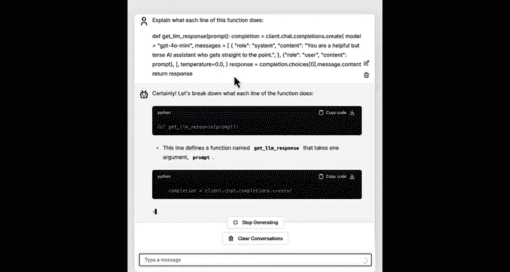
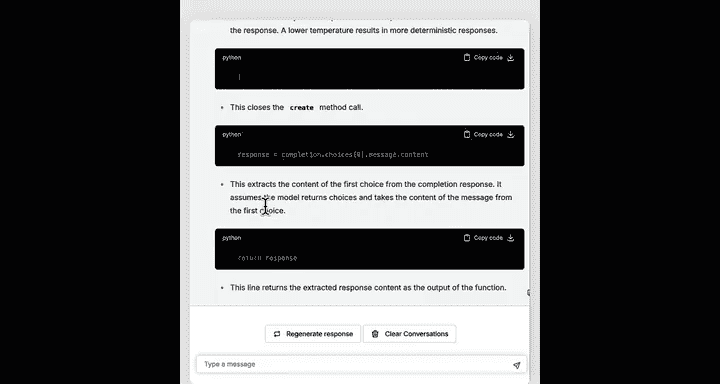
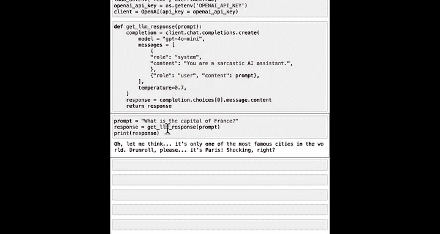
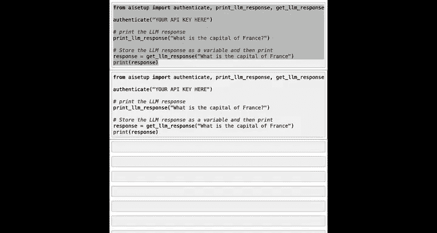
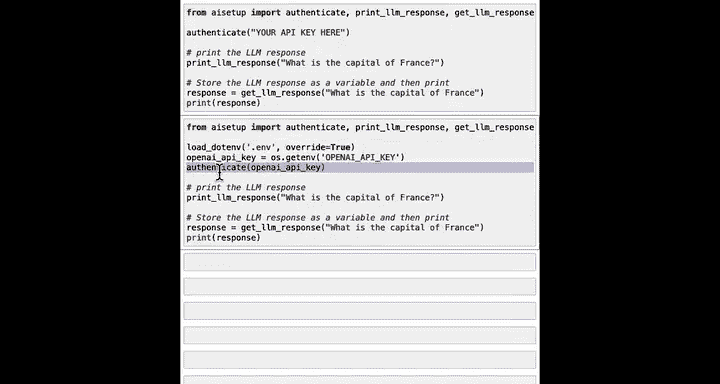
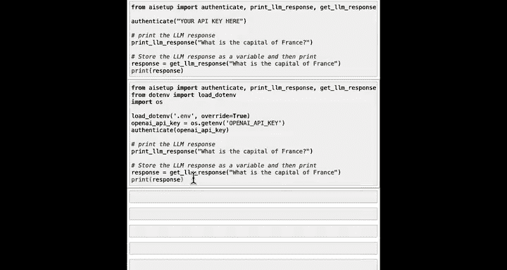

# 吴恩达亲授《给初学者的AI Python编程课（4课全）｜AI Python for Beginners》中英字幕（deepseek-R1 - P34：7.Lesson 6 APIs to use AI models.zh_en - GPT中英字幕课程资源 - BV1qw4m1k7Lq

You saw in the previous lesson how to get real time weather data using an API。

But APIs can actually do more than just get data， they can also help you access online AI tools like Open As。

 chat GPT or Google's Gemini or Anthtroics cloud and many more。

For example， you've been using Getar Respon， which uses Open eyes chat GT API。

OpenI's large language model is running on compute service on the Internet。

 and you can use an API to ask chat G questions and get an answer back。

In this lesson， you see the guts of the get response function that you've been using throughout these past few courses。

 Let's take a look。

So here's how you can use Openly eyes API。I've already installed the open AI package。

 If this is not yet on your computer， you might need to run Pip， install open AI。

 but already done that。 So I won't do this year。 And the open AI function from the openai package is what actually powers the getel response function that you've been using in the Hoer functions or in the AI setup package。

 Let's take a look at what getel response actually does。I know this looks like a logic code。

 it's not important for you to understand every single line of this。

 but I want to quickly walk through this so just give you a sense of what modern cutting edge API usage might look like。

So client。chat。comption。readredes is a function provided by open AI。

And this line here selects the large language model that we want to use here we're using the Q 40 mini model。

 and when you use a large language model， one of the things we often do is tell the how to respond That's called a system message and we tell the large language model。

 we wanted to act like an AI assistant。 We'll see an example later of what happens if you change this system message。

 and then we also specify the prompt， which can be a question like what is the capital of friends。

It turns out large language models have a parameter called the temperature parameter which controls how random the response is and often set it to zero in my code。

 if I don't want it to be too random， that's the lowest possible temperature that you can use a large language model and then this line on top gets result from the large language model which we sometimes call completion and then you extract the text of the response and lastly return the text of the response。

 please don't worry if you don't understand every single line of this code。

 I just want to get a sense of what it looks like if you actually were to use it yourself。

 it'd be fine to take this chunk of code and copy paste into your own code and just run it that way。

 In fact， if you go to the open AI website which has online documentation for API you probably find a code sample that looks a lot like this and so you can just take the code sample from openaiI documentation or。

Anthropic cloud documentation or Google gymnaized documentation or whatever you're using。

 and then get it to work for yourself in your own code without needing to worry about what every single line here is actually doing。

And if you want to understand what each line of this does， as usual， you can also a language model。

And it walks you through line by line。Just one note。

 your language model has learned by reading text of the internet。

 and so they will be better at understanding better known APIs and older APIs that have been around on the Internet for a while。

 they may not be as good as understanding less popular APIs。

 so APIs have just been created and released by someone else on the Internet。

Now it turns out that to use the Open AI API， you need to use a secret API key from OpenaiIs website and I'm going to use the load。

N method to get this API key securely and then this is a line of code that you can also get from the Open AI documentation to initialize the Open AI service or the OpenI client so then just run that and I'm now defined get El response the resources now。

And now if I send this prompt was the capital of France。

 it will then generate the response and because I was using my API key here to surcharge a fraction of ascent to my account。

Just to show you something fun。 If you say you are a sarcastic。😊，AI assistant， let me redefine this。

 and if I run this now， let's see what it says。 Oh boy， that is pretty sarcastic。 Yep， Miss Paris。

 but short a lot of attitude you giving us the answer。 and that's what the system message does。

 it tells the large language model how you want it to behave and maybe to show you something fun if I were to run this a few times you get。

 you know， usually the same response because temperature is 0。 and so this makes it not very random。

 if I were to set the temperature to a higher number at 1。0 would be pretty high temperature。

Then this makes the response more random。 And every time I run it， I end up with， in this case， a。

Different sarcastic response and this temperature which can vary from0 to2 le you control the degree of randomness you want in the responses and many people use the value around maybe 0。

7 thats used a common choice and this will give you a little bit of randomness。

 maybe a little bit of the appearance of creativity without excessive randomness so I encourage you to play with this try out different temperature values and run these multiple times or try different system messages。

 maybe try to create an AI system that always returns rhymes or that only speaks certain language like Spanish or Japanese or something else and see what results you get Lastly if you want to run all this locally on your own computer I want to share just a few details on how to get the API key into the code。

So after PIipP installing AI setup， remember， the command would be Bank Pip install AI setup。

Then you can import it from AI set up functions called authenticate print response Gi Air response。

 and the authenticate function will need to be passed an API key that you can get from the open AI website and this is a paid service So it may ask you for a credit card and other large language model providers will also usually ask you for credit card as well to get an API key to access their services。

 But if you do this this will then authenticate your program to open AIs API service using your secure API key so you can then use it to generate large language model responses。

 Having your API key stored inside your code isn't the most secure way to do this so。

A somewhat better， more recommended way。

To get the API key would be like this。 These are the three new lines code。

Where you would store the API key in it turns out a file code do n diss the code from that file and then authenticates it with the API key that was more securely loaded from n and you also need to from n import node n in auditor run this code as well as one more library called OS I don't want to dig in the details for this right now。

 but you also say AI language model， it would be able to walk you through all this。

 And if you tried this out and get any error messages。

 then I would copy paste the error messages into AI chatbot to get it to try to help you debug it。

 So if you have Python set up on your own computer rather than running over the internet on a deep learning AI website this is the code you will use。

Right after this video， there's an optional reading item。

 they'll show you some options for how to install Python and Jupyter notebooks locally on your computer。

 There are different ways of doing so and it can be a little bit different on a Mac versus a Windows machine both step here free a few options so that if you want you can install these things and have them run on your own computer It's completely optional for you to read this item and also to install things but I do enjoy having Jupyter notebooks in Python running on my own laptop and I think you might do because it's actually really cool to just run things on your computer even without internet access like either on an airplane or something whether you go through that item or not willll then wrap up with one lost video where we'll talk about where you might go next after finishing this course。

