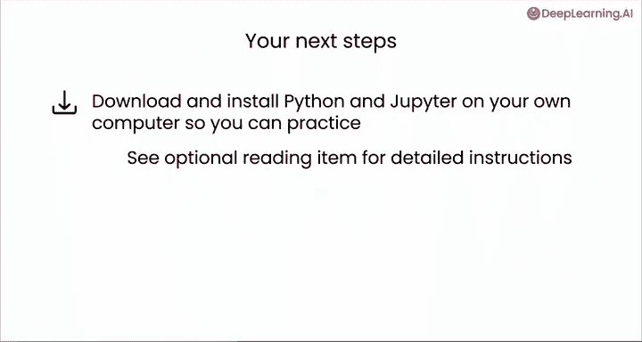
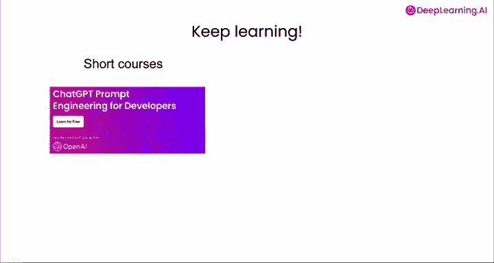
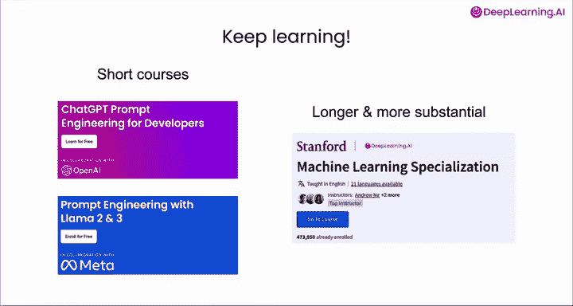
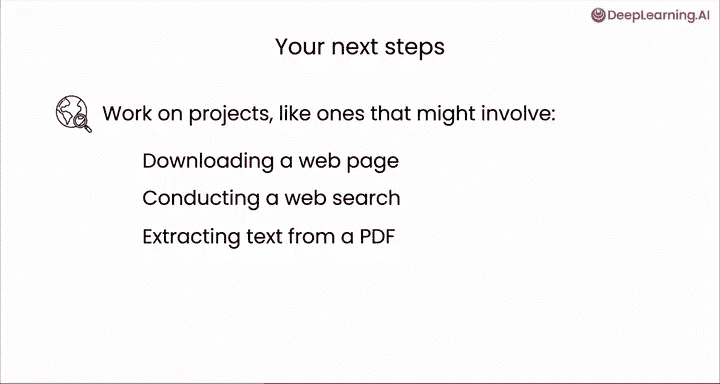

# 吴恩达亲授《给初学者的AI Python编程课（4课全）｜AI Python for Beginners》中英字幕（deepseek-R1 - P35：8.conclusion.zh_en - GPT中英字幕课程资源 - BV1qw4m1k7Lq

Congratulations on making it to the end of this course and to the end of the AI Python forbiquious sequence of causes。

You've learned a lot in these focuses causess from the basics of Python like data types and functions and variables and code patternss like full loops and if statements。

 you also learn how to have Python read files from your computer so they can do fun things like process your own documents and data or U AI to plan a dream vacation。

And in this final course， you saw how to expand the capabilities of Python by using packages that other programmers have written that let you download and process web pages or make kinds of data or get weather data and even call a large language model over the internet。

And now you might be wondering what you might do next。There's a lot you can do。

 and here are some concrete next steps that you might consider。First。

 do consider installing Jupyter on your own computer if you haven't already done so。

 it's fun to be run things on your own laptop。

In addition， I hope you keep on taking courses and keep on learning。From deep learning AI。

 a couple of short courses you might consider are Ch GT Pro engineering for developers。

 which will teach you how to prompt Ch GbT in a more sophisticated way or prompt engineering with Lama 2 and3。

For something longer and more substantial， consider taking also our machine learning specialization。

While you continue to take courses， if you have an idea for a project， do go for it。

Please do use your skills responsibly that is in ways to help people and I've seen beginners work on projects that might involve things like downloading a web page and processing that page。

 maybe to summarize it or to gather insights relevant to your business or doing web search by using a web search engines API or extracting text from PDF and processing that text and many other fun examples。

If there's something that you do not yet know how to do， I'd encourage you to ask an AI chatbot。

 not necessarily the one on this website， but open your eyes Cha GT or Anthropics cloud or Google's Gemminline or some other one and ask them for help。

And maybe also do a quick web search to figure out if there are any relevant Python packages or APIs that you can use。

Many people start out doing small projects and then go on to build up to bigger and bigger ones over time。

 so don't feel like your first project has to be some massive thing that changes the world It's great if you can do some small fun project and whether your project works or not。

 you can take those learnings and hopefully do a second slightly bigger project and through that learn even more and so on。

To this day I frequently try to code up things and sometimes what I do just doesn't work。

 it happens to all of us and is that practice then as you keep on holding your skills by finishing this course。

 you are a Python programmer You're just starting off but you're now part of the global community of AI coders and I'm really happy to have you with us and I'm optimistic that you find ways to use these skills to improve your daily life and work I'm a bit sad that I journey together is coming to an end for now but also grateful for all the time and effort youve put into these courses to learn Python。

😊，I hope I'll see you again soon and that you continue to learn and practice and you do wonderful things with your new skills that help yourself and others。

