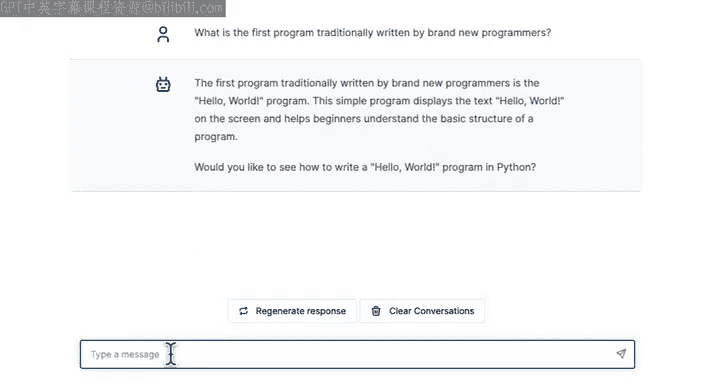
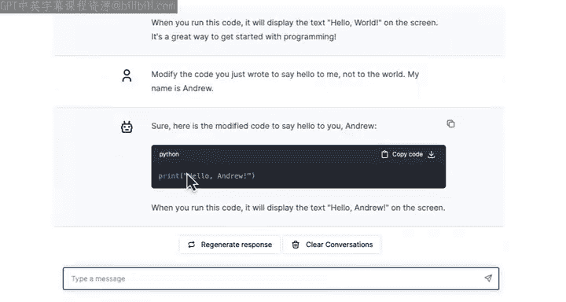
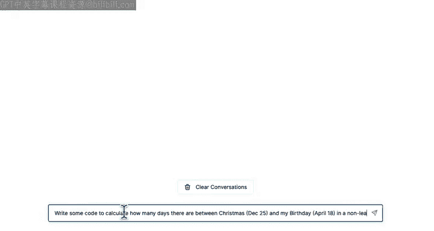
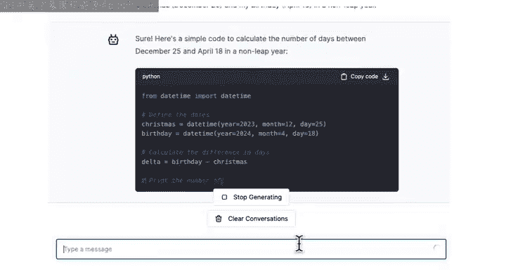
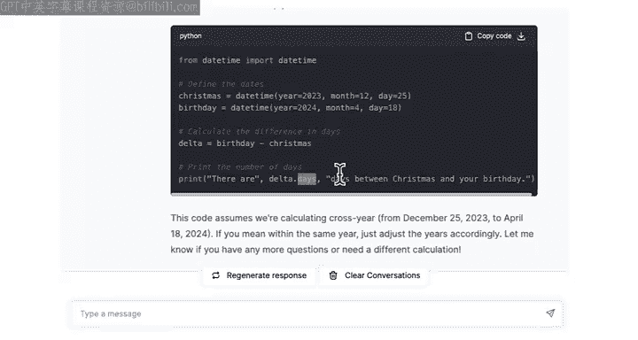

# 吴恩达亲授《给初学者的AI Python编程课（4课全）｜AI Python for Beginners》中英字幕（deepseek-R1 - P3：3.writing code with chatbots.zh_en - GPT中英字幕课程资源 - BV1qw4m1k7Lq

Programmers are using chatbots a lot in our daily work。

 and this is making many of us more productive。Previously。

 if I was stuck with a programming toss or didn't know what to do Nicks。

 I might have to find an exp to us and that could take a while， you know， to find someone。

 see if they're available and so on。But now whenever you have a question。

 you can ask an AI chatbot and get an answer right away。 Let's take a look。For this course。

 we' provided the chat bot that you can use directly。

 and we can type our questions also called a prompts into this。 So， for example。

 if you're wondering what is programming。I can enter that and this generates a pretty reasonable answer。

Even though we have this chat bo provided right here in this class。

 Fi free also to use third party chatbots like chat GPT， Microsoftco pilotlo andtroic cloud。

 Google Gemini or any of the other large number of options out there right now。

 Let's try another question。 I'm going to clear the conversation。

 hit the trash can and hit the check mark to confirm。 and now let me ask what is。

Python this text I just typed is called a prompt and after typing the prompt what is Python。

 let me hit enter and this generates a response for historical reasons。

 computer programme is will sometimes call this response a completion。

 but if you hear the word completion that just means is the chatbo responds to the prompt what is Python so Python's highly level language does either read write and so on。

 Oh known for a simple syntax which is makes it great choice us for beginners And if you're ever curious to learn more if you ever see something like this。

 Python is known for a simple syntax what does syntax mean。

And it'll give you an answer and you can read through this if you want or if not as fine。

 don't worry about this， but this is actually a workflow that I use myself， I'll use a chatbot。

 Ill give an answer if there's part of it that I don't fully follow won't just ask a follow- up question and certainly for introductory level of programming questions chatbots like these tend to give very good answers。

Now， it turns out that there is a program。That traditionally is written by brand new programmers。

 many， many programmers， including ones that are having fantastic careers today。

 They read about the news has started programming， writing a certain program。

 So let's find out what this is。 What is the first。😊，Program。Traditionally。Written by Brand new。

Programmous。So this says the first we' introduced by Brandy Per's Holello World program。

 the Sim to Space Holello World on the screen， which you like to see how to write this。

Yes， please。And so we just got a chatbot to write a piece of code for us。

 it says print and then a bunch stuff here， but this will tell the computer to print out the messageHello world。

In the next video， we'll take a look at how to actually run this computer program。

 But there's brand history， when you start your programming to tell your computer to say hello， So。

 you know， your program wakes up the first time it saysHello world， Im here。

 and that's why we tell the computer to print Hello world。😊，Just one note。

 if you try a similar prompt to the chatbots out there like Chagivi or Claude or Gemini。

 you might need to tell those chatbots so you want to use the Python programming language just like there。

Many human languages， there are many programming languages。

 if you don't tell it that you want Python， there's some chance hard to say。

 it may tell you how to print Hollo world using a different language than Python。

And it turns out that。If you want to modify the code。

 maybe I wanted to say hello to me rather than to the world， you can also use a chatbot。

To try to make changes， so modify the code you just wrote to say。Hello， to me， not。To the world。

My name is。Andrew。And now it says hello， Andrew。

Now， it turns out that chatbo can write much more complex code as well。Here's an example。

Write some code to calculate how many days there are。Between Christmas。December 25。And my。Birthday。

April 18th。Say in a non leap year。

So I have no idea how many days there are between Christmas of our birthday。

 if you' taught to write a program like this， then write a program like this that actually looks like a correct program I hope you repeat us with your birthday I mean I don't care damage about my birthday but actually you know for fun。

 pick a holiday， pick your birthday and if you want you can prompt a chatbot to calculate the number of days from whatever your favorite holiday is and whatever your birthday is。

And so it turns out that because AI can write simple programs。

 it turns out they're not that good at writing really complex programs。

 but they're pretty good at writing simple snipppers of code This is why the use of AI is transforming how all of us how many of us code and in all seriousness I hope you will play this yourself and go ahead and ask follow up questions if there are some specific aspects of this code that you want to dive more deeply into and when you're ready。

 let's go on to the next video where we'll continue to use chatbots but have a chatbot not just write code for us to look at。

 but actually execute or run the code or tell the computer。

 look at this code go ahead and follow the instructions in this code so thatll be exciting mix extent where we don't just look at code we actually run code I'll see you in the next video。

😊。

