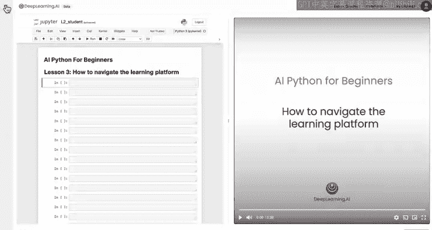
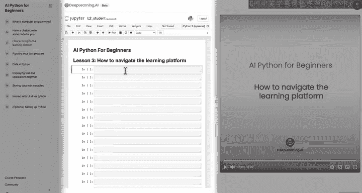
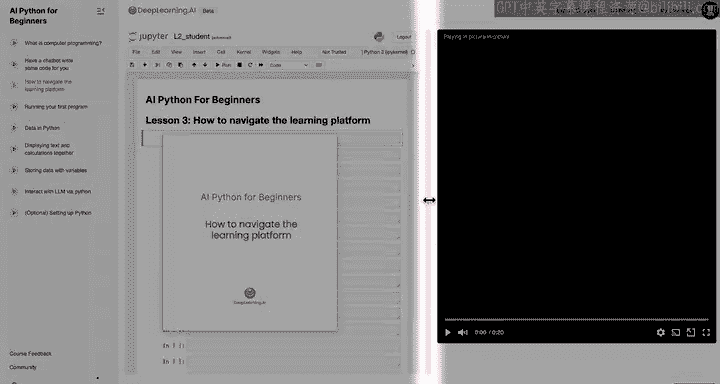
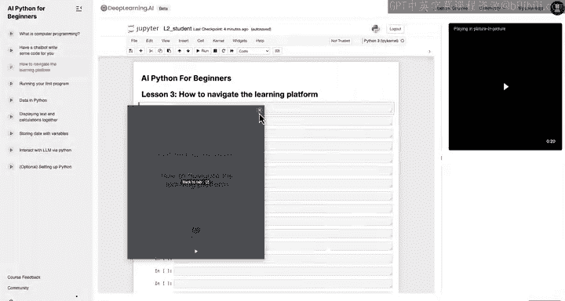
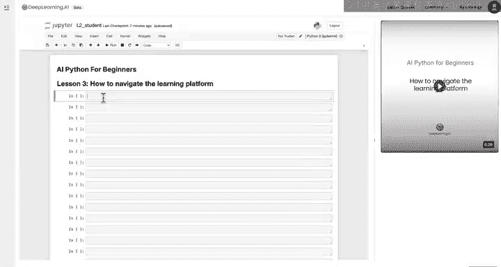
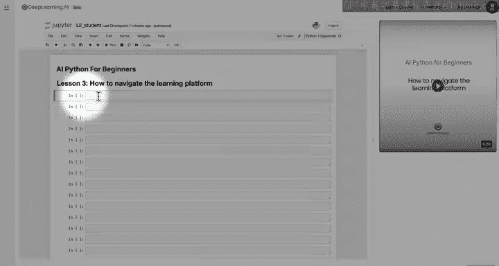
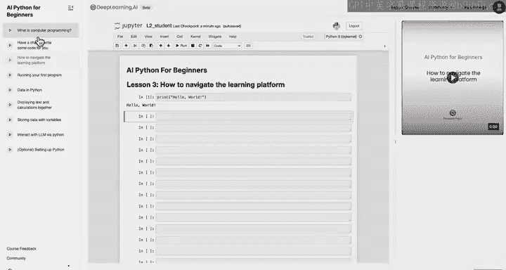
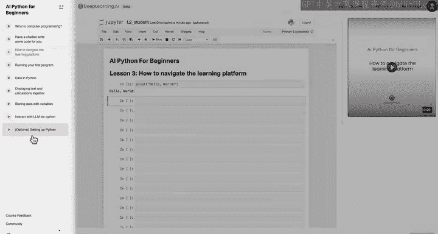
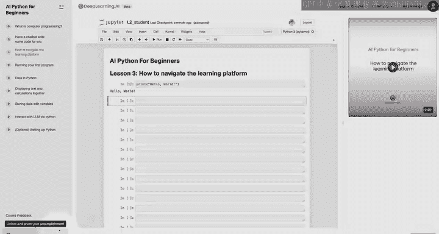
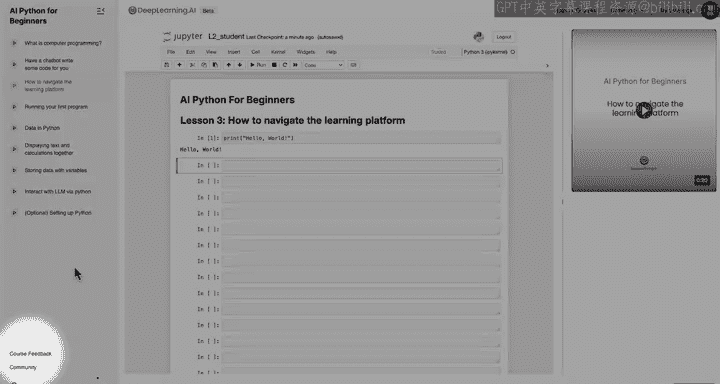

# 吴恩达亲授《给初学者的AI Python编程课（4课全）｜AI Python for Beginners》中英字幕（deepseek-R1 - P4：4.the learning platform.zh_en - GPT中英字幕课程资源 - BV1qw4m1k7Lq

Now that you've see how you can use the chat bot the right code for you。

 let's take a look at the coding environment we'll be using in this course to actually run code In the next lesson you see an environment that looks a bit like this I want to highlight the main sections the left portion is the navigation pane which can shut or reopen like this this middle area is where you be able to right and run code and over to the right is the video player。

I'm going to very quickly run through a few features of this learning platform which a play button。

 so please feel free to pause the video anytime you want to take a break or think over something or go experiment with the code。

😊，You can also control the speed of the video on the settings so if you think I'm talking to slowly speed me up you can move this video to picture and picture this middle tab also lets you control the size of the coding region versus the video player let me get rid of the picture and picture Oh and this little arrow is another way to trigger picture and picture so it pops up picture and picture and then to bring back the video that little arrow there let me close the left navigation and pane and let's focus on this coding environment here in the middle。

This coding environment is called a Jupiter notebook。

 is the exact same coding environment that many professional programmers and data scientists use day to day。

 but don't worry， we'll learn one step at a time how to use these tools you may remember that in the last lesson we used the chatbot so click this chat button to pop this up。

All right， says so I like to see the code， yes。And so here's the code and now I'm going click this button to copy the code and then let's close the chatbot and if I want to run the code I'm going to go to this coding environment。

 click my cursor here and then I'm going hit command V or control V depending on your operating system to paste the code that I just copy out of the chatbot and now I'd like to go through what's probably the single most important command in a Juveter notebook which is shift enter so present whole shift and while holding down shift and then I'm going to hit enter and it runs this line of code and so it says hellello world in the next lesson will actually get a lot more practice on how to run the code like you just saw me do and I will invite you to try。

Copy pastcing some code and then running shift enter yourself。 There's one thing to note here。

 This platform will save your work only for two hours。

 So if you stop a lesson before the end and come back to finish it more than two hours later。

 the notebook will have reset and you have to start to the top and run all the cells again。

 but that's fine too This short course consists of a number of different videos or a number of different lessons which are indicated here in this left navigation bar I recommend you take these lessons one at a time and in order。

When you finish watching each video all the way to the end。

 you get a green checkmark next to each of these lessons in turn and when you turn all of these into checkmarks or when this progress turns into 100%。

 that's when you finished the lesson， I would also love to get any feedback you have on this course。

 which you can share with us by clicking on the course feedback link down here in the lower left。

So that's it for this learning platform， I hope you remember the most important command I say just now。

 which is shift enter Let's go into the next lesson where you start to run your own computer program。

