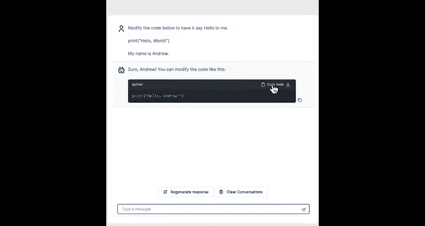
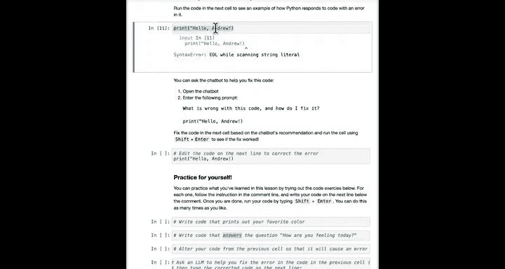
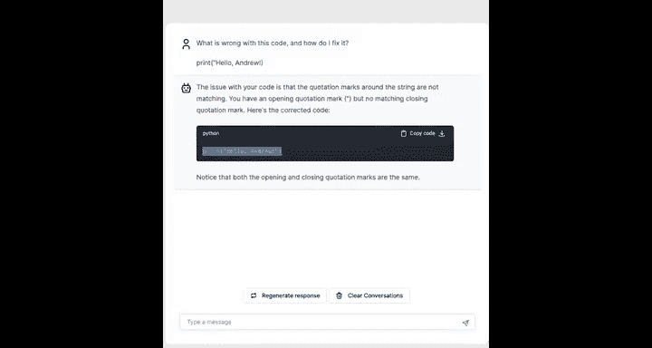
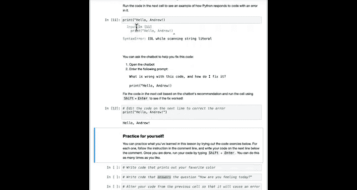
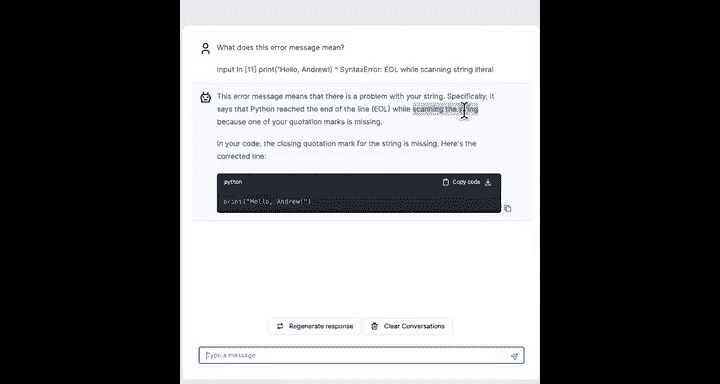
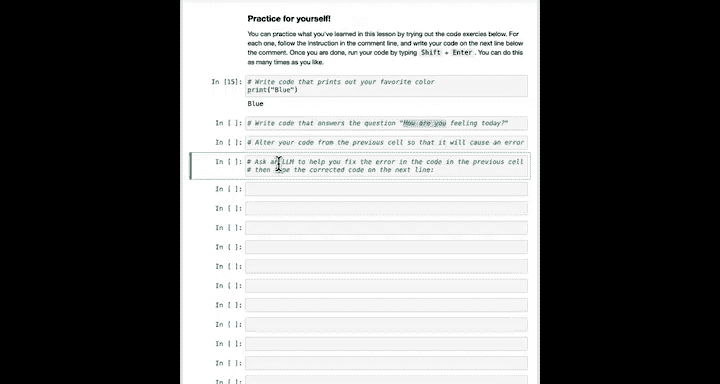

# 吴恩达亲授《给初学者的AI Python编程课（4课全）｜AI Python for Beginners》中英字幕（deepseek-R1 - P5：5.running your programm.zh_en - GPT中英字幕课程资源 - BV1qw4m1k7Lq

In this lesson I hope you try running your own Python code rather than just listening to me talk and watching me run the code late in this video I'd like to invite you to pause this video and actually go into the Jupiter notebook region of this learning environment and run your own code I think learning to code has some similarities to learning a new human language you can listen to teacher tell you about how to speak French or Spanish or similar language but unless you open your mouth and practice speaking that language yourself how much you can actually learn you know will be limited and learning to use a programming languages like that too it really helps if you don't just watch medo it but if you actually pause the video and at the right time which will come a little bit try running the code yourself。

In the Jupyter notebook region hopefully you see this and the first thing I want you to do is use your mouse to click on this printHello world and then run that command。

 so do that right now， Shi enterter and now the computer printHello world why't you pause the video and go do that yourself just hit shift enterter or shift return and your computer will print Hello world if you just ran Hello world。

 then congratulations you just joined the millions of others that started the computer programming adventure by running this line of code Now let's go on to see how we can use a chatbot to write slightly more complex programs。

I'm going to demonstrate a sequence of operations first。 And then after that。

 I'd like you to pause a video and go through the same thing yourself。

 I'm going to open the chatbot and then type in this prompt， Moify the code below to have it。

 say hello to me。 Here's the code。 My name is Andrew。

 And so here we like to write code to say hello not to the world， but to you。 Let me show you。

 I'm going to do that。 So pop up the chatbot by clicking the chat button at the bottom。

 And then I'm to say modify the code below to have it。😊，Say hello to me。I call this print。Hello。

 world。And then my。Neless。Andrew and when you do this please substitute your own name for mine and now it says you can modify the code like this print hello Andrew and now I'm going to click this button to copy the code。

And I'm then going to pace code and hit shift enter。And now I will say， hello， Andrew。

In case you want to copy paste the text from here into the chat bot， that's fine too。

 you can highlight this text and then hit you command C control Z and copy pasts into the chat bot So what I'd like you to do now is go ahead and pause the video and why don't you get the chatbot to modify this code to have it say hello to you and then paste the code into the cell and have your computer say hello to you So hopefully you had fun doing that for the next little exercise。

 let's have the computer say hello to someone。You love。So to do this， I'm going to copy。Pace here。

 Let me type in the names of my kids。Happy and new， My daughter is actually called Nova。

 but she likes to go by happy。 So that's hello to my kids。 Why don't you do that as well。

 get the computer say hello， not just the world， not just to you， but to someone that you love。

 Now you may be wondering what this text is。 There's a pound sign or hash sign followed by a bunch of text here。

 This is what's called a comment in the code。 So this Jupyter notebook cell says pound sign or hash sign。

 This is a commentth way will sign。 So if I click on to the cell and feel free to follow along in your own Jupyter notebook and hit shift enter。

 What do you think will happen。 Shi enter nothing all happens。

 So generates no I'll put the computer does nothing at all。😊，Because as developers。

 we find that sometimes it's useful to write some text。

 to remind ourselves or to let someone else reading our code know what the code is about。

 And so comment is。A type of text that we include in our programs that the computer knows to ignore in contrast。

 this is a print command that we also say as a print statement， so if I run this。

 then it says it prints out this is a print statement。Now。

 let's look at the more complex Ju the notebook coding cell。

 That's what one of these things is called and see what it does。

 So the first three lines are comments， so it will ignore this when you run to sell。

Here's a print command or print statement says print hello， Andrew。

 And then here I'm going to say follow with National printing command。 Hows your day going。

 So what do you think will happen when I run this cell， There are six lines in this cell。

 But only two of them are commands。 and the other four are common。 So when I run this， it will。

Prince hello， Andrew， how's your day going and all the comments are ignored。 So again。

 anytime please pause the video。Go ahead and click into the children notebook cell and hit ship enter so you can see this for yourself。

 And if you feel so inspired， if free to modify this。 You， go ahead and add another line of comment。

 bh。😊，Blah， blah and run that initially ignored his extra lines of comments as well。

Now it turns out that when we're programming， all of us make mistakes all the time I make typos。

 I make mistakes when I code there's a very normal part of programming so here's a piece of code with an error in it we call errors enco bugs but when you run code with an error or a bug in it then sometimes you get an error message like this。

 sometimes I get an error message go boy， I have no idea what this means Fortunatelyly you can ask a chatbot how to fix the code So let's take this buggy line of code and let's ask a chatbot to fix it for us here's a chatbot I'm going clear the conversation and then I'm gonna ask it what is wrong this code and how do I fix it。

And then it gives an explanation issue of the code is quotation master on string on matching。

 Here's the corrected code print。😊，Hello， Andrew。

So I can actually go back to my notebook。And edit the code。

 I just paste it in the right answer if we can edit it however you want and then run it and disfies it。

So finding and fixing errors also known as finding fixing bug and Comp programming has really changed with。

Chatbots， because for many at least simple mistakes， such as little typos， which we had here。

 chatbots are very good at spotting what went wrong。And if you're interested， you can also。

Use a chatbot to explain error messages to you。🎼So for example， if it's us。

 what does this error message mean？And it pasted， the error message that we saw then。

It's actually just a pretty decent explanation for what's going on。And right now。

 you may not know what some of these terms mean， Like what is a string。

Or what is scanning the string By the end of the short course。

 you will have learned a lot of the vocabulary， Like what is a string in Python to help you understand messages like these。

 So that almost takes us to the end of the lesson。 after you're done watching this video。

 before going on to the next lesson， I hope you go through some of these little practice exercises。

 So I'll do the first one。 So say print。😊。

Blue， that is my favorite color。 It's also my son's favorite color。 not my daughters。

 And I hope you practice writing and running print statements to have it say。

 how are you feeling today， Go ahead， make a genuine error。 Yeah。

 we all write code with errors or bug。 It's good for you to sometimes do that too even deliberately。

 And then see if you get the chatbot to fix the error。😊。

So I hope you have fun with these practice exercises and when you're done let's go on to the next lesson where we'll start to talk about data。

 which is a key ingredient of both AI as well as of Python programs I'll see you in the next video。

