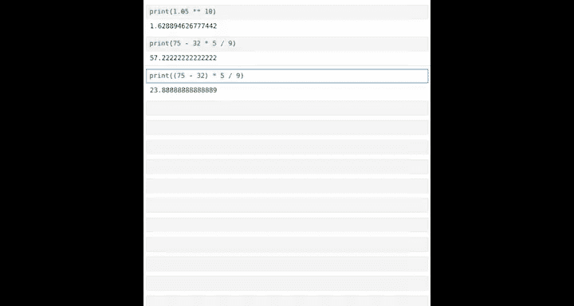
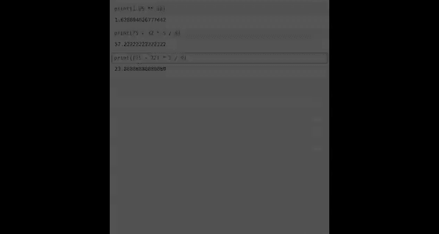

# 吴恩达亲授《给初学者的AI Python编程课（4课全）｜AI Python for Beginners》中英字幕（deepseek-R1 - P7：7.data.zh_en - GPT中英字幕课程资源 - BV1qw4m1k7Lq

You may have heard others say that data is really important for computer programming and for AI but what is data let's take a look here are a few examples of data you might encounter in your day to day life if you were to search online for a map of the population density of your country that's data showing where people are living in a given region or if you were to look at weekly weather conditions in the city the numbers showing the daily temperature would be data。

Or if you look up stock prices， highs and lows， those numbers are also data。 Python。

 or computer programs can process certain types of data。 One type of data is text data。 So a is。

A piece of text， the word egg is a piece of text。 My favorite activity is hiking is a piece of text。

 and Python can print out text。 and as we'll see later， also do other things with text。

Program managersrs can also process and manipulate numbers like pi 3。

14 or other numbers Other types of data you may have heard of computers processing include tabular data like spreadsheets or pictures are also another form of data as well as audio almost all data in computers turns into either text or numbers。

 it turns out that an image is made out of pixels and the way a computer stores an image is by storing a lot of numbers showing maybe how much each pixel exhibits red green or blue。

 the three primary colors and sound2 is stored as a lot of numbers in a computer it turns out sound is made out of very rapid variations in air pressure and is by storing these different measurements of air pressure as a bunch of numbers that's how computer stores sound。

So the two most important types of data will process are text and numbers。 This side of text。

 Hollo world is an example of a snippet of text that's called a string in Python。

 And the word string comes from thinking of。Hello world as a string of letters to specify a string in Python here are the key components。

 there are double quotation marks that we use to mark the start and the end of the string and then the text is in between these quotation marks。

Technically， strings in Python are any combination of text number or symbol characters enclosed in double quotation marks。

 In this string， everything between the quotation marks is part of the string， including the space。

 So here are some examples of strings you could store in Python。

 Hello world or my favorite drink is a greatty or a funny character like that。 or here's 2。

99 stored as a string。And I'll share in a second， what's the difference between 2。

99 stored as a string versus stored as a number？So feel free also to go to the juvenile book and run。

The co snipp is to print out these three different strings。Now。

 it turns out that there's another way to store strings in Python。If you use triple quotation marks。

 then you can store a multi line string， meaning a string with enter in it。

 And so here's an example of a multi line string。 I'm using triple quotes are going insert and enter here。

 And if I run this， you see that all these spaces are actually part of that multi line string。

 So if you don't want all these spaces， you have to。

Run it like this and feel free to edit the code and play with this。In contrast。

 if you were to try to。Write this。With a single quote， this will generate an error message。

 let me show you that right now because there's an enter here。

 so Python things of this as two lines of ago， the first line of quote that things is print hellello world with a close quote that quote parentes and so it tries to run this first line and so there's an error whereas in contrast if you use triple quotes。

Then Python knows。You're trying to write a。Multily string。And this does not generate an error。Now。

 it turns out that Python， lets you check what type a particular piece of data is。

 you've seen this co print Ho world。Print is a function or a command。 You can tell Python to execute。

 I want to show you a different function， which is the type function。

And if you were to tell Python typeHello world， then you'll output STR。

 which tells you that this is a string。So。Here has type Andrew and never hit shift enter。

 It outputs string SR， because this。Andrew， here is a string。

If you were to do this with a multi line string， this is also a string。

 It the exact same type as the string Andrew is just that the string has a different piece of text in it。

 Now， if I were to tell what's the type of 2。99 in quotation marks， this is a string。

Now let me do something different， I'm going to say type of 100， it turns out the type of 100。

 this is a number and in particular is a type of number called an integer meaning is the number without the decimal part。

In contrast of what to do type of 2。99。Then this is a float。

 and a float is another way that Python stores or represents numbers， but numbers with a decimal paw。

So Python has two primary ways to store represent numbers， which are integers and flows。

Intgens represent numbers with no decimal pot， like 42， 100， negative 90。

And floats have digits after the decimal place， number8 3。14，2。99， nectar by 03， and so on up floats。

So please feel free to pause the video and plug in your own different numbers and run print or type on them and see where results you get。

One of the ways I often use Python is as a calculator。

 If you want to do addition like what's 2 plus6， you can actually write a Python command to say print 2 plus 6 or print 57 minus-40 or multiplication or division。

The reason I do this in Python is because if I'm trying to add all the numbers and make a mistake。

 I'm going go back and edit one of the numbers and have Python redo that calculation。So for example。

 if I run a business selling。四。Lemonade。 And I went to totalto up to sales of the last 12 months。

 I might type something like this and have it print out to sum。

But I find that I actually made a typo。 I can actually go back and say， oh， yes， back in March。

 we didn't sell 43 units。 We actually sell 45 units and just edit it and get an updated answer like that。

 So I should find using Python more convenient than using my personal handhel calculator。

 can go back and edit these calculations。 So far we've done just arithmetic。

 It turns out that if you have other things you want to do say you have money at the bank account earning 5% interest rate and you want to know how much you have after 10 years。

 So you need to compute 1。05 to power of 10。 But if you're not sure how to do that。

 you can go to the chatbo to ask it how to compute 1。05 to power of 10。And if you do that。

 it shows this answer that is the double star。Operator。1。05 to power of 10， that puts， you know， 1。

62。So for every dollar you have， you end up with $1。62 after to 10 years。Lastly。

 when manipulating numbers in Python， one thing to be aware of is the order of operations。

If you are converting temperature from Celsius to Fahrenheit。

 then you have to first subtract 32 from the temperature in Fahrenheit and then multiply by 5 over9。

So if it's 75 degrees Fahrenheit。 and you want to convert it to。Celsius。

 if you were to write this code， then Python will do this first。

 itll first particularly to multiply by 5 over 9， and this will result in incorrect answer。

 and so using brackets or parentheses like these tells Python in what order you wanted to carry out these operations and the order of operations is the same as a normal math where you multiply and divide before you do addition and subtract。

And that's why encode code。This。Generates an incorrect conversion from degrees Frenheit Celsius。

 whereas this generates the correct conversion where 75 degrees Fheit is 23。

889 degrees Celsius and so that's it you've now seen data types in Python as was how to use Python as a calculator and this by itself is actually a very powerful tool。

 Before you go into the next video， I encourage you to try out the exercises at the end of the notebook to practice what you've learned。

 and always remember that you can ask the chatbot at any point for hope when you're learning the code。

 building the habit of asking the chatbot is a very useful one。In the next video。

 we'll learn about a key technique for printing things in Python called F strings and this will allow you to print out both strings and numbers together。

 so please try the exercises and I will then see you in the next video。

