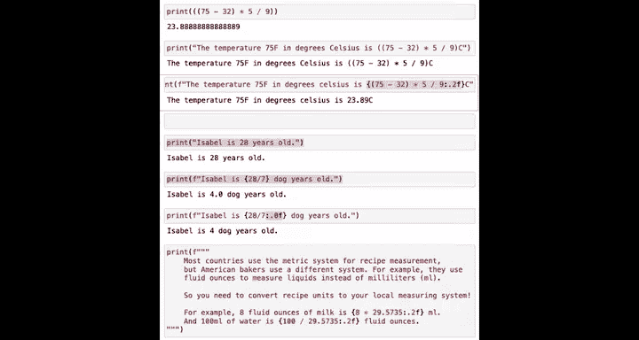

# 吴恩达亲授《给初学者的AI Python编程课（4课全）｜AI Python for Beginners》中英字幕（deepseek-R1 - P8：8.combine text and calculations.zh_en - GPT中英字幕课程资源 - BV1qw4m1k7Lq

In this video， you learn how to take text data or strings and display them alongside the numerical calculations that you can now do using flows and ins。

😊。

To do this， you use something in Python called F strings， which stands for formatted strings。

 which is something that I and many other developers use all the time。

 especially when working with AI tools， let's dive in。😊。

To recap you've seen that strings represent or store text and integers and flows represent numbers。

 and you can display data with print commands and you can also use Python as a calculator like this。

So we thought that if you were to convert 75 degrees from Fahrenheit to Celsius， you could do this。

But what if you wanted to print the temperature 75 f in degrees Celsius is the answer。

 What anything would happen if you were to run this command， let's do it and see。

 And this is the temperature 75 f in degrees Celsius is this formula。

 but I think what I wanted was for to say that this is 23。

889 degrees Celsius not to just give back the formula like this。

 So how do you make this print out the answer of the calculation itself。

It turns out that there's something in Python called a formatted string that looks like this here I've written F for formatted。

 So this is called an F string。 and I've taken this calculation and I've put it within curly braces。

 That's what this is。 this is an open curly brace。And this is close curly brace also called a curly bracket。

 And if I run this with shift enter analysis， the temperature of 75 f in Celsius is 23。8889 Celsius。

 So this is a useful tool to insert calculations and other types of data into strings and you'll be using this through subsequent lessons and causes as well。

 what the F character here does is it tells Python this is not a regular string is a formatted string and it tells Python look for the things within curly braces and to do calculations within the curly braces。

Let's look at another example， let's say Isabel is 28 years old。

 you can print Isabel is 20 years old now in some countries it's a fun concept of what is someone's dog age because you know people live longer than dogs on average。

 someone's socalled dog age is supposedly one seventh their real human age。

And so if I were to try to compute Isabel's dog age and do this， it wouldn't work。 It just says。

 well， this is 20 divided by 7， but here's how you can fix it。

 I'm going to add F to tell there's an F string， add 20 over 7 in curly braces。And if I do that。

 then it says Isel is4 dog years old。So you saw both of these examples of an F string。

 I'd like to walk through step by step how Python interprets F string so that you know exactly what's happening under the hood。

When you print a string that's not the app string， it tells Python to display the string to screen。

 that's what the print command does， and Python looks at the opening and closing parentheses to find the string that the disaster print and the opening and closed quotation box tells it where the string is and so print as well as 20 years old character by character。

In contrast， this is what happens with an F string。Same as before。

 the print command has open and closed parentheses that tells Python what to print and here we're giving the print command an F string or a formatted string so Python looks for the opening and closed quotation marks to look for the string。

 but it also looks for any opening and curly braces。

In order to figure out which of the calculations you should carry out inside the curly braces。

 in this case， 20 divided by 7， when you do the calculation is 4。0 and so it plugs in 4。

0 and so it prints out isbel is 4。0 Doc newsode and that's why this is what it ends up printing。

Now this printed as about as $4。0 as or what do you want us to print it out as a whole number without the 0。

0 Deal place。 And so to do that， you can also chat about how do I modify this code to print the answer without any characters after the de whole place。

 So here's the original code。And then the check bar tells us， oh， you can use the colon 。

0 F format specifier through remove characters。 So here's the modified code。

 Let me just copy this code。And let's run this analysis as though is four dog years old。Just for fun。

 if you're curious， you can actually do。0 F up here as well。 So it says 24 degrees。

 Or it turns out if you do 01 F， it prints one decimal place，02 F。

 it prints the answer to two decimal places。 The important thing is not to remember this colon  point0 F syntax。

 The important thing to remember is if you want to make a modification to your code。

 asking the chat bot to help you out with， you know， how do I do this little thing。

That's often a good way to help you accomplish the task you want。

Now so here we've used a single line f string， I want to show you just briefly the multiline F string。

 So this is a multiline string as indicated by the triples and I've put f in front and here I actually have two pairs of curly braces with calculations in between and so this illustrates how to convert from the metric system to the American or the imperial system and so a flu ounces of milk is this number of millimeters00 ml of water is this fluid ounces and if we run this。

You know， it prints out these answers。 and again just a fun。 if you want to print this just to。

Two deimal places say you can do quote 02 F here and here and get these answers to say， look。

 maybe a little bit simpler。Now you may have noticed that while the F string gives us the answer we want。

 it looks a little bit messy， you here it is a formula right in the middle of a string in the next lesson we will go through a pretty fundamental concept of programming languages。

 which is variables that would make you much easier to read and much easier for others to use as well。

After this video， I hope you try out the exercises at the bottom of the Jupyter notebook and practice with F strings to see if you can get your code to print out some math calculations in a nicely formatted way。

 I hope you have fun with that and I look forward to seeing you in the next video we'll talk about variables。

😊。

