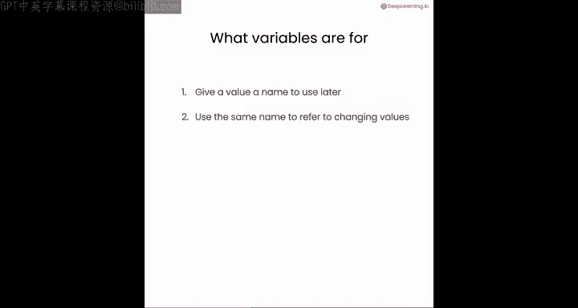
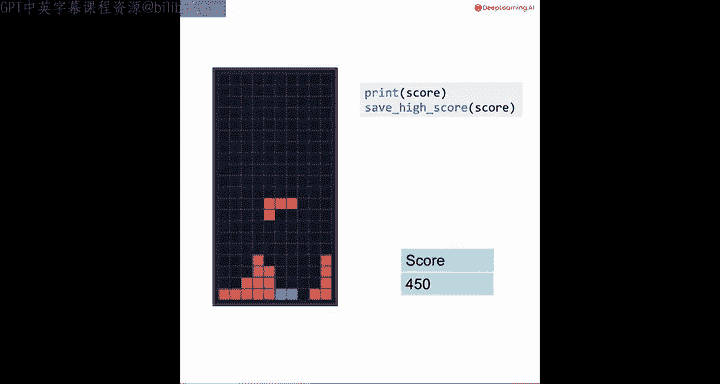
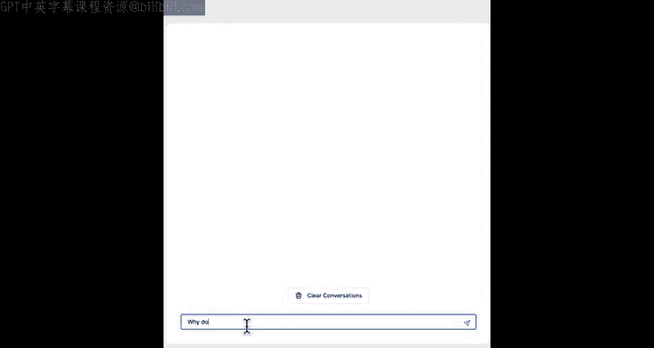
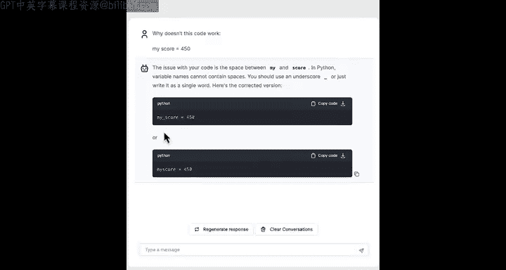
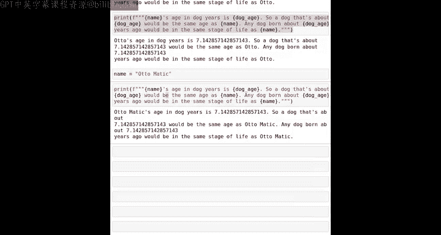

# 吴恩达亲授《给初学者的AI Python编程课（4课全）｜AI Python for Beginners》中英字幕（deepseek-R1 - P9：9.variables.zh_en - GPT中英字幕课程资源 - BV1qw4m1k7Lq

In computer programming， variables are a fundamental concept related to how you thoughtaw as well as process data。

 Let's take a look at what this means。

Please run every code cell in this lesson in the same order as I do from top to bottom。

This is important if you don't run every cold cell in the same order。

 you might have unexpected errors pop up Let me start by illustrating this with a cold snippet I'm going to say age equals 28。

And what this does is it creates a variable and slows the value 28 to it。 So now if I say print age。

 guess what this will do， just prints out the number 28。

 Let's look in detail at what just happened here。With the line of code H equals 28。

 what you're telling Python to do is to create a space which you can think of as an empty box to store the number 28 and so whenever I use this variable H Python node。

 I mean 28。Now I can decide to change what age stores if I were to have a line of code that says age equals5 does my daughter's age。

 then what this is saying is forget the old value that we stored in the box 28。

 let's get rid of that and store the value 5 inside this box instead so now age is equal to5。

So to illustrate that in codes。At this moment， age is equal to 28。

 but it would to now say age equals5。And then print age H has now been replaced with the number five variabless can be used to store strings or numbers In the example we saw we assigned the value 28 to age。

Or you can have a variable called name and assign to it to string， although。Or if you have a gaome。

 you can create a variable called no height and save the number 12。

7 let's take a look at how this works in code， so I'm going to say name equals auto no height equals 12。

7 and if I were to use an F string to print the variable H this will print age 5。And similarly。

 now that I've set named auto and no height to 2。7， I can print name auto no height 12。7。

 when you're defining variables， it's important to use the exact same name。

 So if I were to change this to。Kown height。This won't work。

 this will generate an error message so I've used the exact same name for it to be correct and switching the load from lowercase uppercase confuses Python。

So variables can be used to give a value like someone's age。

 a name to use later in one or more places， another common use variable is to use the same name to refer to value that changes。

So for example， if you are playing the game of Tetririss， your score may sum up with zero。

 but after you play for a while， your score entries at 50 and then 150 and then 450。

 and after the game ends， you've saved the high score to memorialize your accomplishment playing Tetriris。

In this example， your score may start off as zero， but then after you earn another 50 points in the game。

 we can set score equals score plus 50。 So what this means is take the O value of score add 50 to it and use the assignment operator De computer please。

Take the O Valus score。And replace it with the new value of score， which is score plus 50。

 And now if you earn another100 points， you're gonna take the old value of score， which is 50。

 add 100 to it， store that in the box labels score。 And so now your score is 150。

 if you earn another 300 points in the game now the score。😊，450。

 And if you say your final school of score， this would print 450。 Now。

 some things about variable names。If you were to try my score equals。

450 just generates an error message because names variables cannot contain spaces in them。

 If you want a space using instead an underscore like that， and that will work。

If I hadn't told you this， you can also find out from the chat boxt。Why doesn't。

This code work and this will then tell you， see you can put an underscoreco or just eliminate the space。

 Let's look at the fun dog gauge example。

Let's see our friend Otto， is 49 years old。And so if you want to compute his dog age。

 you would print 49 divided by7， which is7。 If you want to print out all those dog age。

 you could do so like this， all those Asian dog uses。7。0。

I can define the variable dog H equals 49 divided by 7。And now dog age is going to be equal to seven。

And where this comes in handy is if I want to write a paragraph of text that refers to all those dog age multiple times before we have variables。

 you could write this and it's just a little bit annoying to the right 49 divided by seven multiple times and if although ever becomes a year older then we need to go to the code and change this to 50 in multiple times there's actually a better way to do this which is you could use this code to print out the same result having computed dog age just once and if ever although ages by a year you can actually set dog age equals 50 over seven。

And then if I rerun this code， it now updates in all of the different places。

 so by defining a variable once you could use it in multiple places。

 and this is why variables help make computer programs much more efficient You can also even change out the name auto。

If you decide one it refer to Alto by his last name as low， like Oto。Matic。

 then you can rerun Disc code and。You have this whole name printed out in all three places。Although。

 Maddie， hope you've got that joke。Just to walk through in detail how F strings and variables work together。

 This is an example we had just now where the dog age was 7。

And so when Python finds dog age in curly braces， this causes it to check for a box with the name dog age。

Whereupon it finds the number 3。0 replaces that part of the F string with 3。0。

 and similarly for the other two places， which is why it then prints out the string that you saw in the code。

This F string pattern that you see here， where you have some text and you insert the value of a variable to customize the string。

 it turns out this pattern is one that's very useful for customizing the prompt that you can then pass on to an AI language model using a Python program。

So please take some time to practice using F strings and variables together by trying out the exercises below。

 Talk to the chatbot to help you resolve any problems you might encounter and when you're ready。

 join me in the next video to take a closer look at using F strings to build prompts for large language models。

