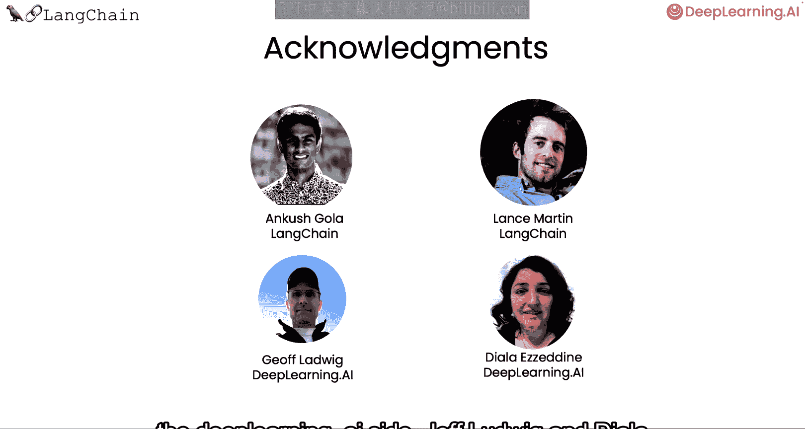

# 吴恩达最新《LangChain：与你的数据对话》｜langchain-chat-with-your-data｜中英字幕 - P1：LangChain2_Intro0-v3.zh_en - GPT中英字幕课程资源 - BV148411D7d2

Hi， I'm excited to share with you this new course on using Lacha to chat with your data。

 This is built in collaboration with Harrison Chase， cofounder and CEO of Landchain。😊。

Lch language models or LOMs such as chatt GT can answer questions about a lot of topics。

 but an LOM in isolation knows only what it was trained on， which doesn't include your personal data。

 such as if you're in a company and have proprietary documents not on the Internet。

As well as data or articles that were written after the O M was trained。

So wouldn't it be useful if you or others， such as your customers。

 can have a conversation with your own documents and get questions answered using information from those documents and using an LM？

In this short course， we will cover how to use L chainin to chat with your data。

LangChain is an open source developer framework for building LLM applications。

Langching consists of several modular components， as well as more end to end templates。

The modular components in Li chain include prompts， models， indexes， chains， and agents。

For a more detailed look at these components， you can see our first course that I taught with Andrew。

In this course， we will zoom in and focus on one of the more popular use cases of La chain。

How to use L chain to chat with your data， We will first cover how to use L chain document loaders to load data from a variety of exciting sources。

We will then touch on how to split these documents into semantically meaningful chunks。

 This preprocessing step may seem simple， but has a lot of nuance。Next。

 we'll give an overview of semantic search， a basic method for fetching relevant information given the user question。

This is the easiest method to get started with， but there are several cases where it fails。

 We'll go over these cases， and then we'll go over how to fix them。

We'll then show how to use those retrieved documents to enable an LLM to answer questions about a document。

But sure that you're still missing one key piece in order to fully recreate that chatbot experience。

Finally， we'll cover that missing piece， memory， and show how to build a fully functioning chatbot through which you can chat with your data。

This will be an exciting short course。 We're grateful to Ansh Goer。

 as well as Lance Martin from the Lcha team for working on all the materials that you hear Harrison present later。

 as well as on the deep learning AI side， Jeff Ludwig and Dila Eadin in case you're going through this course and decide you like a refresher on the basics of Lcha。

 I encourage you to also take that earlier short course on Lacha for LM application development that Harrison had mentioned as well。

😊。

But with that， let us now go on to the next video where Harrison will show you how to use Landangchain's very convenient collection of document loaders。

