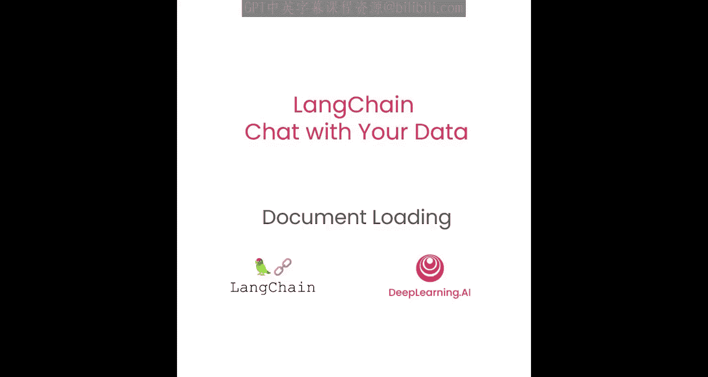
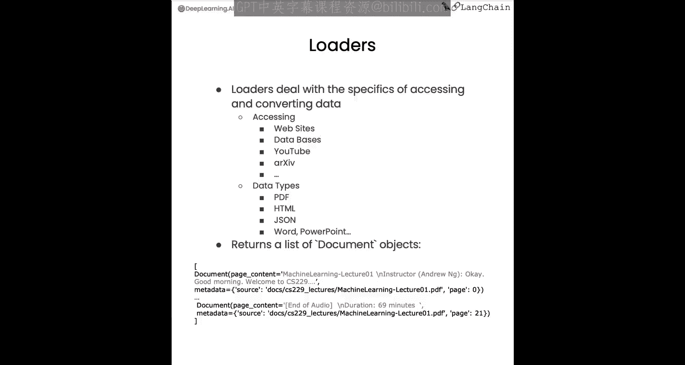
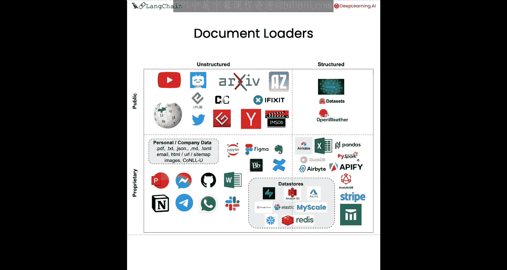
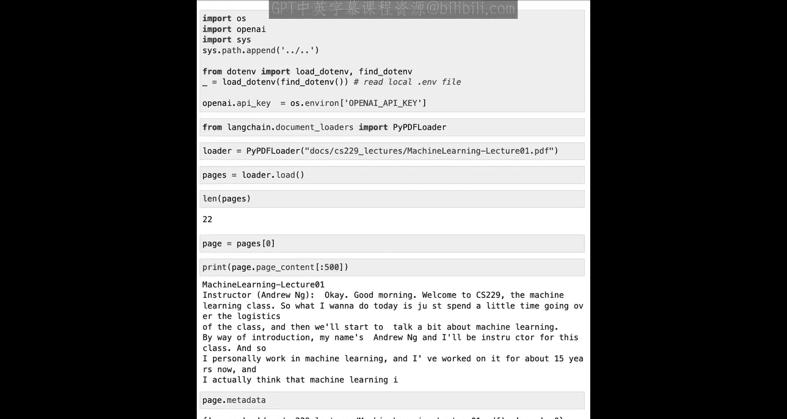
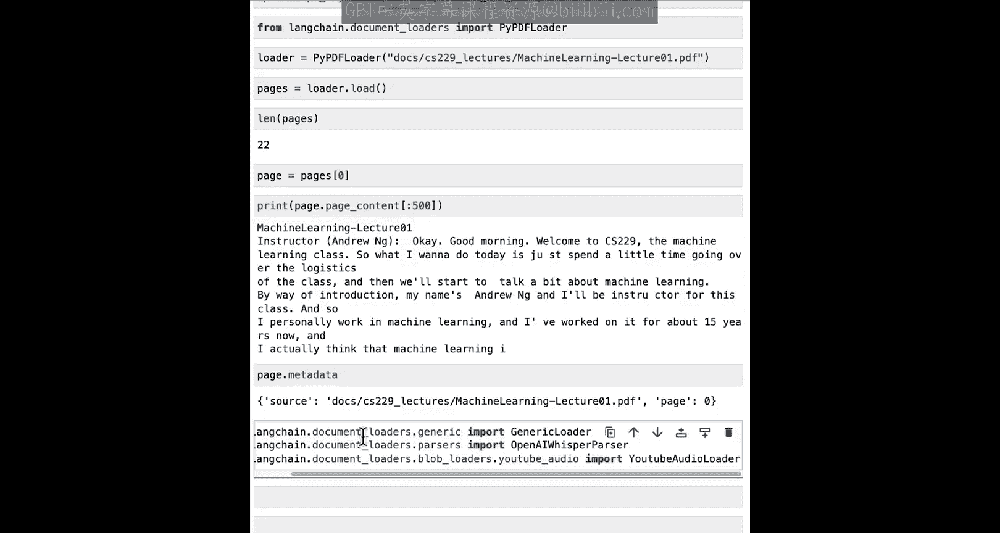
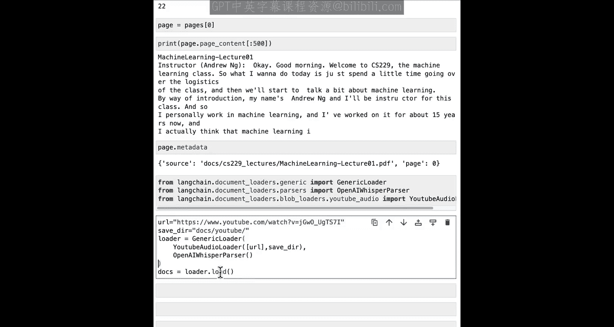
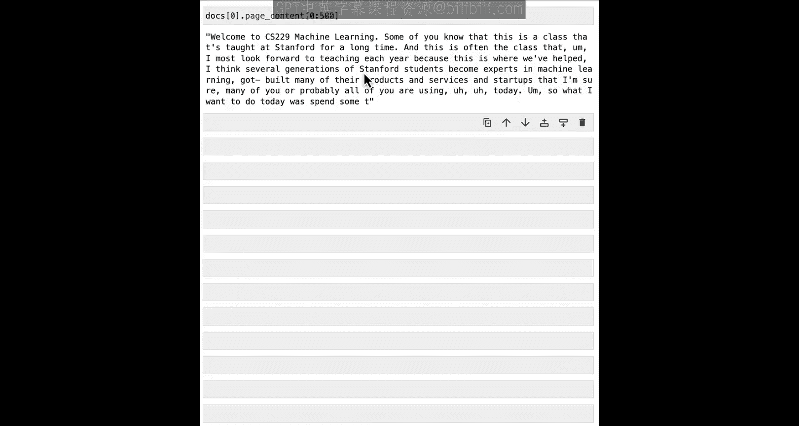
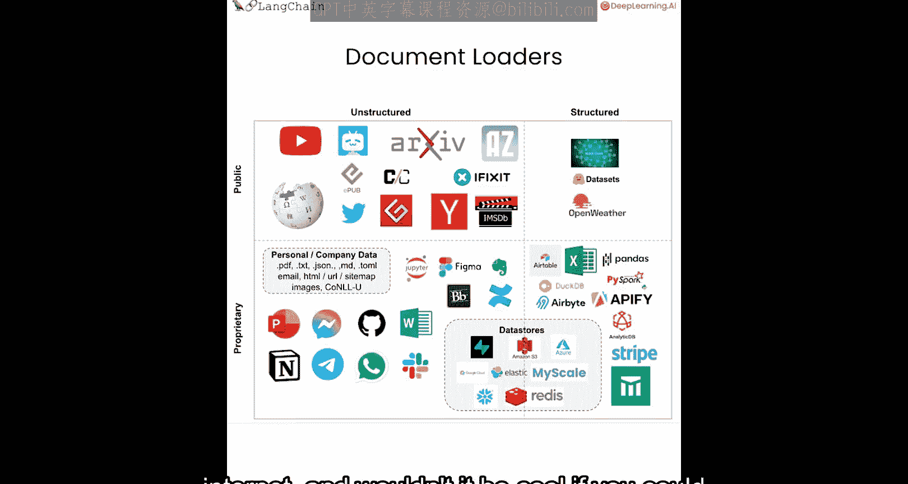
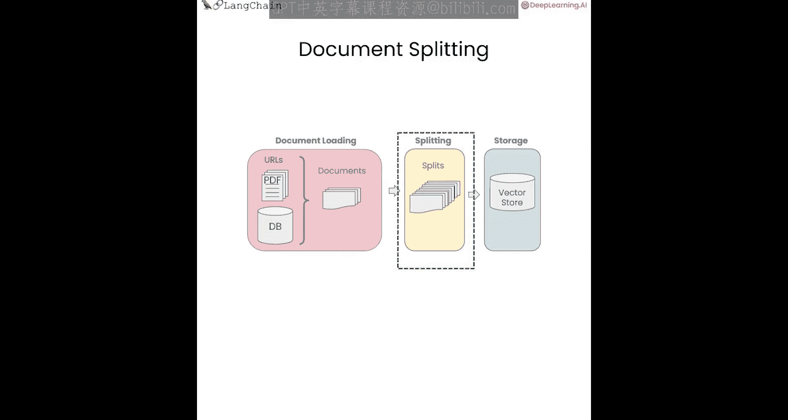

# 吴恩达最新《LangChain：与你的数据对话》｜langchain-chat-with-your-data｜中英字幕 - P2：LangChain2_L1-v4.zh_en - GPT中英字幕课程资源 - BV148411D7d2

In order to create an application where you can chat with your data。

 you first have to load your data into a format where it can be worked with。

That's where Li chain document loaders come into play。

 We have over 80 different types of document loaders。And in this lesson。

 we'll cover a few of the most important ones and get you comfortable with the concept in general。

 Let's jump in。

Document load deal with the specifics of accessing and converting data from a variety of different formats and sources into a standardized format。

There can be different places that we want to load data from like websites， different databases。

 YouTube， and these documents can come in different data types like PDFs， HTML， JSON。

And so the whole purpose of document letters is to take this variety of data sources and load them into a standard document object。

 which consists of content and then associated metadata。

There are a lot of different type of document loaders in Linkin。

 and we won't have time to cover them all， but here is a rough categorization of the 80 plus that we have。

There are a lot that deal with loading unstructured data like text files from public data sources like YouTube。

 Twitter， hacker news， and there are also even more that deal with loading unstructured data from the proprietary data sources that you or your company might have like Figma notion。

Document loaders can also be used to load structured data。Data that's in a tabular format。

 it may just have some text data in one of those cells or rows that you still want to do question answering or semantic search over。

And so the sources here include things like airbite， stripe， Airtable。

All right， now let's jump into the fun stuff， actually using document loaders。First。

 we're going to load some environment variabless that we need， like the Open AI API key。

The first type of documents that we're going to be working with are PDFs。

So let's import the relevant document load from Liang chainin。We're going use the pi P D F floater。

We've loaded a bunch of PDFs into the documents folder in the workspace。

 and so let's choose one and put that in the loader。Now。

 let's load the documents by just calling the load method。

Let's take a look at what exactly we've loaded。So this， by default， will load a list of documents。

In this case， there are 22 different pages in this P D F。Each one is its own unique document。

 Let's take a look at the first one and see what it consists of。

The first thing the document consists of is some page content， which is the content of the page。

 This can be a bit long， so let's just print out the first few hundred characters。

The other piece of information that's really important is the metadata associated with each document。

This can be accessed with the metadata element。

You can see here that there's two different pieces。One is the source information。 This is the PDF。

 the name of the file that we loaded it from。The other is the page field。

 This corresponds to the page of the PDFf that it was loaded from。

The next type of document loader that we're going to look at is one that loads from YouTube。

 there's a lot of fun content on YouTube， and so a lot of people use this document loader to be able to ask questions of their favorite videos or lectures or anything like that。

We're going to import a few different things here。 The key parts are the YouTube audio loader。

 which loads an audio file from a YouTube video。The other key part is the open AI whisper parser。

This will use OpenaiI's Whi model。A speech text model to convert the YouTube audio into a text format that we can work with。

We can now specify a URL， specify a directory in which to save the audio files。

 and then create the generic loader as a combination of this YouTube audio loader。

Combined with the open AI， whisper parser。And then we can call loader dotload to load the documents corresponding to this YouTube。

This may take a few minutes， so we're going speed this up and post。Now that it's finished loading。

 we can take a look at the page content of what we've loaded。

And this is the first part of the transcript from the YouTube video。This is a good time to pause。

 go choose your favorite YouTube video and see if this transcription works for you。

The next set of documents that we're going to go over how to load are URLs from the internet。

There's a lot of really awesome educational content on the internet。

 and wouldn't it be cool if you could just chat with it？

We're going to enable that by importing the web base loader from LinkChain。

Then we can choose any URL， our favorite URL here， we're going to choose a markdown file from this GitHub page。

And create a loader for it。And then next， we can call loader dot load。

 and then we can take a look at the content of the page。Here。

 you'll notice there's a lot of white space followed by some initial text。And then some more text。

 this is a good example of why you actually need to do some post processing on the information to get it into a workable format。

Finally， we'll cover how to load data from Notion。Notion is a really popular store of both personal and company data。

And a lot of people have created chatbots talking to their notion databases。In your notebook。

 you'll see instructions on how to export data from your notionion database into a format through which we can load it into Li chain。

Once we have it in that format， we can use the notionion directory loader to load that data。

And get documents that we can work with。If we take a look at the content here。

 we can see that it's in Markdown format， and this notion document is from Bdel's employee Handbook。

I'm sure a lot of people listening have used notion and have some notion databases that they would like to chat with。

 and so this is a great opportunity to go export that data。

 bring it in here and start working with it in this format。

That's it for document loading here we've covered how to load data from a variety of sources and get it into a standardized document interface。

However， these documents are still rather large。And so in the next section。

 we're going to go over how to split them up into smaller chunks。

This is relevant and important because when you're doing this retrieval augmented generation。

 you need to retrieve only the pieces of content that are most relevant。

 and so you don't want to select the whole documents that we've loaded here。

 but rather only the paragraph or few sentences that are most topical to what you're talking about。

And this is also an even better opportunity to think about what sources of data we don't currently have loaders for。

 but you might still want to explore。

Who knows， Maybe you can even make a PR to Linkin？