# 吴恩达最新《LangChain：与你的数据对话》｜langchain-chat-with-your-data｜中英字幕 - P3：LangChain2_L2-v3.zh_en - GPT中英字幕课程资源 - BV148411D7d2

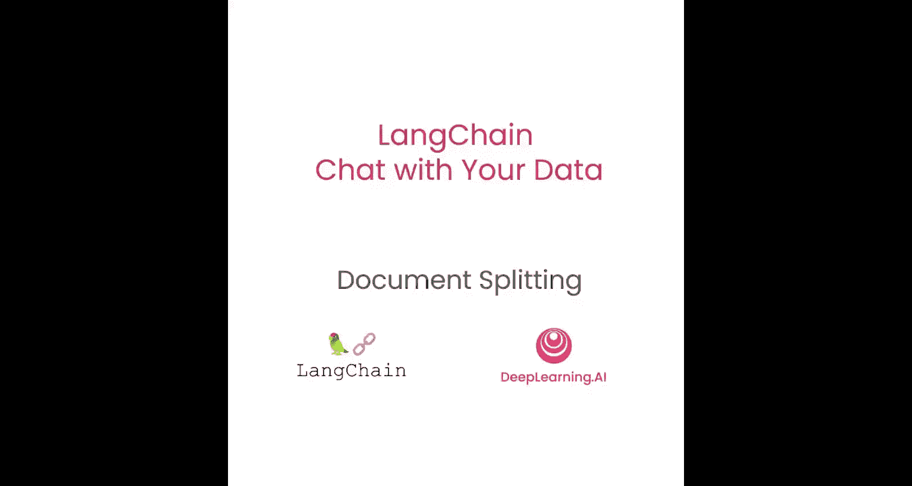

We just went over how to load documents into a standard format。 Now。

 we're going to talk about how to split them up into smaller chunks。This may sound really easy。

 but there's a lot of subtleties here that make a big impact down the line。

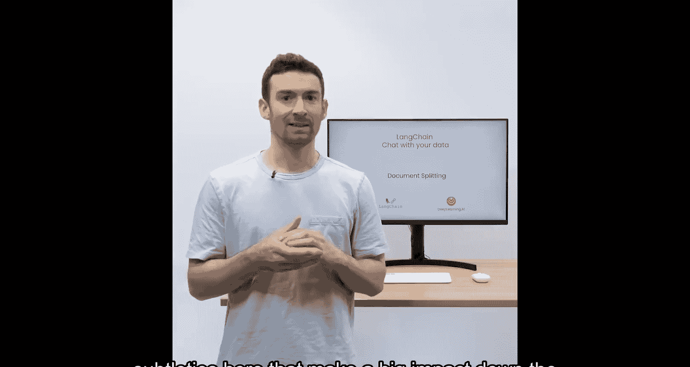

Let's jump into it。

Document splitting happens after you load your data into the document format。

But before it goes into the vector store。And this may seem really simple。

 You can just split the chunks according to the lengths of each characters or something like that。

 But as an example of why this is both trickier and very important down the line。

 let's take a look at this example here。 we've got a sentence about the Toyota Cammry and some specifications And if we did a simple splitting。

 we could end up with part of the sentence in one chunk and the other part of the sentence in another chunk。

 And then when we're trying to answer a question down the line about what are the specifications on the Camry we actually don't have the right information in either chunk and so it's split apart。

 And so we wouldn't be able to answer this question correctly。

 So there's a lot of nuance and importance in how you split the chunks so that you get semantically relevant chunks together。

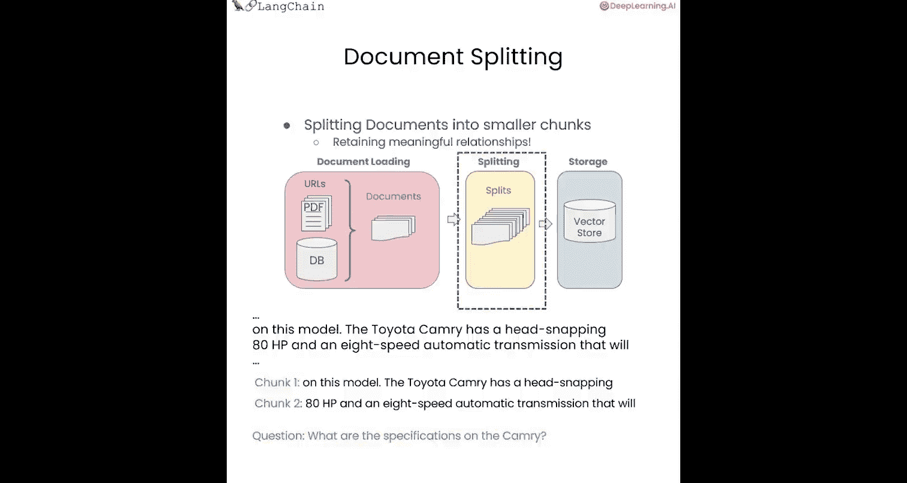

The basis of all the text splitters in lane chain involves splitting ons in some chunk size with some chunk overlap。

And so we have a little diagram here below to show what that looks like。

 so the chunk size corresponds to the size of a chunk and the size of the chunk can be measured in a few different ways。

 and we'll talk about a few of those in the lesson。

 and so we allow passing in a length function to measure the size of the chunk。

 This is often characters or tokens。A chunk overlap is generally kept as a little overlap between two chunks。

 like a sliding window as we move from one to the other。

 And this allows for the same piece of context to be at the end of one chunk and at the start of the other and helps create some notion of consistency。

The text splitters and L chain all have a C documents and a split documents method。

This involves the same logic under the hood。 It just exposes a slightly different interface。

 one that takes in a list of text and another that takes in a list of documents。

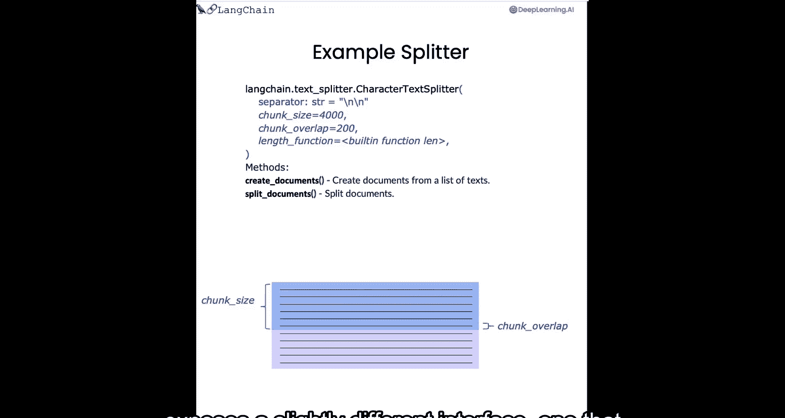

There are a lot of different types of splitters in L chain。

 and we'll cover a few of them in this lesson。But I would encourage you to check out the rest of them。

In your spare time。These text splitters vary across a bunch of dimensions。

 They can vary on how they split the chunks， what characters go into that。

They can vary on how they measure the length of the chunks， Is it by characters， Is it by tokens。

There are even some that use other smaller models to determine when the end of a sentence might be and use that as a way of splitting chunks。

Another important part of splitting into chunks is also the metadata。

 maintaining the same metadata across all chunks， but also adding in new pieces of metadata when relevant。

 and so there are some text splitters that are really focused on that。

The splitting of chunks can often be specific on the type of document that we're working with。

 and this is really apparent when you're splitting on code。

 so we have a language text splitter that has a bunch of different separators for a variety of different languages like Python。

 Ruby， C。And when splitting these documents， it takes those different languages and the relevant separators for those languages into account when it's doing the splitting。

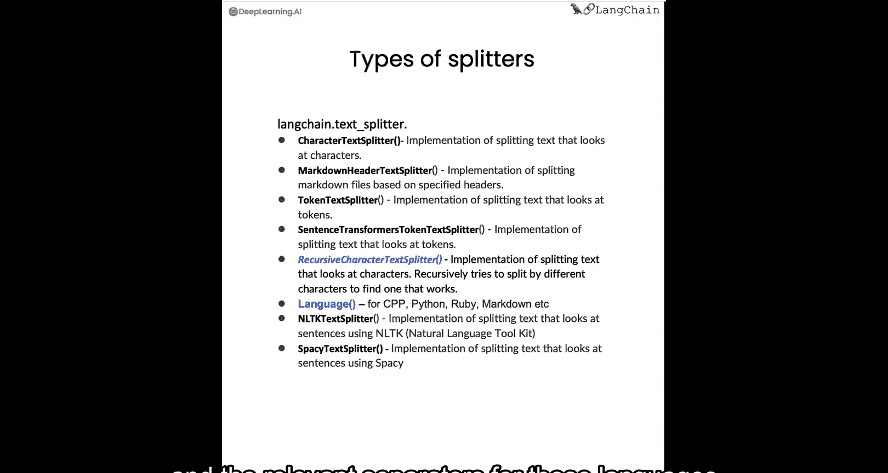

First， we're going to set up the environment as before by loading the Open AI API key。Next。

 we're going to import two of the most common types of text splitters in La chain。

 The recursive character text splitter and the character text splitter。

We're going to first play around with a few toy use cases just to get a sense of what exactly these do。

And so we're going to set a relatively small chunk size of 26 and an even smaller chunk overlap。

Of four。Just so we can see what these can do。Let's initialize these two different text splitters as R splitter and C splitter。

And then let's take a look at a few different use cases。Let's load in the first string。

 ABC D all the way down to Z， and let's look at what happens when we use the various splitters。

When we split it with the recursive character tu splitter， it still ends up as one the string。

 This is because this is 26 characters long， and we've specified a chunk size of 26。

 So there's actually no need to even do when he's splitting here。

Now let's do it on a slightly longer string。Where it's longer than the 26 characters that was specified as the chunk size。

Here we can see that two different chunks are created。The first one ends at Z。

 so that's 26 characters。The next one we can see starts with W X， Y， Z。

 Those are the four chunk overlaps。And then it continues with the rest of the string。

Let's take a look at a slightly more complex turn， where we have a bunch of spaces between characters。

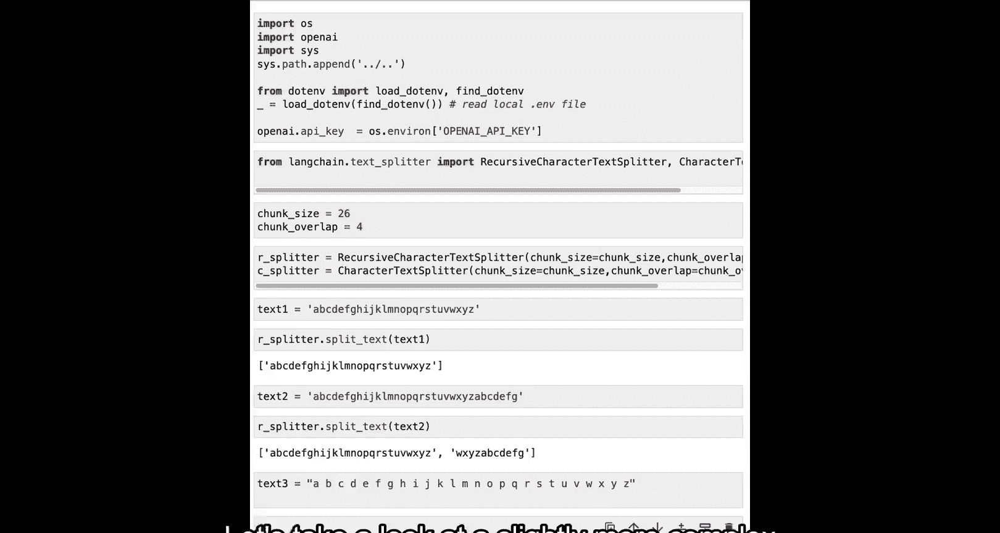

We can now see that it' split into three chunks。Because there are spaces， so it takes up more space。

And so if we look at the overlap， we can see that in the first one。

 there's L and M and the L and M are then also present in the second one that seems like only two characters。

 but because of the space both in between the L&M and then also before the L and after the M。

That actually counts as the four that makes up the chunk overlap。

Let's now try with the character text splitter。

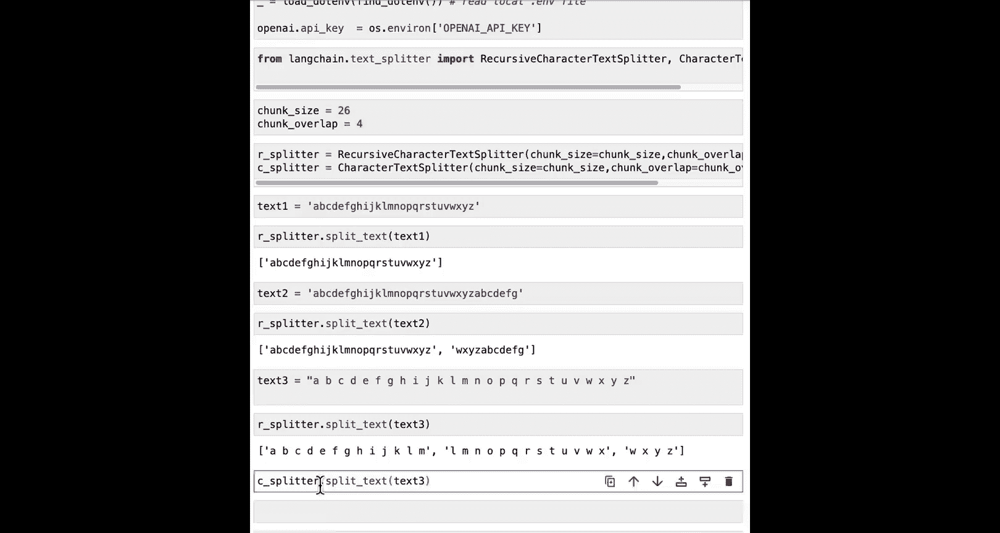

And we can see that when we run it， it doesn't actually try to split it at all。

 and so what's going on here。The issue is the character text blur splits on a single character。

 and by default， that character is a new line character。But here there are no new ones。

If we set the separator to be an empty space。We can see what happens then。

Here it's split in the same way as before。This is a good point to pause the video and try some new examples。

Both with different strings that you've made up and then also swapping out the separators and seeing what happens。

It's also interesting to experiment with the chunk size and chunk overlap and just generally get a sense for what's happening in a few toy examples so that when we move on to more real world examples。

 you'll have good intuition as to what's happening underneath the scenes。

Now let's try it out on some more real world examples。 We've got this long paragraph here。

 and we can see that right about here， we have this double new line symbol。

 which is typical separator between paragraphs。Let's check out the length of this piece of text。

And we can see that it's just about 50。And now let's define our two text splitters。

 We'll work with the character text splitter as before with this the space as a separator。

 and then we'll initialize the recursive character text splitter。

 and here we pass in a list of separators and these are the default separators but we're just putting them in this notebook to better show what's going on。

 and so we can see that we've got a list of double new line single new line space and then nothing and empty string。

What these mean is that when you're splitting a piece of text。

 it will first try to split it by double new lines。

 and then if it still needs to split the individual chunks more。

 it will go on to single new lines and then if it still needs to do more。

 it goes onto the space and then finally it will just go character by character if it really needs to do that。

Looking at how these perform on the above text， we can see that the character text splitter splits on spaces。

 and so we end up with the weird separation in the middle of the sentence。

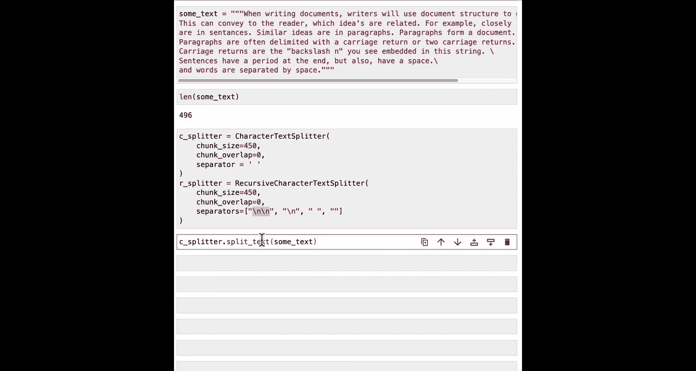

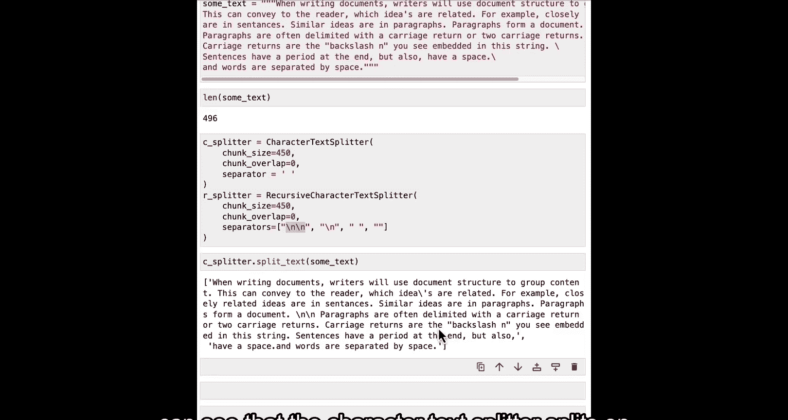

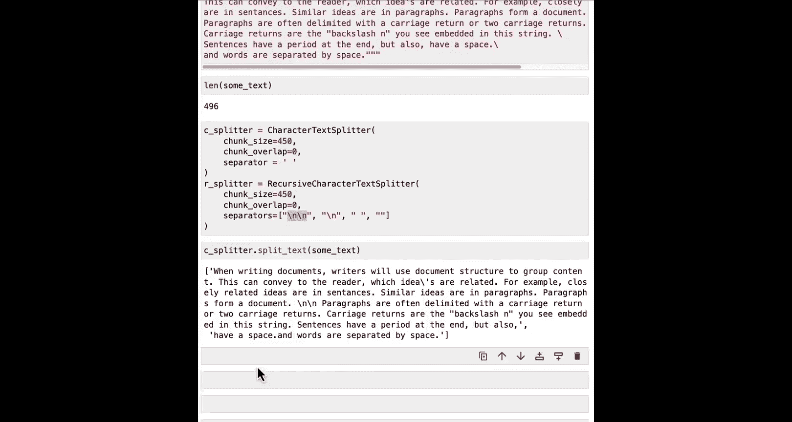

The recursive text splitter first tries to split on double new lines。

 And so here it splits it up into two paragraphs。 even though the first one is shorter than the 450 characters would be specified。

 this is probably a better split because now the two paragraphs that are each their own paragraphs are in the chunks。

 as opposed to being split in the middle of a sentence。

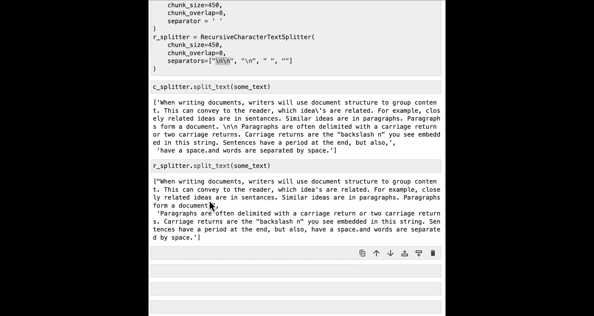

Let's now split it into even smaller chunks just to get an even better intuition as to what's going on。

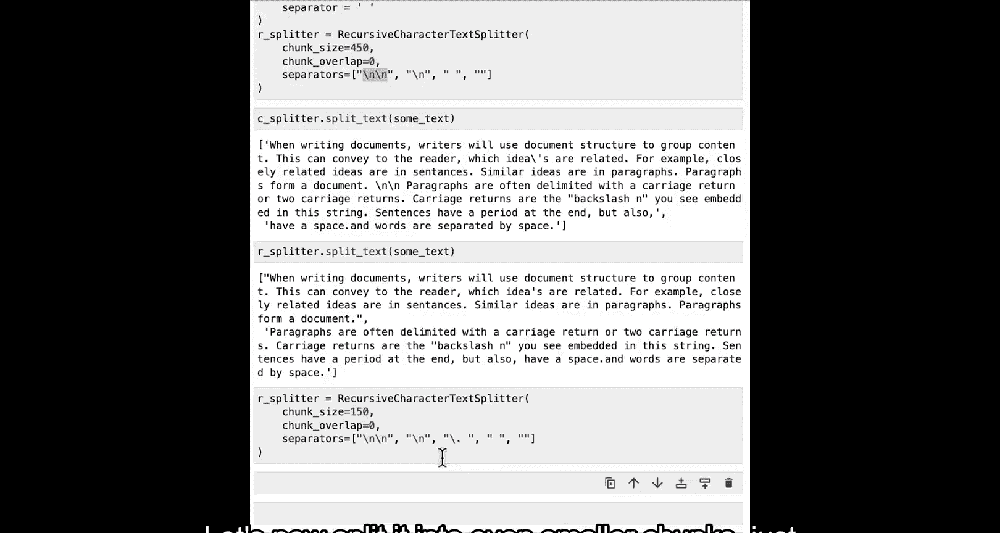

We'll also add in a period separator。 This is aimed at splitting， in between sentences。

If we run this text splitter， we can see that's split on sentences。

 but the periods are actually in the wrong places。This is because of the rex that's going on underneath the scenes。

To fix this， we can actually specify a slightly more complicated rex with a look behind。Now。

 if we run this。

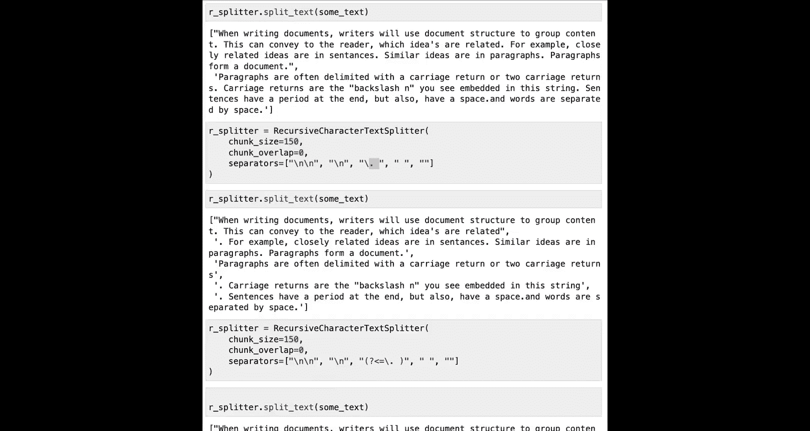

We can see that it's split into sentences and it's split properly with the periods being in the right places。

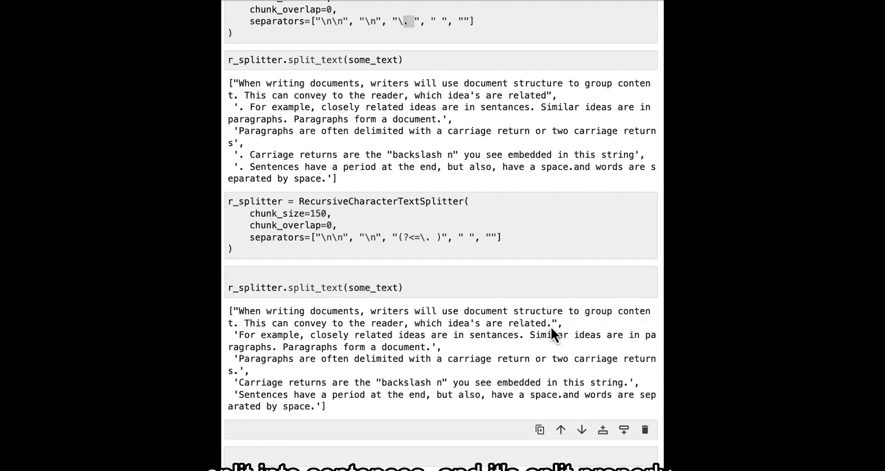

Let's now do this on an even more real world example with one of the PDFs that we worked with in the first document loading section。

Let's load it in， and then let's define our text blur here。Here we pass the length function。

 this is using when， the Python built in， this is the default。

 but we're just specifying it for more clarity what's going on underneath the scenes。

 and this is counting the length of the characters。Because we now want to use documents。

 we're using the split documents method， and we're passing in a list of documents。

If we compare the length of those documents。To the length of the original pages。

We can see that there's been a bunch more documents that have been created as a result of this splitting。

We can do a similar thing with the notion DB that we used in the first lecture as well。

And once again， comparing the links of the original documents to the new split documents。

 we can see that we've got a lot more documents now that we've done all the splitting。

This is a good point to pause the video and try some new examples。So far。

 we've done all the splitting based on characters， but there's another way to split。

 and this is based on tokens。 And for this， let's import the token text splitter。

The reason that this is useful is because often LLMs have context windows that are designated by token count。

And so it's important to know what the tokens are and where they appear。

 and then we can split on them to have a slightly more representative idea of how the LLM would view them。

To really get a sense for what the difference is between tokens and characters。

 let's initialize the token text splitter with a chunk size of1 and a chunk overlap of0。

 So this will split any text into a list of the relevant tokens。Let's create a fun made up text。

And when we split it， we can see that it's split into a bunch of different tokens。

 and they're all a little bit different in terms of their length and the number of characters in them。

 So the first one is just fo。 then you've got a space and then bar。

 and then you've got a space in just the B， then A Z， then Z Y， and then fo again。

And this shows a little bit of the difference between splitting on characters versus splitting on tokens。

Let's apply this to the documents that we loaded above in a similar way。

In a similar way we can call the split documents on the pages。

And if we take a look at the first document， we have our new split document with the page content being roughly the title。

 and then we've got the metadata of the source and the page where it came from。

You can see here that the metadata of the source and the page is the same in the chunk as it was for the original document。

And so if we take a look at that， just to make sure。Pages 0。Metadata， we can see that it lines up。

 This is good。 It's carrying through the metadata to each chunk appropriately。

But there can also be cases where you actually want to add more metadata to the chunks as you split them。

This can contain information like where in the document the chunk came from。

 where it is relative to other things or concepts in the document。

 and generally this information can be used when answering questions to provide more context about what this chunk is exactly。

To see a concrete example of this， let's look at another type of text splitter that actually adds information into the metadata of each chunk。

You can now pause and try a few examples that you come up with。

This text splitter is the markdown header text splitter。

And what it will do is it will split a markdown file based on the header。Or any subheaders。

 And then it will add those headers as content to the metadata fields。

 and that will get passed on along to any chunks that originate from those splits。

Let's do a toy example first and play around with a document where we've got a title and then a subheader of chapter 1。

 we've then got some sentences there and then another section of an even smaller subheader and then we jump back out to chapter 2 in some sentences there。

Let's define a list of the headers we want to split on and the names of those headers。

 So first we've got a single hashtag and we'll call that header1， we've then got two hashtags。

 header2， three hashtags， header  three。We can then initialize the markeddown header text splitter with those headers。

And then split the toy example we have above。If we take a look at a few of these examples。

 we can see the first one has the content。 Hi， this is Jim。 Hi， this is Joe， and now in the metadata。

 we have header1 and then we have it as title and header2 as chapter 1。

 and this is coming from right here。In the example document above。

Let's take a look at the next one and we can see here that we've jumped down into an even smaller subsection。

 and so we've got the content of high this is Lance。

 and now we've got not only header1 but also header2 and also header3。

 And this is again coming from the content and names in the markdown document above。

Let's try this out on a real world example before we loaded the notionion directory using the notion directory loader。

 and this loaded the files to markdown。Which is relevant for the Markdown header splitter。

So let's load those documents and then define the markdown splitter with header1 as a single hashtag and header 2 as a double hashtag。

We split the text and we get our splits。 if we take a look at them。

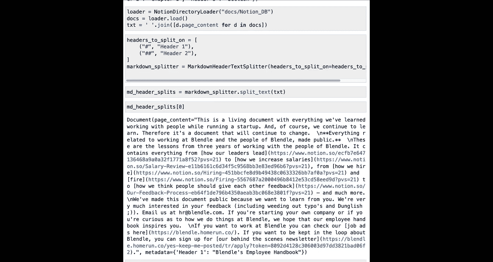

We can see that the first one has content of some page， and now if we scroll down to the metadata。

 we can see that we've loaded header1 as Bdle's employee handbook。

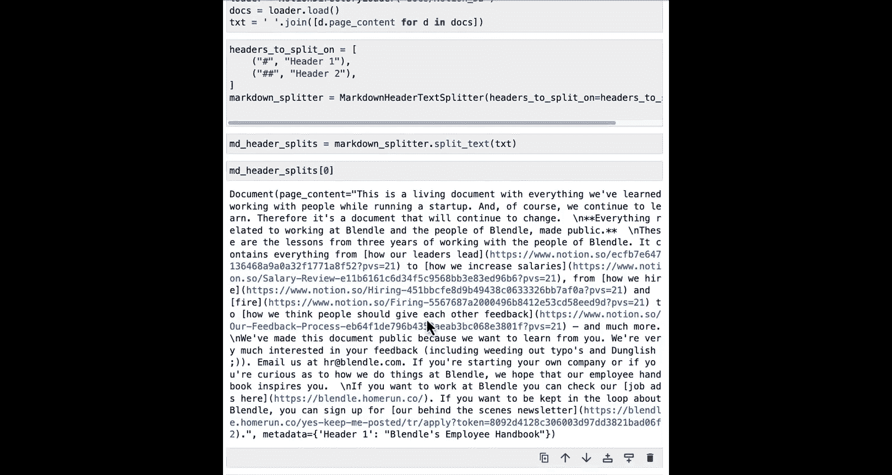

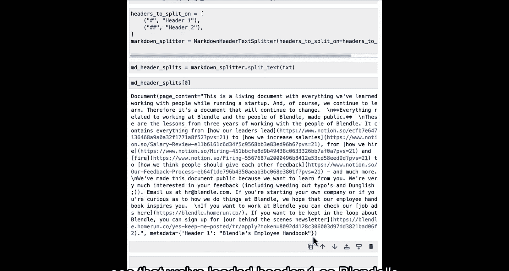

We've now gone over how to get semantically relevant chunks with appropriate metadata。

The next step is moving those chunks of data into a vector store。

 and we'll cover that in the next section。

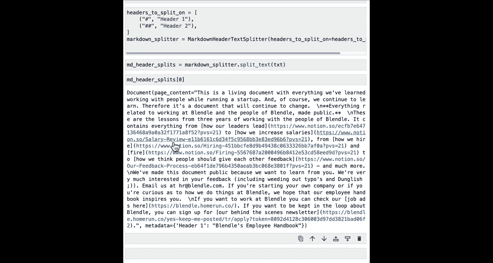