# 吴恩达最新《LangChain：与你的数据对话》｜langchain-chat-with-your-data｜中英字幕 - P4：LangChain2_L3-v3.zh_en - GPT中英字幕课程资源 - BV148411D7d2

We've now got our documents split up into small， semantically meaningful chunks。

 and it's time to put these chunks into an index whereby we can easily retrieve them when it comes time to answer questions about this corpus of data To do that。

 We're going to utilize embeddings and vector stores。 Let's see what those are。

We covered this briefly in the previous course， but we're going to revisit it for a few reasons。

First， these are incredibly important for building chatbots over your data。And second。

 we're going to go a bit deeper and we're going to talk about edge cases and where this generic method can actually fail。

 don't worry， we're going to fix those later on， but for now let's talk about vector stores and embeddings and this comes after text splitting when we're ready to store the documents in an easily accessible format。

What embeddings are they take a piece of text and they create a numerical representation of that text。

Text with similar content will have similar vectors in this numeric space。

What that means is we can then compare those vectors and find pieces of text that are similar。

So in the example below， we can see that the two sentences about pets are very similar while a sentence about a pet and a sentence about a car are not very similar as a reminder of the full end to end workflow。

 we start with documents， we then create smaller splits of those documents。

 we then create embeddings of those documents， and then we store all of those in a vector store。

A vector store is a database where you can easily look up similar vectors later on。

This will become useful when we're trying to find documents that are relevant for a question at hand。

We can then take the question at hand， creating an embedding。

 and then do comparisons to all the different vectors in the vector store。

 and then pick the n most similar。We then take those nmost similar chunks and pass them along with a question into an LLM and get back in answer。

We'll cover all of that later on。 For now， it's time to deep dive on embedding and vector storess themselves。

To start， we'll once again set the appropriate environment variables。From here on out。

 we're going to be working with the same set of documents， these are the CS 229 lectures。

We're going to load a few of them here。Notice that we're actually going to duplicate the first lecture。

 this is for the purposes of simulating some dirty data。After the documents are loaded。

 we can then use the recursive character text splitter to create chunks。

We can see that we've now created over 200 different chunks。

 time to move on to the next section and create embeddings for all of them。

 We'll use open AI to create these embeddings。Before jumping into a real world example。

 let's try it out with a few toy test cases just to get a sense for what's going on underneath the hood。

We've got a few example sentences where the first two are very similar。

 and the third one is unrelated。We can then use the embedding class to create an embedding for each sentence。

We can then use numpy to compare them and see which ones are most similar。

We expect that the first two sentences should be very similar。

And then the first and second compared to the third shouldn't be nearly as similar。

Will use a dot product to compare the two embedding。If you don't know what a do product is。

 that's fine。 The important thing to know is that higher is better。

Here we can see that the first two embeddings have a pretty high score of 0。96。

If we compare the first embedding to the third one， we can see that it's significantly lower at 0。77。

And if we compare the second to the third， we can see it's right about the same at 0。76。

Now is a good time to pause and try out a few sentences of your own and see what the dot practice is。

Let's now get back to the real world example， it's time to create embeddings for all the chunks of the PDFs and then store them in a vector store。

The vector store that we'll use for this lesson is chroma。So let's import that。

Lang chainin has integrations with lots over 30 different vector stores。

 We choose Chroa because it's lightweight and in memory。

 which makes it very easy to get up and started with。

There are other vector stores that offer hosted solutions。

 which can be useful when you're trying to persist large amounts of data or persist it in cloud storage somewhere。

We're going to want to save this vector store so that we can use it in future lessons。

 So let's create a variable called persist directory， which we will use later on at Doc/lashchroma。

Let's also just make sure that nothing is there already。If there's stuff there already。

 it can throw things off and we don't want that to happen， so let's RMrf docs。

chroma just to make sure that there's nothing there。Let's now create the vector store。

So we call Chroma from documents passing in splits， and these are the splits that we created earlier。

 passing in embedding， and this is the open AI embedding model， and then passing in Per directory。

 which is a Chma specific keyword argument that allows us to save the directory to disk。

If we take a look at the collection count after doing this， we can see that it's 209。

 which is the same as the number of splits that we had from before。Let's now start using it。

Let's think of a question that we can ask of this data。We know that this is about a class lecture。

 so let's ask if there is any email that we can ask for help if we need any help with the course or material or anything like that。

We're going to use the similarity search method。And we're going to pass in the question and then we'll also pass in K equals 3。

 This specifies the number of documents that we want to return。

So if we run that and we look at the length of the document。

 we can see that it's three as we specified。If we take a look at the content of the first document。

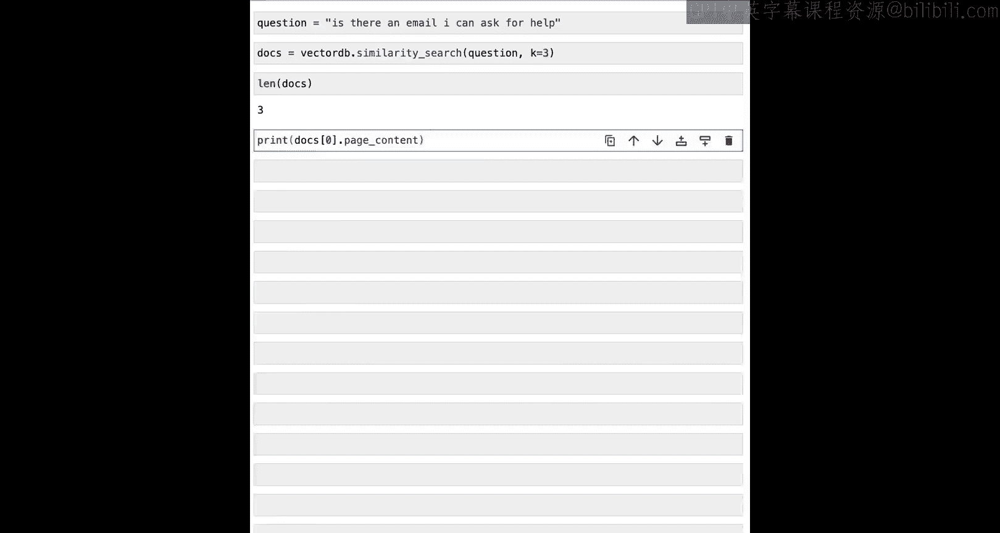

We can see that it is， in fact， about an email address， CSs 229qa@ cs。tanford。 eu。

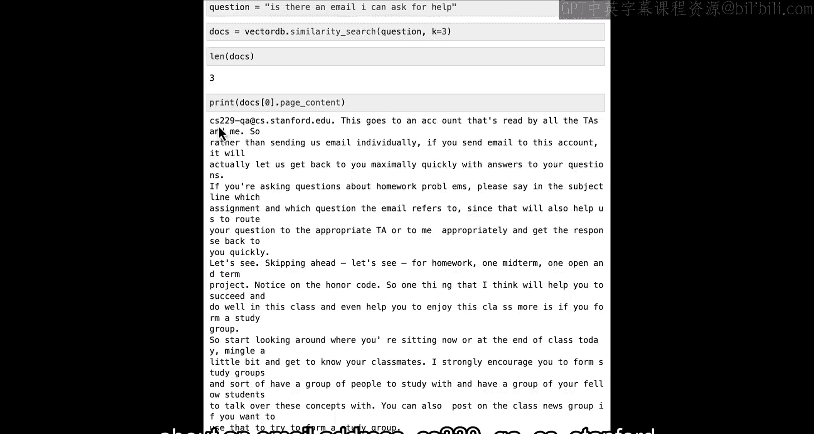

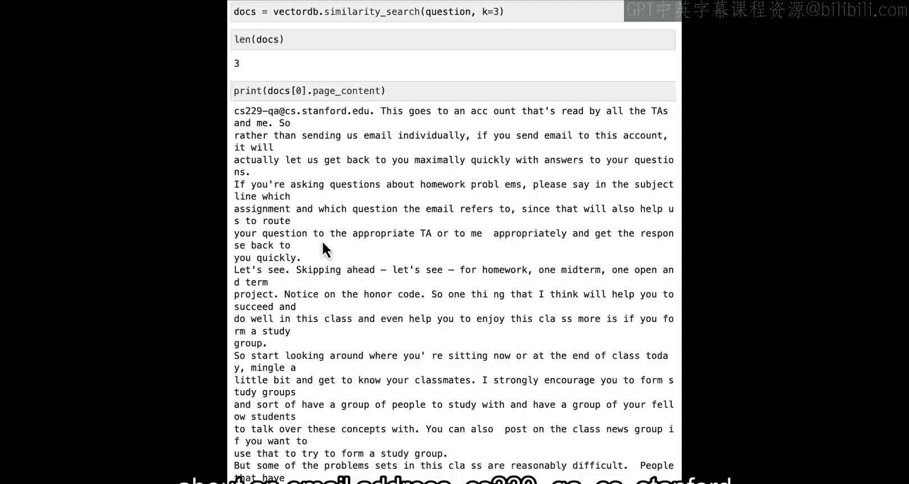

And this is the email that we can send questions to and is read by all the TAs。

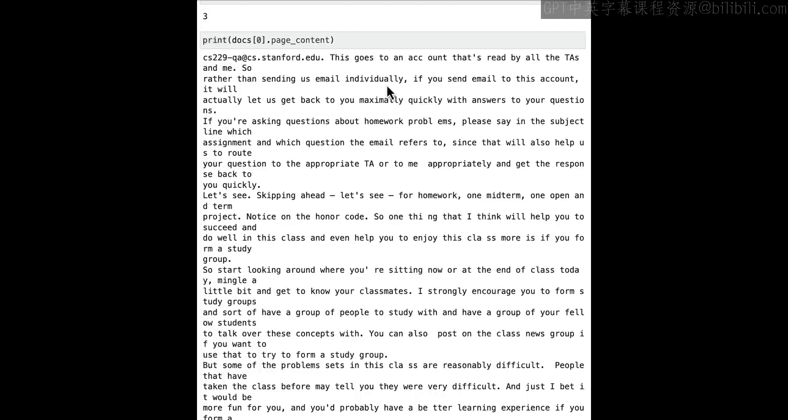

After doing so， let's make sure to persist the vector database so that we can use it in future lessons。

By running vector Db dot persist。This has covered the basics of semantic search and shown us that we can get pretty good results based on just embeddings alone。

But， it isn't perfect。And here we'll go over a few edge cases and show where this can fail。

Let's try a new question。 What did they say about matlab。

Let's run this specifyinging K equals 5 and get back some results。

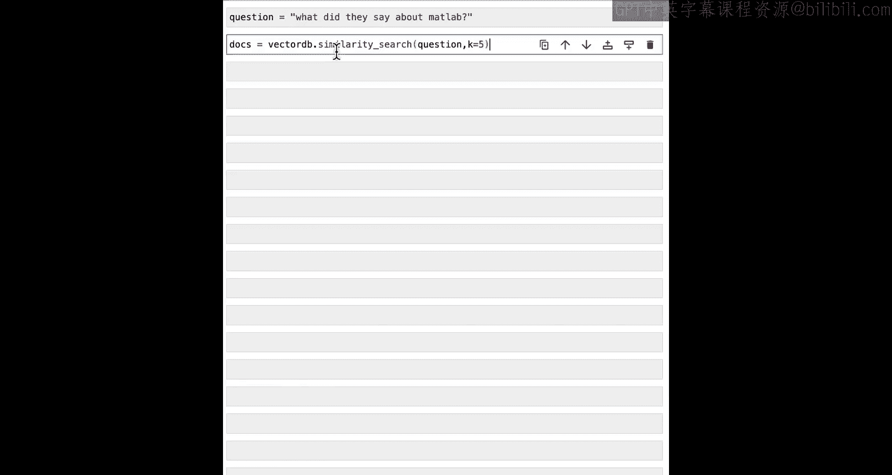

If we take a look at the first two results， we can see that they're actually identical。

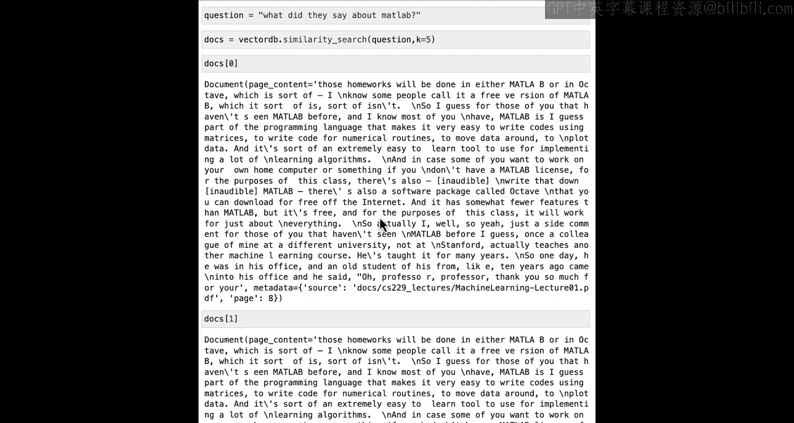

This is because when we loaded in the P Dfs， if you remember， we specified on purpose。

 a duplicate entry。

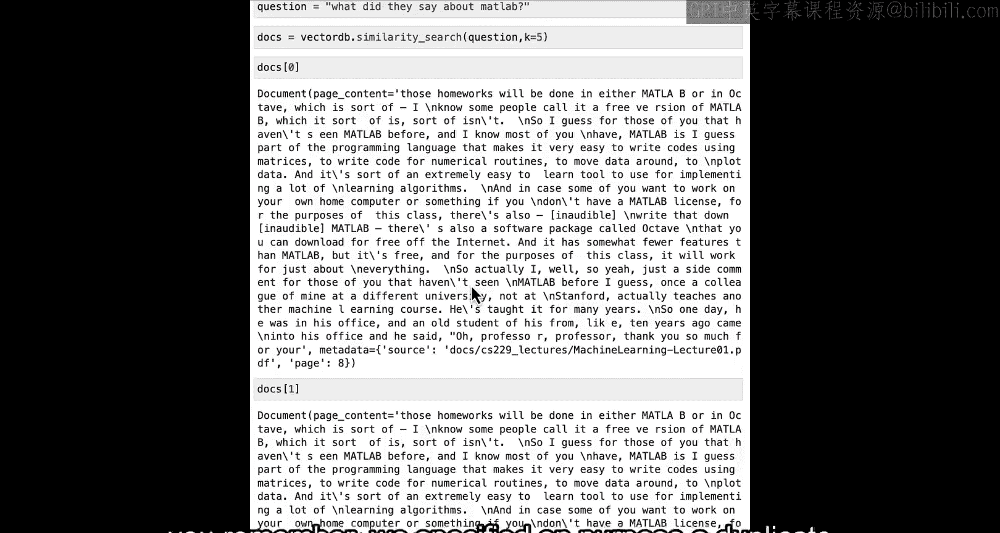

This is bad because we've got the same information in two different chunks。

 and we're going to be passing both of these chunks to the language model down the line。

There's no real value in the second piece of information。

 and it would be much better if there is a different distinct chunk that the language model could learn from。

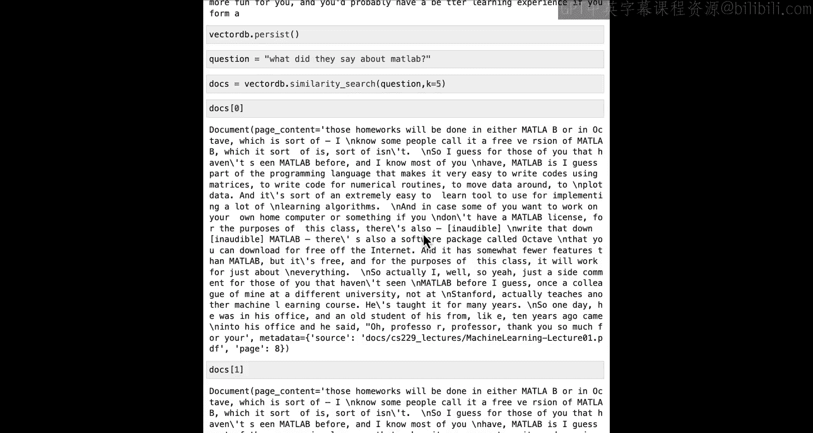

One of the things that we'll cover in the next lesson is how to retrieve both relevant and distinct chunks at the same time。

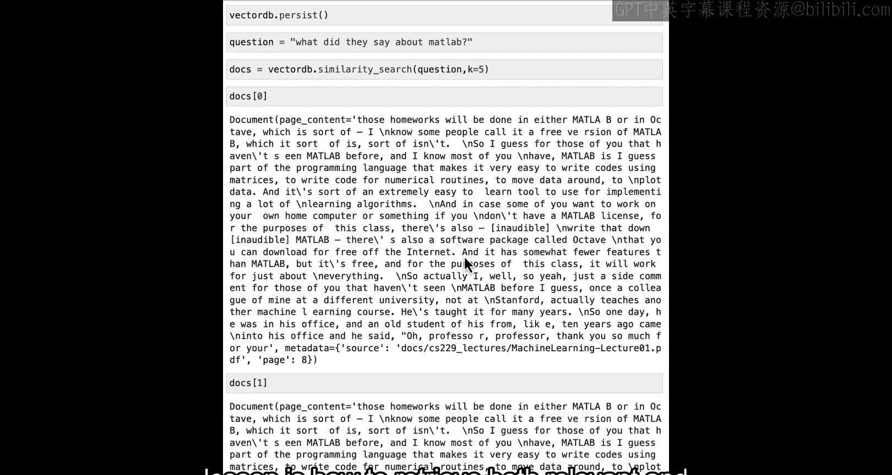

This is another type of failure mode that can also happen。 Let's take a look at the question。

 what did they say about regression in the third lecture。When we get the docs for this intuitively。

 we would expect them to all be part of the third lecture。

 we can check this because we have information in the metadata about what lectures they come from。

So let's loop over all the documents and print out the metadata。

We can see that there's actually a combination of results， some from the third lecture。

 some from the second lecture and some from the first。

 the intuition about why this is failing is that the third lecture and the fact that we want documents from only the third lecture is a piece of structured information。

 but we're just doing a semantic lookup based on embeddings where it creates an embedding for the whole sentence and is probably a bit more focused on regression。

Therefore， we're getting results that are probably pretty relevant to regression。

 And so if we take a look at the fifth doc。

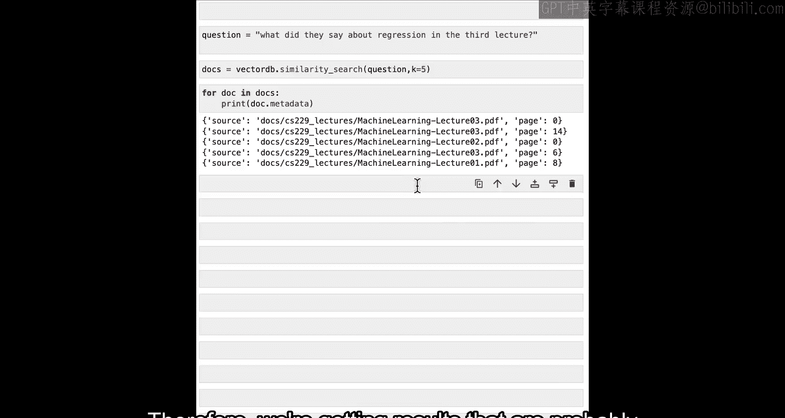

The one that comes from the first lecture， we can see that it does， in fact， mention regression。

 So it's picking up on that。But it's not picking up on the fact that it's only supposed to be querying documents from the third lecture because。

 again， that's a piece of structured information that isn't really perfectly captured in the semantic embedding that we've created。

Now is a good time to pause and try out a few more queries。😊。

What other edge cases can you notice that arise。You can also play around with changing K。

 the number of documents that you achieve。As you may have noticed throughout this lesson。

 we used first three and then five， you can try adjusting it to be whatever you want。

You'll probably notice that when you make it larger， you'll retrieve more documents。

 but the documents towards the tail end of that may not be as relevant as the ones at the beginning now that we've covered the basics of semantic search and also some of the failure modes。

 let's go on to the next lesson where we'll talk about how to address those failure modes and beef up our retrieval。

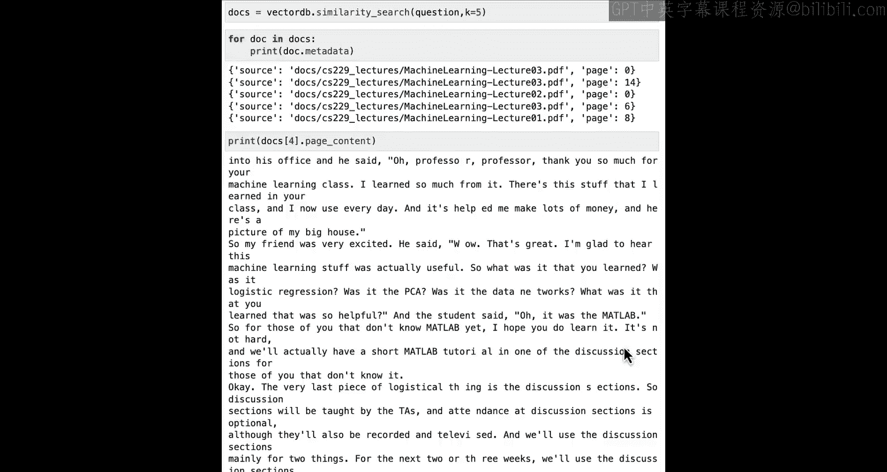