# 吴恩达最新《LangChain：与你的数据对话》｜langchain-chat-with-your-data｜中英字幕 - P5：LangChain2_L4-v3.zh_en - GPT中英字幕课程资源 - BV148411D7d2

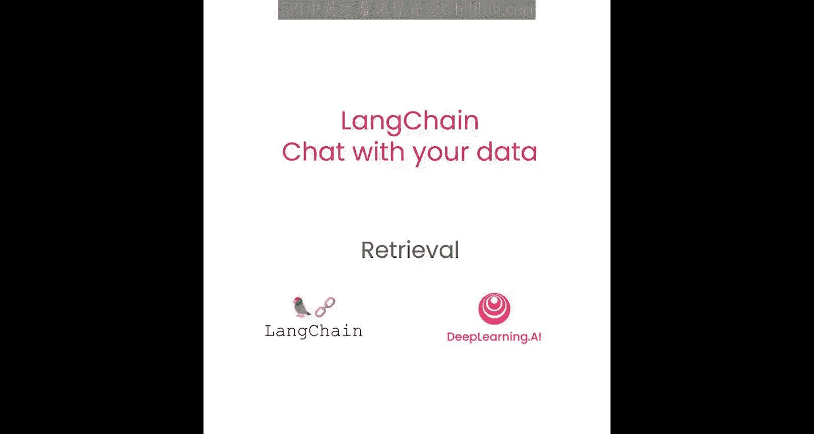

In the last lesson， we covered the basics of semantic search and saw that it worked pretty well for a good amount of use cases。

 but we also saw some edge cases and saw how things could go a little bit wrong。In this lesson。

 we're going to deep dive on retrieval and cover a few more advanced methods for overcoming those edge cases。

I'm really excited by this because I think retrieval is something that is new。

 and a lot of the techniques we're talking about have popped up in the past few months or so。

 And this is a cutting edge topic。 And so you guys are gonna be right at the forefront。

 Let's have some fun。😊。

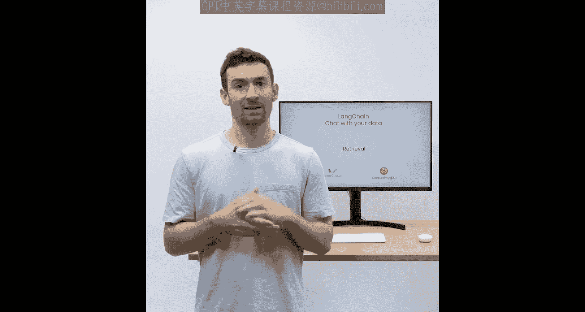

In this lesson， we're gonna talk about retrieval。This is important at query time。

 when you've got a query that comes in and you want to retrieve the most relevant splits。

We talked in the previous lesson about semantic similarity search。

 but we're going to talk about a few different and more advanced methods here。

The first one we're going cover is maximum marginal relevance， or MM MR。

And so the idea behind this is that if you just always take the documents that are most similar to the query in the embedding space。

 you may actually miss out on diverse information， as we saw on one of the edge cases。

In this example， we've got a chef asking about all white mushrooms。

And so if we take a look at the most similar results。

 those would be the first two documents where they have a lot of information similar to the query about a fruiting body and being all white。

But we really want to make sure that we also get other information。

 like the fact that it's really poisonous。 And so this is where using MMMR comes into play。

 as it will select for a diverse set of documents。The idea behind MMMR is that we send a query in。

 and then we initially get back a set of responses with fetch underscore K being a parameter that we can control in order to determine how many responses we get。

This is based solely on semantic similarity。From there。

 we then work with that smaller set of documents and optimize for not only the most relevant ones based on semantic similarity。

But also， ones that are diverse。And from that set of documents。

 we choose a final K to return to the user。Another type of retrieval we can do is what we call self query。

So this is useful when you get questions that aren't solely about the content that you want to look up semantically。

 but also include some mention of some metadata that you want to do a filter on。

So let's take the question， what are some movies about aliens made in 1980。

This really has two components to it。 It's got a semantic part， the aliens bit。

 so we want to look up aliens in our database of movies。

But it's also got a piece that really refers to the metadata about each movie。

 which is the fact that the year should be 1980。What we can do is we can use a language model itself to split that original question into two separate things。

 a filter and a search term。Most vector stores support a metadata filter。

So you can easily filter records based on metadata like the year being 1980。Finally。

 we'll talk about compression。This can be useful to really pull out only the most relevant bits of the retrieved passages。

For example， when asking a question， you get back the whole document that was stored。

Even if only the first one or two sentences are the relevant parts。With compression。

 you can then run all those documents through a language model and extract the most relevant segments and then pass only the most relevant segments into a final language model call。

 This comes at the cost of making more calls to the language model。

 but it's also really good for focusing the final answer on only the most important things。

 And so it's a bit of the trade off。Let's see these different techniques in action。

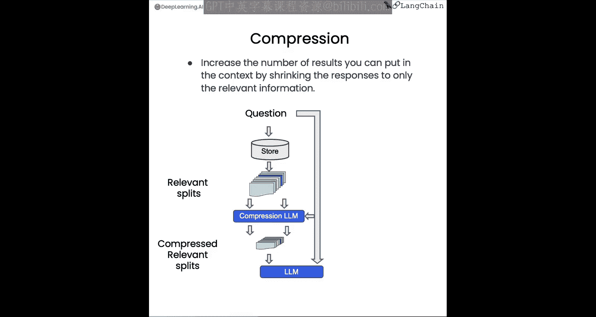

We're going to start by loading the environment variables as we always do。

What's then import Chroma and Open AI as we used them before？

And we can see by looking at the collection count that it's got the 209 documents that we loaded in before。

Let's now go over the example of max marginal relevance。

And so we'll load in the text from the example。Where we have the information about mushrooms。

For this example， we create a small database that we can just use as a toy example。

We've got our question， and now we can run a similarity search。

We'll set k equals to2 to only return the two most relevant documents。

 and we can see that there is no mention of the fact that it is poisonous。Let's now run it with MR。

Unless passing k equals 2， we still want to return two documents， but let's fetch K equals to3。

Where we fetch。All three documents originally。We can now see that the information that is poisonous is returned among the documents that we retrieve。

Let's go back to one of the examples from the previous lesson when we asked about MATLb and got back documents that had repeated information。

To refresh your memory， we can take a look at the first two documents。

Just looking at the first few characters because they're pretty long otherwise。And we can see that。

 they're the same。

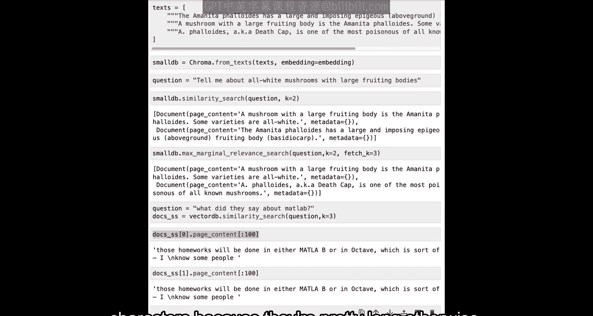

When we run MMR on these results， we can see that the first one is the same as before because that's the most similar。

But when we go on to the second one。We can see that it's different。

 it's getting some diversity in the responses。Let's now move on to the self query example。

This is the one where we had the question， what did they say about regression in the third lecture？

And it return results from not just the third lecture， but also the first and the second。

If we were fixing this by hand， what we would do is we'd specify a metadata filter。

So we'd pass in this information that we want the source to be equal to the third lecture PDF。

And then if we look at the documents that would be retrieved。

 that'd all be from exactly that lecture。We can use a language model to do this for us。

 so we don't have to manually specify that。To do this， we'll import a language model， open AI。

 we'll import a retriever called the self query Rer， and then we'll import attribute info。

 which is where we can specify different fields in the metadata and what they correspond to。

We only have two fields in the metadata， source and page。We fill out a description of the name。

 the description and the type for each of these attributes。

 This information is actually going to be passed to the language model。

 so it's important to make it as descriptive as possible。

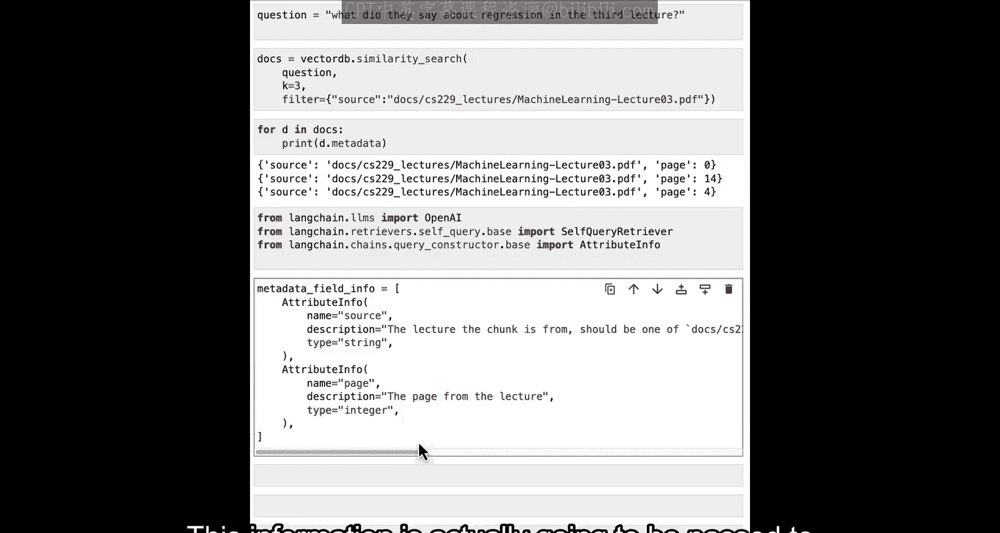

We'll then specify some information about what's actually in this document store。

 we'll initialize the language model， and then we'll initialize the self query retriever。

Using the from LM method and passing in the language model。

 the underlying vector database that we're going to query。

 the information about the description and the metadata， and then we'll also pass in verbo Ss true。

Setting verbo equals true， will let us see what's going on underneath the hood when the LLM infers the query that should be passed。

 along with any metadata filters。When we run the self query retriever with this question。

 we can see thanks to rubbose equals true， though we're printing out what's going on under the hood。

We get a query of regression， this is the semantic bit。

 and then we get a filter where we have a comparator of equals between the source attribute and a value of docs and then this path。

 which is the path to the third machine learning lecture。

So this is basically telling us to do a lookup in the semantic space on regression and then do a filter where we only look at documents that have a source value of this value。

 and so if we loop over the documents and print out the metadata。

 we should see that they're all from this third lecture。And indeed， they are。

 So this is an example where the self query retriever can be used to filter exactly on metadata。

A final retrieval technique that we can talk about is contextual compression。

And so let's load in some relevant modules here， the contextual compression retriever。

 and then an LLM chain extractor， and what this is going to do is this is going to extract only the relevant bits from each document and then pass those as the final return response。

We'll define a nice little function to pretty print out docs because they're often long and confusing。

 and this will make it easier to see what's going on。

We can then create a compressor with the LLM chain extractor。

 and then we can create the contextual compression retriever passing it in the compressor and then the base retriever of the vector store。

When we now ask the question， what did they say about MATLb and we look at the compressed docs？

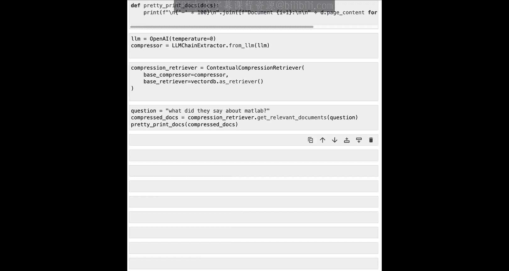

If we look at the documents we get back， we can see two things， One。

 theyre a lot shorter than the normal documents。 But two。

 we've still got some of this repeated stuff going on。 And this is because under the hood。

 we're using the semantic search algorithm。

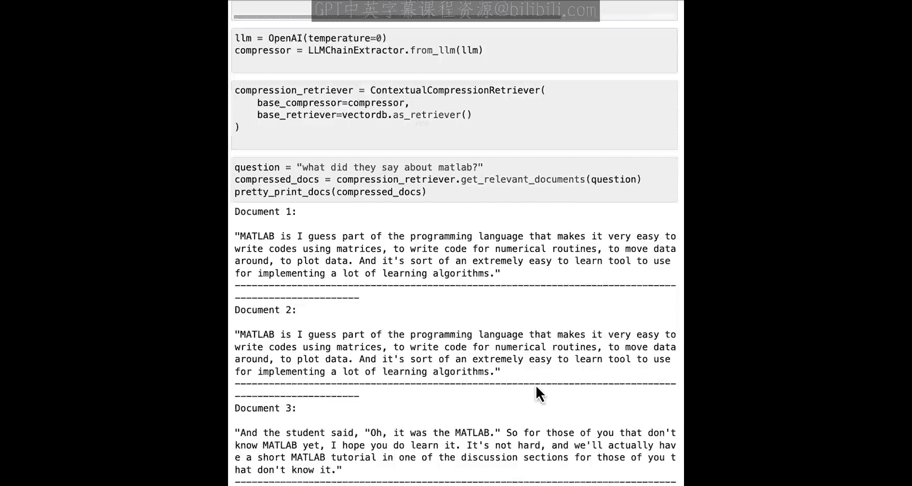

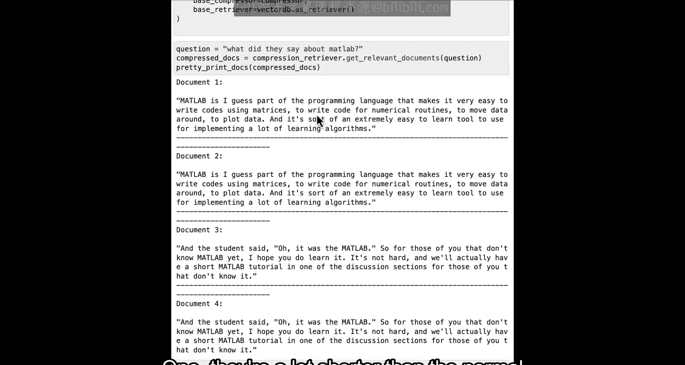

This is what we solved by using MMR from earlier in this lesson。

This is a good example of where you can combine various techniques to get the best possible results。

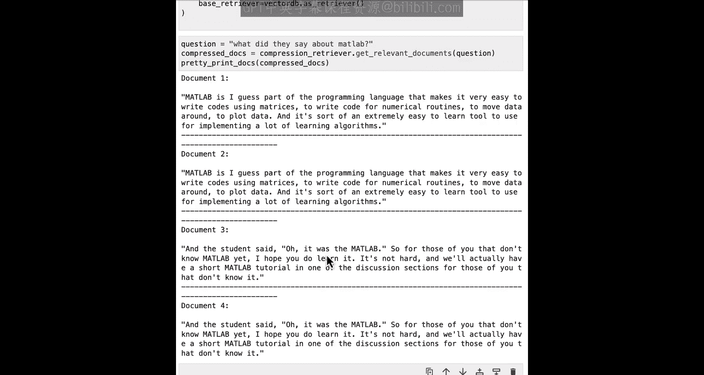

In order to do that。When we're creating the retriever from the vector database。

 we can set the search type to MMR。We can then rerun this and see that we get back a filtered set of results that do not contain any duplicate information。

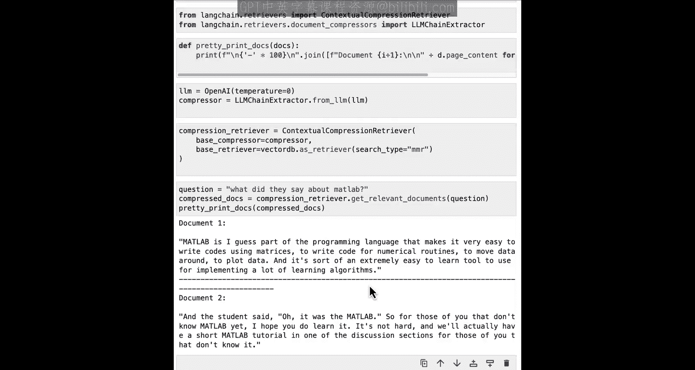

So far， all the additional retrieval techniques that we've mentioned build on top of a vector database。

It's worth mentioning that there's other types of retrieval that don't use a vector database at all。

 and instead uses other more traditional NLP techniques。Here。

 we're going to recreate a retrieval pipeline with two different types of rers an that VM retriever and a TFIDF retriever。

 If you recognize these terms from traditional NLP or traditional machine learning。

 that's great If you don't， it's also fine。 This is just an example of some other techniques that are out there。

 there are plenty more besides these and I encourage you to go check out some of them。

We can run through the usual pipeline of loading and splitting pretty quickly。

And then both of these retrievers expose a from text method。One takes in an embedding module。

 that's the SVM retriever， and the TFIDF retriever just takes in the splits directly。

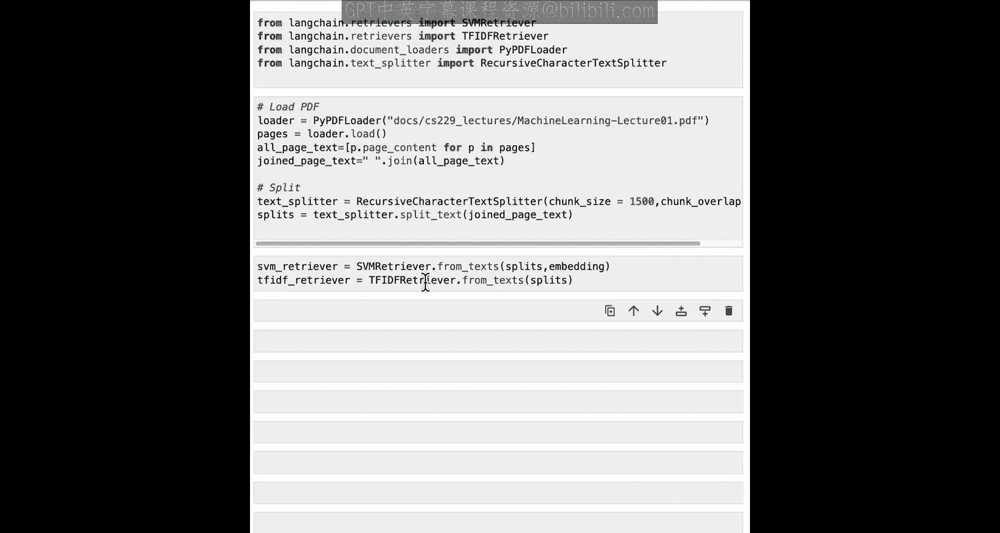

Now we can use the other retrievers。Let's pass in， what did they say about Matlabs to the SVM retriever。

 and we can look at the top document we get back， and we can see that it mentions a lot of stuff about Matlab。

 So it's picking up some good results there。

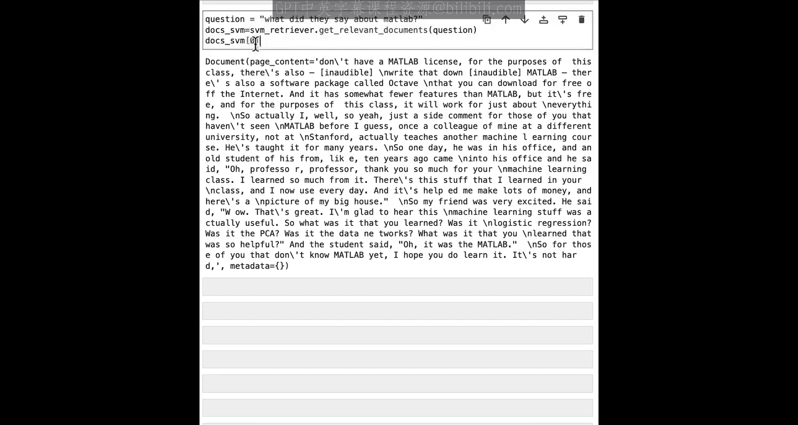

We can also try this out on the TF IDF retrievetr and we can see that the results look a little bit worse。

Now is a good time to pause and try out all these different retrieval techniques。

 I think you'll notice that some of them are better than others at various things。

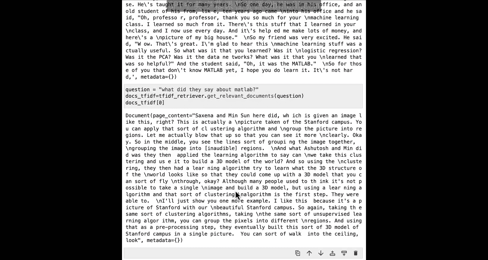

And so I'd encourage you to try it out on a wide variety of questions。

The selflfquery retriever in particular is my favorite。

 so I would suggest trying that out with more and more complex metadata filters。

 even maybe making up some metadata where there's really nested metadata structures and you can try to get the LLM to infer that。

 I think that's a lot of fun。 I think that's some of the more advanced stuff out there。

 And so I'm really excited to have been able to share with you。😊。

Now that we've talked about retrieval， we're going to talk about the next step in the process。

 which is using these retrieved documents to answer the user question。

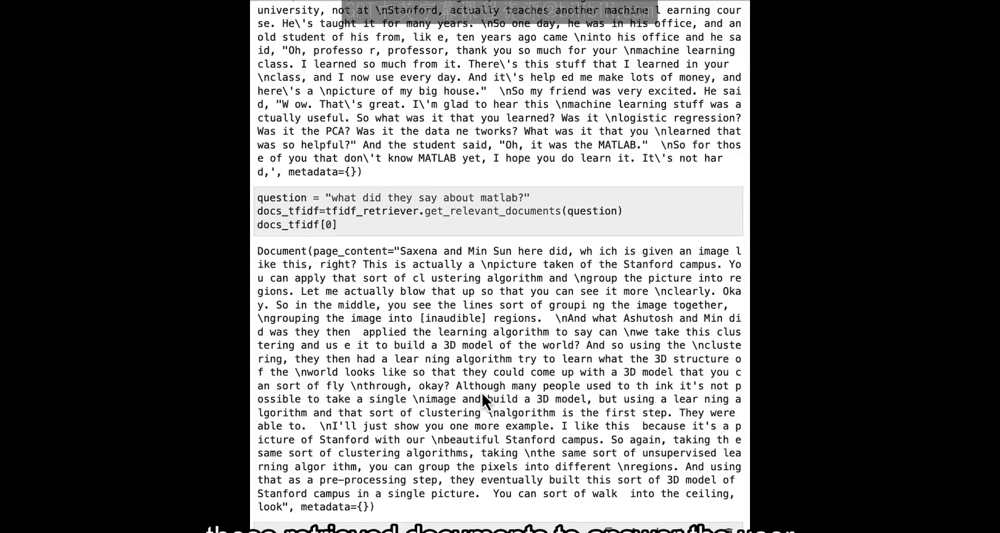