# 吴恩达最新《LangChain：与你的数据对话》｜langchain-chat-with-your-data｜中英字幕 - P6：LangChain2_L5-v3.zh_en - GPT中英字幕课程资源 - BV148411D7d2

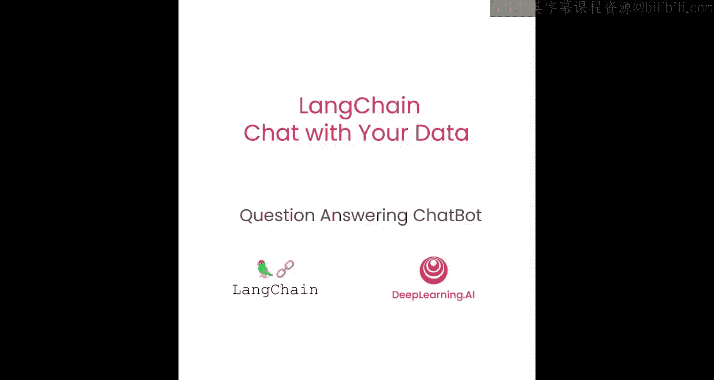

We've gone over how to retrieve documents that are relevant for a given question。

 The next step is to take those documents， take the original question。

 pass them both to a language model and ask it to answer the question。

We're going to go over that in this lesson and the few different ways that you can accomplish that task。

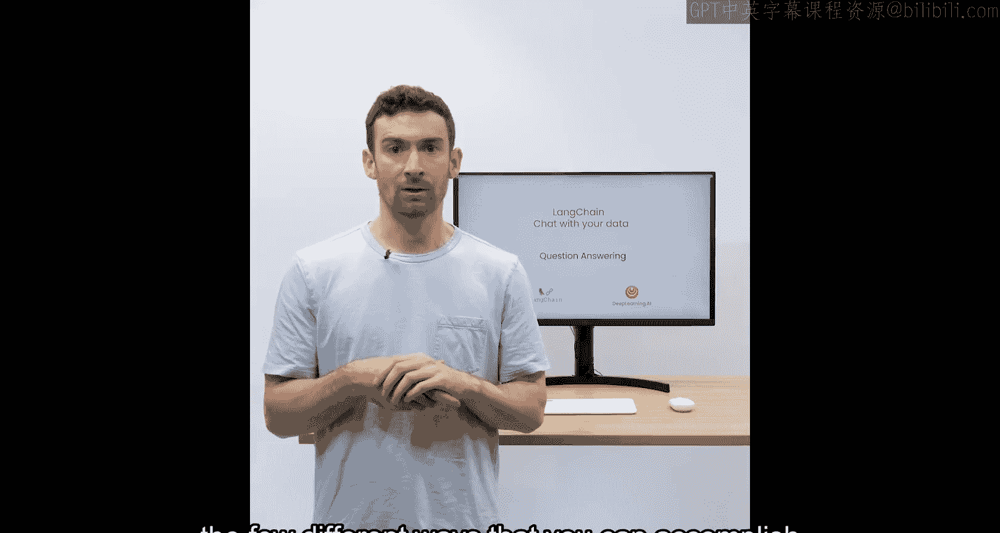

Let's jump in。In this lesson， we're going to cover how to do question answering with the documents that you've just retrieved。

 This comes after we've done the whole storage and ingestion after we've retrieved the relevant splits。

 now we need to pass that into a language model to get to an answer。 The general flow for this goes。

 The question comes in。 We look up the relevant documents。

 We then pass those splits along with a system prompt and the human question to the language model and get the answer。

By default， we just pass all the chunks into the same context window into the same call of the language model。

However， there are a few different methods we can use that have pros and cons to that。

 Most of the pros come from the fact that sometimes there can be a lot of documents and you just simply can't pass them all into the same context window。

MapRduce， refine， and map rean are three methods to get around this issue of short context windows。

 and we'll cover a few of them in the lesson today。Let's get to coding。First。

 we're going to load in our environment variables as usual。

We will then load in our vector database that was persisted from before。

And I'm going to check that it is correct。And we can see that it has the same 209 documents from before。

We do a quick little check of similarity search just to make sure it's working for this first question of what are major topics for this class？

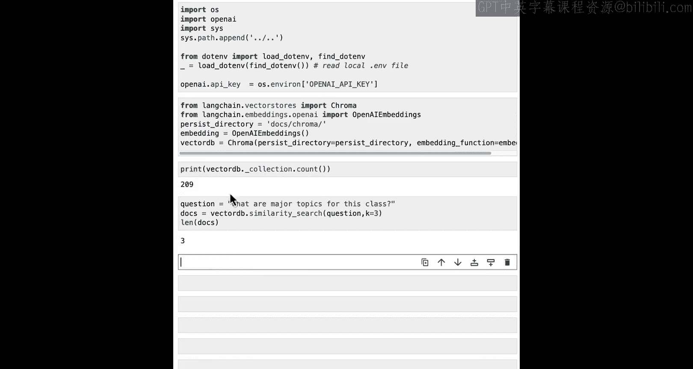

Now we initialize the language model that we're going to use to answer the question。

We're going to use the chat open AI model， G3。5， and we're going to set temperature equal to 0。

 This is really good when we want factual answers to come out because it's going to have a low variability and usually just give us the highest fidelity。

 most reliable answers。We're then going to import the retrieval QA chain。

This is doing question answering backed by a retrieval step。

We can create it by passing in a language model， and then the vector database as a retriever。

We can then call it with the query being equal to the question that we want to ask。

And then when we look at the result， we get an answer。

 The major topic for this class is machine learning。 Additionally。

 the class may cover statistics and algebra as refreshers in the discussion sections。

 Later in the quarter， the discussion sections will also cover extensions for the material taught in the main lectures。

Let's try to understand a little bit better what's going on underneath the hood and expose a few of the different knobs that you can turn。

The main part that's important here is the prompt that we're using。

 This is the prompt that takes in the documents and the question and passes it to a language model。

For a refresher on prompts， you can see the first class that I did with Andrew。

Here we define a prompt template， has some instructions about how to use the following pieces of context。

 and then it has a placeholder for a context variable， this is where the documents will go。

 and a placeholder for the questions variable。We can now create a new retrieval Q H N。

 We're going to use the same language model as before in the same vector database as before。

 but we're going to pass in a few new arguments。 So we've got the return source documents。

 We're going to set this ss to true。 This will let us easily inspect the documents that we retrieve。

And then we're also going to pass in prompt equals to the QA chain prompt that we defined above。

Let's try out a new question is probability a class topic We get back a result。

 And if we inspect what inside it， we can see yes， Probabilities assumed to be a prerequisite for the class。

 The instructor assumes familiarly with basic probability and statistics and we'll go over some of the prerequiites in the discussion sections as a refresher course。

 Thanks for asking。 It was very nice when it responded to us as well。

For a little bit better intuition as to where it's getting this data from。

 we can take a look at some of the source documents that were returned。

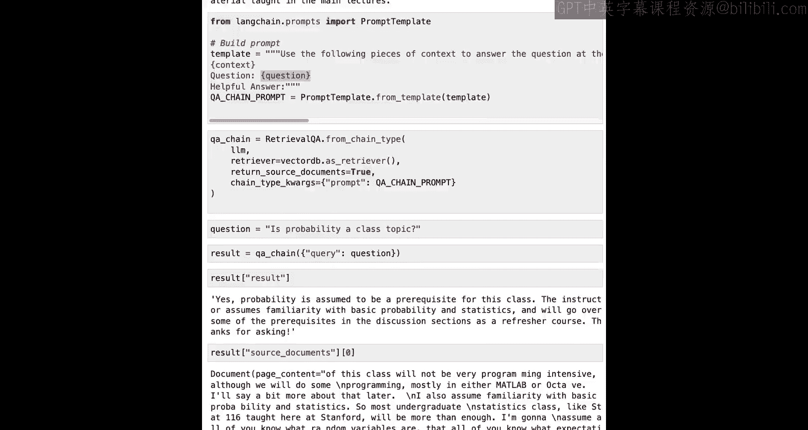

If you look through them， you should see that all the information that was answered is in one of these source documents。

Now is a good time to pause and play around with a few different questions or a different prompt template of your own and see how the results change。

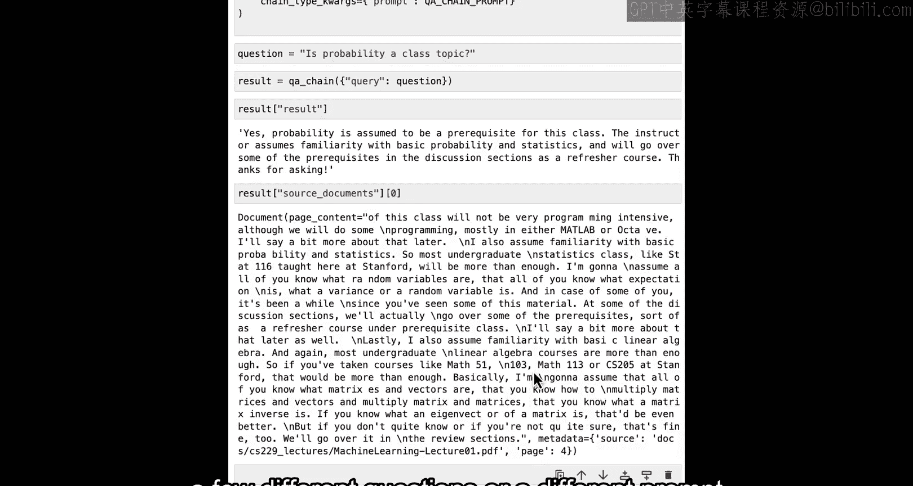

So far， we've been using the stuff technique， the technique that we use by default。

 was basically just stuffs all the documents into the final prompt。

This is really good because it only involves one call to the language model。 However。

 this does have the limitation that if there's too many documents。

 they may not all be able to fit inside the context window。

A different type of technique that we can use to do question answering over documents is the mapRuce technique。

In this technique， each of the individual documents is first sent to the language model by itself to get an original answer。

 and then those answers are composed into a final answer with a final call to a language model。

 This involves many more calls to the language model。

 but it does have the advantage in that it can operate over arbitrarily many documents。

When we run the previous question through this chain。We can see another limitation of this method。

 or actually， we can see2，1， it's a lot slower 2， the result is actually worse。

 There is no clear answer on this question based on the given portion of the document。

 This may occur because it's answering based on each document individually。

 And so if there is information that's spread across two documents。

 it doesn't have it all in the same context。This is a good opportunity to use the La chain platform to get a better sense for what's going on inside these chains。

We're going to demonstrate this here， and if you'd like to use it yourself。

 there'll be instructions in the course material as to how you can get an API key。

Once we've set these environment variables， we can rerun the map reduceuce chain。

And then we can switch over to the UI to see what's going on underneath the hood。From here。

 we can find the run that we just ran， we can click in it， and we can see the input in the output。

We can then see the child runs for a good analysis of what's happening underneath the hood。First。

 we have the map Red documents chain。This actually involves four separate calls to the language model。

If we click in one of these calls， we can see that we have the input and the output。

For each of the documents。If we go back， we can then see that after it's run over each of these documents。

 it's combined in a final chain， the stuffed documents chain where it stuffs all these responses into the final call。

 clicking into that， we can see that we've got the system message where we've got four summaries from the previous documents and then the user question and then we have the answer right there。

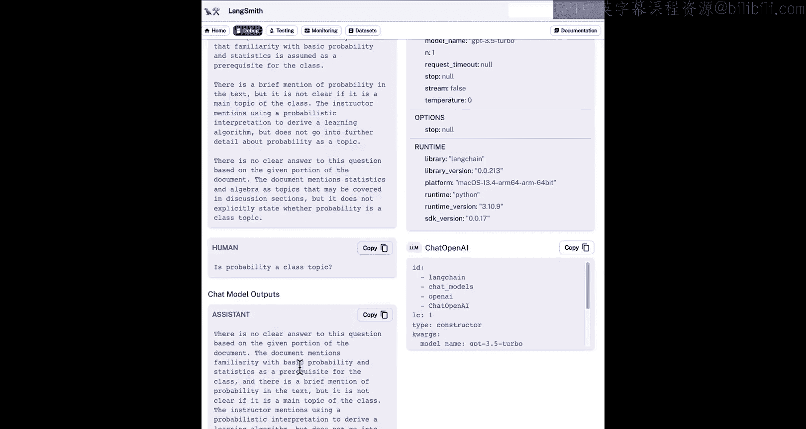

We can do a similar thing setting the chain type to refine。 This is a new type of chain。

 so let's see what it looks like under the hood。

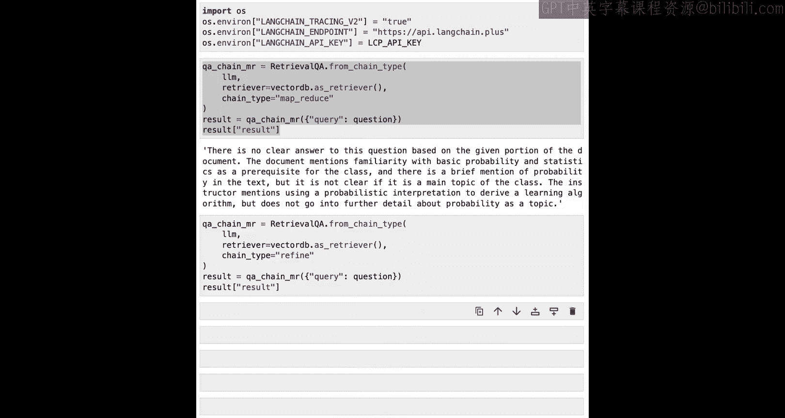

Here we can see that it's invoking the refinefind Docu chain。

 which involves four sequential calls to an LLM chain。

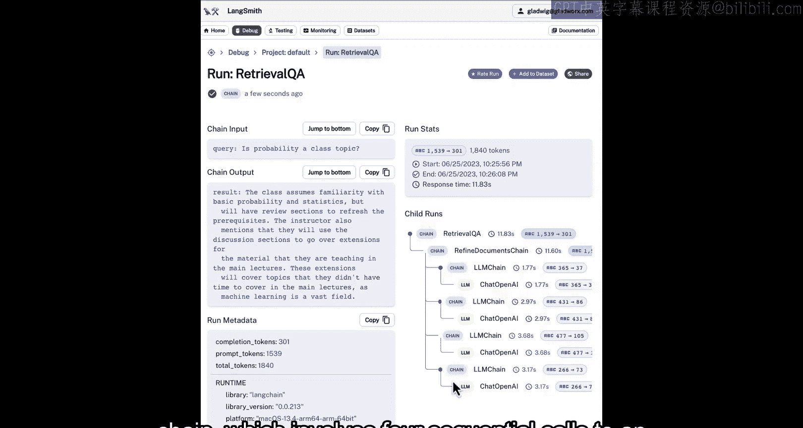

Let's take a look at the first call in this chain to see what's going on。Here。

 we've got the prompt right before it's sent to the language model。

 We can see a system message that's made up of a few bits。This piece， context information is below。

 is part of the system message， part of the prompt template that we defined ahead of time。

This next bit， all this text here。 This is one of the documents that we retrieved。

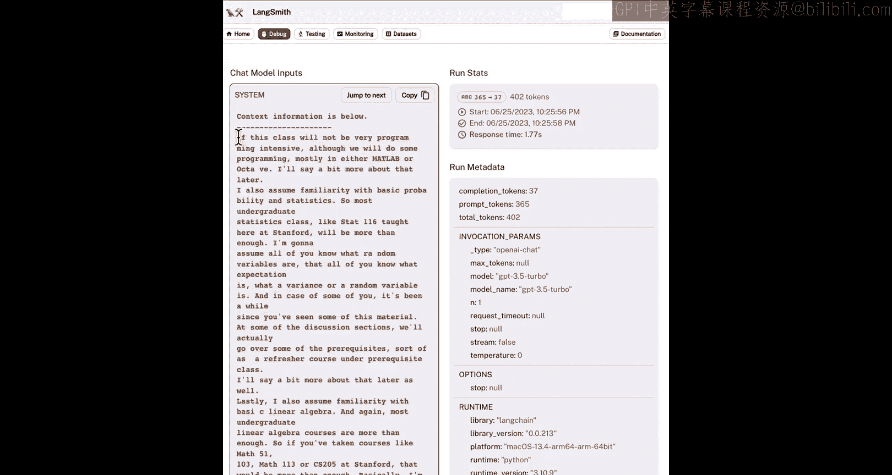

We've then got the user question down here， and then we've got the answer right here。

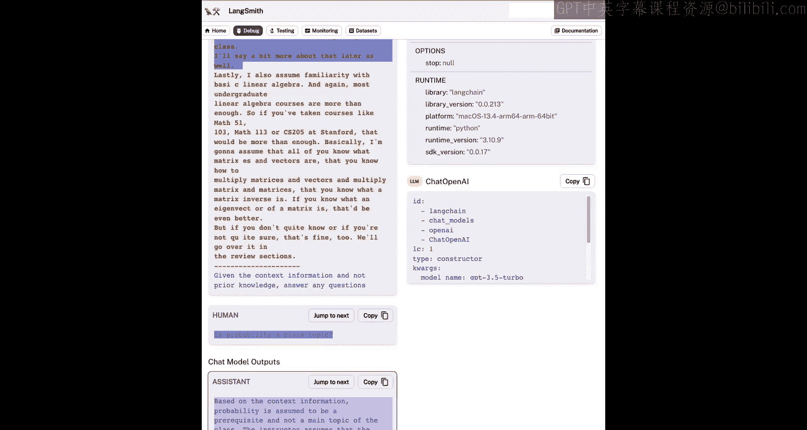

If we then go back。We can look at the next call to the language model。Here。

 the final prompt that we send to the language model is a sequence that combines the previous response with new data and then asks for an improved response。

 so we can see here that we've got the original user question。 We've then got the answer。

 This is the same one as before。

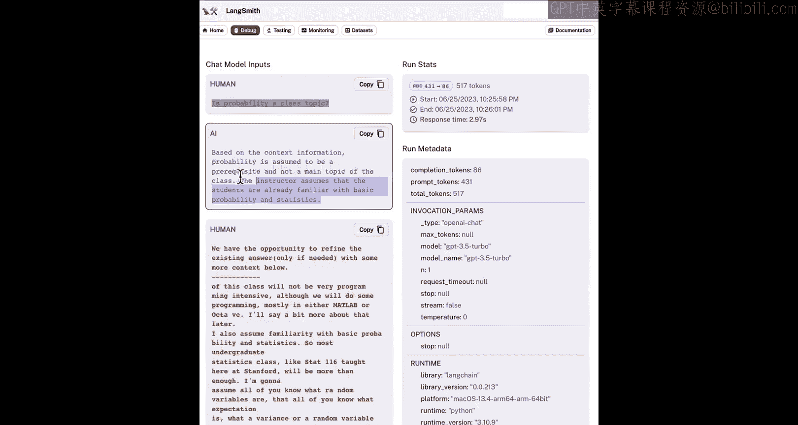

And then we're saying we have the opportunity to refine the existing answer only if needed with some more context below。

 this is part of the prompt template， part of the instructions。

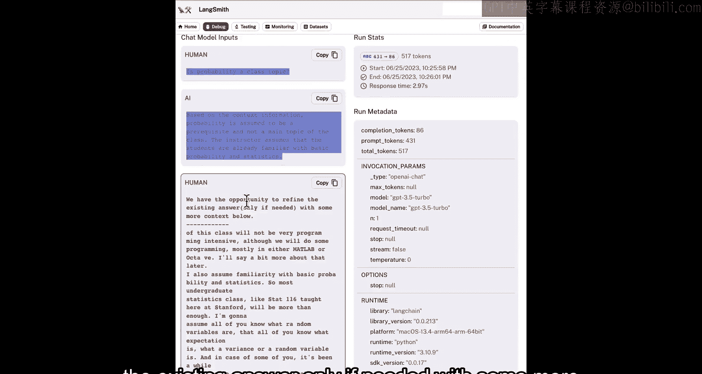

The rest of this is the document that we retrieved， the second document in the list。

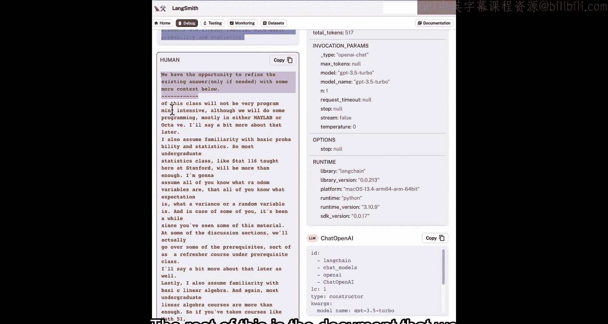

And then we can see at the end， we have some more instructions， given the new context。

 refine the original answer to better answer the question。

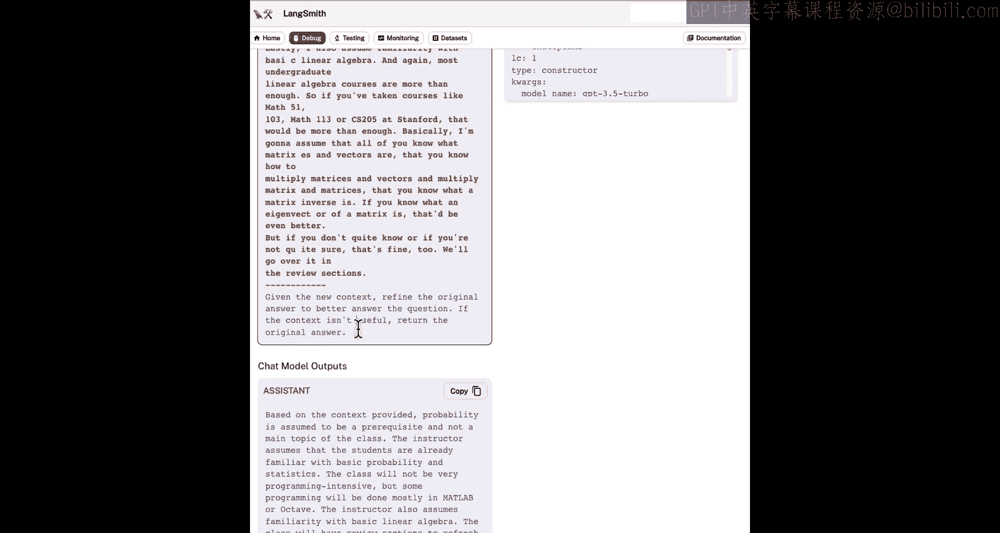

And then down below， we get a final answer。But this is only the second final answer。

 and so this runs four times， this runs over all the documents before it arrives at the final answer。

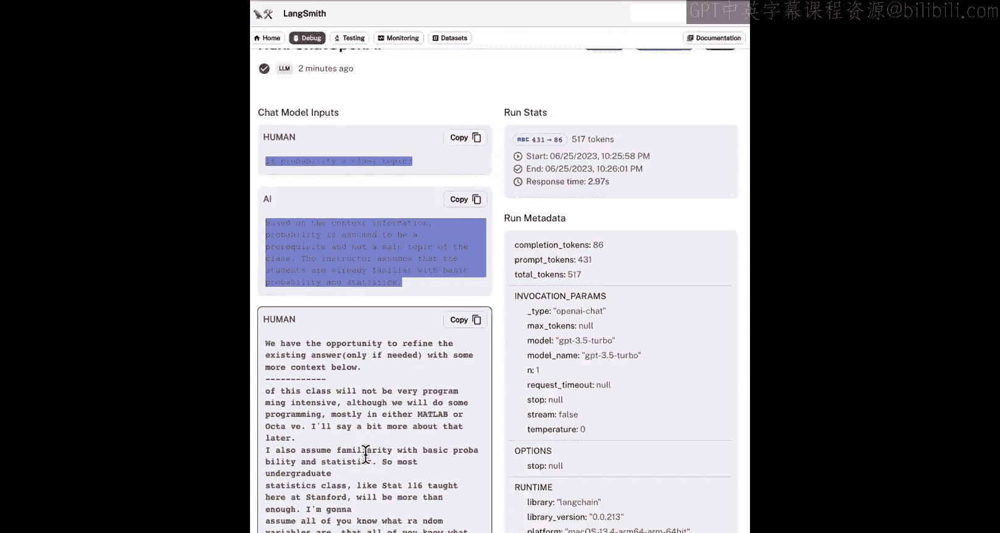

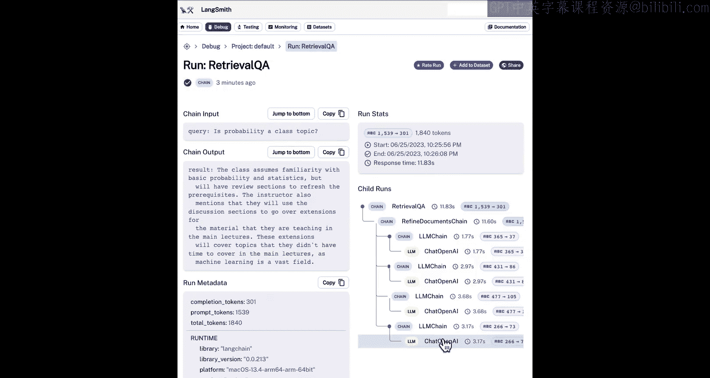

And that final answer is right here， the class assumes familiarity with basic probability and statistics。

 but willll have review sections to refresh the pre requisites。

You'll notice that this is a better result than the mapRduce chain。

 that's because using the refine chain does allow you to combine information albeit sequentially。

 and it actually encourages more carrying over of information than the mapreduce chain。

This is a good opportunity to pause， try out some questions， try out some different chains。

 try out some different prompt templates， see what it looks like in the UI。

 there's a lot to play around with here。

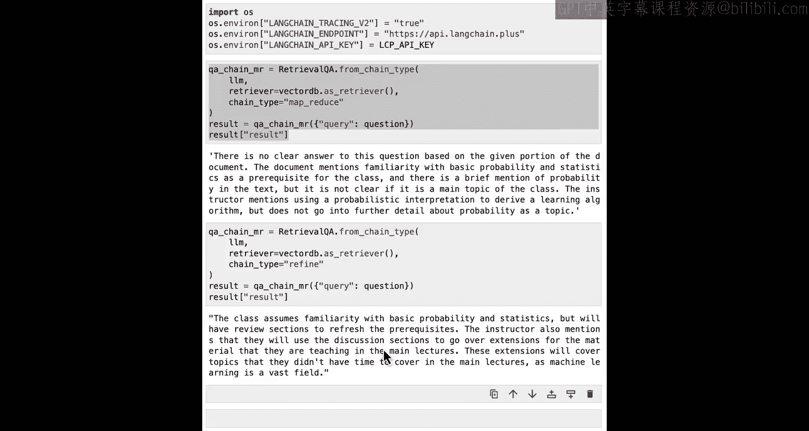

One of the great things about chatbots and why they're becoming so popular is that you can ask follow up questions。

 you can ask for clarification about previous answers。 So let's do that here。Let's create a QA chain。

 and we'll just use the default stuff。Let's ask it a question， is probability a class topic？

And then let's ask it a follow up question， it mentions that probabilities should be a prerequisite。

 and so let's ask why are those prerequisites needed？And then we get back in answer。

 the prerequisites for the class are assumed to be basic knowledge of computer science and basic computer skills and principles。

That doesn't relate at all to the answer before when we were asking about probability。

What's going on here？Basically， the chain that we're using doesn't have any concept of state。

 it doesn't remember what previous questions or previous answers were。For that。

 we'll need to introduce memory， and that's what we'll cover in the next section。

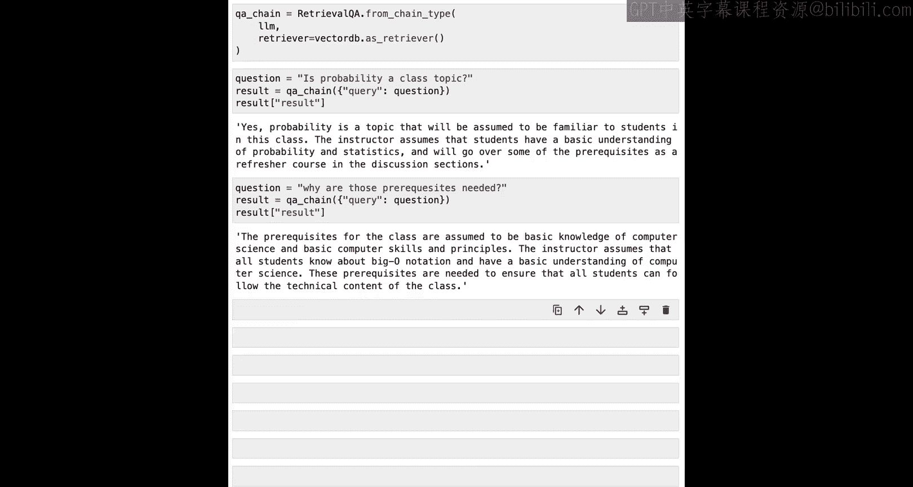