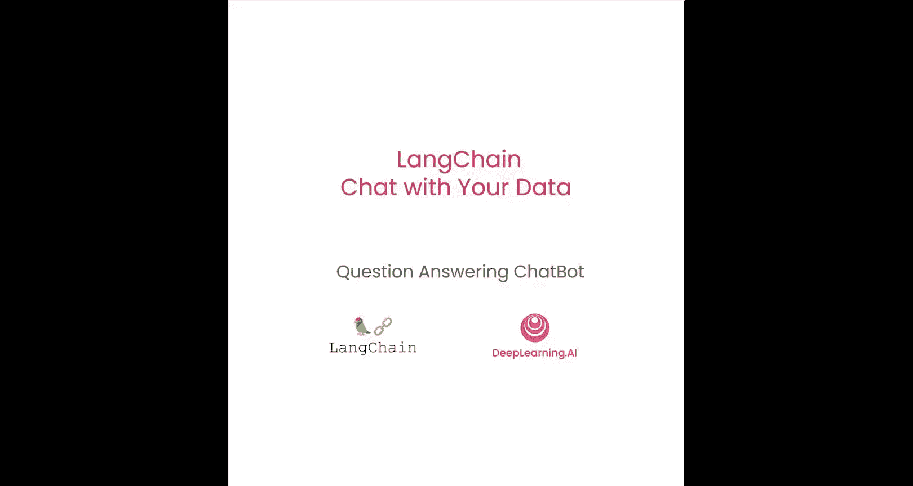
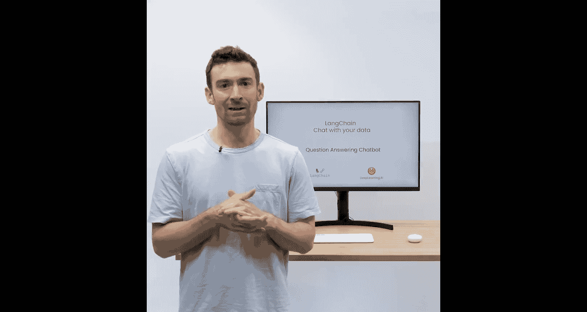
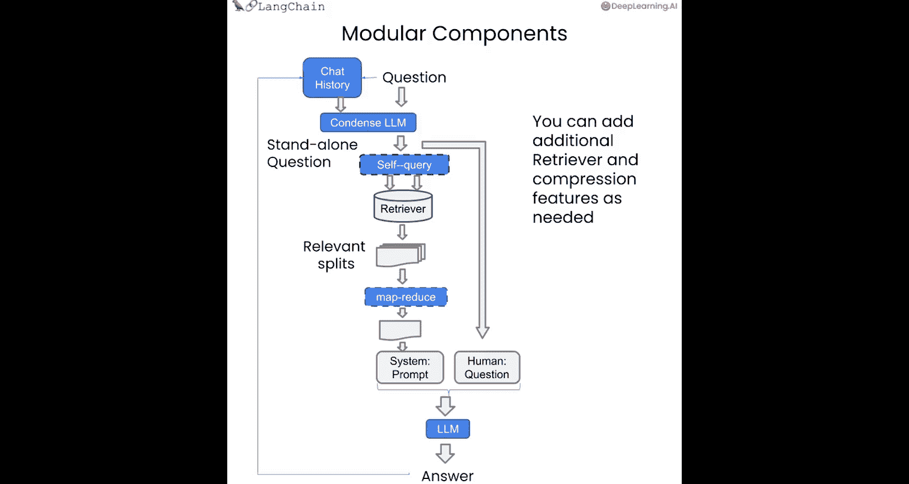
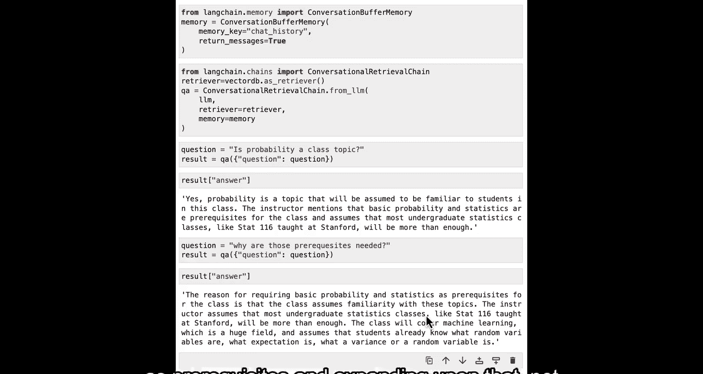
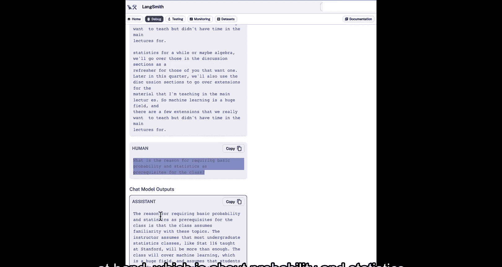
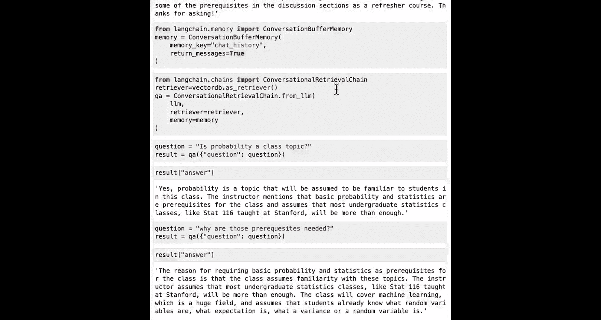
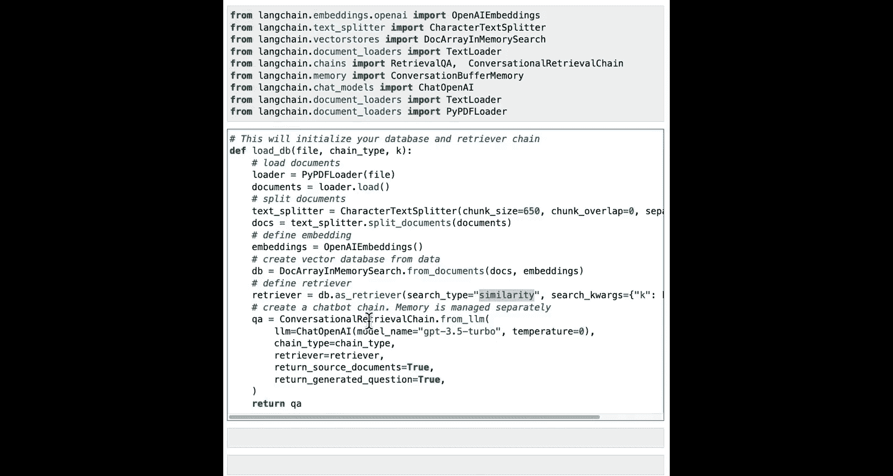
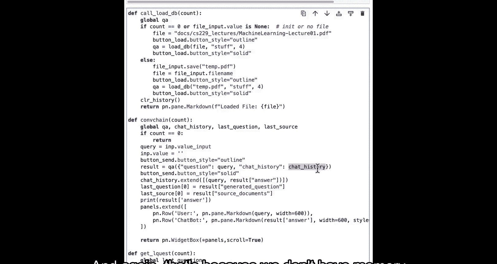
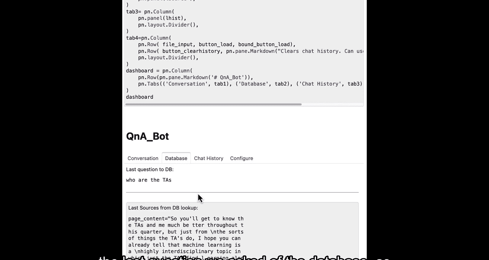
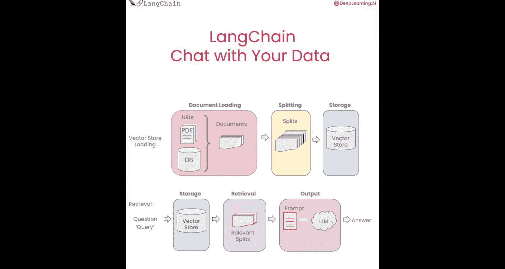

# 吴恩达最新《LangChain：与你的数据对话》｜langchain-chat-with-your-data｜中英字幕 - P7：LangChain2_L6-v4.zh_en - GPT中英字幕课程资源 - BV148411D7d2

We're so close to having a functional chatbot。 We started with loading documents， then we split them。

 then we created a vector store。 We talked about different types of retrieval。

 We've shown that we can answer questions， but we just can't handle followup questions。

 We can't have a real conversation with it。 The good news is we're gonna to fix that in this lesson。

 Let's figure out how。😊。

We're now going to finish up by creating a question answering chat app。

What this is going to do is it's going to look very similar to before。

 but we're going to add in this concept of chat history。

 and this is any previous conversations or messages that you've exchanged with the chain。

What that's going to allow it to do is it's going to allow it to take that chat history into context when it's trying to answer the question。

 so if you're asking a follow up question， it'll know what you're talking about。

An important thing to note here is that all the cool types of retrieval that we talked about up to this point。

 like self query or compression or anything like that， you can absolutely use them here。

All the components we talked about are very modular and can fit together nicely。

 We're just adding in this concept of chat history。

Let's see what it looks like。First， as always， we're going to load our environment variables。

If you have the platform set up， it might also be nice to turn it on from the beginning。

 there'll be a lot of cool things that will want to see what's going on under the hood。

We're going to load our vector store that has all the embeddings for all the class materials。

We can run through basic similarity search on the vector store。

We can initialize the language model that we're going to use as our chatbot。

And then and this is all from before， which is why I'm skimming through it so quickly。

 we can initialize a prompt template， create a retrieval QA chain。

 and then pass in a question and get back a result。But now let's do more。

 Let's add some memory to it。 So we're going to be working with conversation buffer memory。

 And what this does is it's just going to simply keep a list of buffer of chat messages in history。

 and it's going to pass those along with the question to the chatbot every time。

We're going to specify memory key， chat history， this is just going to line it up with an input variable on the prompt。

 and then we're going to specify return messages equal true。

 This is going to return the chat history as a list of messages as opposed to a single string。

This is the simplest type of memory for more in depth look at memory。

 go back to the first class that I taught with Andrew， we covered it in detail then。

Let's now create a new type of chain， the conversational retrieval chain。

We pass in the language model， we pass in the retriever， and we pass in memory。

The conversational retrieval chain adds a new bit on top of the retrieval QA chain， not just memory。

 specifically what it adds is it adds a step that takes the history and the new question and condenses it into a standalone question to pass to the vector store to look up relevant documents。

We'll take a look at this in the UI after we run it and see what effect it has。But for now。

 let's try it out。 We can ask a question， this is without any history and see the result we get back。

And then we can ask a follow up question to that answer。 This is the same as before。 So we're asking。

 is probability a class topic， We get some answer。The instructor assumes that students have basic understanding of probability and statistics。

 And then we asked， why are those prerequiites needed。 We get back a result。

 and let's take a look at it。We get back an answer and now we can see that the answer is referring to basic probability and statistics as prerequisites and expanding upon that。

 not getting confused with computer science as it had before。

Let's take a look at what's going on under the hood in the UI。

So here we can already see that there's a bit more complexity。

We can see that the input to the chain now has not only the question， but also chat history。

Chat history is coming from the memory， and this gets applied before the chain is invoked and logged in this logging system。

If we look at the trace， we can see that there's two separate things going on。

 there's first a call to an item， and then there's a call to the stuff documents chain。

Let's take a look at the first call。We can see here a prompt。With some instructions。

 given the following conversation， a follow up question。

 rephrase the follow up question to be a standalone question。Here we have the history from before。

 so we have the question we asked first is probability a class topic。

 we then have the assistance answers。And then out here we have the standalone question。

 what is the reason for requiring basic probability and statistics as prerequisites for the class？

What happens is that standalone answer is then passed into the retriever。

 and we retrieve four documents or three documents or however many to be specified。

We then pass those documents to the stuff documents chain and try to answer the original question。

 so if we look into that。We can see that we have the system answer。

Use the following pieces of context to answer the user's question。 We've got a bunch of context。

And then we have the standal in question down below。And then we get an answer。

 and here's the answer that is relevant for the question at hand。

 which is about probability and statistics as prerequisites。

This is a good time to pause and try out different options for this chain。

You can pass in different prompt templates， not only for answering the question。

 but also for rephrasing that into a standalone question， you can try different types of memory。

Lots of different options to pull out of here。

After this， we're going to put it all together in a nice UI。

There's going to be a lot of code for creating this UI。

 but this is the main important bit right here。Specifically。

 this is a full walkthrough of basically this whole class。

So we're going to load a database and retriever chain。We're going to pass in a file。

 we're going to load it with a PDF loader， where they're going to load it into documents。

 we're going to split those documents， so we're going to create some embeddings and put it in a vector store。

We're then going to turn that vector store into a retriever。

 We're going to use similarity here with some search cogs of K。

 which we're going to set equal to a parameter that we can pass in。

 and then we're going to create the conversational retrieval chain。

One important thing to note here is that we're not passing in memory。

We're going to manage memory externally for the convenience of the GuoeI below。

 That means that chat history will have to be managed outside the chain。

We then have a lot more code here， we're not going to spend too much time on it。

 but pointing out that here we're passing in chat history into the chain and again that's because we don't have memory attached to it and then here we're extending chat history with the result we can then put it all together and run this to get a nice UI through which we can interact。

With our chatbot。Let's ask you a question。Who are the Ts。The Ts are Paul Bumt， Katie Chin。

You'll notice here that there's a few tabs that we can also click on。See other things。

So if we click on the database， we can see the last question we asked of the database。

As well as the sources， we got back from the look up there。So these are the documents。

 these are after the splittings happened， these are each chunk that we've retrieved。

We can see the chat history with the input and the output。

 and then there's also a place to configure it where you can upload files。We can also ask follow ups。

So let's ask， what are their majors。And we get back in answer about the previously mentioned Ts。

 so we can see that Paul is studying machine learning and computer vision。

 while Katie is actually a neuroscientist。This is basically the end of the class。

 so now is a great time to pause， ask it a bunch more questions， upload your own documents here。

 and enjoy this end to end question answering bot complete with an amazing notebook UI。

 and that brings this class on Langcha chat with your data to an end。In this class。

 we've covered how to use L chainin to load data from a variety of document sources using Lang chain's 80 plus different document loaders。

From there， we split the documents into chunks and talk about a lot of the nuances that arrive when doing so。

After that， we take those chunks， create embeddings for them， and put them into a vector store。

 showing how that easily enables semantic search。But we also talk about some of the downsides of selanic search and where it can fail on the certain edge cases that arise。

The next thing that we cover is retrieval， maybe my favorite part of the class。

Where we talk about a lot of new and advanced and really fun retrieval algorithms for overcoming those edge cases。

We combine that with LLMs in the next session where we take those retrieved documents。

 we take the user question， we pass it to an LLM， and we generate an answer to the original question。

 but there's still one thing messing， which is the conversational aspect of it。

And that's where we finish out the class by creating a fully functioning end to end chatbot over your data。

I've really enjoyed teaching this class， I hope you guys have enjoyed taking it。

 and I want to thank everyone in the open source who has contributed a lot of the things that make this class possible。

 like all the prompts and a lot of the functionality that you see。

As you guys build with Langcha and discover new ways of doing things and new tips and techniques。

 I hope that you share what you'll learn on Twitter or even open up a PR in LangChain it's a really fast moving field and it's an exciting time to be building。

Look forward to seeing everything。