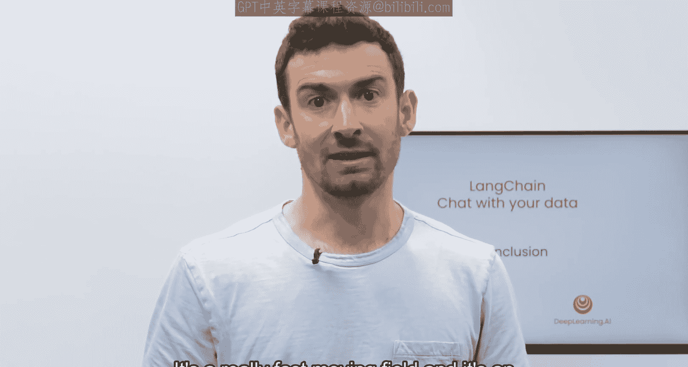

# 吴恩达最新《LangChain：与你的数据对话》｜langchain-chat-with-your-data｜中英字幕 - P8：sc_LangChain_C2_Conclusion-v3.zh_en - GPT中英字幕课程资源 - BV148411D7d2

And that brings this class on Lcha， chat with your data to an end。In this class。

 we've covered how to use L chainin to load data from a variety of document sources using Lang chain's 80 plus different document loaders。

From there， we split the documents into chunks and talk about a lot of the nuances that arrive when doing so。

After that， we take those chunks， create embeddings for them， and put them into a vector store。

 showing how that easily enables semantic search。 But we also talk about some of the downsides of semantic search and where it can fail on the certain edge cases that arise。

The next thing that we cover is retrieval， maybe my favorite part of the class。

 where we talk about a lot of new and advanced and really fun retrieval algorithms for overcoming those edge cases。

We combine that with LLMs in the next session where we take those retrieved documents。

 we take the user question， we pass it to an LLM and we generate an answer to the original question。

 but there's still one thing missing， which is the conversational aspect of it。

 and that's where we finish out the class by creating a fully functioning end- to- end chatbot over your data。

I've really enjoyed teaching this class， I hope you guys have enjoyed taking it。

 and I want to thank everyone in the open source who has contributed a lot of the things that make this class possible。

 like all the prompts and a lot of the functionality that you see。

As you guys build with LangChain and discover new ways of doing things and new tips and techniques。

 I hope that you share what you'll learn on Twitter or even open up a PR in LangChain。

 It's a really fast moving field and it's an exciting time。

 I really look forward to seeing how you apply everything that you learned in this class。

