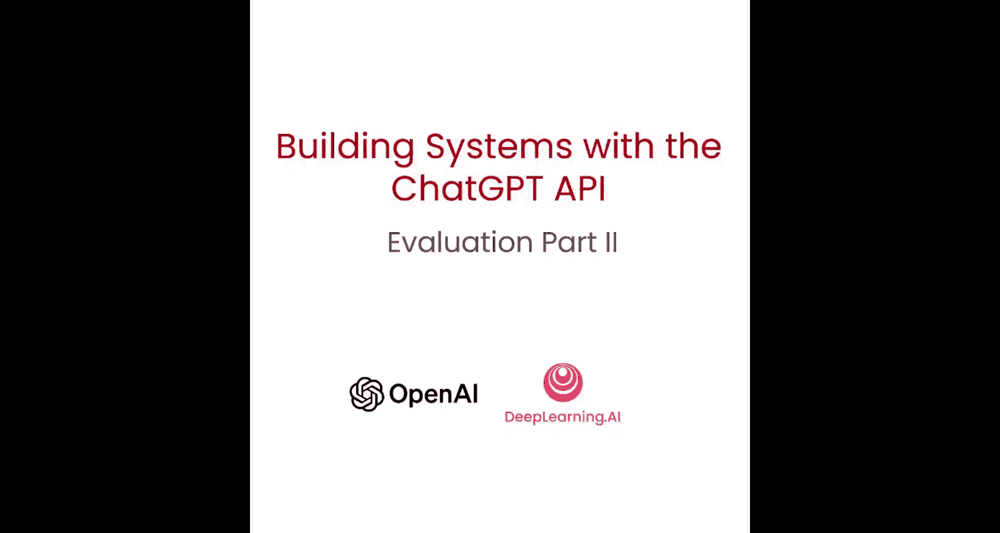
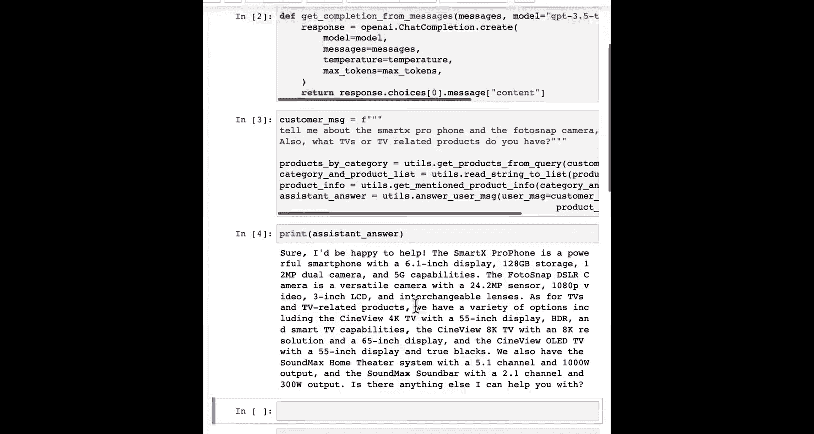
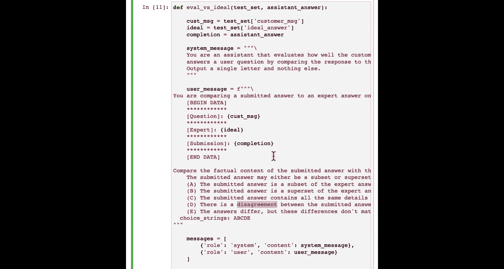

# 吴恩达最新《使用ChatGPT API构建系统》｜Building Systems with the ChatGPT API｜中英字幕 - P10：10_sc-openai-c2-L9-vid10_1.zh_en - GPT中英字幕课程资源 - BV1zX4y187dw

In the last video you saw how to evaluate an OOM output in an example where it had the right answer and so could write down a function to explicitly just tell us if the OM output the right categories and list of products。

 but one of the OM is used to generate text Then there isn't just one right piece of text。

 Let's take a look and the approach for how to evaluate that type of OM output。

Here's my usual hopeer functions and given a customer message。

 tell me about the Ss prophone and the fullt camera and so on。

 here are a few us to get me the assistant answer。This is basically the process that Eer had stepped through in earlier videos and so here's the assistant answer。

 sure I we have hope， smartphone， the Ss prophone and so on and so forth。

So how can you evaluate if this is a good answer or not？

ItSee like there are lots of pause for good answers。One way to evaluate this is to write a rubric。

 meaning a set of guidelines to evaluate this answer on different dimensions and then use that to decide whether or not you're satisfied with this answer。

Let me show you how to do that。So let me create a little data structure to store the customer message as was the product info。

So here I'm going to specify a prompt for evaluating the assistant answer using what's called a rubric。

 I'll explain in a second what that means。But this prompt says in the system message。

 your an assistant evaluates how well the customer service agent answers the user question by looking at the context that the customer service agent is using the generate response。

 so this response is what we had further up the notebook that was the assistant answer。

And we're going to specify the data in this problem。What the customer message？

Was the context that is was the product and category information that was provided and then what was the output of the LM？

And then this is a rubric， so we want the OM to compare the fracture content is limited as of the content or you know difference in style gramar punctuation。

 and then we wanted to check a few things like is the assistant response based only on the content provided。

Does the answer include information that is not provided in the context。

 is there any disagreement between response and the context？

So this is called a rubric and disspecifies what we think。

The answer should get right for us to consider it a good answer。Then finally。

 we wanted to print out yesla no and so on。And now， if we were to。Run this evaluation。

This is what you get。So it says the assistant response is based on concept provided， it does not。

 in this case seem to make up new information。There isn't disagreements， user ask two questions。

 answer question one and answer question two， so answer both questions。

So we would look at this output and maybe conclude that this is a pretty good response。

And one note here I'm using the Cha G 3。5 tu model for this evaluation for a more robust evaluation。

 it might be worth considering using G 4， because even if you deploy 3。

5 tu in production and general logex if your evaluation is the most sporadic exercise。

 then it may be。Prudent to pay for the somewhat more expensive GP4 API call to get a more rigorous evaluation of the output of one design pattern I hope you take away from this is that when you can specify a rubric。

Meaning a list of criteria by which to evaluate an LM output。

 then you can actually use another API call to evaluate your first LM output。

There's one other design patterns that could be useful。For some applications。

Which is if you can specify an ideal response。 So here I'm going to specify a test example where the customer message is。

 tell me about the Sx profile and so on。 And here's an ideal answer。

 So this is if you have an expert human customer service representative write a really good answer。

 And the expert says this would be a great answer。 Of course， the Sx profile and so on。

 and goes on to give a lot of hopeful information。😊。

Now it is unreasonable to expect anyLM to generate this exact answer word for words。

 and in classical national language processing techniques。

 there are some traditional metrics for measuring if the LM output is similar to this expert human written output。

 for example there' something called the blue School BL EU that you can search online to read more about that can measure how similar one piece of text is from another。

But it turns out there's an even better way。Which is you can use a prompt。

whichch I'm going to specify here to ask an LOM to compare how well the automatically generated customer serviceization output corresponds to the ideal expert response that was written by a human that I just showed up above。

Here's the prompt we can use， which is we're going to use an OM and tell it to be an assistant。

 that evaluates how will the customer service agent。As to user the question。

 by comparinging the response， that was the automatically generated one to the ideal expert human written response。

And so we're going to give it the data， which is was the customer request was the expert written idea response and then what did ROM actually output？

And this rubric comes from the Open AI Open source EvalS framework。

 which is a fantastic framework with many evaluation methods contributed both by open AI developers and by the broader open source community。

In fact， if you once， you could contribute and eval to that framework yourself。

To help others evaluate their large languageggage model outputs。 So in this rubric。

We tell the OM to compare the factual content to the submitted answer of the expert answer。

 a no difference in styleogram or punctuation and feel free to pause the video and read through this in detail。

 but the key is we ask it to carry the comparison and output a score from A to E。

 depending on whether the submitted answer is a subset of the expert answer and it's fully consistent versus the submitted answer is a superet of the expert answer。

 but it's fully consistent with it， this might mean it hallucininated or made up some additional facts。

Civvic answer contains all the details as a。Exponentcer。

Whether there's disagreement or whether the answers differ。

 but these differences don't matter from the perspective of factuality。

And the L will pick whichever of these seems to be the most appropriate description。

 So here's the assistant answer that we had just now。 I think is a pretty good answer。

 But now let's see what the things when it compares the assistant answer to test and I。

 looks like a got an A。And so it thinks the submit an answer is a subset of the exp answer and is fully consistent with it。

 And that sounds right to me this assistant answer is much shorter than the long exp answer up top。

 but it does hopefully is consistent Once again， I'm using G3。5 terrible in this example。

 but to get a more rigorous evaluation just it might make sense to use GP4 in your own application。

Now， let's try something totally different。Have a very different assistant answer。

 life is like a box of chocolate， quote from a movie called Forreest Gump。

And if we were to evaluate that， it outputs D， and it concludes that there's a disagreement between to submit an answer。

Life is like a box of chocolate and the expedanza， so it correctly assesses this to be a pretty terrible answer。

And so that's it I hope you take away from this video two design patterns first even without an expert provided ideal answer。

 if you can write a rubric， you can use 1 LM to evaluate another OM's output。And second。

 if you can provide an expert provided I answer， then that can help your OEM M better compare if and if a specific assistant output is similar to the expert provided I answer。

 I hope that helps you to evaluate your。OM systems outputs so that both during development as was when the system's running and you're getting responses。

 you can continue to monitor its performance and also have these tools to continuously evaluate and keep on improving the performance of your system。

