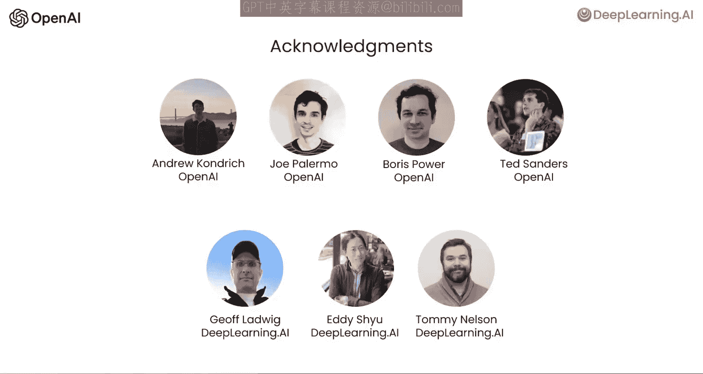
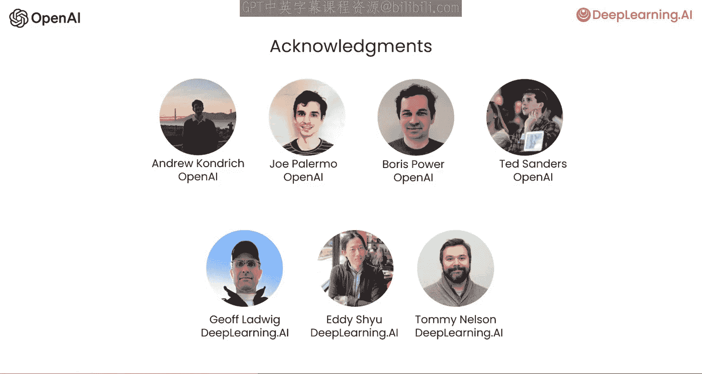

# 吴恩达最新《使用ChatGPT API构建系统》｜Building Systems with the ChatGPT API｜中英字幕 - P1：1_overview_1.zh_en - GPT中英字幕课程资源 - BV1zX4y187dw

Welcome to this course on building systems using the chat GT APIPrevious。

 Eer and I had presented the course on how to prompt chatGT。

 but a system requires much more than a single prompt or a single call to an LOM or large language model。

In this short course， we'd like to share with you best practices for building a complex application using an LOM。

We'll use the running example of building an end to end customer service assistance system that chains multiple calls to a language model using different instructions depending on the output of the previous call and sometimes even looking things up from external sources So for example。

 given a user input like tell me about what TVs are for sale We'd use the following steps to process this First you can evaluate the input to make sure it doesn't contain any problematic content。

Such as hateful speech。Next the system will process the input。

 it will identify what type of query this is， is it a complaint or a product information request and so on。

 once it has established that it is a product inquiry。

It will retrieve the relevant information about Ts and use a language model to write a helpful response。

Finally， you'll check the output to make sure it isn't problematic。

 such as inaccurate or inappropriate answers One theme you see throughout this course is that an application often needs multiple internal steps they're invisible to the end user you often want to sequentially process the user input in multiple steps to get to the final output that is then shown to the user。

😊，And as you build complex systems using LOMs over the long term。

 you often want to also keep on improving the system。

 so also share with you what the process of developing an LOM based application feels like and some best practices for evaluating and improving a system over time。

We're grateful to many people that had contributed to this short course on the open AI side。

 We're grateful to Andrew Cndrick， Joe Polermo， Boris Power and Ted Sanders。

 and from the deep learningning AI team， thank you also to Jeff Ludwig， Eddie Shu and Tommy Nelson。

Through this short course we hope you'll come away confident in your abilities to build a complex multistep application and also be set up to maintain and keep on improving it Let's dive in。

😊。