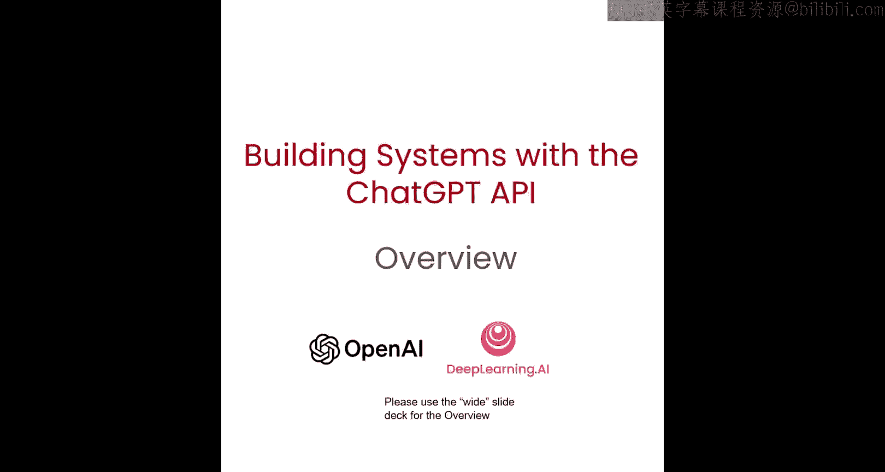
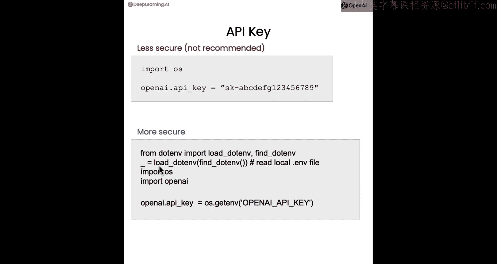
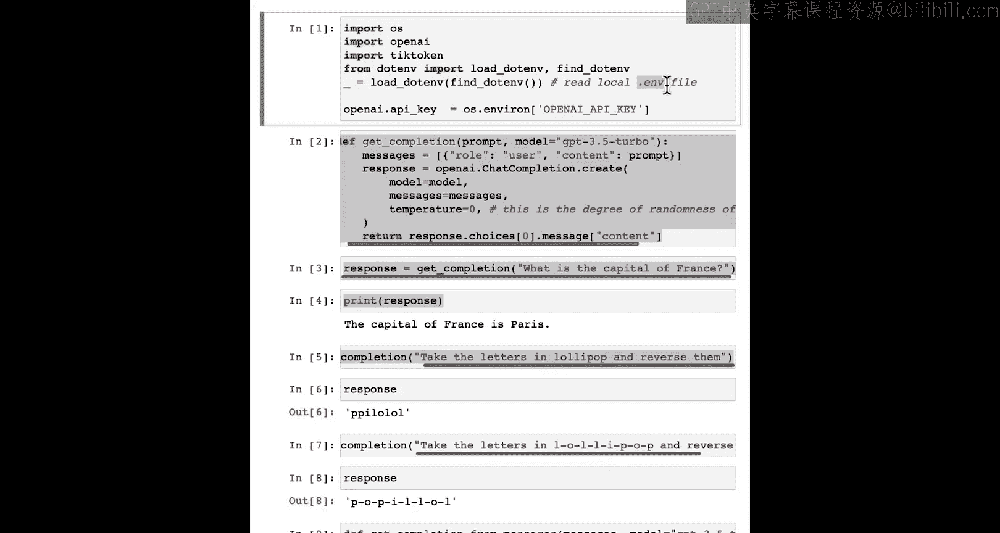
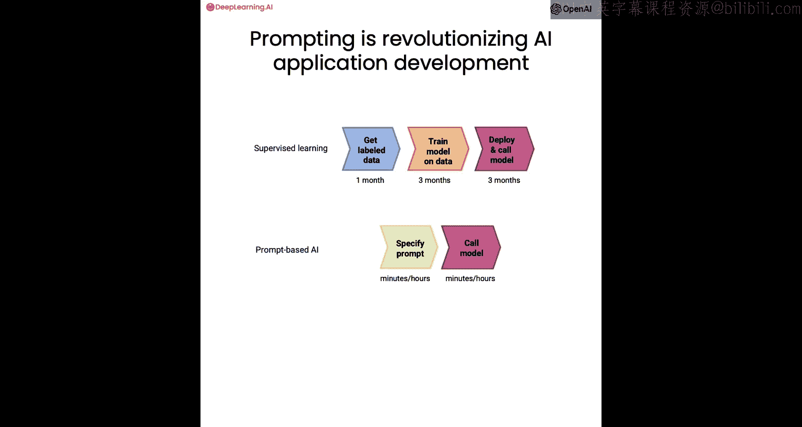

# 吴恩达最新《使用ChatGPT API构建系统》｜Building Systems with the ChatGPT API｜中英字幕 - P2：2_sc-openai-c2-L1-vid2_1.zh_en - GPT中英字幕课程资源 - BV1zX4y187dw

In this first video， I'd like to share a you an overview of how LOM's large language models work We'll go into how they are trained。

 as well details like the tokenizer and how that can affect the output of when you prompt an LOM and we'll also take a look at the chat format for LOMs。

 which is a way of specifying both system as well user messages and understand what you can do with that capability Let's take a look。

😊。

First， how does a large language model work？You're probably familiar with the next generation process where you can give a prompt。

 I love eating and ask an LOM to fill in what the things are likely completions given this prompt and it may say bakekers of cream cheese or my mother's melo or else with friends。

But how did the model learn to do this？Demas， who used to train an LOM is actually supervised learning。

In supervised learning， a computer learns in input outputs or X or Y mapping using label training data。

 So for example， if you're using supervised learning to learn to classify the sentiment of restaurant reviews。

 you might collect a training set like this where a review like the past driving time。

 which is great is labeled as a positive sentiment review and so on and。

S slow the food social is negative and the ER GT was fantastic， has a positive label， by the way。

 both E and I were born in the UK and so both of us like our ERGT and so the process for Subvis learning is typically to get labeled data and then train the model on data and after training you can then deploy and call the model and give it a new restaurant review like best pizza I've ever had you hopefully output it that has a positive sentiment。

It turns out that supervised learning is a whole building block for training large language models。

 specifically a large language model can be built by using supervised learning to repeatedly predict the next word。

Let's say that。In your training sets of a lot of text data。

 you have to sentence my favorite food is a bagel with cream trees and mos。

Then this sentence is turned into a sequence of training examples where given a sentence fragment。

 my favorite fruit is a。If you want to predict the next word in this case was bagel。

 or given the sentence fragment or sentence prefix， my favorite food is a bagel。

 the next word in this case would be with and so on。

And given a large training set of hundreds of billions or sometimes even more words。

 you can then create a massive training set where you can start off with part of a sentence or part of a piece of text and repeatedly ask the language model to learn to predict what is the next word。

 So today， there are broadly two。Major types of large language models。

The first is a base OOM and the second， which is what is increasingly used。

 is the instruction to an OM。So the base OM repeatedly predicts the next word based on text training data。

And so if I give it a prompt， once upon a time there was a unicorn， then it may。

 by repeatedly predicting one word at a time， come up with a completion that tells a story about their unicorn living in magical forest with our unicorn friends。

Now， a downside of this is that if you were to prompt it with what is the capital of France。

 quite plausible that on the internet， there might be a list of quiz questions about France。

 so it may complete this with what is France's largest city， what is France's population and so on。

But what you really want is you wanted to tell you what is the capital of France probably rather than list all these questions。

So an instruction to an OM instead tries to follow instructions and will hopefully say the couple of Francis Paris。

How do you go from a base OM to an instruction to OM？

This is what the process of training an instruction to an LOM like Chat EC looks like。

You first train a base OM on the lot of data。 So hundreds of billions of words， maybe even more。

 And this is a process that can take months on a large superpututing system。

After you've trained the base O M， you would then further train the model by fine it on a smaller set of examples where the output。

Follows an input instruction。 And so， for example， you may have contractors。

Hope you write a lot of examples of an instruction and then a good response to an instruction。

 and that creates a training set to carry out this additional fine tuning so that learns to predict what's the next word if it's trying to follow an instruction。

After that， to improve the quality of the LLM's output。

 a common process now is to obtain human ratings of the quality of many different LLM outputs on criteria such as whether the output is helpful。

 honest and harmless。And you can then further tune the LOM to increase the probability of its generating the more highly rated outputs。

 and the most common technique to do this is ROHF， which stands for reinforcement Learning from Human feedback。

And whereas training the base LM can take months， the process of going from the base LM to the instruction to an LM can be done in maybe days on much more。

 on a much more modest size dataset and much more modest size computational resources。

 So this is how you would use an L M going import a few libraries。

I'm going to load my open AI key here。 I'll say a little bit more about this later in this video。

 and here's a helper function to get a completion given a prompt。

If you have not yet installed the open AI package on your computer。

 you might have to run Pip install open AI， but I already have an installed here。

 So I won't run that。 And let me hit Shain。To run these。 and now I can set response equals。

Get completion。What is the capital of France？And抽福。有も。Give me a good result。Now。About now。

 in the description of the large language model so far， I talked about it as。

Predicting one word at a time。 But there's actually one more important technical detail。

If you were to tell it， take the letters in the word lollli popop。And reverse them。

This seems like an easy tos， maybe like a four year old could do this toss。

But if you were to ask Ch UPT to do this。It actually。Outputs are somewhat gobble， whatever this is。

 This is not L， O， L I PO P。 This is not。Loip pop's letters reverse。

 So why is chat Gp unable to do what seems like a relatively simple task。

 It turns out that there's one more important detail for how large language model works。

 which is it doesn't actually repeatedly predict the next word。

 instead repeatedly predicts the next token。 And what an actually does。

 is it will take a sequence of characters like learning new things is fun and group the characters together to form tokens that comprise commonly occurring sequences of characters。

 So here， learning new things is fun。 Each of them is a fairly common word。

 And so each token corresponds to one word or one word in a space or an exclamation mark。😊。

But if you were to give it input with some somewhat less frequently used words。

 like prompting a powerful developer to， the word prompting is still not that common in the English language。

 but certainly gaining in popularity and so prompting is actually broken down to three tokens with and in because those three are commonly occurring sequences of。

Letters。And if you were to give it the word lollipop。

 the tokenizer actually breaks us down into three tokens， L and O and EPop。

 and because Ch GBT isn't seeing the individual letters is instead seeing these three tokens。

It's more difficult for it to correctly print out these letters in reverse order。

 So here's a trick you can use to fix this。If I were to add dashes。

Between these letters and spaces with work to or other things will work too until take the letters and lollipop and reverse them。

 then it actually does a much better job This O O I P O P。

 And the reason for that is if you pass it lollipopop with dashes in between the letters。

 it tokenizes each of these。Characters into an individual token making it easier for it to see the individual letters and print them out in reverse order。

So if you ever want to use ChG to play a word game like Wordle or scrap or something。

 this nifty trick helps it to better see the individual letters of the words。

For the English language， one token roughly on average。

 corresponds to about four characters or about three quarters of a word。

And so different large language models will often have different limits on the number of input plus output tokens it can accept The input is often called the context and the output is often called the completion and the model GPT 3。

5 terrible， for example， the most commonly used ChGT model has the limit of roughly 4000 tokens in the input plus output。

So if you try to feed in an input context that's much longer than this。

 so actually throw an exception or generate an error。Next。

 I want to share with you another powerful way to use。N OM API。

Which involves specifying separate system， user and assistant messages。Let me show you an example。

 then we can explain in more detail what it's actually doing。

Here's a new helper function called Get completion from messagesss。 And when we prompt this OM。

 we are going to give it multiple messages。 Here's an example of what you can do。

I'm going to specify first a message in the row of a system， so this a system message。

And the content of the system messages is you're an assistant who responds to the style of Dr。 Seus。

Then I'm going to specify a user message， so the row of the second message is row user and the content of this is write me a very short poem about a happy carrot。

And so let's run that。And with temperature equals 1， I actually never know what's going to come out。

 But okay， that's a cool poem。 Oh， how jolly is this carrot Did I see。

And it actually rhmes pretty well， all right， well done Cha GPD。And so in this example。

 the system message specifies the overall tone of what you want the large language model to do。

 and the user message is a specific instruction that you wanted to carry out given this higher level behavior that was specified in the system message。

Here's an illustration of how it all works。So， this is how the。Chat format works。

The system message sets the overall tone of behavior of the large language model or the assistant。

 and then when you give the user message maybe such as a tell me a joke called write me a poem。

 it will then output。An appropriate response following what you ask for in the user message and consistent with the overall behavior set in the system message。

And by the way， although I'm not illustrating it here。

 if you want to use this in a multiter conversation， you can also input assistant messages。

In this message format to let Chai ChiP know what it had previously said。

If you wanted to continue the conversation based on things that had previously said as well。

But here are a few more examples。If you want to set a tone。To tell it。

 to have a one sentence long output， then in the system message。

 I can say all your responses must be one sentence long。And when I execute this。

 it outputs a single sentence， is no longer a poem not in a style of Dr。 Seus。

 but it's a single sentence， there's a story about the happy carrot。And。If we want to combine both。

 specify the style and the length。Then I can use the system message to say。

 you're an assistant responds to style Delta suus， all your sentences must be one sentence long。

And now。This generates a。Nice one sentence poem。 It was always smiling and never scary。 I like that。

 That's a very happy poem。And then lastly， just the fun。

 if you are using an LM and you want to know how many tokens are you using。

Here's a whole function that is a little bit more sophisticated in that it gets a response from the open AI API endpoint。

 and then it uses other values in the response to tell you how many prompt tokens。

 completion tokens and total tokens were used in your API call。 Let me define that。And if I。

Run this now。Here's a response。 And here is。Accounts of how many tokens we use。 So this output。

 which had 55 tokens， whereas the prompt input had 37 tokens。 So this used up 92 tokens altogether。

When I'm using L models in practice， I don't worry that much， frankly， about the number of tokens。

 I'm using maybe one case where it might be worth checking the number of tokens is if you're worried that the user might have given you too long an input that exceeds the 4000 or token limit of chat GT in which case you could double checkck how many tokens it was and trunc to make sure you're staying within the input token limit of the large language model。

Now， I want to share with you one more tip for how to use a large language model。

Cing the open AI API requires using an API key that's tied to either a free or a paid account。

 And so many developers will write the API key in plain text like this into their Jupyter notebook and this is a less secure way of using API keys that I would not recommend you use because it's just too easy to share this notebook with someone else or checklist into GiHub or something and does end up leaking your API key to someone else。

In contrast。

What you saw me do in the Jupyter notebook was this piece of code where I use a library do n and then run this command load dot n find out n to read a local file which is called dot n that contains my secret key。

And so with this co snippet。I have locally stored a file called dot end that contains my API key。

 and this loads it into the operating systems environmental variable。And then， always start， get n。

Open air API key slows it into this variable。 And in this whole process。

 I don't ever have to enter the API key in plain text and unencryptted plain text into my Jupyterter notebook。

 So this is a relatively more secure and a better way to access the API key。 And in fact。

 this is a general method for storming different API keys from loss of different online services that you might want to use and call from your Jupyterter notebook。

Lastly。I think。The degree to which prompting is revolutionizing AI application and development is still underappated。

In the traditional supervised machine learning work， though。

 like the restaurant review S classification example that I touched on just now。

 if you want to build a classifier to classify a restaurant review positive negative sentiments。

 you at first get a bunch of label data， maybe hundreds of examples， this might take。

 I don't know weeks， maybe a month。Then you would train a model on data and getting an appropriate open source model。

 tuning on a model， evaluating it。 that might take。Days， weeks， maybe even a few months。

And then you might have to find a cloud service to deploy it， and then get your model。

 upload it to the cloud and then run the model and finally be able to call your model and it's again not uncommon common for this to take a team a few months to get working。

In contrast， with prompting based machine learning， when you have a text application。

 you can specify a prompt。 This can take minutes， maybe hours if you need to iterate a few times to get an effective prompt。

And then in hours， maybe at most days， but frankly， more often hours。

 you can have this running using API calls and start making calls the model。

 And once you've done that in just again， maybe minutes or hours。

 you can start calling the model and start making inferences。

And so there are applications that used to take me maybe six months or a year at to build that you can now build in minutes or hours。

 maybe very small numbers of days using prompting， and this is revolutionizing what AI applications can be built quickly。

One important caveat this applies to many unstructured data applications。

 including specifically text applications and maybe increasingly vision applications。

 although the vision technology is much less mature right now， but it's kind of getting there。

 this recipe doesn't really work for structured data applications。

 meaning machine learning applications on tableau data with lots of numerical values and Excel spreadsheets。

 say。But for applications to which this does apply。

 the fact that that AI component can be built so quickly is changing the workflow of how the entire system might be built。

 though the entire system might still take days or weeks or something。

 but at least this piece of it can be done much faster。And so with that。

 let's go on to the next video where ESA will show how to use these components to evaluate the input to a customer service assistant。

 and this will be part of a bigger example that you see developed through this course for building a customer service assistant for an online retailer。

