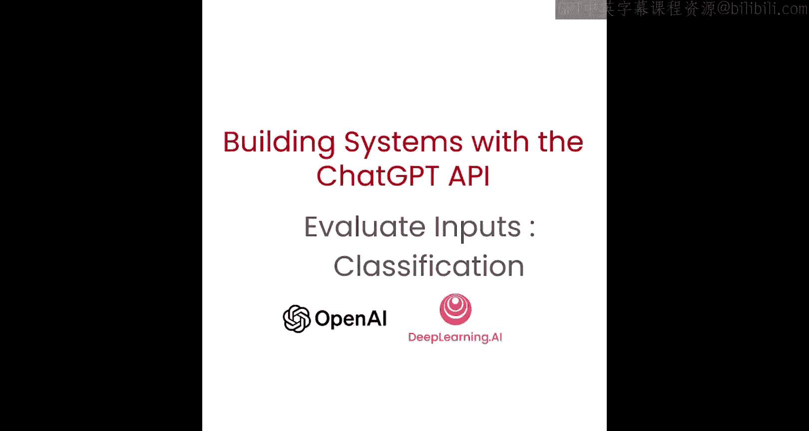
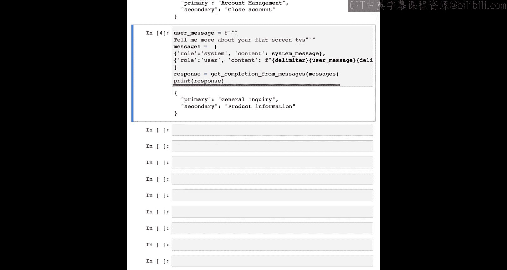

# 吴恩达最新《使用ChatGPT API构建系统》｜Building Systems with the ChatGPT API｜中英字幕 - P3：3_sc-openai-c2-L2-vid3_1.zh_en - GPT中英字幕课程资源 - BV1zX4y187dw

In this section， we'll focus on tasks to evaluate inputs。

 which can be important for ensuring the quality and safety of the system。

For tasks in which lots of independent sets of instructions are needed to handle different cases。

 it can be beneficial to first classify the type of query and then use that classification to determine which instructions to use。

 This can be achieved by defining fixed categories and hard coding instructions that are relevant for handling tasks in a given category。

 For instance， when building a customer service assistant。

 it might be important to first classify the type of query and then determine which instructions to use based on that classification。

 So， for example， you might give different secondary instructions if a user asks to close their account versus if a user asks about a specific product。

 So in the first case， you maybe add additional instructions about how to close the account。

 And then in the second case， you might add additional product information。 But let's see an example。

 and I think it will make it more clear。

So here we have our system message， which is the instruction for the overall system。

 And we're using this delimiter。 and its delimiter is just a way to separate different parts of an instruction or output。

 And it helps the model kind of determine the different sections。 And so for this example。

 we'll use the delimiter for hashtags。 And this is a nice delimiter because it's actually represented as one token。

And so here's our system message。 What we're asking the model。

 So you will be provided with customer service queries。

 The customer service query will be delimed with these hashtag characters。

Classify each query into a primary category and a secondary category and then provide the output in a JSO format with the keys primary and secondary。

 And so we have our primary categories listed here。 So billing， technical support。

 account management or general inquiry。 And then below we have the list of secondary categories。

 unsubscribeable upgrade， etc。And so now let's do an example of a user message。So。

For our first user message， will use。The following。So the user messages。

 I want you to delete my profile and all of my user data。

And then we'll just format this into a messages list with the system message and the user message delimited with these hashtags。

And let's just take a look and see what we think this might be。 So I want you to delete my profile。

 This kind of looks like account management。Maybe close accounts。 So let's see what the model thinks。

Great， so the classification from the model is account management as the primary category and then close account as a secondary。

 And the nice thing about asking for a structured output like a JO is that you can then read this easily into some kind of object。

 So a dictionary， for example， in Python or something else if you're using a different language。

 and then you can use this as the input to a subsequent step。😊，I'll show you another example。

 but also feel free to pause the video now and just try your own user questions and see how the model categorizes them。

So here's another user message。 Tell me more about your flat screen Tvs。

 and we just have the same messages list response from the model， and then we'll just print it。

And here we have。Second categorization， which seems correct。And so in general。

 based on the categorization of the customer inquiry。

 we can now provide a set of more specific instructions to handle the next steps。 In this case。

 we might add kind of additional information about the TVvs versus in this case。

 we might want to give a link to closing the account or something like that。

 We'll learn more about different ways to process inputs in a later video。And in the next video。

 we'll look at more ways to evaluate inputs and specifically ways to ensure that your users are using the system in a responsible way。

