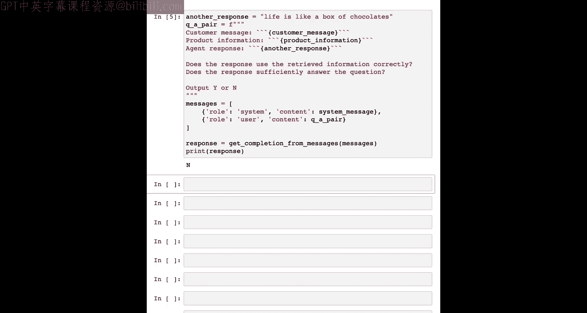

# 吴恩达最新《使用ChatGPT API构建系统》｜Building Systems with the ChatGPT API｜中英字幕 - P7：7_sc-openai-c2-L6-vid7-take-2_1.zh_en - GPT中英字幕课程资源 - BV1zX4y187dw

In this video， well focus on checking outputs generated by the system。

 checking outputs before showing them to users can be important for ensuring the quality。

 relevance and safety of the responses provided to them or use in automation flows。

 well learn how to use the moderation API but this time for outputs and how to use additional prompts to the model to evaluate output quality before displaying them。

So let's dive into the examples。 We've already discussed the moderation API in the context of evaluating inputs。

 Now let's revisit it in the context of checking outputs。

 moderation API can also be used to filter and moderate outputs generated by the system itself。

 And so here's an example。

So， here's。A generated response to the user。And we're going to use the moderation API in the same way that we saw the earlier video。

So let's see if this output is flagged。And as you can see。

 this output is not flagged and has very low scores in all categories， which makes sense given。

The response。In general， it can also be important to check the outputs。 For example。

 if you were creating a chatbot for。Sensitive audiences。

 you could use lower thresholds for flagging outputs。 In general。

 if the moderation output indicates that the content is flagged。

 you can take appropriate actions such as responding with a fallback answer or generating a new response。

Note that as we improve the models， they。Also are becoming less and less likely to return。

Some kind of harmful output。Another approach for checking outputs is to ask the model itself if the generated was satisfactory and if it follows a certain rubric that you define。

 this can be done by providing the generated output as part of the input to the model and asking it to rate the quality of the output。

You can do this in various different ways。 So let's see an example。

So our system message is you are an assistant that evaluates whether customer service agent responses sufficiently answer customer questions and also validates。

Dot。All the facts， the assistant sites from the product information are correct。

The product information and user。And customer service agent messages will be delivered by three Bas。

Respond with a Y or N character with no punctuation。

 Why if the output sufficiently answers the question。

And the response correctly uses product information and no otherwise， output a single letter only。

 And you could also use a chain of thought， reasoning prompt for this。

 This might be a little bit difficult for the model to validate both in one step。

 So you could play around with this。 You could also add some other kind of guidelines。 You could ask。

Give a rubric like a rubric for an exam or grading an essay。

You could use that kind of format and say， does this use a friendly tone in line with our brand guidelines and maybe outline some of your brand guidelines if that's something that's very important to you？

So let's add our customer message。 So this is the initial message used to generate this response。

 And then let's also paste in our product information。

 And so this is the product information we fetched in the previous step for all of the products mentioned in this message。

And now， will。Deefine our comparison。 So the customer message。Is。The customer message。

 product information， and then the agent response， which is the response to the customer that we have from this previous cell。

So let's format this into a messages list and get the response from the model。So the model says yes。

The product information is correct， and the question is answered sufficiently。Well， in general。

 for these kind of evaluation tasks， I also think it is better to use a more advanced model because they're just better at reasoning。

 so something like GBT4。Let's try another example。So this response is。

 life is like a box of chocolates。So let's add our message to do with the output checking。

And the model has determined that this does not sufficiently answer the question or use the retrieved information。

This question， does it use the retrieved information correctly， This is a good。

Prompt to use if you want to make sure that the model isn't hallucinating。

 which is making up things that aren't true。And feel free to pause the video now and try some of your own customer messages。

 responses and adding product information to test how this works。So as you can see。

 the model can provide feedback on the quality of a generated output。

 and you can use this feedback to decide whether to present the output to the user or to generate a new response。

 You could even experiment with generating multiple model responses per user query and then having the model choose the best one to show the user。

 So there's lots of different things you could try。 in general。

 checking outputs using the moderation API is good practice。

 But while asking the model to evaluate its own output might be useful for immediate feedback to ensure the quality of responses in a very。

Small number of cases。 I think it's probably unnecessary， most of the time。

 especially if you're using a more advanced model like GB4。

 I haven't actually seen many people do something like this in production。

 It would also increase the latency and cost of your system。

 because you'd have to wait for an additional call for the model。 and that's also additional tokens。

 if it's really important for your Apple product that。Your error rate is 0。000001%。

 then maybe you should try this approach， but overall。

 I wouldn't really recommend that you do this in practice。In the next video。

 we're going to put together everything we've learned in the evaluateval input section。

 process section and checking output section to build an end to end system。

