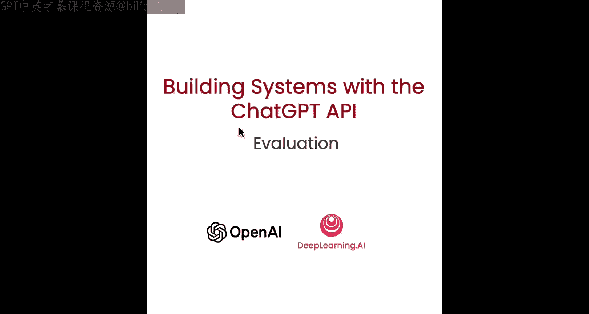
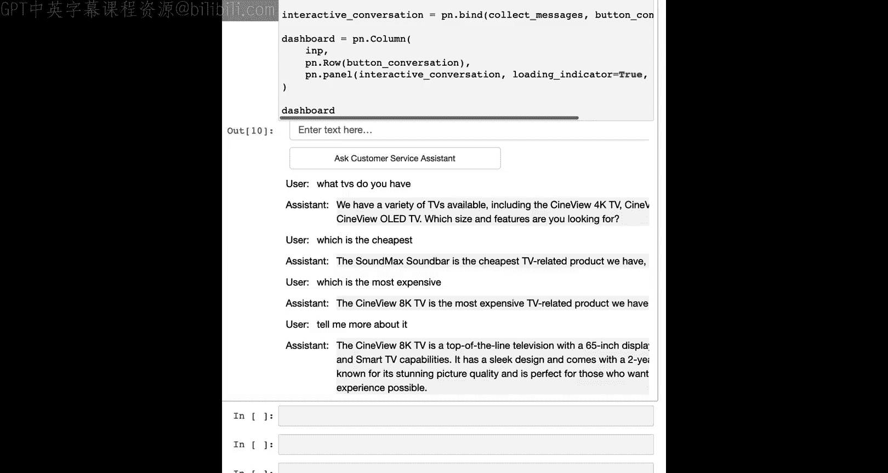

# 吴恩达最新《使用ChatGPT API构建系统》｜Building Systems with the ChatGPT API｜中英字幕 - P8：8_sc-openai-c2-L7-vid8-take-2_1.zh_en - GPT中英字幕课程资源 - BV1zX4y187dw

In this video， we'll put together everything we've learned in the previous videos to create an end to end example of a customer service assistant。

 We'll go through the following steps。 First， we'll check the input to see if it flags the moderation API。

😊。

Second， if it doesn't， we'll extract the list of products。 Third， if the products are found。

 we'll try to look them up in4。Willll answer the user question with the model。 And finally。

 we'll put the answer through the moderation API。 And if it is not flagged。

 we'll return it to the user。So we have our setup。 We have this additional import。 This is。

A Python package we use。For a chatbot U， I。And so I'm going to paste in a function process user message。

 and I'm actually going to run an example first， and then we'll talk through the function。

So we have our user input that we've been using。Tell me about the smartX prophone and the camera。

 Also tell me about Tvs。So let's run this。First， let's run this。So as you can see。

 we're going through the steps。To answer the user question。So the first step， the moderation step。

 the second step is extracting the list of products， the third step。

Is looking up the product information。And so now with this product information。

 the model is asked is trying to answer the question。As we've seen in the previous videos。

And then finally， it puts the response。Through the moderation API， again。

 to make sure it's safe to show to the user。 And so this is the response that we are now familiar with。

And so let's talk through a little bit of what's happening。

 So we have our helper function process user message。It takes in the user input。

 which is the current message and an array of all of the messages so far。

 And this is when we build the chatbot UI。 So the first step。

Checking to see if the input flags and moderation API。 We covered this in a previous video。

If the input is flagged， then。We。Tell the user that we can't process the request。

 If it is not flagged， we try to extract the list of products， as we did in the previous video。

 Then we try to look up the products。And in this case， if no products are found。

 this will just be an empty string。Then we answer the user question。

 so we give the conversation history and the new messages with the relevant product information。

 so we get the response。And then we run this response through the moderation API。If it's flagged。

 will tell the user that we can't。Provide this information。Maybe we'll say something。

 Let me connect you。And you could take some subsequent step。

 And so let's put this all together with a nice U I。And try to have a conversation。

 So here we have a function that will just accumulate the messages as we interact with the assistant and feel free to pause the video to understand in more detail how this works。

And of course， feel free to do the same for the really long process user message function that we just saw as well。

So now we're going to paste in our code to display the chatbot U I。So if we run this。

 now let's try and have a conversation with the customer service assistant。 So let's ask。

 what Ts do you have。And under the hoodd， the assistant is going through all of the steps in the process Use a message function。

So it's listed a variety of different Tvs。 So now let's ask， which is the cheapest。Again。

 it's going through all the same steps， but this time it's passing。The conversation history as well。

 into。The prompts。Okay， so it's telling us that this speaker is the cheapest TV related product we have。

 Interesting。 Let's see what the most expensive is。So the most expensive TV is the Cinna 8K TV。

 So let's ask more information about it。Tell me more about it。

And so we've received some more information about。This television。So in this example。

 we've combined the techniques we've learned throughout the course to create a comprehensive system with a chain of steps that evaluates user inputs。

 processes them， and then checks the output。By monitoring the quality of the system across a larger number of inputs。

 you can alter the steps and improve the overall performance of your system。

Maybe we might find that our prompts could be better for some of the steps。

 maybe some of the steps aren't even necessary。 maybe we'll find a better retrieval method。And so on。

 We'll discuss this more in the next video。

