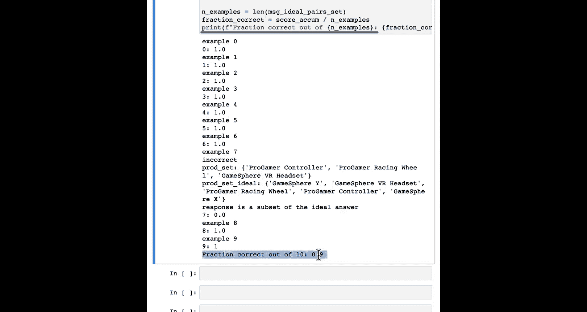

# 吴恩达最新《使用ChatGPT API构建系统》｜Building Systems with the ChatGPT API｜中英字幕 - P9：9_sc-openai-c2-L8-vid9_1.zh_en - GPT中英字幕课程资源 - BV1zX4y187dw

In the previous few videos， ESA showed how to build an application using an OOM from evaluating the inputs to processing the inputs to then doing final output checking before you show the outputs to a user。

After you've built such a system， how do you know how it's working and maybe even as you deploy it and let users use it。

 how can you track how it's doing and find any shortcomings and continue to improve the quality of the answers of a system In this video I'd like to share with you some best practices for evaluating the outputs of an LM and I want to share you specifically what it feels like to build one of these systems one key distinction between what you hear me talk about in this video and what you may have seen in more traditional machine learning supervised learning applications is because you can build such an applications so quickly the methods of evaluating it it tends not to start off with a test set instead you often end up gradually building up a set of test examples Let me share you what I mean by that You may remember this diagram from the second video about how promptbased development speeds up the core parts of model development from。

Maybe months to just minutes or hours or at most a very small number of days。

In the traditional supervised learning approach， if you needed to collect， say 10。

000 labeled examples anyway， then the incremental cost of collecting another 1000 test examples isn't that bad。

 so in the traditional supervised learning setting， it was not unusual to collect a training set。

 collect a development set or hold our trust validationidation set in a test set and then to have those at hand throughout this development process。

But if you're able to specify a prompt in just minutes and get something working in hours。

 then it would seem like a huge pain if you had to。

Pause for a long time to collect a thousand test examples because you can get this working with zero training examples。

So when building an application and using an LOM， this is what it often feels like first you would tune the prompts on just a small handful of examples。

 maybe one to three to five examples， and try to get a prompt that works on them。

And then as you have the system undergo additional testing。

 you occasionally run into a few examples that are tricky。

 the prompt doesn't work on them or the algorithm doesn't work on them。

 and in that case you can take these additional one or two or three or five examples and add them to the set that you're testing on to just add additional tricky examples opportunistically。

Eventually， you have enough of these examples you've added to your。

Slowly growing development set that it becomes a bit inconvenient to manually run every example through the prompt every time you change the prompt。

 and then you start to develop metrics to measure performance on this small set of examples。

 such as maybe average accuracy。😊，And。One interesting aspect of this process is if you decide at any moment in time your system is working well enough。

 you can stop right there and not go on to the next bullet and in fact there are many deployed applications that stopped at maybe the first or the second bullet and are running actually and are running just fine。

Now， if your hand built。Development set that evaluating the model on isn't giving you sufficient confidence yet in the performance of your system。

 then that's when you may go to the next step of collecting a randomly sampled set of examples to tune the model to and this would continue to be a development set or a holdout trust validation set could be because' be quite common to continue to tune your prompt to this。

And only if you need even higher fidelity estimate of the performance of your system。

 then might you collect and use a hold out test sets that you don't even look at yourself when you're tuning the model。

And so step 4 tends to be more important if say your system is getting the right answer 91% of the time and you want to tune it to get it to give the right answer。

 92 or 93% of the time， then you do need a larger set of examples to measure those differences between 91 and 93% performance。

 and then only if you really need a unbiased fair estimate of how was the system doing。

 then do you need to go beyond the development set to also collect a holdout test set。

 One important caveat， I've seen a lot of applications of large language models where there isn't meaningful risk of harm。

If it gives not quite the right answer， but obviously for any high stakes applications。

 if there's a risk of bias or an inappropriate output causing harm to someone。

 then the responsibility to collect a test set to rigorously evaluate the performance of your system to make sure it's doing the right thing before you use it。

 that becomes much more important。But if， for example。

 if you are using it to summarize articles just for yourself to read and no one else。

 then maybe the risk of harm is more modest and you can stop early in this process without going to the expense of bullets four and5 and collecting larger dataset sets on which to evaluate your algorithm。

So in this example。Let me start with the usual hopeer functions。

Use a u function to get a list of products and categories。So in the computers and laptop category。

 there's a list of computers and laptops in the smartphones accessories category。

 here's a list of smartphones and accessories and so on for other categories。Now。对。

Let's say the task in the address is given a user input。

 such as what TV can I buy if I want a budget。To retrieve the relevant。

Cadries and products so that we have the right info to answer the userss query。 So here's a prompt。

 feel free to pause the video and read through this in detail if you wish。

 but the prompt specifies a set of instructions and it actually gives the language model one example of a good output This is sometimes called a few shop or technically one shot prompting because we're actually using a user message and a system message to give it one example of a good output。

 someone says I want the most expensive computer Yeah let's just return all the computers because we don't have pricing information。

 Now let's use this prompt on the customer message which TV can I buy if I'm on budget。

And so we're passing in to this， both the prompt custom message zero。

 as was the products and category， this is information that we retrieve up top using the U function。

And here， it lists out。The relevant information to this query， which is under the a。

 televisions and whole theater systems。 This is a list of Tvs and whole theater systems that seem relevant to see how well the prompt is doing。

 you may validate it on a。Second prompt of customer says I need a charger from my smartphone。

It looks like it's correctly retrieving。This data categories。

 smartphone accessories and list the relevant products， and here's another one。

So what computers do you have？And hopefully I'll retrieve a list of the computers。

So here I have three prompts and if you are developing this prompt for the first time。

 it would be quite reasonable to have one or two or three examples like this and to keep on tuning the prompts until it gives appropriate outputs until the prompt is retrieving the relevant products and categories to the customer requests for all of your prompts。

 all three of them in this example。And if the prompt had been missing some products or something。

 then what we would do is probably go back to edit the prompt a few times until it gets it right on all three of these prompts。

After you've gotten the system to this point。You might then start running the system in testing。

 maybe send it to internal test users or try using it yourself and just run it for a while to see what happens。

And。Sometimes you will run across a prompt that it fails on so here's an example of a prompt。

 tell me about the smartest prophone and fills out camera， also what TVs do you have。

So when I run it on this prompt， it looks like it's outputting the right data。

 but it also outputs a bunch of text here， this extra junk it makes it harder to pass this。

Into a python list of dictionaries， so we don't like that as outputting this extra junk。

So when you run across one example that the system fails on。

 then common practice is to just note down that this is a somewhat tricky example。

 so let's add this to a set of examples if we're going to test the system on systematically and if you keep on running the system for a while longer。

 maybe it works on those examples we did tune the problem to three examples maybe it'll work on many examples but。

Just by chance， you might run across another example where it generates an error。

So this customer message4 also causes the system to output to a bunch of junk text at the end that we don't want。

Trying to be helpful to give all this extra tags we actually don't want this and so at this point you may have run this prompt maybe on hundreds of examples。

 maybe of test users， but you would just take the examples。

 the tricky ones it' doing poorly on and now have this set of five examples index from zero to four。

 have to set the five examples that you use to further fine tune the prompts。And。

In both of these examples， DLM had output put a bunch of extra junk texts at the end that we don't want。

And after a little bit of trial and error， you might decide to modify the prompts as follows。

So here's a new prompt。 This is called prompt V2， but what we did here was we added to the prompt。

 do not output any additional texts not in J format。 Just emphasize。

 please don't output this J stuff and added the second example using the user and assistant message for few shot prompting where the user also the cheapest computer and in both of the few shot examples we're demonstrating to the system a response where it gives only J output So here's the extra thing that we just added to the prompt do not output any additional text now in J formats and we use few shot user one future short one and future short user2 few short assistant2 to give it two of these few shot prompts。

 So let me hit shift enter。To find that prompt， and you were to go back and manually rerun this prompt on all five of the examples of user input。

 including this one that previously had given a broken output。

 you find that it now gives a correct output。And if you were to go back and rerun this new prom。

 this is Prom version V2 on that customer message example that had resulted in the broken output with the extra junk after the JO output。

 then this will generate a better output。And I'm not going to do it here。

 but I encourage you to pause a video and rerun it yourself on customer message4 as well on this prompt V2。

 see if it also generates the correct output and hopefully it will， I think it should。And of course。

 when you modify the prompt， it's also useful to do。A bit of regression testing to make sure that。

When fixing the incorrect outputs on prompts 3 and4。

 it didn't break the output on prompt zero either。Now you can kind of tell that if I had to copy paste five prompts customs 0。

1，2，3 and 4 into my Jupyter notebook and run them and then manually look at them to see if they output in the right categories and products。

 you can kind of do it， I can look at this and go yep ca， TV and whole systems， products。

 yep mostly got all of them， but it's actually a little bit painful to do this manually to manually inspect or to look at this output to make sure with your eyes that this is exactly the right output。

So when the development set that you're tuning to becomes more than just a small handful of examples。

It。Then becomes useful to start to automate the testing process。

So here is a set of 10 examples where I'm specifying 10 customer messages。

 so here's a customer message what TV can to buy on a budget as was what's the ideal answer think of this as the right answer in the test set or really actually should say development set because we're actually tuning to this and so we've collected here 10 examples index from zero through nine。

Where the last one is if the user says I with the hot time machine。

 we have no relevant products to that， really sorry， so the ideal answer is the empty set。

And now if you want to evaluate。Autoomatically， what the prompt is doing on any of these 10 examples。

Here is a function to do so it kind of a long function。

 feel free to pause a video and read through it if you wish。

 but let me just demonstrate what it's actually doing。😊。

So let me print out the custom message for custom Mehes0。Right， so customer messages。

 which do you be going to buy if I'm on a budget？And let's also print out。The ideal answer。

 so the ideal answer is here are all the TVs that we want the prompt to retrieve。

And let me now call the prompt， this is prompt V2。On this customer message with that user process and category information that's printed out。

 and it will call the Eval。We'll call the Eval responsive ideal option。

To see how well the response matches the ideal answer， and in this case。

 it did output the category that we wanted and it did output the entire list of products。

 and so this gives you a score of 1。0。Just to show you one more example。

 it turns out that I know it gets it wrong on example 7。

 so if I change this from zero to7 and run it。This is what it gets。 Oh let me update this to。

7even as well。 So under this customer message， this is the ideal answer where should output。

Under gaming consoles and accessories， a list of gaming consoles and accessories。

 but whereas the response here has V outputs。It actually should have had one， two， three， four， five。

Outputs， and so it's missing some of the products。So what I would do about tuning the prompt now is I would then。

Use a for loop to loop over all 10 of the development set examples where we repeatedly pull out the customer message。

 get the I answer， the right answer， call the arm to get a response evaluated it and then yeah accumulate it an average and let me just run this。

坏。So this would take a while to run， but when it's done running。

 this is a result where running through the 10 examples， looks like example 7 was wrong。

 and so their fraction correct color of 10 was 90% correct。And so if you were to tune the prompts。

 you can rerun this to see if the percent correct goes up or down What you just saw in this notebook is going through steps 1。

2 and three of this bulleted list and this already gives a pretty good development set of 10 examples with which to tune and validate the prompt is working。

If you needed an additional level of rigor， then you now have the software needed to collect a randomly sample set of maybe 100 examples with their ID outputs and maybe even go beyond that to the rigor of a holdout test set that you don't even look at while you're tooning to prompt。

 but for a lot of applications stopping at bullet3。

 but there are also surf the applications where you could do what you just saw me do in distribute the notebook and get to pretty performance system quite quickly。

We gained the important caveat that。If you're working on a safety critical application or an application with this。

Where there's nontrivia risk of harm， then of course it would be the responsible thing to do to actually get a much larger test set to really verify the performance before you use it anywhere and so that's it I find that the workflow of building applications using problems is very different than a workflow of building applications using supervised learning and the pace of iteration feels much faster and if you have not yet done it before you might be surprised at how well an evaluation method built on just a few hand cur tricky examples。

 you think with 10 examples and this is not statistically valid for almost anything。

 but you might be surprised when you actually use this procedure， how effective。Adding a handful。

 just a handful of tricky examples into your development set might be in terms of helping you and your team get to an effective set of prompts and an effective system。

In this video， the outputs could be evaluated quantitatively as in there was a desired output and you could tell if it gave this design output or not。

 so the next video， let's take a look at how you can evaluate LM output in that setting where what is the right answer is a bit more ambiguous。

