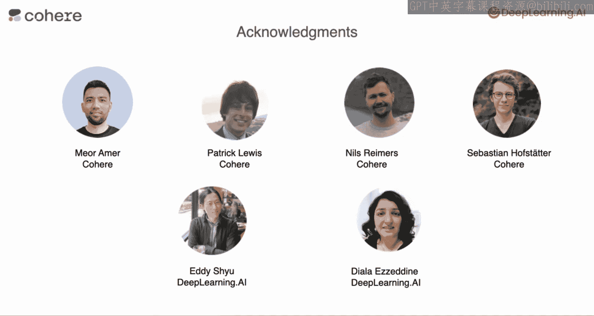
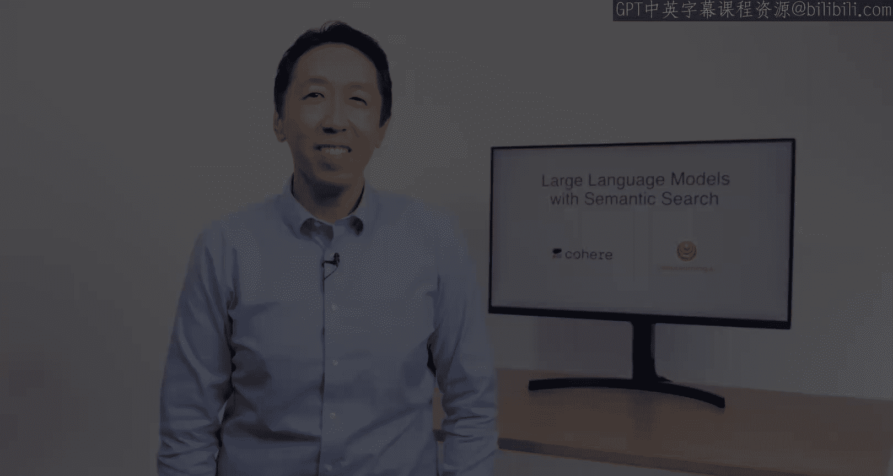

# 吴恩达最新《大型语言模型与语义搜索》｜Large Language Models with Semantic search｜中英字幕 - P1：SC-Cohere_Intro.zh_en - GPT中英字幕课程资源 - BV1zr4y1d7bi

Welcome to the short course Lage language models with Semantic Search built in partnership with cohere In this course。

 you'll learn how to incorporate large language models or LOMs into information search in your own applications For example。

 let's say you run a website with a lot of articles picture Wikipedia for the sake of argument or a website with a lot of ecommerce-commerce products Even before LOMs it was common to have keyword search to let people maybe search your site but with LOMs you can now do much more First you can let users ask questions that your system then searches your site or database to answer。

And second， the LLM is also making the retrieve results more relevant to the meaning or the semantics of what the user is asking about I'd like to introduce the instructors for this course Jay Alaer and Louisis Serrao。

 both Jay and Louis are experienced machine learning engineers as well as educators I've admire admire for a long time some highly reference illustrations that Jay had created to explain Transformer Network he's also co-authoring a book hands-on La language models。

😊，Louis is the author of the bookDing Mach Learning。

 and he also taught with deep learning about AI Ma for machinech learning at Cohere Jay and Lewis。

 together with Mia Amir have also been working on a site called LM and have a lot of experience teaching developers to use Lms So I was thrilled when they agreed to teach semantic search with LOms。

 Thanks Andrew， what an incredible honor it is to be teaching this course with you Your machine learning course introduced me to machine learning8 years ago and continues to be an inspiration to continue sharing what I learned As you mentioned Louis and I work at cohere。

 So we get to advise others in the industry on how to use and deploy large language models for various use cases We are thrilled to be doing this course to give developers the tools they need to build robust LLM powered apps and we're excited to share what we learn from our experience in the field Thank you Jay and Louis great to have you with us This course consists of the following topics First。

😊，how to use basic keyword search， which is also called Lexical search。

 which powered a lot of search systems before large language models。😊。

It consists of finding the documents that has the highest amount of matching words with the query then you learn how to enhance this type of keyword search with a method called rerannk as the name suggests this ranks the responses by relevance with the query After this you learn a more advanced method of search which has vastly improved the results of keyword search as it tries to use the actual meaning or the actual semantic meaning of the text with which to carry out the search This method is called dense retrieval This user is a very powerful tool in natural language processing called embeddings which is a way to associate a vector of numbers with every piece of text。

Semantic search consists of finding the closest documents to the query in the space of embeddings similar as other models。

 search algorithms need to be properly evaluated。You also learn effective ways to do this Finally。

 since LMs can be used to generate answers， you also learn how to plug in the search results into an LOM and have it generate an answer based on them dense retrieval with embeddings vastly improves the question answering capabilities of an LM as the first searches for and retrieves the relevant documents and it creates an answer from this retrieved information many people have contributed to this course。

 we're grateful for the hard work of Miir Ammeir， Patrick Lewis。

 Niils Reimmer and Sebastian Hofatta from cohere as well as on the deep learning of AI side Eddishu and Dila Eidine In the first lesson。

 you will see how search was done before large language model。

From there， we will show you how to improve search using LLMs。

 including tools such as embeddings and rerank。 That sounds great。 And with that。

 let's dive in and go on to the next video。😊。

