# 吴恩达最新《大型语言模型与语义搜索》｜Large Language Models with Semantic search｜中英字幕 - P2：SC-Cohere_L1.zh_en - GPT中英字幕课程资源 - BV1zr4y1d7bi

Welcome to lesson 1 in this lesson， you will learn how to use keyword search to answer questions using a database。

 Search is crucial to how we navigate the world。 This includes search engines。

 but it also includes search within apps。 So when you search Spotify or YouTube or Google Maps。

 for example， companies and organizations also need to use keyword search or various methods of search to search their internal documents。

 Keyword search is the method most commonly used to build search systems。😊。

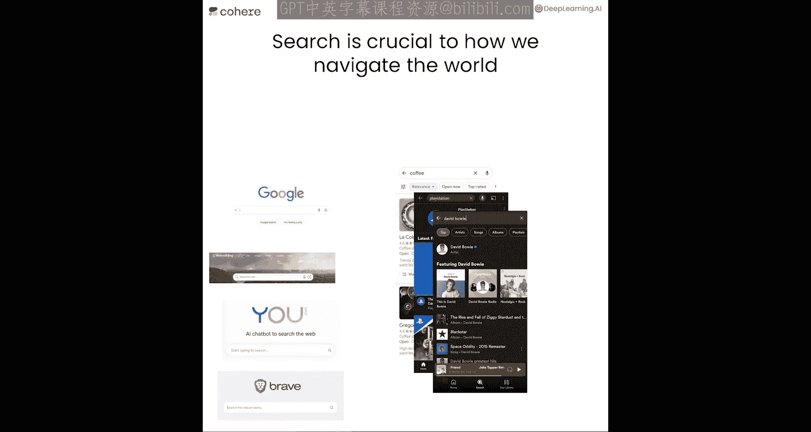

Let's look at how we can use a keyword search system and then look at how language models can improve those systems。

Now in this code example， we'll connect to a database and do some keyword search on it。

The first cell。Installs weviiate client。 You don't need to run this if you're running this from inside the classroom。

 but if you want to download this code and run it on your own environment。

 you would want to install Viviiate client。The first code cell we need to run loads the API keys we'll need later in the lesson。

And then now we can。Import weviate， this will allow us to connect to an online database。

 we'll talk about this database。Let's talk about what weviate is， weviate is an open source database。

 it has keyword search capabilities， but also vector search capabilities that rely on language models。

The API key we'll be using here is public， this is part of a public demo。

 so the actual key is not a secret and you can use it and we encourage you to use it。

To access this demo database。Now that we've set the configurations for authentication。

Let's look at this code that connects the client to the actual database。 Now。

 this database is a public database and it contains 10 million records。

These are records from Wikipedia， each cell， each record row in this database is a passage。

 is a paragraph from Wikipedia。These 10 million records are from 10 different languages。

 so 1 million of them are in English and the other 9 million are in different languages and we can choose and filter which language we want to query and we'll see that later in this lab。

After we run this line of code， we make sure that the client is ready and connected and if we get true。

 then that means that our local Wviiate client is able to connect to the remote Wviiate database and then now we're able to do keyword search on this data。

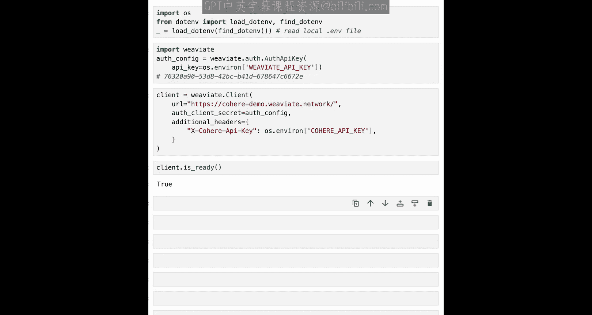

Let's talk a little bit about keyword search before we look at the code。

So let's say you have the query， what color is the grass？

And you're searching a very small archive that has these five texts， these five sentences。

One says tomorrow is Saturday， one says the grass is green， the capital of Canada is Ottawa。

 the sky is blue and a whale is a mammal， so this is a simple example of search。

A high level look at how keyword search works。Is to compare how many words are in common between the query and the documents。

So if we compare how many words are in common between the query and the first sentence。

 they only share the word is， and so that's one word they have in common。

 and we can see the accounts of every sentence in this archive。

We can see that the second sentence has the most words in common with the query。

 and so keyword search might retrieve that as the answer。

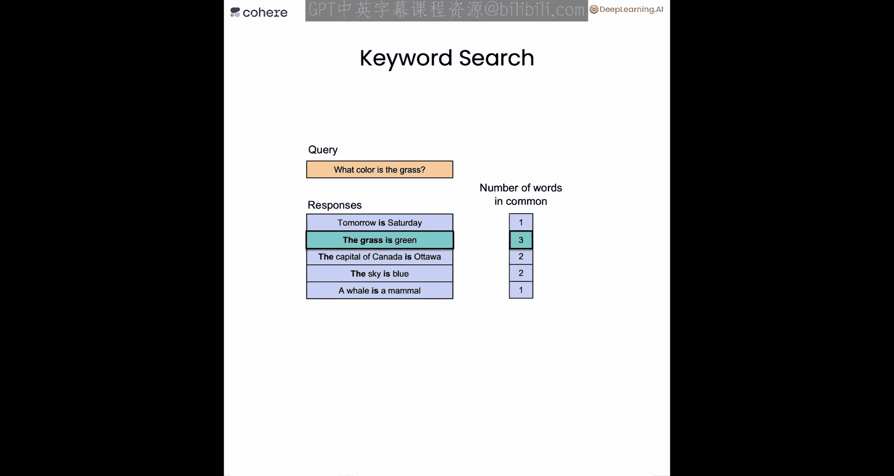

So now that we're connected to the database， let's build out the function that will query it。

 Let's call it。Keyword。Search。And we'll be building this and going back and forth。

 So the simplest thing we'll need to do here is to say response。Equals， and then。Client dot query。

t get。Now everything we're doing here， this is。Wevi it。

 So this is all defined by the wevit API and it tells us the kind of I think the collection we need to add here is called articles。

 So that's defined in that database。 And since we want to do keyword search。

Let's say before we go into key search， let's copy what these properties are like。 So these will be。

It's a less defined with this data。Like this。Every article in this database has a number of properties。

 What we are saying here is that the results for this search， we want you to return to us the title。

 the URL and the text for each result， there are other properties in here。

 but we don't want the database to return them to us now。Now to do the keyword search part。

 wevi8 has a type。With BM25 and BM25 is this keyword search or lexical search algorithm commonly used。

 and it scores the documents in the archive versus the query based on a specific formula that looks at the count of the shared words between the query and each document and the way we need to do this is to say query equals the query we will pass to you。

And the query we need to add to this function， so it is a parameter here as well。

A couple more lines we need to pass to alliate are。With where， so we can have a where clause here。

That is formatted in a specific way。 So what we want to do here is limit this to only English results。

And results L will be something we also add to this definition。 So let's say E。By default。

We'll filter by the English language and only look at the English language articles。

 so that's why we're adding it here as a default， but it's something we can change whenever we call the keyword search method。

Now， one more line we need to add is to say with。Limit。

 so how many results do we want the search engine to retrieve to us？So when say number results。

 and then we define that here as well， so。No results。And let's set that by default to say three。

And with that， our query is complete。 and we just say do， and then。We close that request。

And once we've completed this， we can now get the response and return the results。With this。

 that is our keyword search function。Now let's use this keyword search function and pass it one query。

 say we say what is the most viewed televised event。

 we pass the query to the function and then we print it so let's see what happens when we run this。

 it goes and comes back and these are the search results that we have。

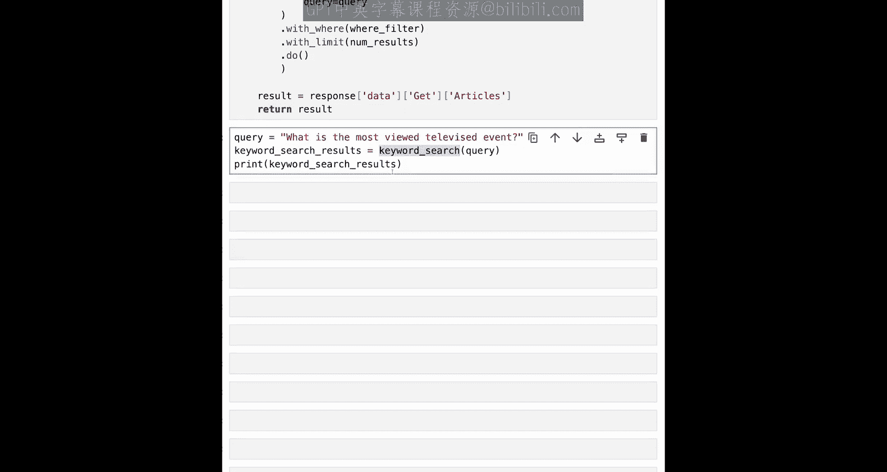

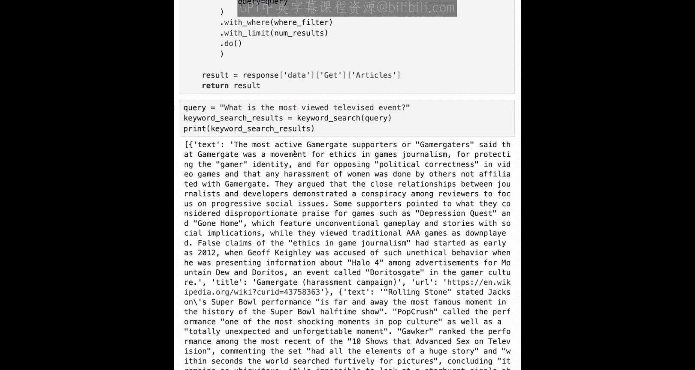

It's a lot of text we go through it， but we can see that it's a list of dictionaries。

 so let's define a function that prints it in maybe a better way。

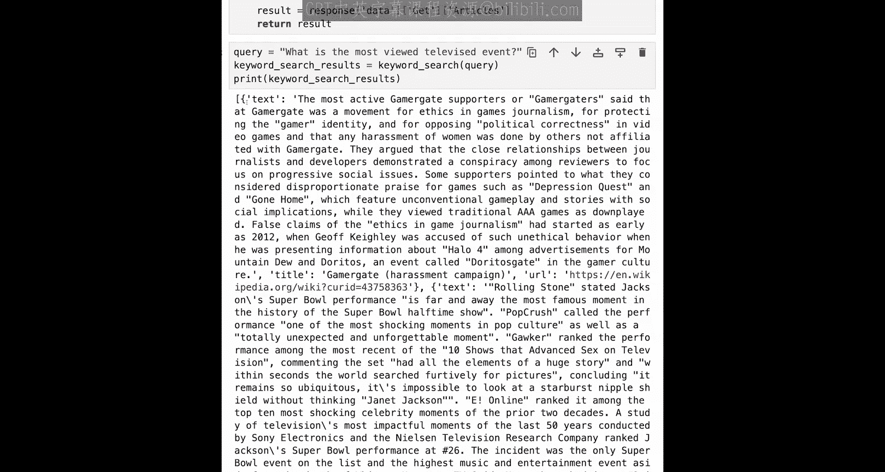

And this function can look like this print result。And with this， we can say， okay。

 now print it and let me see exactly what the results were。

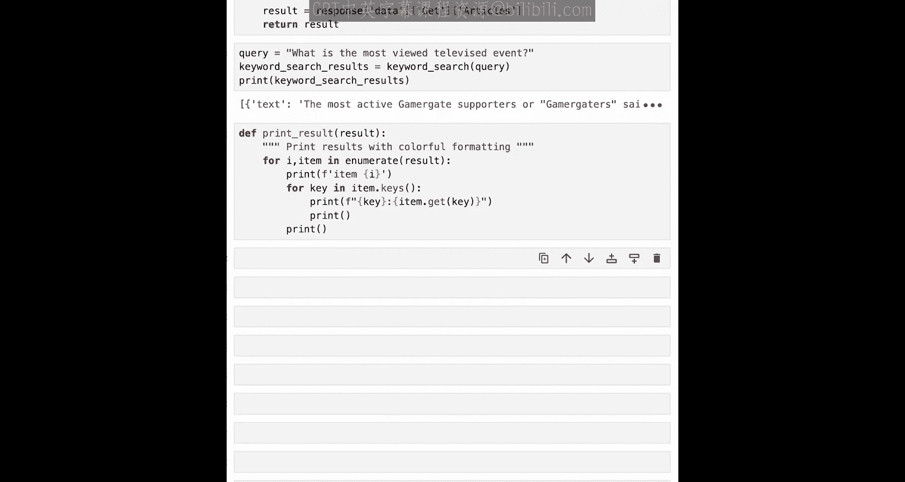

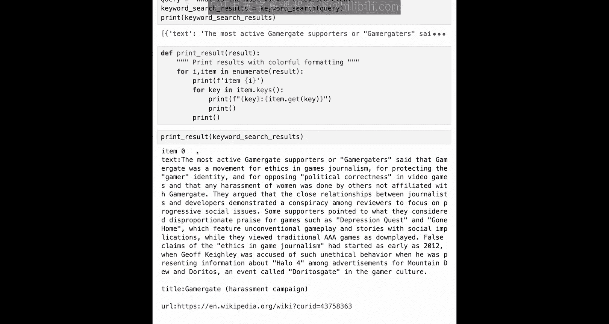

So the first result that we got back is this is the text。

 This is the passage or paragraph of the text。 This is the title。 And remember。

 we're trying to look for what is the most televised event。 And this does not really look like the。

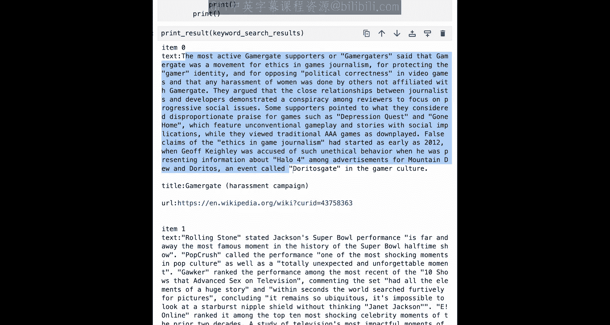

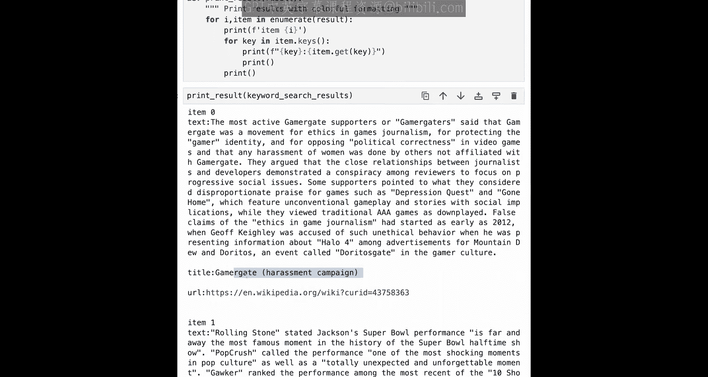

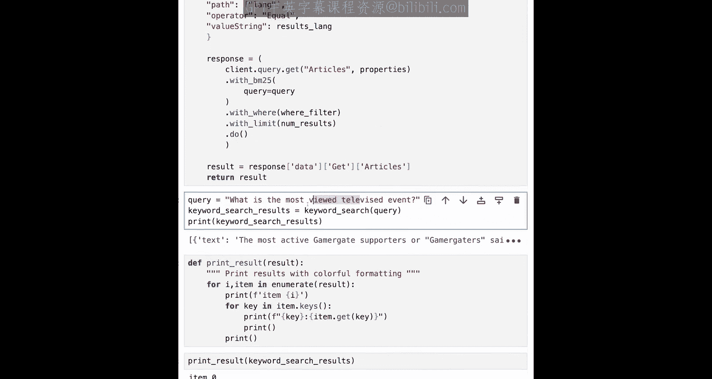

Correct result very much， but it contains a lot of the keywords。

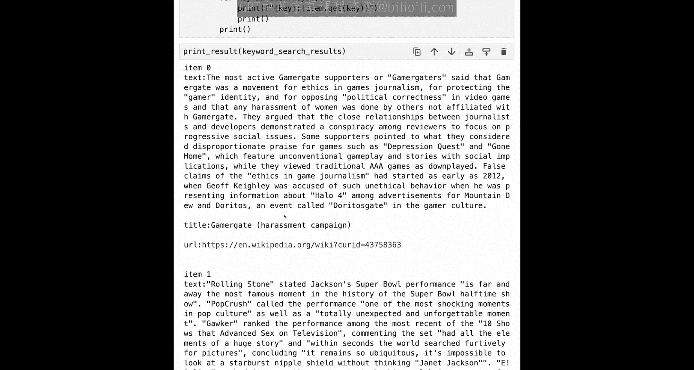

Now we have another。Article here about the Super Bowl is a better result。

 so the Super Bowl could probably be a highly televised event。

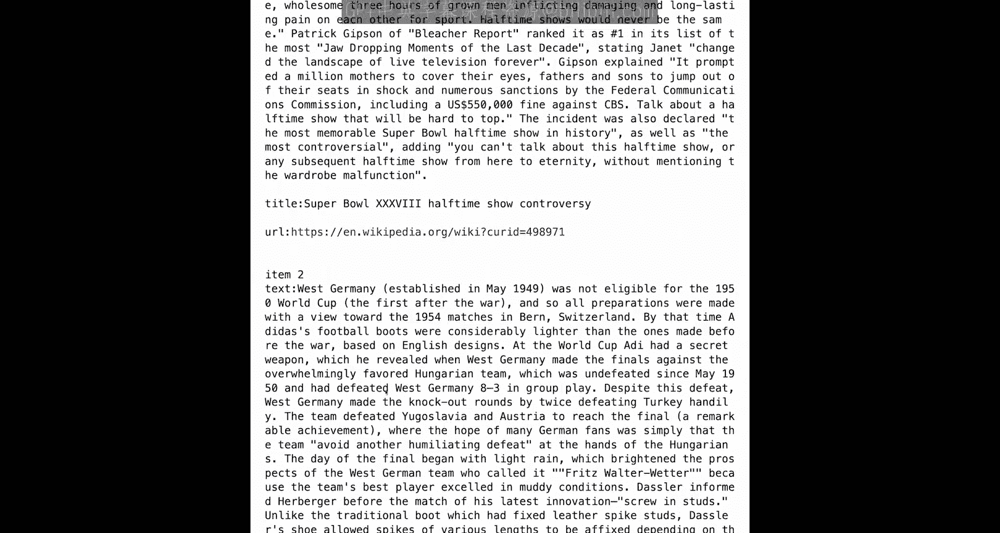

And then there's another result here that kind of mentions the World Cup。

 but it's not exactly the World Cup result。With each of these， you see the URL of that article。

 we can click on it and it will lead us to a Wikipedia page。

 You can try to edit this query so you can see what else is in this dataset。

 but this is a high level example of the query connecting to the database and then seeing the results。

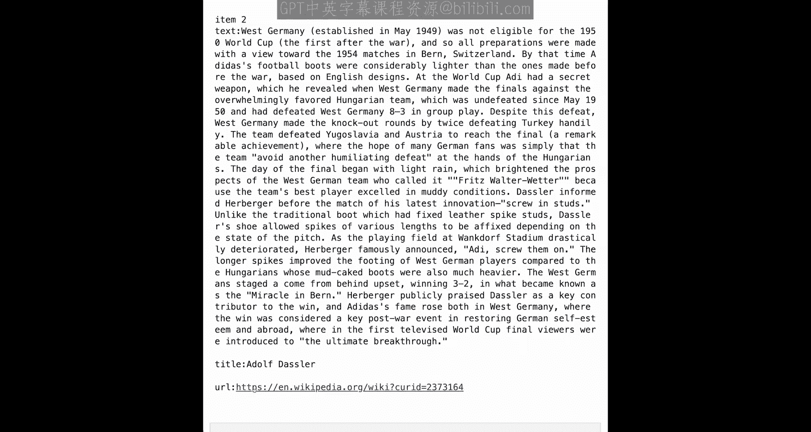

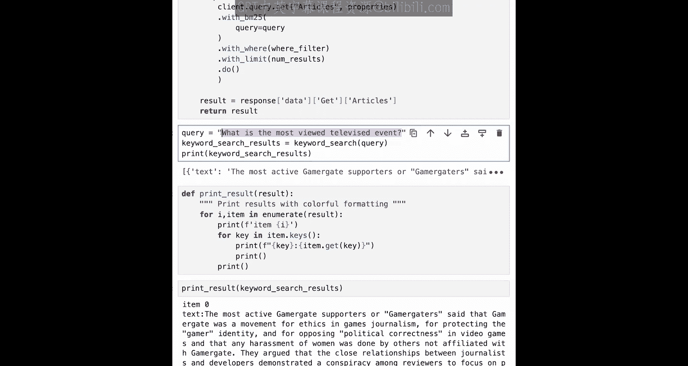

A few things you can try here as well is you need to look at the properties。

 this is the list of properties that this data set was。Built using。

 And so these are all columns that are stored within the database。

 So you can say you're gonna look at how many views a Wikipedia page received。

 You can use that to filter or sort。 This is an estimated figure。

 But then this is the language column that we use to filter。

 and you can use other values for language。 The codes for the other languages look like。This。

 so we have English， German， French。Spanish， Italian， Japanese， Arabic， Chinese， Korean and Hindi。

 I believe。So just input one of these and pass it to the keyword search and it will give you results in that language。

Let's see how we can query the database with a different language， so let's say we copy this code。

 notice that now we're printing the result here， let's specify the language。

To a different language here。I'm going to be using。Let's say。Chairman。

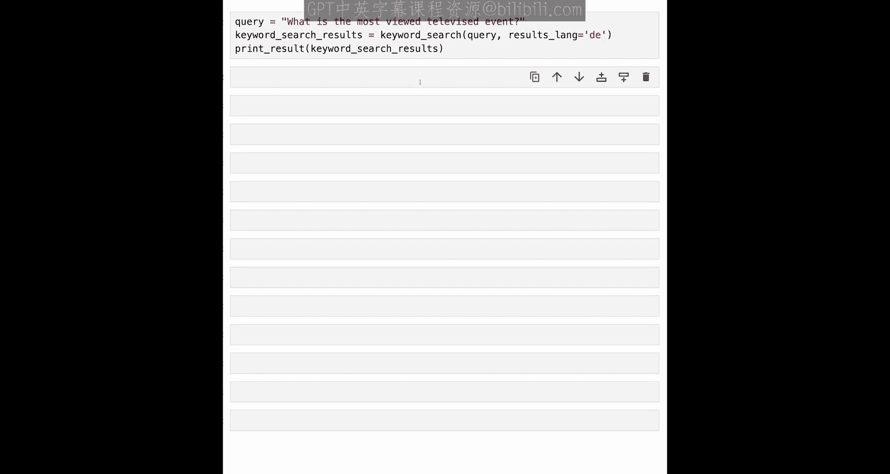

And we did German here because some words might be shared and we can see here some results。

 so this result for the most televised event is for Buster rhymes， the musician。

 but you can see why it brought this as a result right because the word event is here。

And then the name of the album mentioned here is event。

So the text here and the query that we have shared， they don't have to share all of the keywords。

 but at least some of them BM25 only needs one word to be shared for it to score that as as somewhat relevant and the more words the query in the document share and the more its repeated in the document the higher the score is。

 but we can see in general while these results are return is maybe not the best most relevant answer to this question or document that is most relevant to this query we'll see how language models help with this So at the end of the first lesson。

 let's look back at search at a high level。

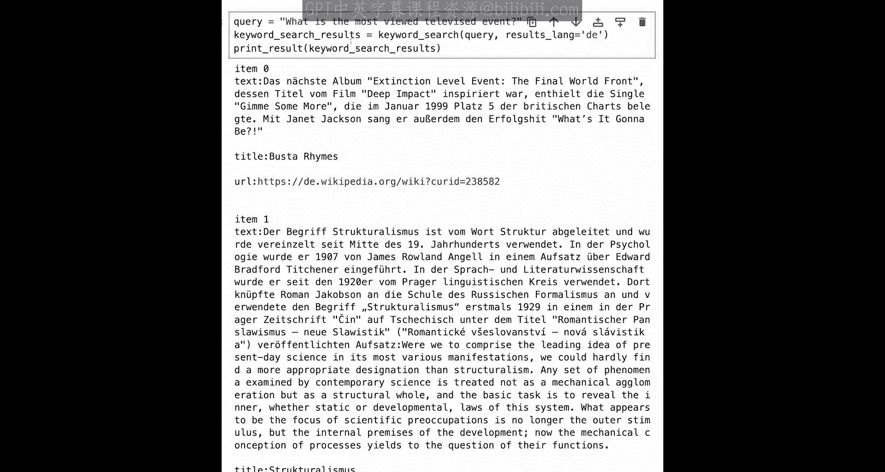

The major components are the query。The search system。

The search system has access to a document archive that it processed beforehand。

And then in response to the query， the system gives us a list of results ordered by the most relevant to the query。

If we look a little bit more closely， we can think of search systems as having multiple stages。

The first stage is often a retrieval or a search stage and there's another stage after it called reranking。

 reranking is often needed because we want to involve or include additional signals rather than just text relevance。

The first stage， the retrieval， commonly uses the BM25 algorithm to score the documents in the archive versus the query。

 the implementation of the first stage retrieval often contains this idea of an inverted index。

Notice that this table is a little bit different than the。

Table we showed you before of the documents。 the inverted index is this kind of table that has kind of these two columns。

 One is the keyword。 and then next to the keyword is the documents that this keyword is present in This is done to optimize the speed of the search When you enter a query into a search engine。

 you expect the results in a few milliseconds This is how it's done In practice。

 in addition to the document Id， the frequency of how many times this keyword appears is also added to this call with this。

 you now have a good high levelvel overview of keyword search。

Now notice for this query what color is the sky when we look at the inverted index the word color has the document 804。

And the word Sky also has the document 804， so 804 will be highly rated from the results that are retrieved in the first stage。

From our understanding of keyword search， we can see some of the limitations。

 So let's say we have this query。Strong pain in the side of the head。

If we search a document archive that has this other document， that answers it。Exactly。

 but it uses different keywords， so it doesn't use them exactly。 it says sharp T headache。

 keyword search is not going to be able to retrieve this document。

This is an area where language models can help。Because they're not comparing keywords simply。

 they can look at the general meaning and they're able to retrieve a document like this for a query like this。

Language models can improve both search stages， and in the next lessons we'll look at how to do that。

We'll look at how language models can improve the retrieval or first stage using embeddings。

 which are the topic of the next lesson。And then we look at how reranking works and how it can improve the second stage。

And at the end of this course， we'll look at how large language models can generate responses as informed by a search step that happens beforehand。

So let's go to the next lesson and learn about embeddings。

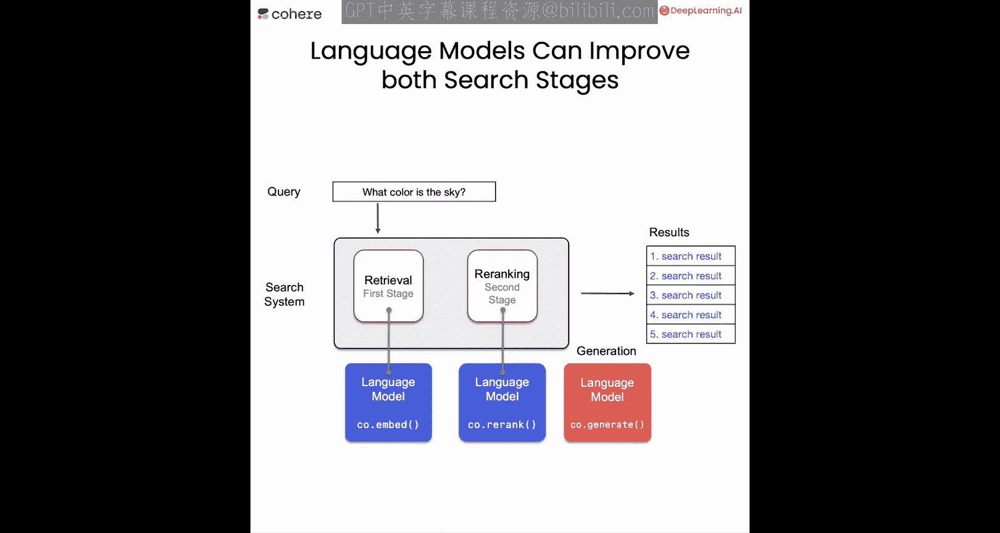