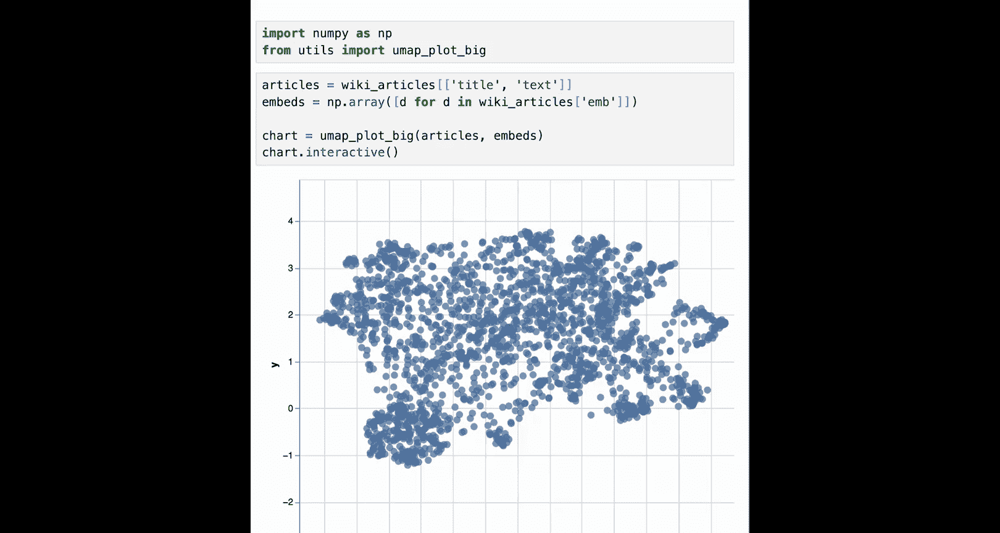
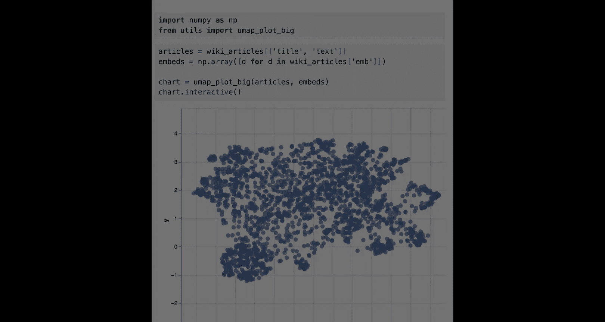

# 吴恩达最新《大型语言模型与语义搜索》｜Large Language Models with Semantic search｜中英字幕 - P3：SC-Cohere_L2.zh_en - GPT中英字幕课程资源 - BV1zr4y1d7bi

Welcome to lesson2 in this lesson， you will learn embeddings。

 embeddings are numerical representations of text that computers can more easily process。

This makes them one of the most important components of large language models。

So let's start with the embedding Slab。😡，This code over here is going to help us load all the APIPA keys we need。

Now in the classroom， this is all done for you， but if you'd like to do this yourself。

 you would have to p install some packages， for example， the cohere one。

Other packages you would have to install for the visualizations are UMap Learnear。

Altti and data sets for the Wikipedia data。I'm going to comment in this line because I don't need to run it in this classroom。

So next you'll import the cohere library， the cohere library is an extensive library of functions that use large language models。

 and they can be called via API calls。In this lesson， we're going to use the embed function。

 but there are other functions like the generate function。

 which you'll use later in the course The next step is to create a cohere client using the API key。

So first， let me tell you what an embedding is over here。

 we have a grid with a horizontal and a vertical axis and coordinates。

 and we have a bunch of words located in this grid， as you can see Given the locations of this words。

 where would you put the word apple As you can see in this embeddings。

 similar words are grouped together。 So in the top left， you have sports in the bottom left。

 you have houses and buildings and castles in the bottom right。

 you have vehicles like bikes and cars。 and in the top right， you have fruits。

 So the apple would go among the fruits。Then the coordinates for Apple here are 5 comma 5。

 because we are associating each word in the table in the right to two numbers。

 the horizontal and the vertical coordinate。This is an embedding。 Now。

 this embedding sends each word to two numbers like this。 In general。

 embeddings would send words to a lot more numbers， and we would have all the possible words。

Ebedding that we use in practice could send a word to hundreds of different numbers or even thousands。

Now， let's import a package called pandas， and we're going to call it P D。

 Panndas is very good for dealing with tables of data。

And the first table of data that we're going to use is a very small one， it has three words。

 the word joy， the word happiness， and the word potato， which you can see over here。

The next step is to create embeddings for these three words。We're going to call them three words M。

 And to create the embeddings， we're going to call the cohere function embed。

The embed function takes some inputs。 The first one is the data set that we want to embed。

 which is called three words for this table。 and we also have to specify the column。

 which is called text。Next， we specify which of the cohere models we want to use。And finally。

 we extract the embeddings from there。So now we have our three words andbeddings。

Now let's take a look at the vector associated with each one of the words。

The one associated with the word Jo， we're going to call it word1。And the way we get it is。

By looking at3 words M and taking the first row。Now we're going to do the same thing with word 2 and War 3。

 those are the vectors corresponding to the words happiness and potato。Just out of curiosity。

 let's look at the first 10 entries of the vector associated with the word joy。😊。

That's going to be word 1 all the way up to 10。Now embeddings not only have to work for words。

 they can also work for longer pieces of text。 actually。

 it can be really long pieces of text In this example here。

 we have embeddings for sentences Now the sentences get sent to a vector or a list of numbers and notice that the first sentences hellello how are you。

 The last one is hi， how's it going and they don't have the same words but they are very similar and because they're very similar。

 the embedding sends them to numbers that are really close to each other。

Now let me show you an example of embeddings First we'll have to import pandas as PD。

 Pandas is a library that works for handling tables of data。

And next we're going to take a look at a small data set of sentences。

 This one has eight sentences as you can see they are in pairs。

 each one is the answer to the previous one， for example， what color is the sky， this sky is blue。

 what is an apple and apple is a fruit。Now we are going to plot this embedding and see which sentences are close or far from each other。

In order to turn all these sentences into embeddings。

 we are going to use the embed function from cohere。

 so we're going to call this table M and we're going to call the endpoint code。 embed。

This function is going to give us all the embeddings， and it takes some inputs。

The first input is the table of sentences that we want to embed。

 so the table is called sentences and we have to specify the column which is called a text。

The next input is the name of the model we're going to use。Finally。

 we extract the embeddings from the output of this function。

This function is going to give us a long list of numbers for each one of the sentences。

 let's take a look at the first 10 entries of the embeddings of each of the first three sentences。

 and they are over here。Now how many numbers are associated to each one of the sentences in this particular case。

 it's 4，096， but different embeddings have different lengths。

Now we're going to visualize the embedding for this。

 we're going to call a function from u called UMap plot。Uap Cloud uses the packages UMap and altair。

And it produces this plot over here。Notice that this plot gives us eight points in pairs of2 and let's look what the pairs are。

 this one over here is the bear lives in the woods and the closest sentences where does the bear live。

 which makes sense because they are sentences that are quite similar。

 Let's look at this two over here。Here we have what is an apple and an apple is a fruit。

Over here we have where is the World Cup， the World Cup is in Qatar， and over here we have。

What color is the sky and the sky is blue， so as you can see。

 the embedding puts similar sentences in points that are close by and different sentences in points that are far away from each other。

Notice something very particular， the closest sentence to any question is its particular answer。

 so we could technically use this to find the answer to a question by searching for the closest sentence this is actually the basis for dense retrieval。

 which is what J is going to teach you in the very next video。

Now feel free to add some more sentences or change these sentences completely and then plot the embedding and see how it looks like。

Now that you know how to embed a small data set of eight sentences， let's do it for a large data set。

We're going to work with a big data set of Wikipedia articles。Let's load the following dataset。

 It has a bunch of articles with title， the text of the first paragraph and the embedding of that first paragraph。

 and it has 2000 articles。We're going to import numpy and a function that will help us visualize this plot very similar to the previous one。

We're going to bring it down to two dimensions so that it's visible for us。

 The embedding is over here and notice that similar articles are in similar places， for example。

 over here you can find a lot of languages。In here。Countries。Over here。

 you're going to find a lot of kings and Queens。And here you're going to find a lot of soccer players。

 and over here you're going to find artists， feel free to explore this embedding and try to find where the topics are located。

And that's it for embeddings Now in the next lesson with J。

 you will be able to use embeddings to do dense retrieval。

 that is to be able to search for the answer to a query in a big database。

