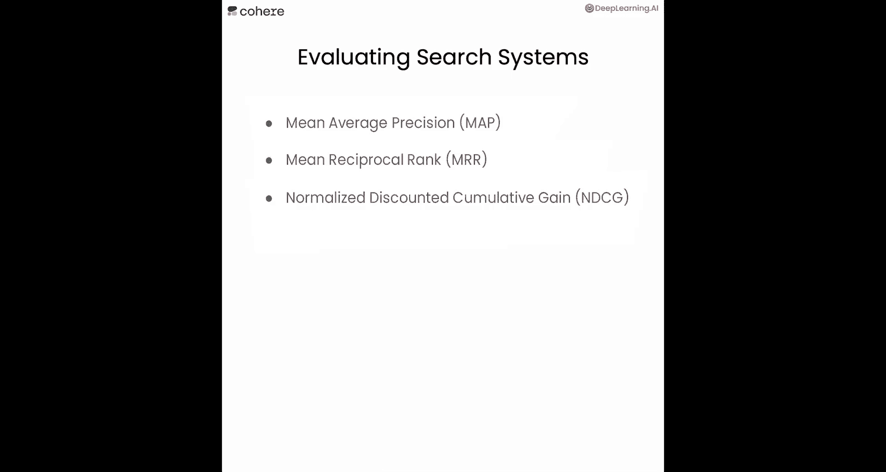

# 吴恩达最新《大型语言模型与语义搜索》｜Large Language Models with Semantic search｜中英字幕 - P5：SC-Cohere_L4.zh_en - GPT中英字幕课程资源 - BV1zr4y1d7bi

Welcome to lesson 4。 I am very excited to show you one of my favorite methods called the rerannk。

 Now that you've learned keyword search and dense retrieval， rerannk is a way to improve them both。

 and it is actually the second component of semantic search。 In addition to dense retrieval。

 Rerannk is a way for a large language model to sort search results from best to worst。😊。

Based on the relevance they have with respect to the query。

Now， let's see rerank in action in this lab。 So let's start by getting the API key from cohere and weiate。

 Then we're going to import cohere。And import we8。Next step。

 we are going to create our client that's going to store all the Wikipedia entries。Now。

 let's perform a search using dense retrieval。 What you learned in the previous lesson。

 We're going to import the dense retcural function。Now， let's search for the following query。

What is the capital of Canada。We're going to call the answer， dense retrieval。Results。

And to get these results， we're going to use the dense retrieval function。

Using the query and the client as inputs。Now， if you remember。

 we had a function that would help us print the results nicely。It was called print result。

So when we print the result。We get。The following。So let's take a look at these results。

 The first one is correct。 It's Ottawa。 Then we have some noisy ones。

 Toronto is not the capital of Canada， and then we also have Quebec City， which is the wrong answer。

 and why does this happen， Well， let me show you。 Here's a small pictorial example。

 The answers are different， but it's forgetting the idea。

 So the query says what is the capital of Canada， And let's say that the possible responses are these five。

 The capital of Canada's Ottawa， which is correct。 Toronto is in Canada， which is correct。

 but irrelevant to the question。 The capital of Francis Paris， which is also correct。

 but not the answer to the question。 then a wrong sentence， the capital of Canadas Sydney。

 which is not correct。 and then a sentence says the capital of Ontario is Toronto。

 which is true but also not answering the questions。 What happens when we do dense retrieval here。

 Well， let's say that the sentences are here。 the capital of Canada， Ottawa。 Toronto is in Canada。

 the capital of Francis， Paris， the capital。Canness Sydney and the capital of Ontarios Toronto。

 So in an embedding， let's just imagine that they're located over here。

 Now remember that the way dense ret works is it puts the query inside the embedding。

 and then it returns the closest of the responses， which in this case is the capital of Ontario is Toronto。

 dense retrieval looks at similar。 So it returns the response that is the most similar to the question this may not be the correct answer。

 This may not even be a true statement。 It's just a sentence that happens to be close to the question semantically。

 So therefore dense ret has the potential to return things that are not necessarily the answer。

How do we fix this？Well， this is where rerank comes into play。Now。

 let me show you a small example of rerannk。 Let's say that the query is what is the capital of Canada。

 and we have 10 possible answers。 And as you can see。

 some of these are relevant to the question and some of them are not。 So when we use dense retrieval。

 it gives us the top5。 let's say the five responses that are the most similar to the query。

 and let's say they are these ones over here。 but we don't know which one is the response。

 We just have five sentences that are pretty close to the query。

 So here is when rerannk comes into play。 rerank assigns to each query response pair are relevant score that tells you how relevant the answer is with respect to the query。

 it could also be a document。 So how relevant the document is with respect to the query。

 As you can see the highest relevance here was 0。9 which corresponds to the capital of Canada is Ottawa。

 which is the correct answer。 So that is what。Rerannk us。

 You may be wondering how rerannk gets strained。 Well。

 the way the train rerank is by giving it a lot of good pairs。

 So that's a pair where the query and the response are very relevant or when the query and document are very relevant and training it to give those high relevance scores and then also giving it a big set of wrong query responses。

 So query responses where the response does not correspond to the query。 It may be close。

 but it may not correspond to it or also a document and document that it may not correspond to the query。

 And if you train a model to give high scores to the good query response pairs and low scores to the bad query response pairs。

 then you have the rerank model that assigns a relevance and the relevance is high when you have a query and a response are very related。

Now let's look at more rerank examples， let's use it to improve keyword search。

 so we're going to import that keyword search function that we used in the first lesson。And again。

 let's ask it， what is the capital？Canada。So now let's use keyword search to find the answers to this query。

 we're going to start by outputting three answers and they're not so great monarchy of Canada。

 early modern period， and Fl of Canada。Why does it not work so well， Well。

 Because keyword search is finding documents that have a lot of words in common with the query。

 but keyword search can't really tell if you're answering the questions。

 All these articles here have a lot of words in common with the query， but they're not the answer。

 so let's make this a little bigger。 Let's I ask it for 500 results。

 and I'm not going to print the text only the title。So here we have。500 top results。

That's a lot of them。 How do we find if one of these has the answer。Well。

 that's where re ranknk comes into play。 This function over here reranks the responses。

 and it outputs the top 10。Now let's call the answers texts and let's apply rerank on texts where we have to input the query and the results。

And finally， let's print the top 10 rera results notice that this actually picked up the answer。

 it picked up Ottawa as the capital of Canada。 The relevant score is very high， is very close to 1。

 it's 0。98。Notice that the second best article is also pretty good because it talks about the different capitals that Canada has had in its history and this one has a relevance score of 0。

97 and as you can see， the third ones also pretty good and reraned actually picked the top 10 answers among the ones that keyword search surfaced that has the highest relevance。

And now let's do a final example using dense retrieval。 so again。

 I'm going to use this dense retrieval function and let's give it a slightly hard question。

 Let's give it the question who is the tallest person in history。

This would be a hard question for keyword search because it may surface articles with the word history or the word person。

 It may not actually pick up the meaning of the question。

 but let's hope that dense retrieval can do better。

 So we're going to call the function to give us some results。 and now let's print out these results。

 notice that this actually cut the correct answer those personing histories Robert Wadlow and I also picked up other documents。

 but we can still use reran to help us out What happens when we reraked these results。

 So let's call the results texts and now let's call the rerank function that again is going to check how relevant are the texts with respect to the query we gave it。

And when we print the answers， then we get that indeed the one with the highest relevance， 0。

97 is the one belonging to Robert Wadlow， and for the other articles。

 it gave them some relevance but is not as high， so rerannk actually helped us identify what is the correct answer to the question among the ones that dense retrieval had surfaced。

Now， I encourage you to pause here and actually try your own example， so make your own queries。

 find the search results， and then use rerannk to find the correct answers。

Now that we have all these search systems， you may be wondering how to evaluate them。

 there are several ways to evaluate them， and some of them are mean average precision or map。

 mean reciprocal rank or MRR， and normalizedize discounted cumulative gain or NDCG。Now。

 how would you make a test set for evaluating these models， Well。

 a good test set would be one containing queries and correct responses。

 and then you can compare these correct responses with the responses that the model gives you in a very similar way as you would find the accuracy or position or recall of a classification model。

If you'd like to learn more about evaluating search systems。

 we are going to put some links to articles in the resources for you to take a look at more carefully。

Now that you learned to use search and rerannk to retrieve documents that contain the answer to a specific question in the next lesson you're going to learn something really cool。

 you're going to learn how to combine a search system and a generation model in order to output the answer to a query in sentence mode the way a human would answer it。

