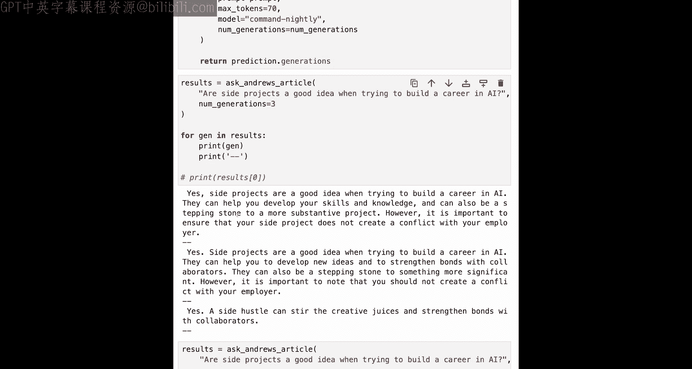

# 吴恩达最新《大型语言模型与语义搜索》｜Large Language Models with Semantic search｜中英字幕 - P6：SC-Cohere_L5.zh_en - GPT中英字幕课程资源 - BV1zr4y1d7bi

In this lesson， we'll add a generation step using an LLM at the end of the search pipeline。 This way。

 we can get a answer instead of search results。 for example。

 this is a cool method to build apps where a user can chat with a document or a book or。

 as we'll see in this lesson， an article。 largege language models are great at many things。

 There are， however， use cases where they require some help。 Let's take an example。

 So let's say you have a question that is our side projects。😊。

Important， when you are。Starting to learn about AI。 You can ask this to a large language model。

 some of them might give you interesting answers。 But what is more interesting really is if you ask an expert or the writings of an expert。

 An example here is if you can ask this to Andrew Ang or consult some of Andrew's writings about question like this。

Luckiily， we have access to some of Andrew's writings So you can go in deep learning AI。

 there's this newsletter called the batch。 And you can find this series of articles called how to build a career in AI。

 It's in multiple articles。 we'll use what we've learned in this course to search and then generate an answer from this article using a generative large language model。

 Let's visualize this and describe exactly what we mean。

 We can ask a large language model a question。 and they're able to answer many questions。

 But sometimes we want them to answer from a specific document or archive。

This is where you can add a search component before the generation step to improve those generations。

When you rely on a large language model's direct answer。

 you're relying on the world information it has stored inside of it。

But you can provide it with context using a search step before and for example。

 when you provide it to the context in the prompt that leads to better generations for cases when you want to anchor the model to a specific domain or article or document or our text archive in general This also improves factual generations So in a lot of cases where you want facts to be retrieved from the model and you augment it with a context like this that improves the probability of the model being more factual in its generation。

 the difference between the two steps is instead of just asking the question to a generative model and seeing the result that it prints out we can first present the question to a search system exactly like the ones we built earlier in this course。

 then we retrieve some of these results we pose them in the prompt to the generative model in addition to the question and then we get that response that was informed by the context。

We'll look at exactly how to do that in the code example next。So this is our question。

 let's build our text archive。For this use case， we'll simply just open these articles and copy the text。

 we can just copy it and paste it in this variable we can call text。Just dump all of them in there。

 We can copy3。 So this is the second article。And here we have a variable that contains the text of three articles。

 you can do more， the series is a great read and it's I think it maybe in seven or eight parts。

 but we can do this example with three。Some familiar code that you've seen in the past to set up the environment。

 we run here， also some more familiar code so we can import。Co here。

 because next we will be embedding this text， we'll be chunking it first and then embedding it。

 and then building our semantic search index。So this is where we've chunked it。

 Let's look at what text looks like。 Now， let's look at the first。Three examples。😔。

So these are the first three chunks， so the rapid rise of AI has led to a rapid rise in AI jobs。

Three key steps for career growth， the initial year， so these are three passages。

 three paragraphs from Andrewra's article。Next， we can proceed to setting up the cohere SDK and embedding the text。

 So here we're sending it to embed and getting the embeddings back。 Now let's build our text archive。

We do a few imports。 We've seen all of these before。 So this is annoi。

 which is the vector search library， Ny， pandas will not be using regular expressions， but。

It's always good to have them handy when dealing with text in general。

So the same code goes here and to run through this is we're just turning it into a nuy array。

 so these are the vectors that we got back， so these are the embeddings。We create a new index。

 a vector index， we insert the vectors into it and then we build it and save it to file。

 Now we have our vector search。 Let's now define a function。 Let's call this one search。

And throughs article， and we give it a query and it will run a search on this data。And to do that。

 these steps are exactly what we've seen in the past， so we embed the query。

We do a vector search of the archive。 so we compare the query versus every the embedding of every paragraph in the text。

 and then we return the result。 Now we can ask this search system a question kind of like this。

 are side projects a good idea when trying to build a career in AI。

 So I wonder what Andrew would say about this。And here we return the first result。

 so this is a long paragraph and it's the closest match to this question and if you look somewhere here。

 develop a side hustle， even if you have a full time job。

 a fun project that may or not develop into something bigger can stir the creative juices。

So that's the answer way in the center of this big text here。

 this is a great case for why we can use a large language model to answer this so we can give it this and we have it extract that relevant piece of information for us。

So let's do that next。 So instead of searching， we want to say。

 want to define a new function that says ask。Andrews article。

 and here we give it a question and let's say。Generation。So a few things to do here。

 So the first step before we do anything we will search。

 so we will get that relevant context from from the article。 We can get the top result。

 and this is a design choice for you。 Do you want to inject one result in the prompt2 or3。

 but we'll use one because that's the simplest thing to do here。

The prompt that we can use can look like this， so excerpt from an article titled How toBuild a Care in AI by Android so this is a general prompt engineering tip that the more context we provide for the model the more it's able to tackle the task better。

Then in here we will inject the context that we received。

 so this is the paragraph from the article and then we pose the question to it and we give the instruction or command to the model to say extract the answer from the text provided and if it's not there。

 tell us that it's not available that we then say。Prediction that we need to send to the model now that we have our prompt。

 we say co dot。Generate。Prompt equals。Prompt。Max tokens， let's say 70。

 some of these tend to be on the longer model。 We want to use a model that we call command nightly。

 This is the generation model from cohere that is most rapidly updated。

 So if you're using command nightly。 You're using the latest models that are available on the platform。

 So this tends to be some experimental models， but they're the latest and generally greatest。

 So we can stop here。 We're not using non generations yet， but we can use that later。Then。

 we will return。Print。Diction generations。that is our code now。Exactly this question。

 let's pose it here， and instead of this being a search exercise。

 we want this to be a conversational exercise informed by search and posed to a language model。

 and if we execute it， we get this answer。Yes， side projects are a good idea when trying to build a career in AI they can help you develop your skills and knowledge and can also be a good way to network with other people。

 however， you should be careful not to create a conflict with your employer and you should make sure that you're not evaluating any and then we ran out of tokens here so we can just increase the number of tokens here if you want a longer answer。

So this is a quick demo of how that works。 You can take it first pin ask it a few questions。

 some of these might need a little bit of prompt engineering。

 but this is a high level overview of some of these applications。

 there are a bunch of people who are doing interesting things with things like this with for example ask the Lex Friedman podcast anything and that does exactly this flow so semantic search against the transcripts of the entire podcast。

 somebody did that with Andrew Huberman's podcast as well。

 you see this with transcripts of YouTube videos of books as well so this is a common thing that people are building with large language models and it's usually powered by this one two step of search and then generate and you can throw re-rank in there to improve the search component as well。

Feel free to pause here and try this for yourself， run the code up until this point and change the questions that you want to send the model there。

😊，Get another data that you're interested in。 You don't always have to copy the code。

 This is just a very quick example。 You can use tools like Lama index and L chain to import text from PDFf if you want to work on a more industrial scale。

So remember this numb generations parameter this is a。

Cool tip when you're developing and you want to test out the behavior of the model on a prompt multiple times in every time you hit the API so you can say this is a parameter that we can pass to code out generate。

 so we can say nu generations equal nu generations。And then when we're asking the question here。

 we can say numb generations equals three。And we don't want it necessarily to print this。

 We want to print multiple So what happens here is that we this question is going to be given to the language model and the language model is going to be asked to give us three different generations at the same time。

 not just one so it runs them in like a batch and then here we can say for gen in。Results。

Print gen for generations， basically。Print， this is just for us to see。

Because when you debug model behavior， you want to have this to be able to quickly see， okay。

 is the model answering this question or responding to this prompt？🤢，Multiple times。

Correctly or not without having to continue to run it one after the other。

 you can see three or up to five， I think you can pass to this where this is a generation from the model and this is a generation and they're all in response to the same prompt。

 And that's one way for you to do prompt engineering and get a sense of the model behavior in response to the prompt that you're using at a glance multiple times。

