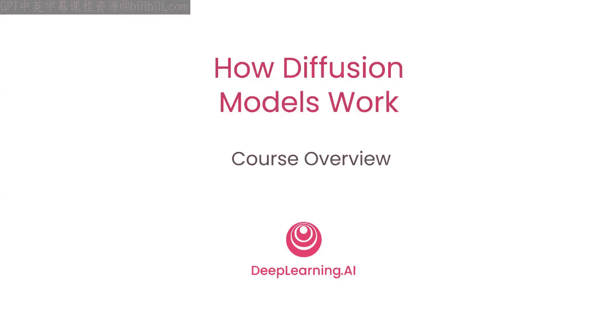
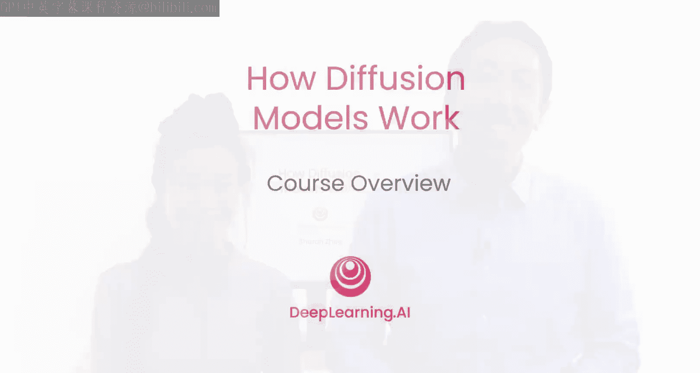
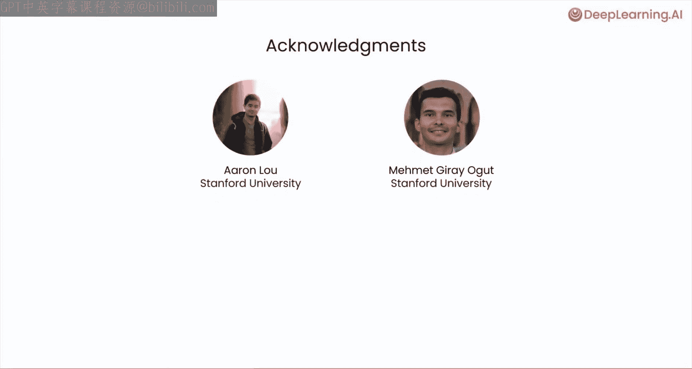
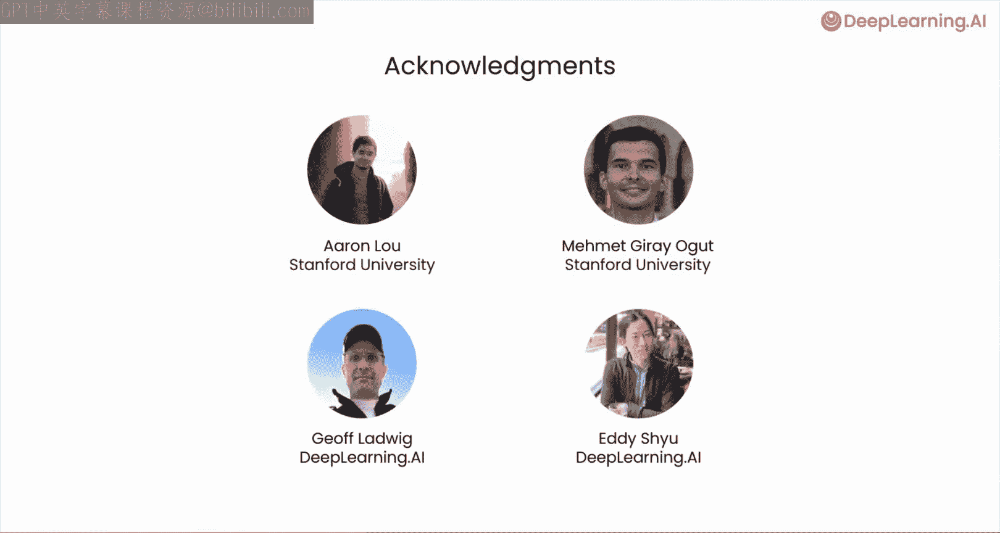

# 吴恩达最新《扩散模型是如何工作的》｜how-diffusion-models-work｜中英字幕 - P1：1_DiffusionModels_Intro_v02.zh_en - GPT中英字幕课程资源 - BV1R14y1D7kx

I'm thrilled to present to you this short course on diffusion models taught by Sharon Jo。

Midjoney， stable diffusion， Dali and others are able to generate an image。

 sometimes a beautiful image， given only a prompt。 How do these algorithms work You may have heard of a vague description of these algorithms learning to subtract noise to generate an image but in this short course Sharon will step you through a concrete implementation of image generation using a diffusion model so that you understand the technical details of exactly how it works。

 thanks Andrew in this course， you'll be learning about the current state and capabilities of diffusion models used today you'll start by understanding the sampling process。

 starting with pure noise and progressively refining it to obtain a final nice looking image you'll build the necessary programming skills to train a diffusion model effectively you'll learn how to build a neural network that can predict noise in an image you'll add context of the model so that you can control what you want it to generate and finally by implementing advanced algorithms you'll learn。

😊，accelerate the sampling process by factor of 10。 This is an intermediate to advanced course。

 We assume you're familiar with Python and basic neural network training So for example。

 we'll assume you know what back propagation is We'll use Pytorrch throughout but if you're familiar with other machine learning frameworks such as Tensorflowlow you should be able to follow along just fine and so the run example will used for the short course would be generating 16 by 16 sprites like those little a characters using video games we chose this example so that it's feasible for you to not just go through the notebooks but also run them yourself to generate cute sprites yourself right there in that Jupyter notebook。

Diffusion models are becoming a foundation for cutting edge research in the life sciences and other sectors too。

 for example， generating molecules for drug discovery。

 so when you understand the technical details of diffusion models。

 you also be in a better position to understand and perhaps apply such models yourself。

Many people work together to build this short course。

 I want to thank Eric Lu and Meme Gura Ogod for their significant contributions and on the deep learninging AI side also Jeff Ludwig and Eddie Shu。

So with that， let me hand it over to Sharon and I hope you enjoy the course Great， let's get started。

😊。