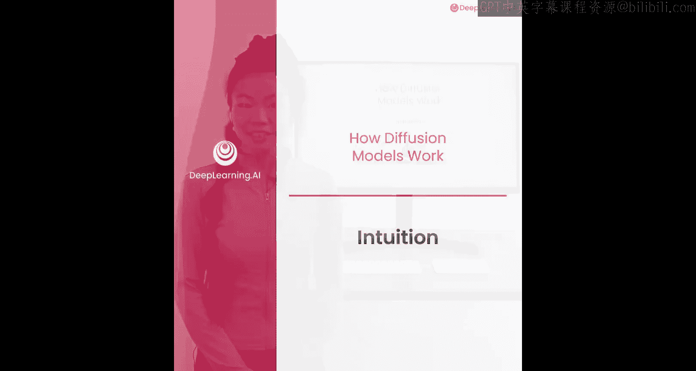
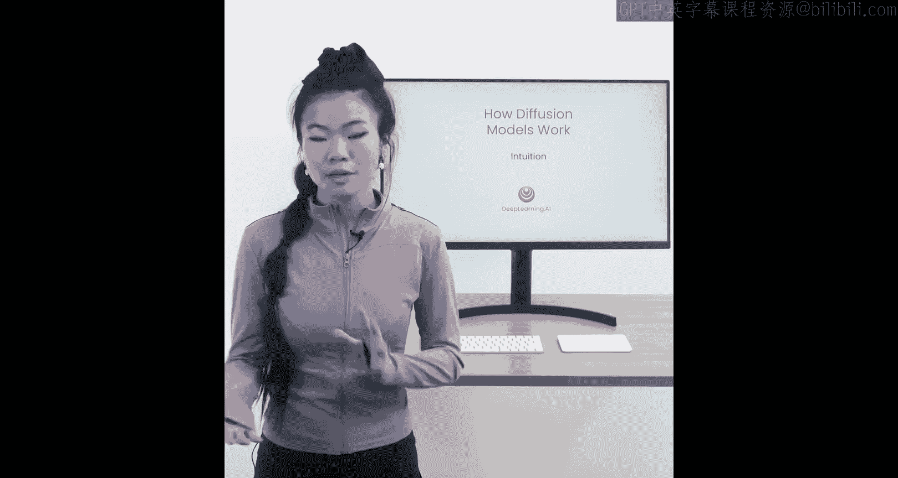
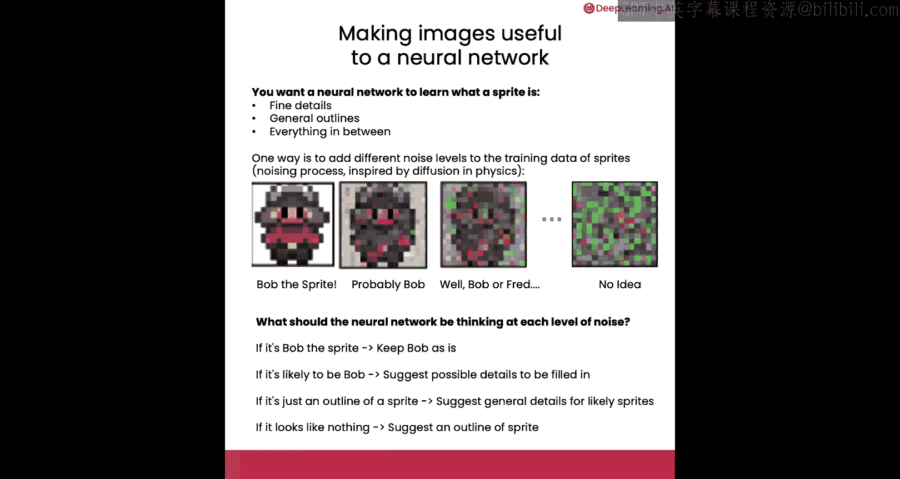
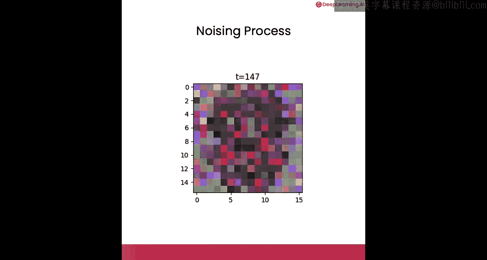
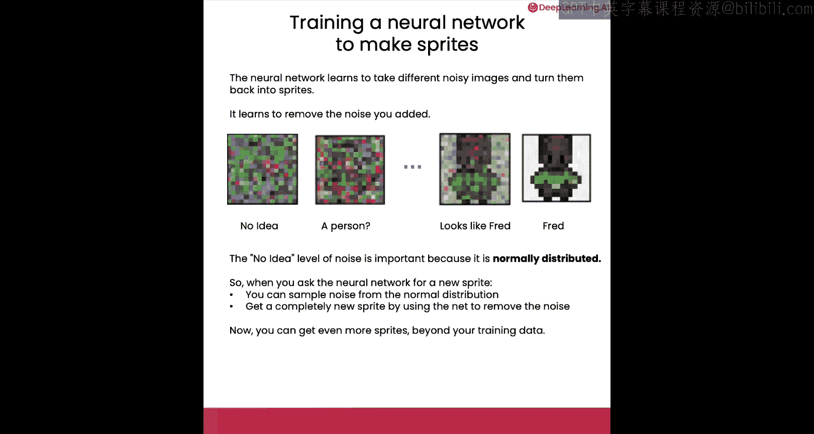

# 吴恩达最新《扩散模型是如何工作的》｜how-diffusion-models-work｜中英字幕 - P2：2_DiffusionModels_L1_v01.zh_en - GPT中英字幕课程资源 - BV1R14y1D7kx

In this video， your goal is to gain some intuition of diffusion models first we'll talk about the goal of the diffusion model then we'll talk through how the training data that you have of different sprites can be made useful to these models and then we'll talk about training the models themselves on this data。

What is the goal of diffusion models Well， you have a lot of training data such as these sprite images that you see down here of video game characters and this is your training data set and what you want is you want even more of these sprites that are not represented in your training data and you can use a neural network that can generate more of these sprites for you following the diffusion model process。

So now how do we make these images useful to the neural network Well you want the neural network to learn generally the concept of a sprite what it is。

 and that could be finer details such as you know the hair color of the sprite or that it's wearing a buckle or its belt。

 but it also could be general outlines like of its head and body and everything in between that。

And one way to do that， one way to kind of take your data and be able to emphasize either finer details or general outlines is actually to add different levels of noise so this is just adding noise to the image and it's known as a noising process and this is inspired by physics you can imagine an ink drop into a glass of water initially you know exactly where the ink drop landed but over time you actually see it diffused into the water until it disappears and that's the same idea here where you start with bob the sprite and as you add noise it will disappear until you have no idea which sprite it actually was。

And so what should the neural network really be thinking at each of these levels of noise when you add progressively more noise to the image Well。

 when it's Bob the sprite， you want the neural network to say， yeah。

 that's Bob the sprite to keep Bob as it is， that is a sprite。If it's probably Bob。

 if it's likely to be Bob， then you probably want the neural network to say， you know。

 there's some noise on here， suggest possible details to make it look just like Bob the sprite。

And if it's just an outline of a sprite now here， you can only get a sense that this is probably a sprite person。

 but it could be Bob or Fred or maybe even Nancy， then you want to suggest more general details for possible likely Sprites。

 so maybe you'll suggest some details for Bob based on this or you'll suggest some details for Fred。

And finally， if you have no idea if it looks like absolutely nothing。

 you still want it to look more like a sprite， you still want the neural network to say。

 you know what， I'm going to still take this completely noisy image and I'm going to turn this into something that's slightly more sprite like by proposing an outline of what a sprite might look like。

All right， so let's take a look at what that noising process。

 the process of adding noise progressively looks like over time。And there it goes。

 an ink drop that's fully diffused in a glass of water。

So now on training that neural network， so it learns to take different noisy images and turn them back into sprites。

 that is your goal and how it does that is it learns to remove the noise you added。

 starting with the no ideal level where it is just pure noise to starting to give a semblance of maybe there's a person in there to looking like Fred and then finally a sprite that looks like Fred。

And I just want to call out that the no idea level of noise is really important because it is normally distributed。

 and what I mean by that is each of those pixels is sampled from a normal distribution。

 also known as a Gaussian distribution or a bellshad curve。

So when you want to ask the neural network for a new sprite， such as Fred here。

 you can sample noise from that normal distribution and then you can get a completely new sprite by using the neural network to just remove that noise progressively。

So now you have reached your goal， you can get even more sprites beyond all those that you are trained on。

In the next video， we'll cover sampling。

