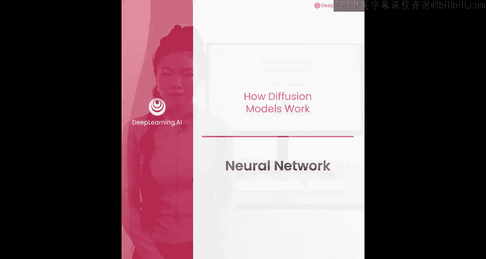
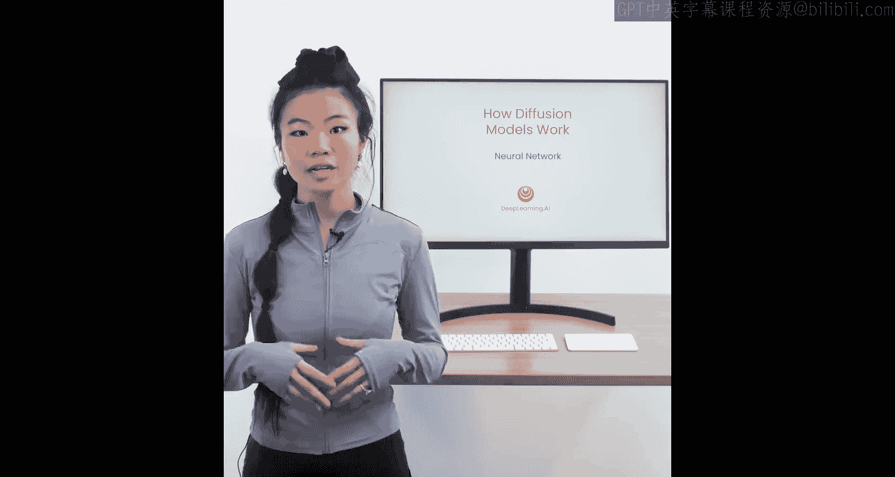
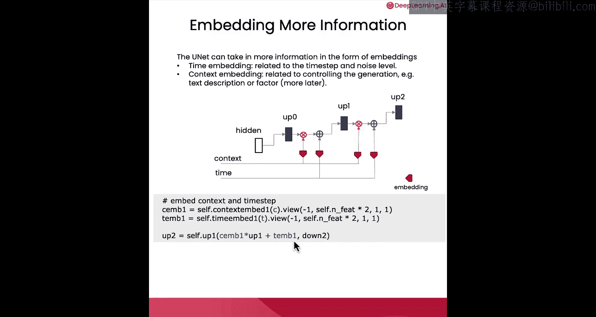
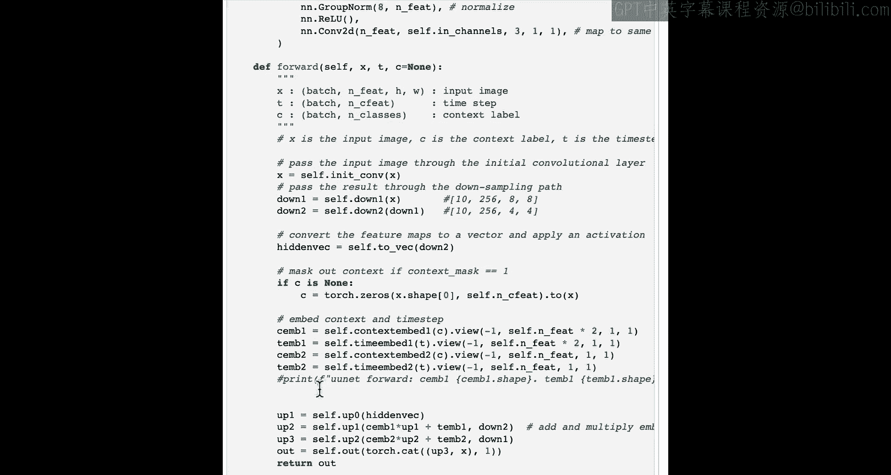
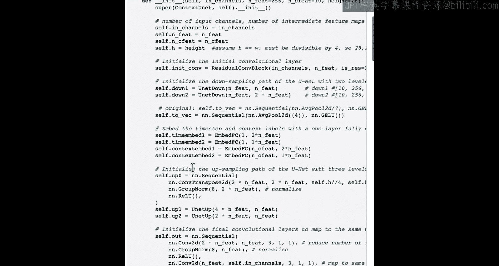
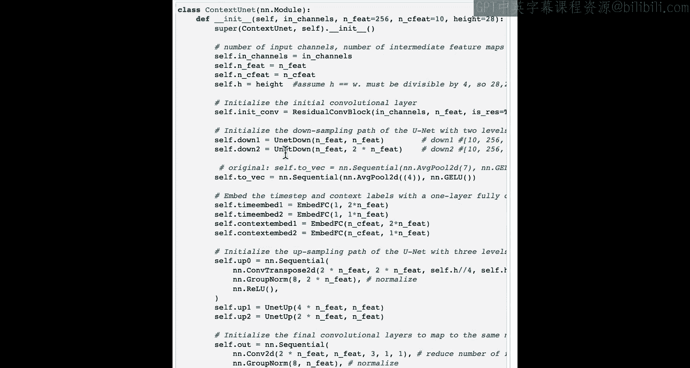
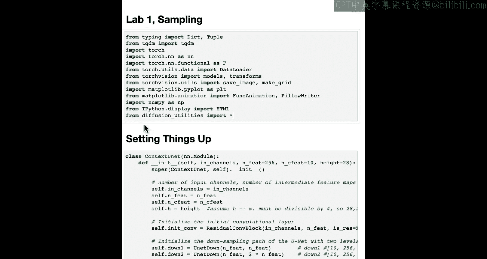
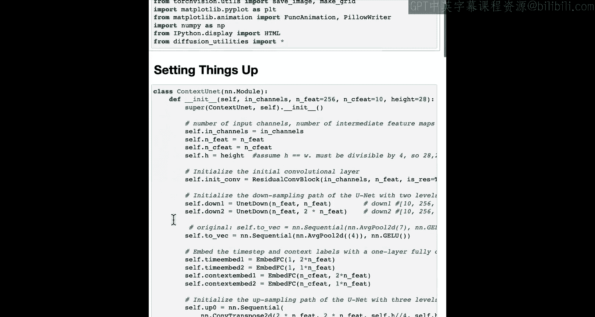

# 吴恩达最新《扩散模型是如何工作的》｜how-diffusion-models-work｜中英字幕 - P4：4_DiffusionModels_L3_v02.zh_en - GPT中英字幕课程资源 - BV1R14y1D7kx

In this video， we'll go over the neural network， the architecture of it。

 and how we can incorporate additional information into it。

So the neural network architecture that we use for diffusion models is a unit and the most important thing that you need to know about a unit is that it is taking as input this image and it's producing as output something of the same size as that image but here it is that predicted noise units have been around for a very long time since 2015 and it was first used for image segmentation is first used to take an image and actually segment it into either pedestrian or a car so it's used a lot in self-driving car research but what's special about units is just that its input and outputs are the same size and what it does is it first embeds information about this input so it down samples with a lot of convolutional layers into an embedding that compresses all that information into a small amount of space and then it upsles with the same number of upsampling blocks into the output back out for。

Its task and in this case that task is to predict the noise that was applied to this image and if you want to look a little bit deeper which we'll do together is that each of these named blocks here are also shown in the code with the same names and this predicted noise is the same dimension 1616 by3 of the original input image what's also great about this unit is that it can take in additional information so it's compress that image to understand what's going on but it can also take in more information and so what information do we want to include well one thing that's really important for these models is the time embedding and so this is an embedding that kind of tells the model what the time step is and therefore what kind of noise level we need and all you have to do for this time embedding as you embed it into some kind of vector and you can add it into these ups blocks。

Another piece of information that could be useful is a context embedding we'll do more of this later。

 but all that context embedding does is it helps you control what the model generates， for example。

 a text description like you really want it to be Bob or some kind of factor like it needs to be certain color we'll discuss this a bit more later。

And for that context embedding， you can just multiply it in。Great。

 so what does that look like in code here you can see a context embedding。

 This is just one of them and then here you see the time embedding and in the up sampling block。

 all'll get to do again， just like in this diagram。

 you multiply the context embedding with the up sampling block and you add the time embedding Co so now in the notebook in the forward pass of the model So this is running the model you can see some of these down。

 down down blocks and then also these up up up blocks here and again here are your context in time embeddings。

 we have two of them here for each of those up blocks and how these down and up blocks are defined is up here。

In initialization for the unit。

And so for the down， this is what a unit down looks like。

 and we actually do have that in our helper functions if you want to look at them in greater detail。

 but they are just convolutional blocks。

And in the next video， you'll learn how to train this neural network。

