# 吴恩达最新《扩散模型是如何工作的》｜how-diffusion-models-work｜中英字幕 - P5：5_DiffusionModels_L4_v02.zh_en - GPT中英字幕课程资源 - BV1R14y1D7kx

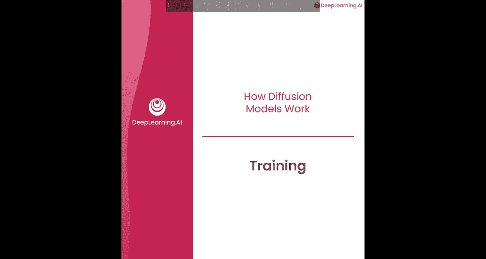

In this video， we'll discuss how to train this UNNe neural network and get it to predict noise。

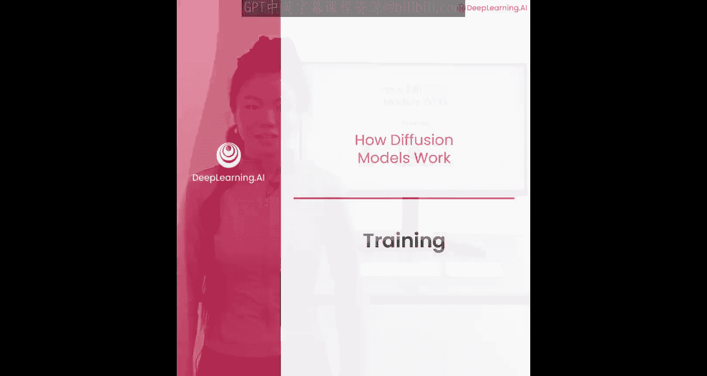

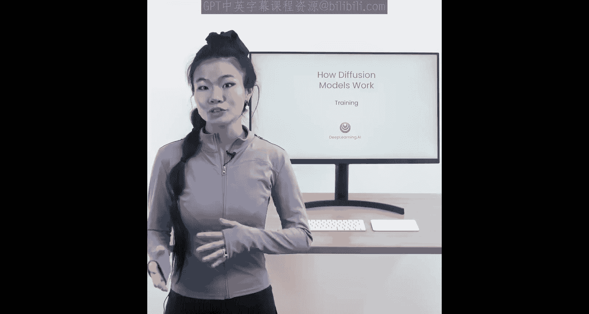

So the goal of the neural network is for it to predict noise and really it learns the distribution of what is noise on the image。

 but also what is not noise， what is sprite likeness right and so how we do that is that we take a sprite from our training data and we actually add noise to it。

 we add noise to it and we give it to the neural network and we ask the neural network to predict that noise and then we compare the predicted noise against the actual noise that was added to that image and that's how we compute the loss and that back props through the neural network so that the neural network learns to predict that noise better。

So how do you determine what this noise here is You could just go through time and sampling and give it different noise levels。

 but realistically in training， we don't want the neural network to be looking at the same sprite all the time。

 It helps it to be more stable if it looks at different sprites across an epoch and is' just more uniform。

 So actually what we do is we randomly sample what this time step could be。

 We then get the noise level appropriate to that time step we add it to this image and then we have the neural network predicted we take the next sprite image in our training data。

 We again sample a random time step could be totally different like you see here and then we add it to this sprite image and again we have the neural network predicted the noise that was added and this results in a much more stable training scheme。

 So what does training actually look like here is a wizard hat sprite and here is what a noise input would look like and when you first put it into the neural network at epoch0 the neural network hasn't really learned what a sprite is yet。

 So the predicted noise。quite changed what the input looks like and when it's subtracted out。

 it actually just turns into this， which looks about the same， but by the time you get to epoch 31。

 the neural network has a better understanding of what this sprite looks like。

 so then it predicts noise that is then subtracted from this input to produce something that does look like this wizard had spred。

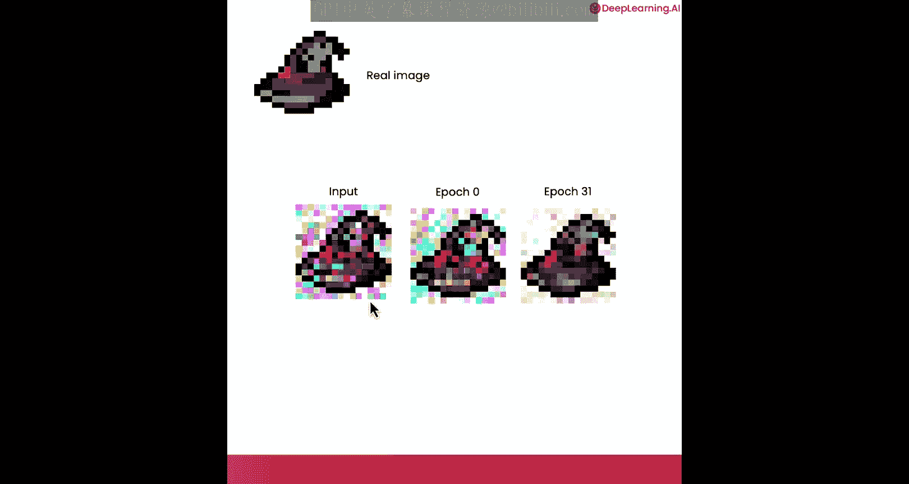

Cool， so that was for one sample， this is for multiple different samples。

 multiple different sprites across many epochs and what that looks like。

 as you can see in this first epoch it is quite far from Sprites。

 but by the time you get to Epoch 32 here， it looks quite like little video game characters and even before that。

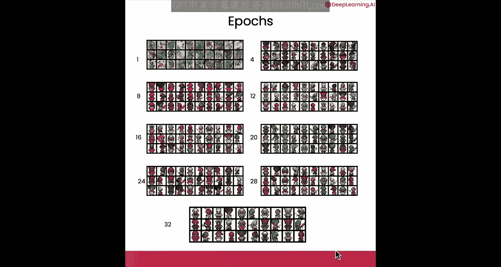

Alright， so now we'll go through the training algorithm with some code。

 so first you want to sample a training image， so here we are loading up all the data into the data loader we're putting into a progress bar so that we can visualize it。

 but essentially imagine all the data here we're then iterating through all of the data samples so X here is a training image so just looking at X now。

Within this loop， we are sampling a time step the T。And this determines the level of noise。

We're not going through all the time steps， just sampling a time step T。We sample a noise。

 we add that noise to the image based on that time step。

 and then we input that noise image into the neural network。

 and we also put in the time step because we also care about adding that time embedding in and the neural network predicts the noise as output。

Comparing that predicted noise with the noise that we actually added。

 we can compute the loss using means Sced error MSE。

And then all we have to do is back prop and learn。 So the model will then learn what is noise and what is sprite。

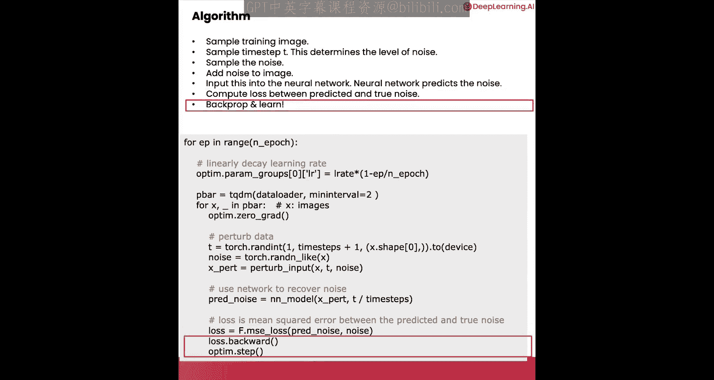

Cool， so onto our training notebook here， so this is all the same as before just hitting Shi enter setting things up with the unit here what's interesting is you know our training hyperparameters。

 our batch size of 100 and we are going through 32 different epochs and our learning rate So I'm just going shift enter there to run it again。

 similar things here of setting up the model and the noise schedule for those scaling parameters Now here's where you get into training so you can load your data and we're loading it into that data loader here it's this 16 by 16 sprites data set。

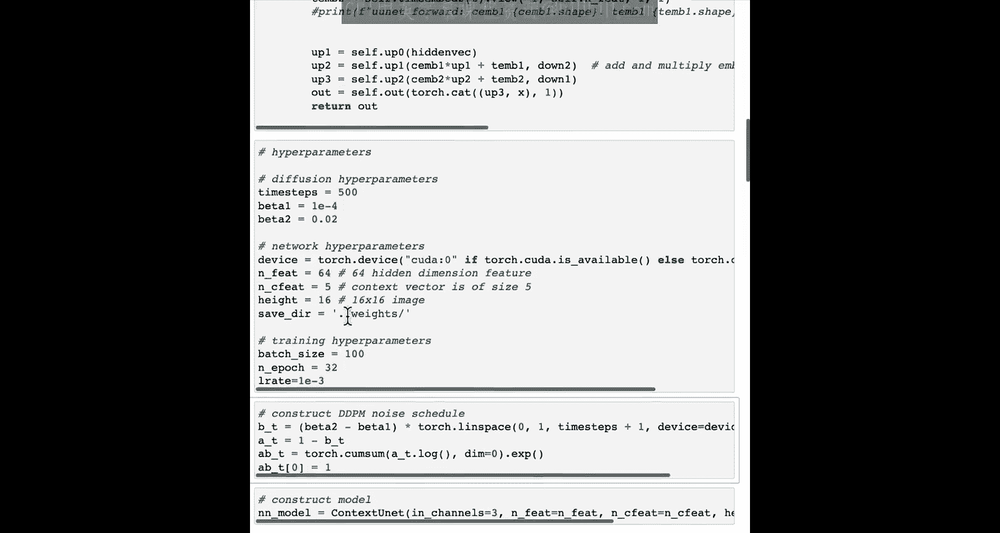

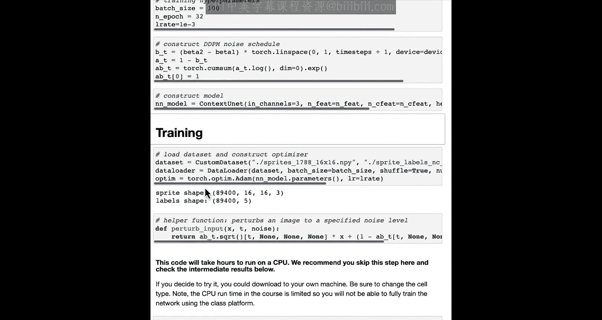

And we're also loading up our optimizer， and here's the function that perturbbs our input。

 meaning that it takes the image， it adds the right noise level for that specific time step to that image and returns it。

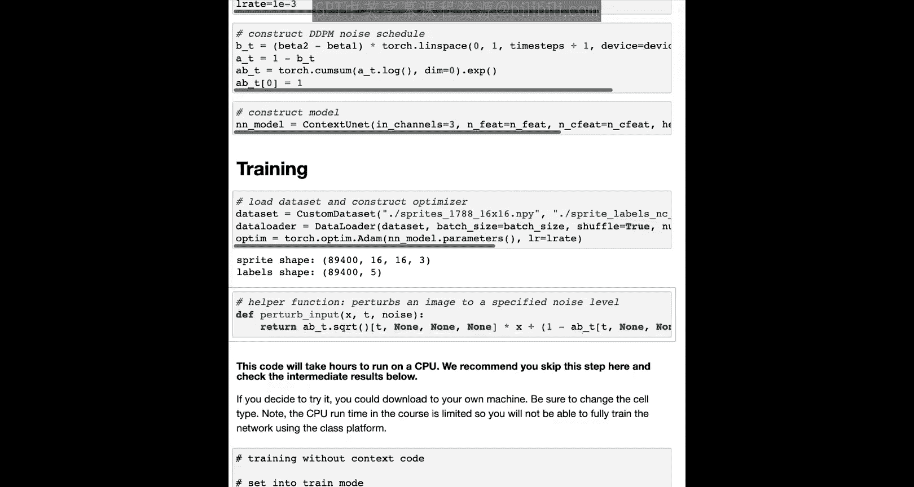

So can I shift enter here？

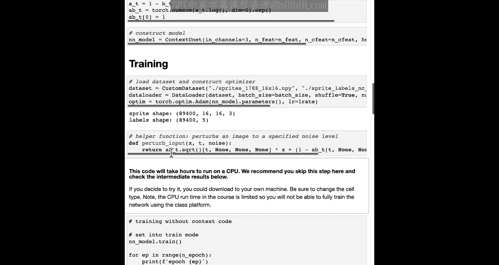

So here we won't actually step through training because it takes many hours on CPU and that's where these notebooks are hosted。

 but I really recommend that you do go through this。

 this is the exact code that we had just looked at together。

But what we can do is that we did train this model and save the model at different epochs such that you can then run sampling and be able to see how it does at each epoC so this is again the same sampling code you saw before I'm just going to breeze through that。

And here is where you would load the model for Epoch0。

 so this is the path to that model checkpoint model underscore zero for epoch0。

 so I'm going to load that model。

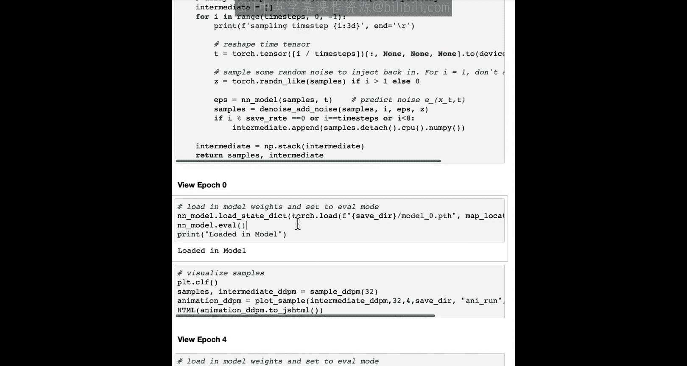

And then here you can just visualize the samples。 And again。

 this is running the same sampling method as before called DDPM that you learned in the previous video。

 This takes a couple minutes and we'll speed this up in the video。 Great， so we can hit play here。

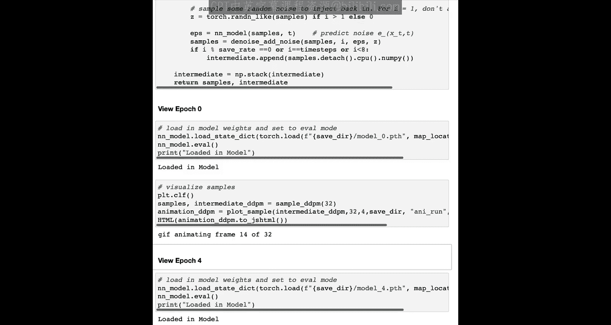

A bit amorphous still， but you know， starting to understand the general outlines of sprites。

 It's not pure noise。 So we also have Epoch4 here for you to see。 so you can see the model improving。

 These look a little bit more like sprites。

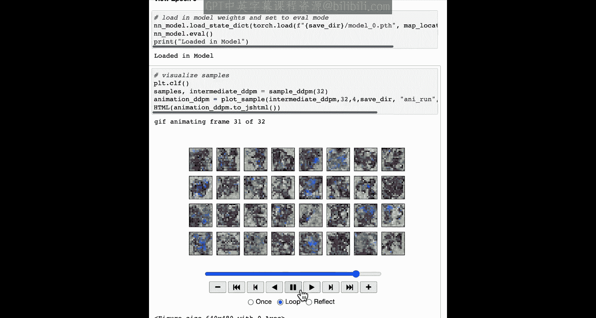

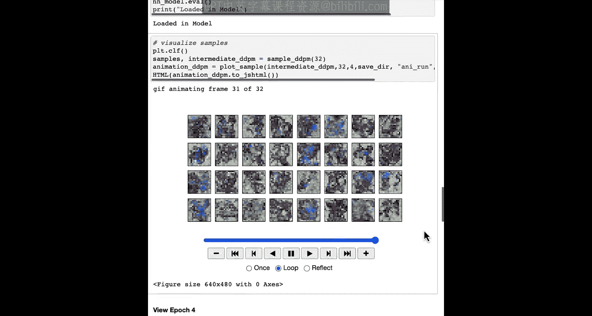

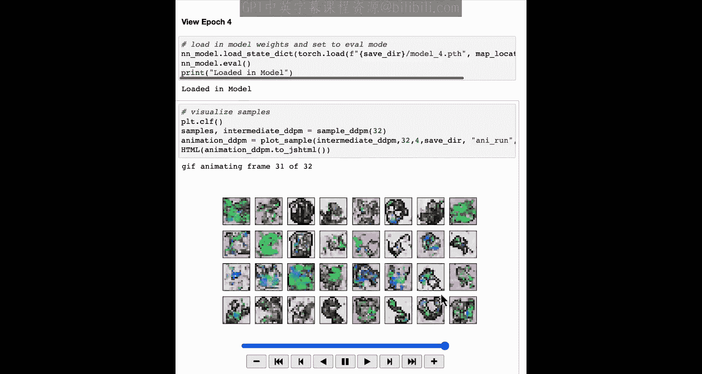

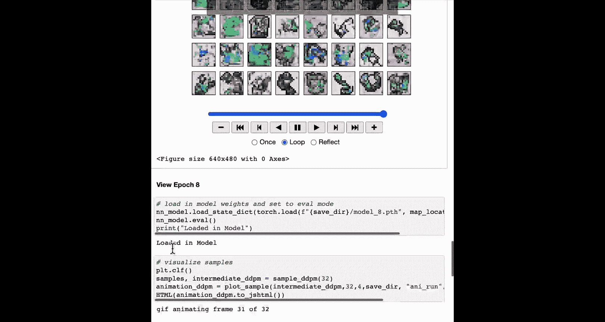

And Epoch 8。A little bit more。

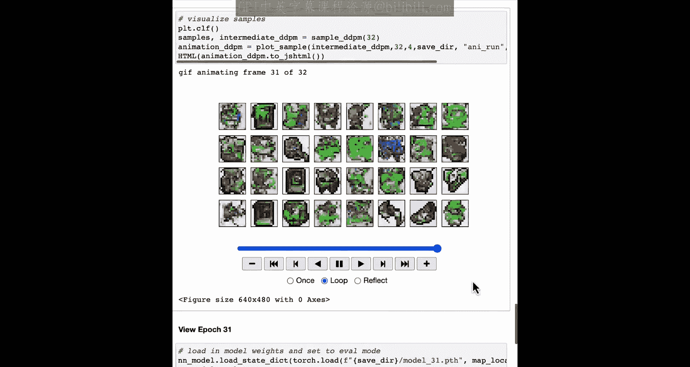

Seeea some books in there， actually。And finally， Epoch 31。

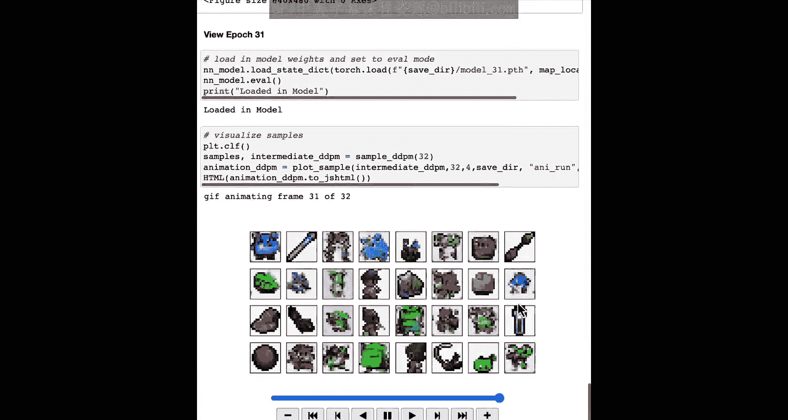

Or this might actually be 32 when we index from zero。

 so these look a lot more like sprites you can see a sword here， this is probably the wizard hat。

 see a potion here， but of course there are still some blobs here and there， some people here。

 so it's not perfect and it could keep going。So in the next video。

 you'll get to control what you generate， meaning you can tell it to generate objects or these people。

 for example。

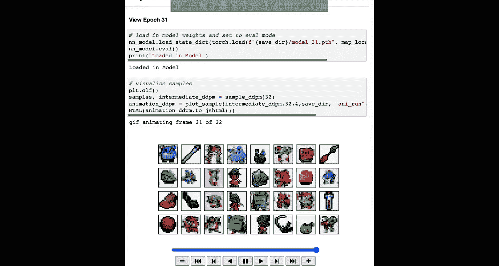