# 吴恩达最新《扩散模型是如何工作的》｜how-diffusion-models-work｜中英字幕 - P6：6_DiffusionModels_L5_v02.zh_en - GPT中英字幕课程资源 - BV1R14y1D7kx

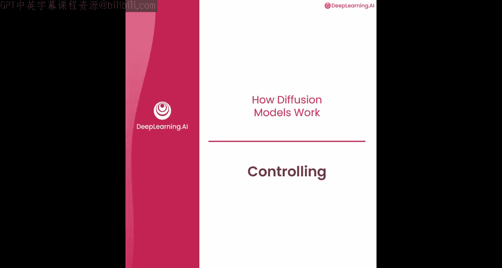

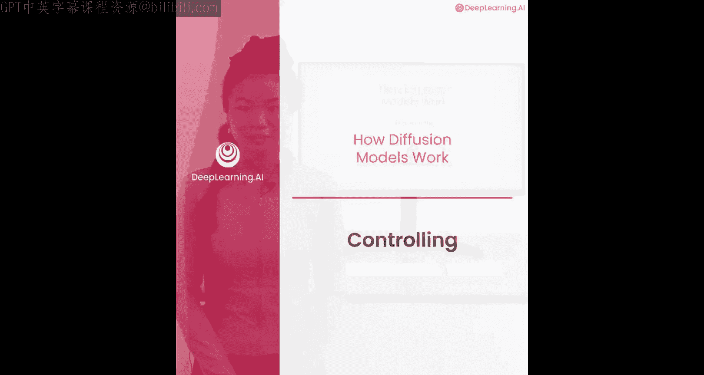

In this video， you'll learn how to control the model and what it generates for many。

 this is the most exciting piece because you get to tell the model what you want and it gets to imagine it for you。

😊。

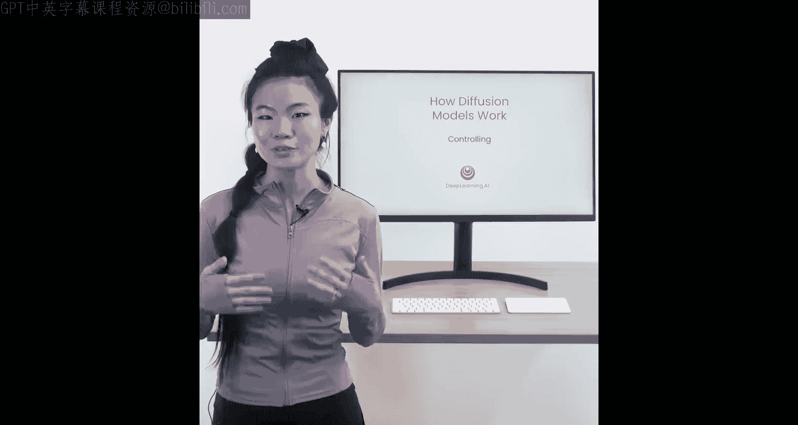

When it comes to controlling these models， we actually want to use embeddings and what embeddings are。

 which we looked at a little bit in previous videos of a time embedding and a context embedding。

 what embeddings are is their vectors， their numbers that are able to capture a meaning and here it's capturing the meaning of this sentence or this joke perhaps for diffusion models。

 brownians often bump into each other， so it encodes that into this embedding which is this set of numbers in a vector。

And what's special about embeddings is because they can capture the semantic meeting texts with similar content will have similar vectors。

 and one of the kind of magical things about embeddings is you can almost do this vector arithmetic with it。

 So Paris minus France plus England equals the London embedding for example so how do these embeddings actually become context to the model during training。

 Well here you have an avocado image， which you want the neural network to understand and you also have a caption for it a ripe avocado and you can actually pass that through。

 get an embedding and input that into the neural network to then predict the noise that was added to this avocado image and then compute the loss and do the same thing as before and you can do this across a lot of different images with captions So here's a comfy armchair you can pass it through an embedding pass it into the model and have that be part of training Now the magic of the section is that while you were able to scrape these images of avocados in armchairs off the internet。

😊，those captions you're able to at sample time be able to generate things that the model has never seen before and that could be it an avocado armchair and the magic of this is because you can embed the words avocado armchair into this embedding that has a bit of avocado and their bit of armchair in there。

 put that through the neural network， have a predict noise。

 subtract that noise out and get low and behold an avocado armchair。

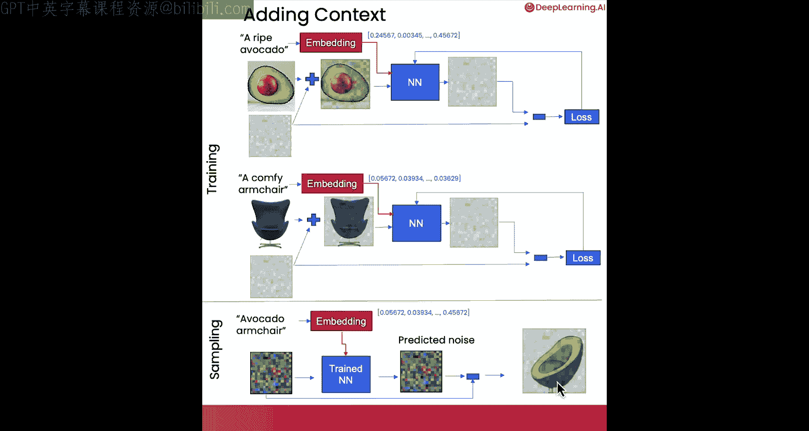

So more broadly， context is a vector that can control generation。

 context can be just as we have seen now the text embeddings of that avocado armchair that's very long。

 but context doesn't have to be that long context can also be different categories that are five in length。

 you know five different dimensions such as having a hero or being a non-hero like these objects of a fireball and a mushroom。

 it could be food items， you know apple， orange， watermelon。

 it could be spells and weapons like this bow and arrow or this candle。

 and finally it could be whether these sprites are side facing or not。

So now let's take a look at adding context to your model in the next lab。

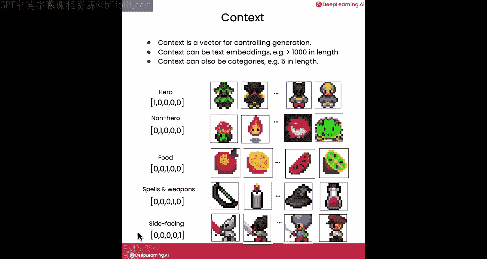

Onto our lab， we can just run this setup here for all these things。

 just setting up the same things as before。

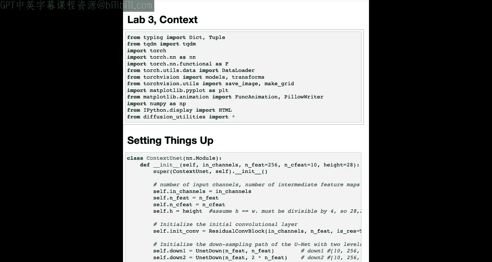

And then down here in context。Iant to instantiate our neural network again and again we're not training but I'm going to call out a few places where we do add the context so when we do load the data here。

 we now iterate through both the data point and the context factor associated with it in the context that we do have are these one hotend vectors of hero non-hero food spells and weapons inside facing we created context mask and what's important here is that actually with some randomness we completely mask out the context so that the model is able to learn generally what a sprite is as well。

It's pretty common for diffusion models， and then we add context when we call the neural network right here。

So let's load a checkpoint where we did train the model with context。

 so just loading that model here， running that。

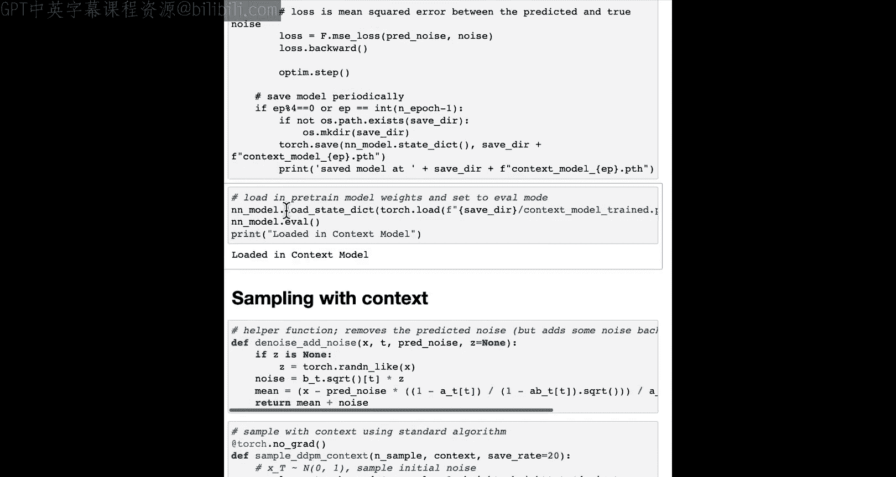

Running our sampling code again so we have that for this notebook and here you can see that when you run this。

 this is actually choosing completely random context right here completely randomly。

 you can see the different types of outputs you can see the different types of outputs of objects and people。

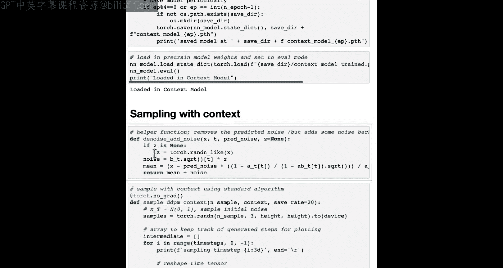

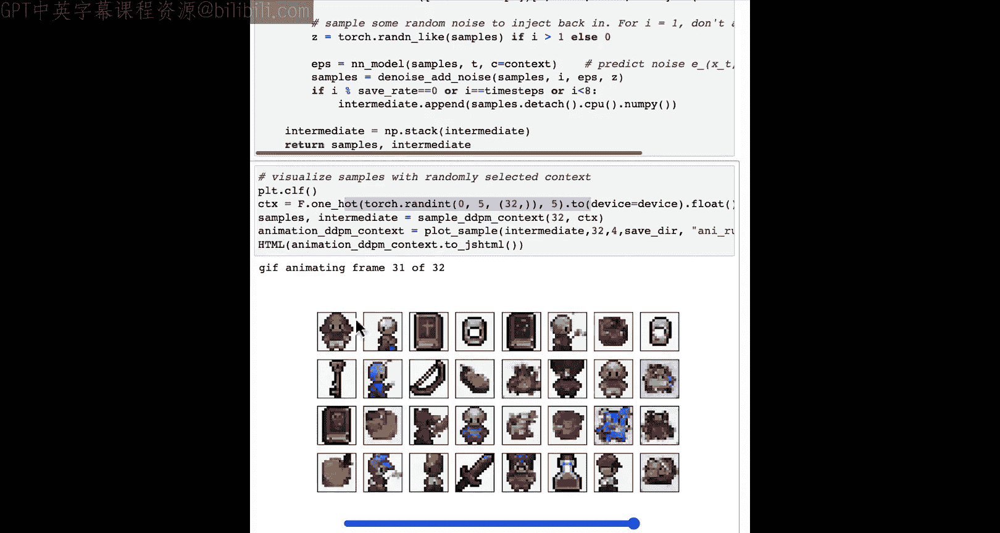

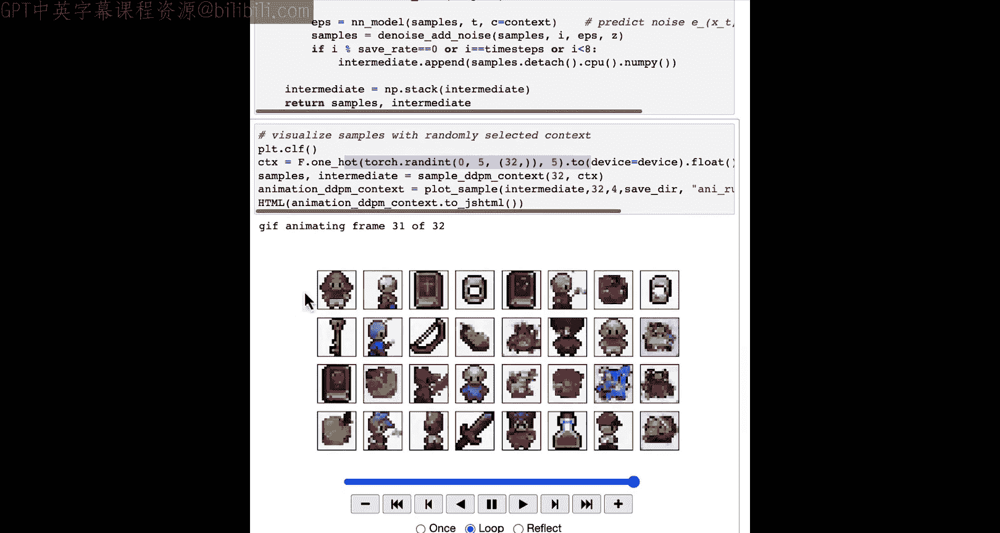

And now controlling it a bit you can actually define it here。

 so here I just defined you know oh hero， a couple heroes you know the first two so these two are heroes。

 the next two are side facing， so it's one hot with this last value here for side facing。

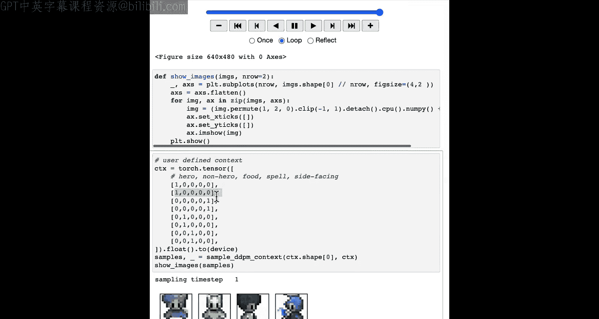

The next two are non heroes， so kind of beasts， they look very lobby here。

And the last two are food items。 So this kind of looks like an apple and this kind of looks like a pear。

 And now getting into the avocado armchair vibe， we can actually mix and match these a bit。

 So while we trained it on one hot encoded vectors。

 we could also provide it with these float numbers between zero and one to get a mix of things So here for the second one here。

 it is a hero and partially food。 And so now it looks like a potato man。

 The third one is also a little bit quick， it is part food and part spells。

 So kind of looks like this potion。 But yeah， you can play with these yourself。

 you can try to put in something contradictory like it's supposed to be a hero。

 but also side facing like both front facing and side facing。 So this is good fun。

 feel free to stop pause and play with us a few times and start changing these values up。

 So now that you can create all these samples control them in the next video you'll explore speeding up the sampling process so that you don't have the wait so long。

😊。

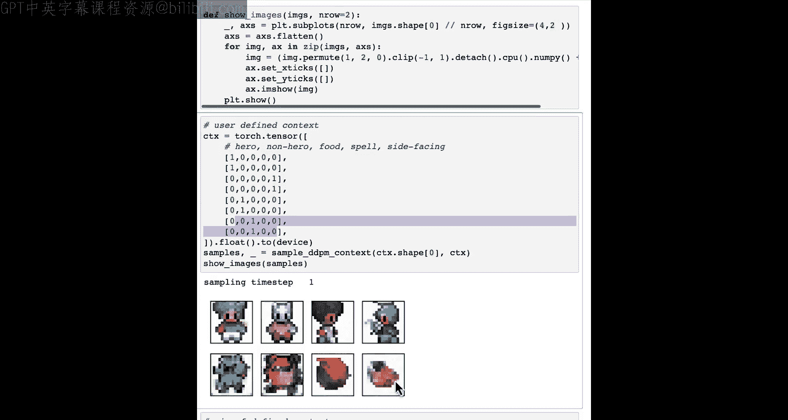

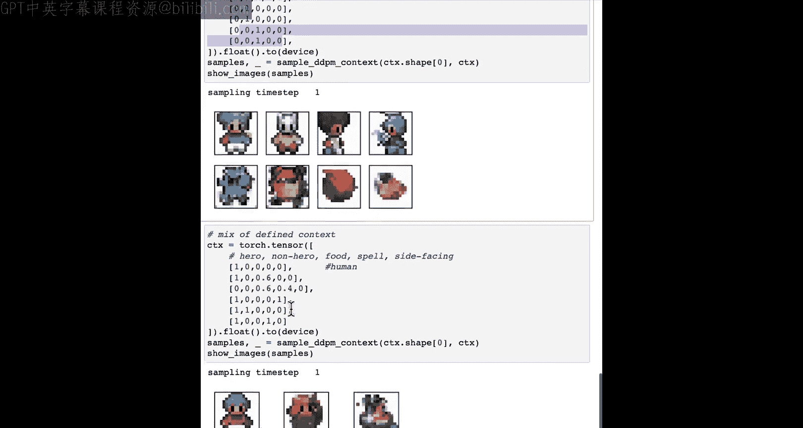

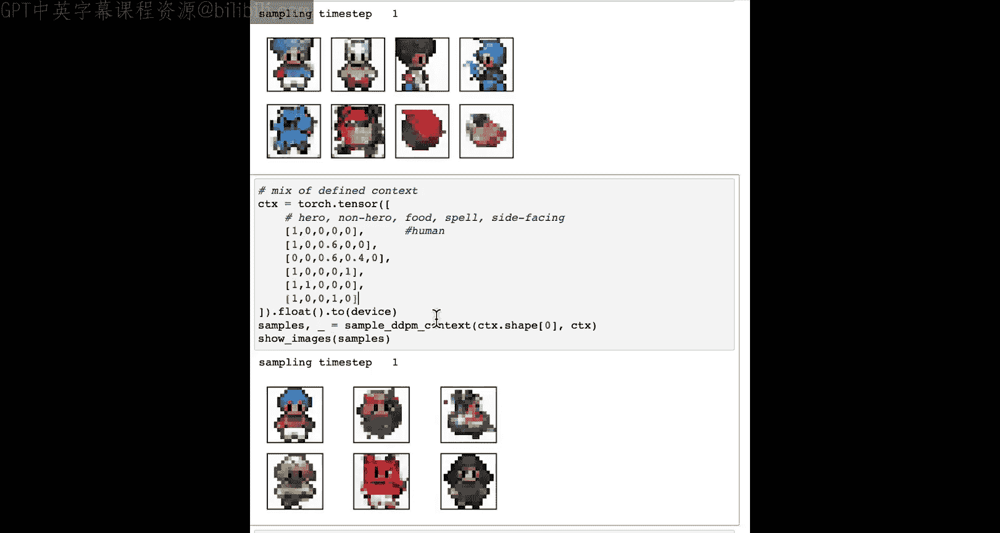

See these amazing samples。