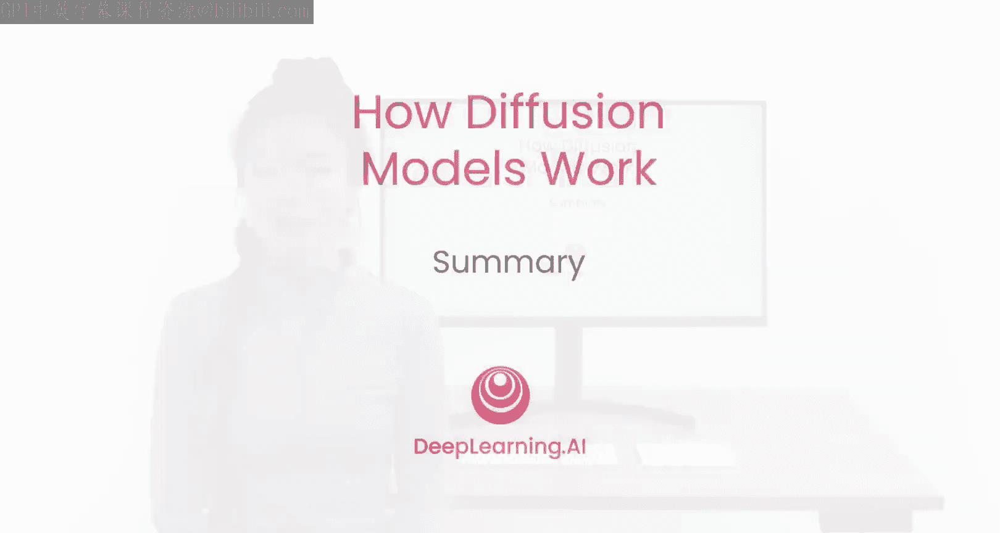
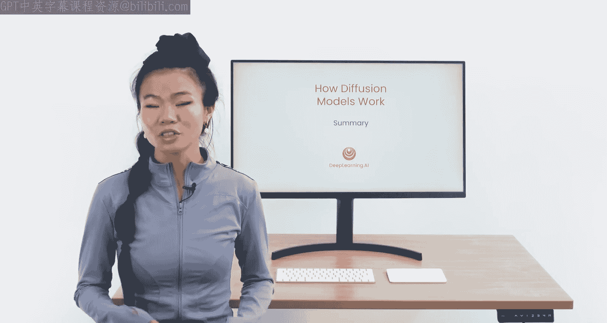
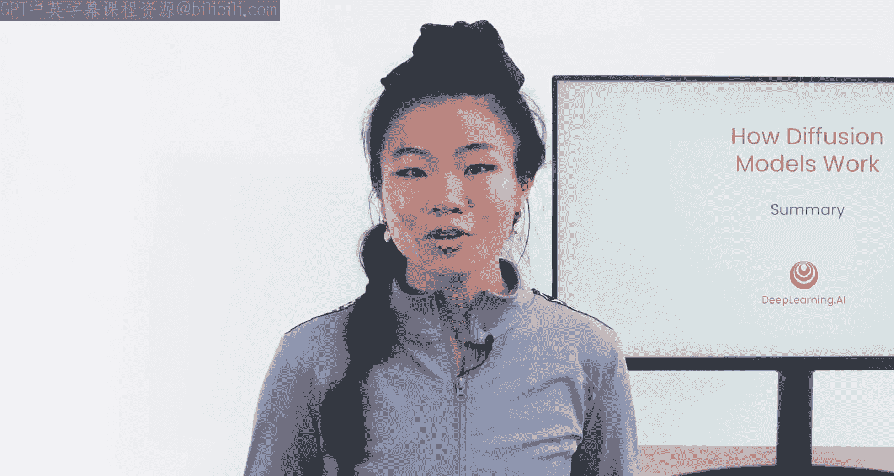
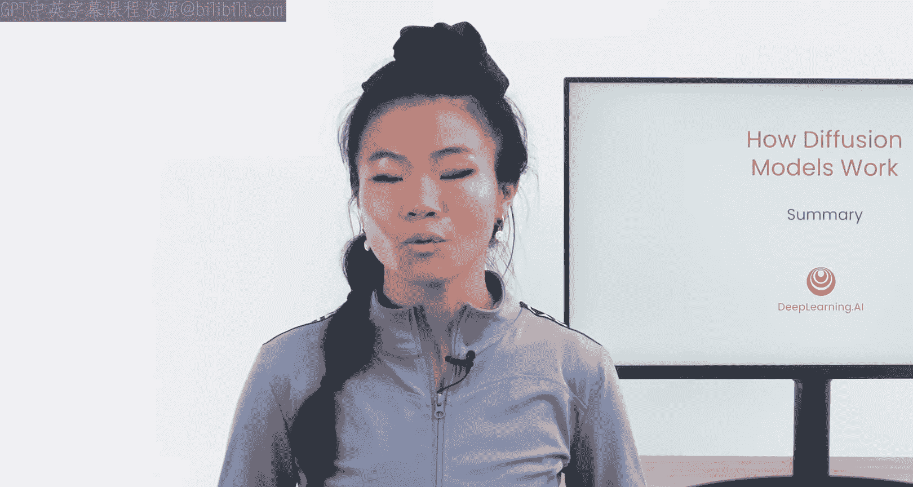

# 吴恩达最新《扩散模型是如何工作的》｜how-diffusion-models-work｜中英字幕 - P8：8_DiffusionModels_Conclusion_v02.zh_en - GPT中英字幕课程资源 - BV1R14y1D7kx

Congratulations on learning about the foundations of diffusion models。 Now， putting it all together。

 you're able to train a diffusion model to predict noise and iteratively subtract the predicted noise from pure noise to get a good image。

 You're able to sample images from that trained neural network fast too with a more efficient sampler called DDIN。

 you went through the model architecture， A unit。 You put context into the model so that you could decide whether you wanted food or spells or a hero sprite out or something quirky in between。

😊。

Finally， you explored and ran the code for all of this。

 Now you can create your own dataset and try to generate new things。

 diffusion models aren't bound to images either。 That's just where they've been the most popular。

 There are diffusion models for music where you can give it any prompt and get music out for proposing new molecules to accelerate drug discovery。

 You can also try a larger data， Try a new sampler。

 There are actually a ton out there that are even faster and better than DDIM。

You can do more with these models such as in paintingint。

 which is letting the diffusion model paint something around an existing image you already have。

 and textual inversion， which enables the model to capture an entirely new text concept with just a few sample images。

You covered the basics here， the foundations， there are other important developments in this space。

 for example， stable diffusion uses a method called latent diffusion。

 which operates on image embeddings instead of images directly to make the process even more efficient。

Other cool methods to call out are cross attention text conditioning and classifier free guidance。

And the research community is still working on faster sampling methods because it's still slower than other generative models at inference time。

 All in all， this is an extremely exciting time for diffusion models and generative models as a whole as they improve and their applications become ever more widespread。

 Thank you so much for joining me in this course， and I look forward to seeing what you build。😊。

