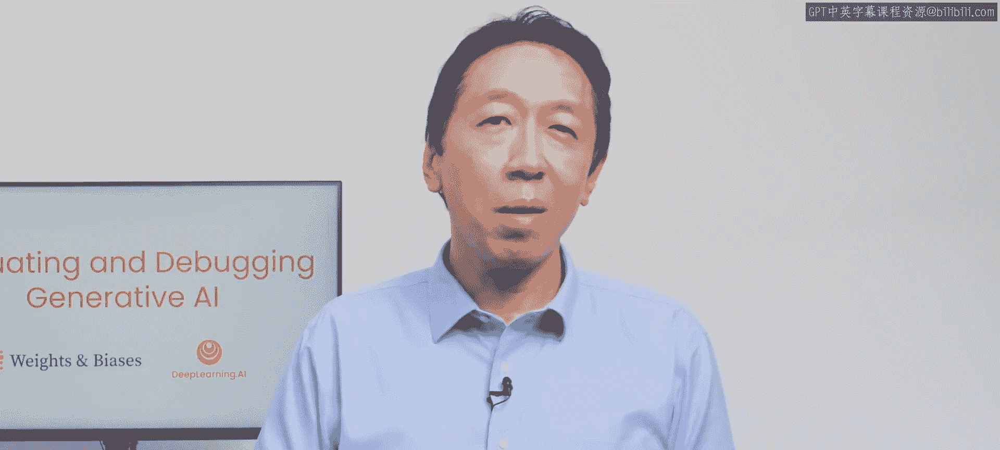
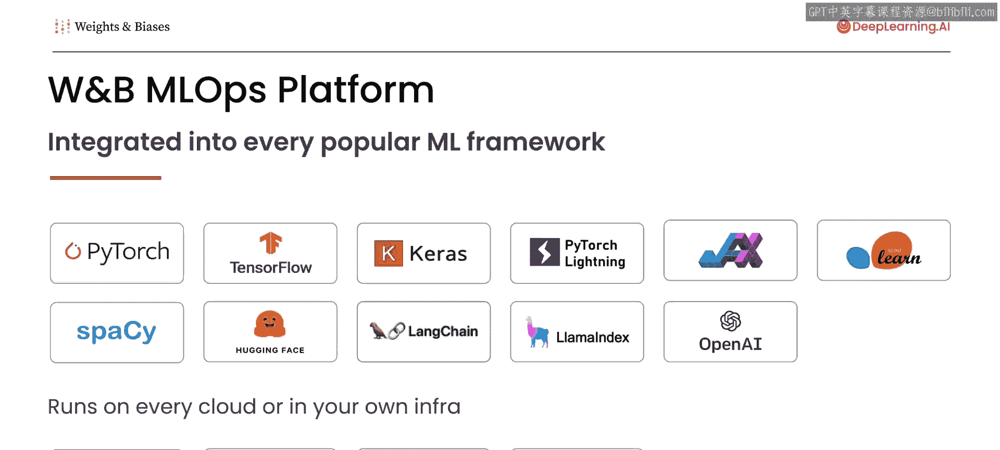
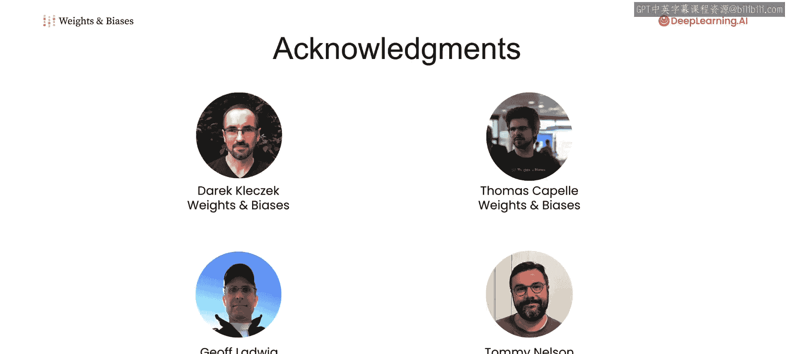

# 吴恩达最新《评估和调试生成型人工智能》｜Evaluating and Debugging Generative AI - P1：00_Course_Intro.zh - GPT中英字幕课程资源 - BV17z4y137fB

Welcome to E and debugging Gen AI。 I'm here with Carrry Fels。

 founding product manager at Was and Bies and instructor for the short course。😊，Hey， Andrew。

 excited to be here。When you're building a machine learning system， keeping track of all the data。

 model and hyper performancepar options can get complicated。

I've been on a lot of projects where I trained the model， then tuned the architecture。

 then retrain the model and decide to change the training techniques and so on。

 and after iterating on the model a few times you end up asking you know the model I trained last week that worked pretty well but how do I replicate that result from a week ago and did I remember to save not just the hyperpars values but also the exact data sets I used？

More generally， when running a lot of models， how do you systematically keep track of everything you're trying and use the results you're seeing to efficiently drive improvements？

Even for a small team， managing and tracking machine learning model training and evaluation gets complicated and the complexity grows worse with larger teams。

I've seen that many teams can be much more efficient if this step of machine learning development is done more rigorously。

So this short course covers tools and best practices for systematic tracking and debugging Gen AI models during the development process。

We'll be using tools from ways and biases， which offers an easy and flexible set of tools that become as bit of industry standard for machine learning experiment tracking。

G to AI models and will cover both large language models for text generation and diffusion models for image generation。

But genative VI models as an additional layer of complexity， compared to supervised learning。

 given that their output is complex and so they can be harder to evaluate。 So Carrie。

 you know these challenges really well。 Can you share of learners what they'll be learning in this course。

 Yeah absolutely。 Thanks， Andrew。 Hello， everyone。 I'm excited to be here with you In this course。

 we'll be focused on evaluating and debugging generative AI。 First。

 we'll show you how to track and visualize your experiments Then we'll teach you how to monitor diffusion models。

 and we'll discuss how to evaluate and fine tune Ls。😊。

Throughout the course you'll learn about a range of debugging and evaluation tools。

 including experiments to track your machine learning experiments。

 artifacts to version and store data sets and models。

 tables to visualize and examine predictions made by your models。

 reports to collaborate and share experimental results in the model registry to manage the lifecycle of your models。

 finally， prompt for evaluating large language model generation。

These tools can work with a wide range of frameworks and computing platforms including Python。

 TensorFlow or Pythtororch So a lot of good stuff there and quite a few people have contributed to the development of this course on the Was and Bies we're grateful to the hard work of Direct Quechek as well Thomas Capel and from deep learning AI Jeff Ludwig and Tommy Nelson by the end of this course you understand best practices and also have a set of tools for systematically evaluating and debugging Genive AI projects I hope you enjoy the course。

😊。

