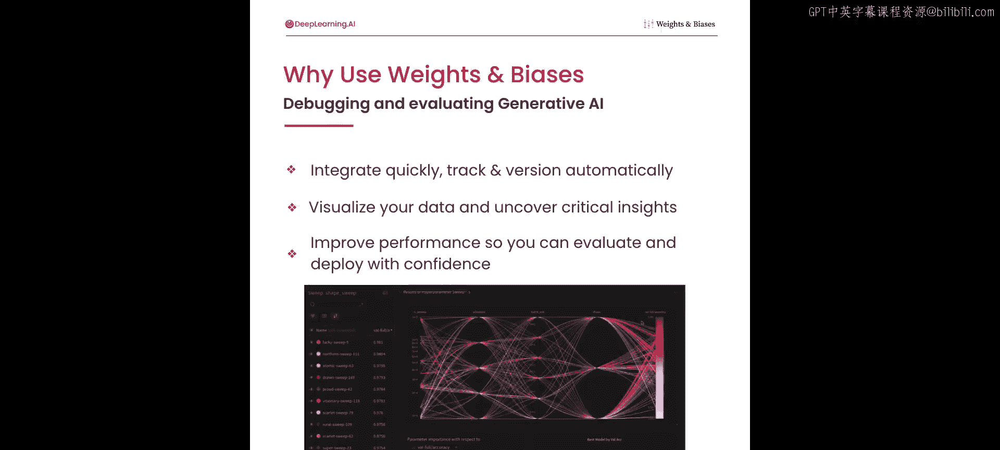
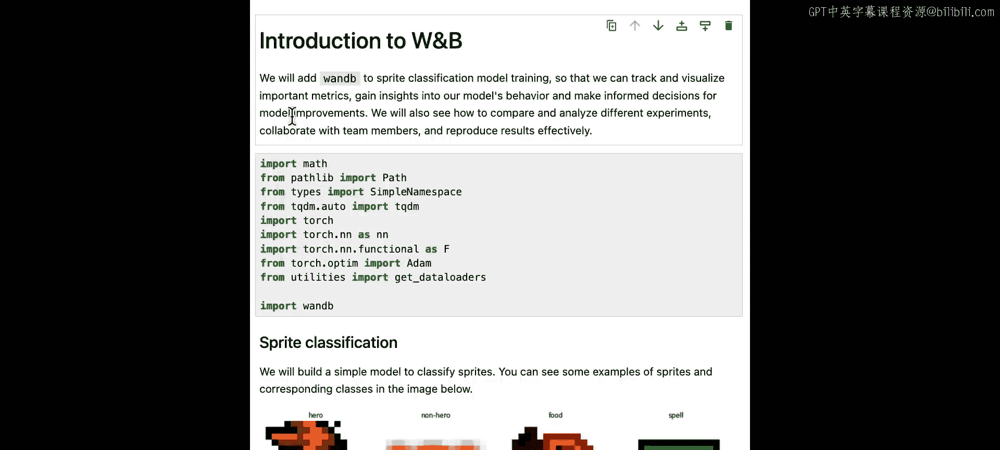
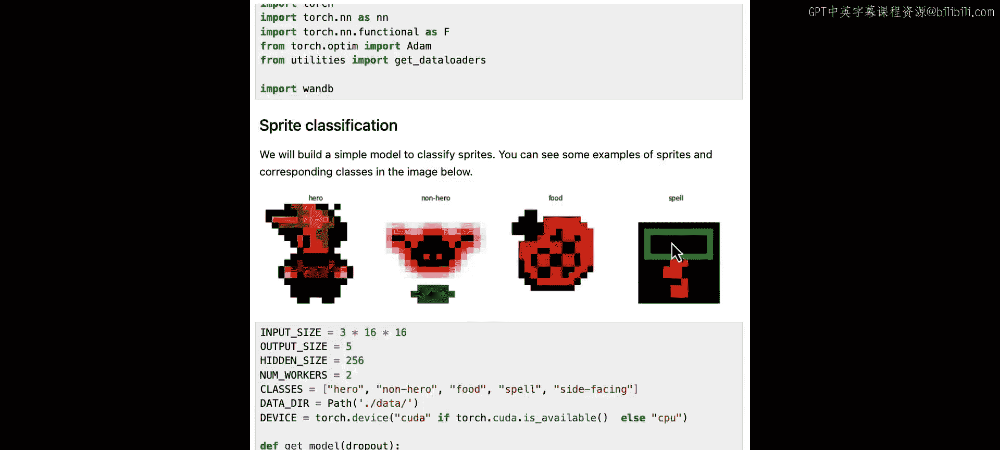
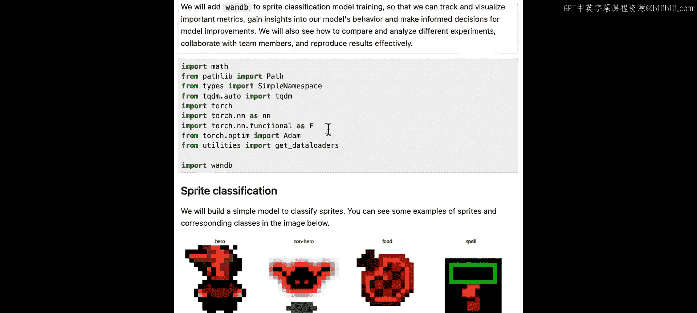
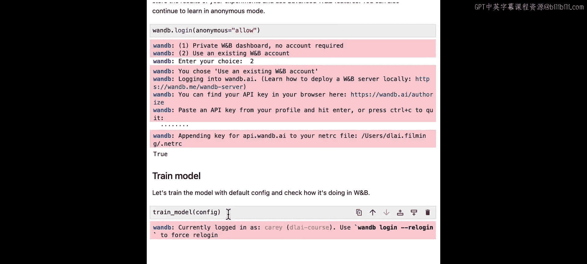
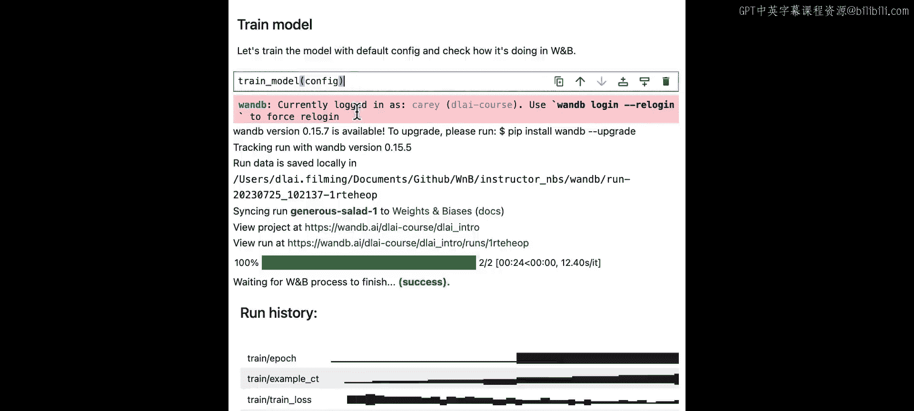
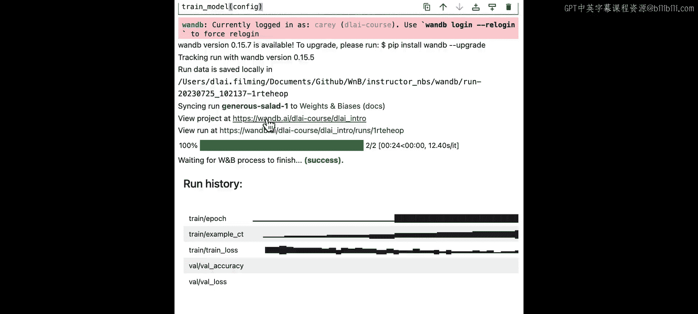
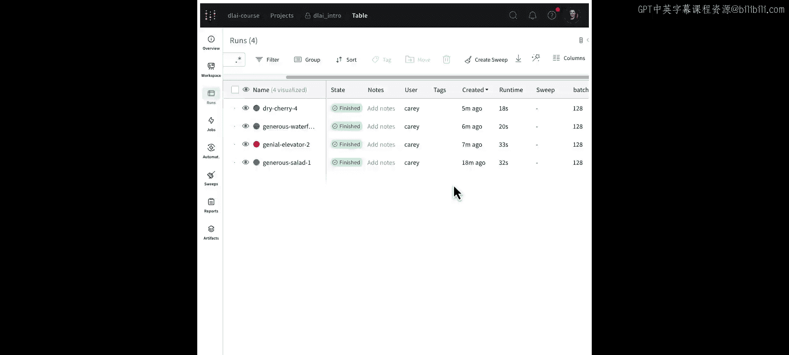
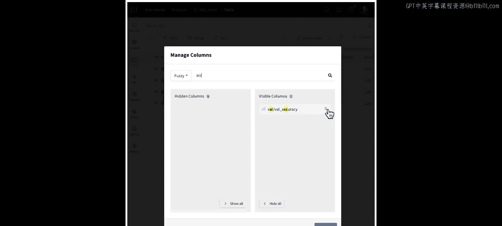
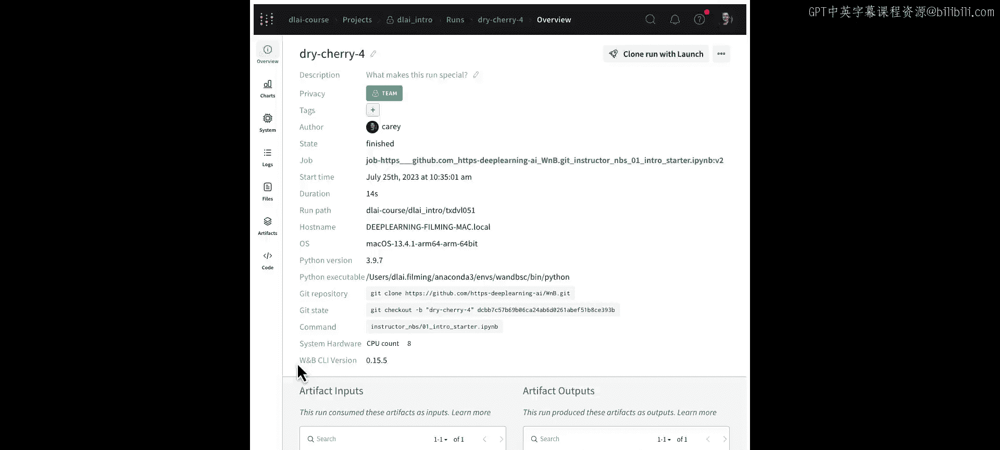

# 吴恩达最新《评估和调试生成型人工智能》｜Evaluating and Debugging Generative AI - P2：01_Introduction_to_W_B.zh - GPT中英字幕课程资源 - BV17z4y137fB

In the first lesson， I'll show you how to instrument weights and biases in your machine learning training code。

As we train machine learning models， many things can go wrong WMB will help us monitor and debug and evaluate our pipelines。

Let's dive in。

With just a few lines of code， you can monitor your metrics， CPU， and GPU usage in real time。

You can version control your code， reproduce model checkpoints。

 and visualize your predictions in a centralized， interactive dashboard。Our users evaluate models。

 discuss bugs， and demonstrate progress with configurable reports。By the end of this course。

 you'll be able to do this， too。 Let's start by learning how to incorporate weights and biases into your training process。

 First， you'll have to install the Python library using the command Pip install WM B。😊。

After installation， we need just a few lines of code。 The first step is to import WMB。 Ideally。

 you already have your hyperparameters structured in an object such as a Python dictionary。

 Otherwise， put them together in a config。😊，You then need to initiate a WNB run。

A run in weights and biases means a unit of computation。Generally。

 a run corresponds to a machine learning experiment， you begin a run by calling WBni。

 passing the project name and your config object。You carry on with your model training code。

 and when you reach a point where there are certain metrics you want to track and visualize。

 you log them using W&B log。If you are using a notebook。

 it is recommended to call Wing the Finnish at the end。Now。

 let's check this out in a notebook in this training script we will train a sprite classification model。

 a sprite is a small 16 by 16 pixel image， and our goal is to categorize the sprite into one of five classes。

Hero， non hero， food or spell。And side facing， which is not pictured。

Now let's start with all the imports。

And make sure the W&B is in there。Here we define a simple classifier model with two linear layers。

We'll store the parameters we want to track in a simple namespace。

 which is similar to a Python dictionary。Here we have our training function。

 let's modify it to add WNB logging。First。We'll need to call Wing the Init and pass our project name and our config object。

Once we have the metrics， we will log them to weights and biases， which is done with wnb。logg。

We will also record our validation metrics at the end of each E。And for the sake of clarity。

 we may explicitly end our weights and biases run by calling wd。finish。

We don't need to change anything in the validation function。So I'll just run this cell。

In this course， we will use WNB Cloud platformform， and that means we need to log in。

There's also an option to install WnB locally， but that is a bit more complex。

 so we will not cover that in this course。WMB is free for personal and academic use。

 and we encourage you to sign up。This way， you can keep the results of your experiment tracking。

But you can also run this code in anonymous mode。So now I've run the login and I'm using my personal account and pasting in my API key。

 you can pull that up at wb。A/authorize。So I'm pressing enter。And that's appending the key。

 that means I'm logged in for this notebook。Finally， let's train the model。

 let's run our training code and see the progress。

Now the data is being logged to the W&B server where we'll save your results。

 so you can see the links that are printed out here when you execute the run and there are few different links。

 so first syncing this run， this is the individual experiment that you've just tracked。

You can also pull up the project page， this will compare across different runs that you're tracking。

Let's follow that link and check our workspace。

Now I'm here in the project page workspace。 Now， this is the data that I can see from that that training run we just ran in the notebook and these charts are small so I can expand them out to make them bigger。

 Now， this looks good。 The training loss is going down over time。

 and I'm checking my validation metrics as well。😊，So looking at validation accuracy。

 it looks like that's around 51%， that's not so great。 So if I want to keep improving this model。

 it looks like I can keep training for longer or increase the learning rate。

 so let's go back to the notebook and make those updates。😊。

Now that the results have been logged to WM B， I can go back to that same project page and see the latest result compared to the previous baseline。

 Great， here's that new run that just appeared in our workspace。

 And you can see that this red run genial elevator actually is doing better than the previous run。

 That's a great sign。 This is what we want to see。 Now。

 I'll go back into the notebook and try a few more things。

 And I encourage you to try different configs as well。

 So how can you tweak the hyperparameters to get better performance from this model。😊。

Take a minute to try that and we'll come back when I have a few more experiments。

Back in the project page， I'm comparing the results of the different hyperparameters we set in those runs。

 so you can see each of these have a different training curve and when I hover over it。

 it's highlighted in the sidebar so I can see this run， drive Chery 4。

 the purple run seems to be doing the best。 It has the lowest training loss。

 and it looks like it's also getting the best validation accuracy at 99。😊。

Another way to compare experiments is by using the runss table。

This shows those same runs in a tabular format so I can look at the metrics and hyperparameters side by side。

Here I can see when I changed the dropout， Es， and learning rate across my different runs。

A specific metric of interest might be accuracy to find it， I can go to the column section。

And search for accuracy。When you're logging a whole lot of metrics。

 this can be especially helpful here， I can click the pin button。

And when I close this window， that metric will appear here on the side。Now。

 when I collapse this view， I can see validation accuracy in the sidebar alongside my other metrics。

In this example， I have one run， generous salad that has pretty bad validation accuracy。

 I can use the filter button to hide any runs below a specific threshold here I'm adding a filter。

Typing accuracy。And then selecting greater than or equal to。And typing in zero point9。

Now that filter has just been applied， and you can see I only have three runs that match that criteria。

 so this helps me narrow in on just my best runs。Since higher validation accuracy is better。

 I'm going to sort in descending order to place the most successful runs at the top。

Here I'm selecting sort and typing accuracy。And picking that one。And now it's in descending order。

 So my best run dry cherry is at the top。 This is especially useful when you have hundreds or thousands of runs。

😊，Now I'm going to select that best friend and see the overview of it。

Here in the detail view for my best friend， I can see some context about how it was created。

 So WM B automatically picks up the Git repo。 so I can easily get back to the code that was used to train this model。

 It also gets the hash of the latest Git commit。 So I know exactly the state of that repo when this run was created。

 But realistically， often， I'm making little tweaks in that notebook and don't remember to always commit my changes。

 So what do you do if you have uncommitted changes。 Fortunately， WM B captures the dipatch。

 So opening the files tab。😊，I can see the di patch has been saved with any uncommitted changes。

So now if I go back to that overview， I know that I can easily get back to the exact state of the code by pulling this Git commit and applying the patch。

So that makes this run more reproducible。If I sent this to someone。

 I could also easily communicate with them about the settings I chose for this model here in the config。

 I'm capturing batch size， dropout Es learning rate。

 all of the settings that we had in that notebook。 And this is an easy， summarized format。

 This information can be helpful when things go well。

 but it's also very valuable when things go wrong。 so we can use this context for debugging。

 understanding what code was used in an experiment。 what the environment was， the data set。

 etc ceter。😊，Now， in the next lesson， we will look at training a generative AI model and how these tools can be helpful there。

