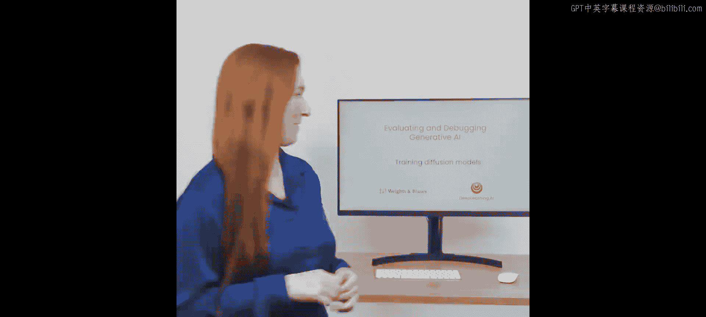
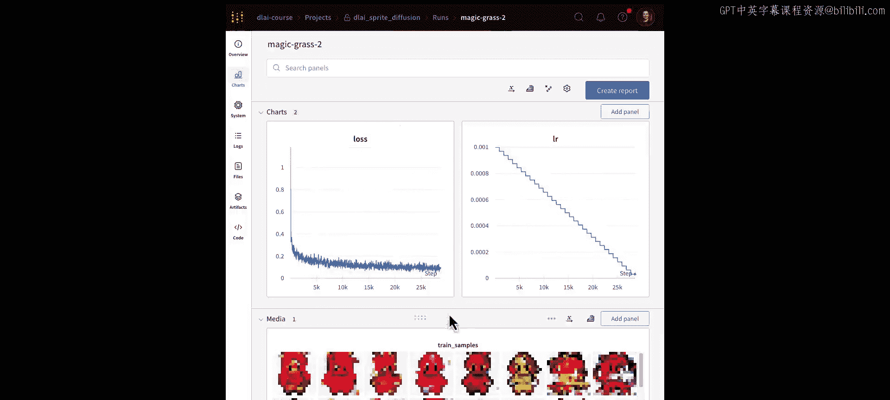
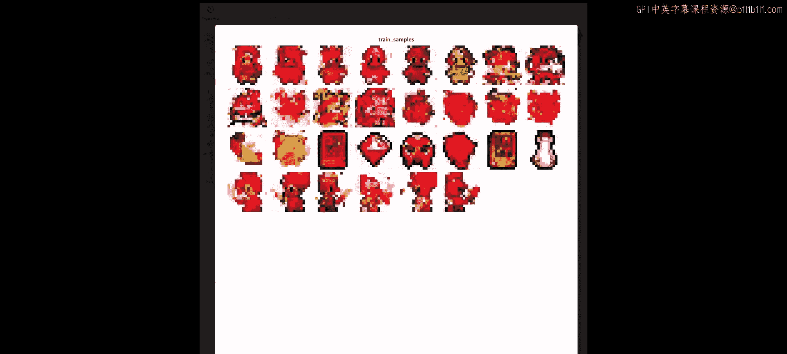
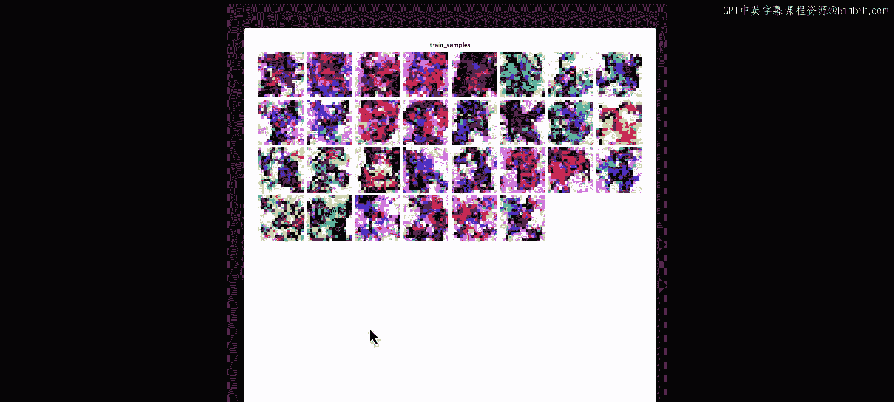
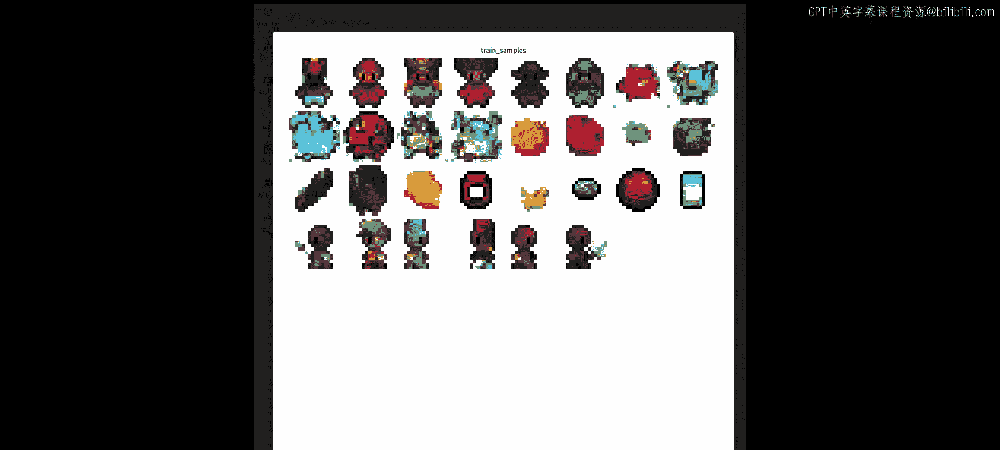
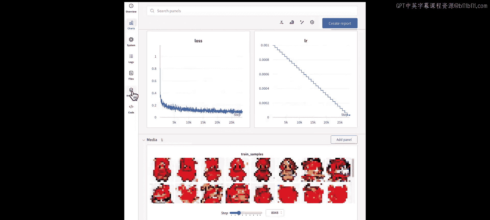
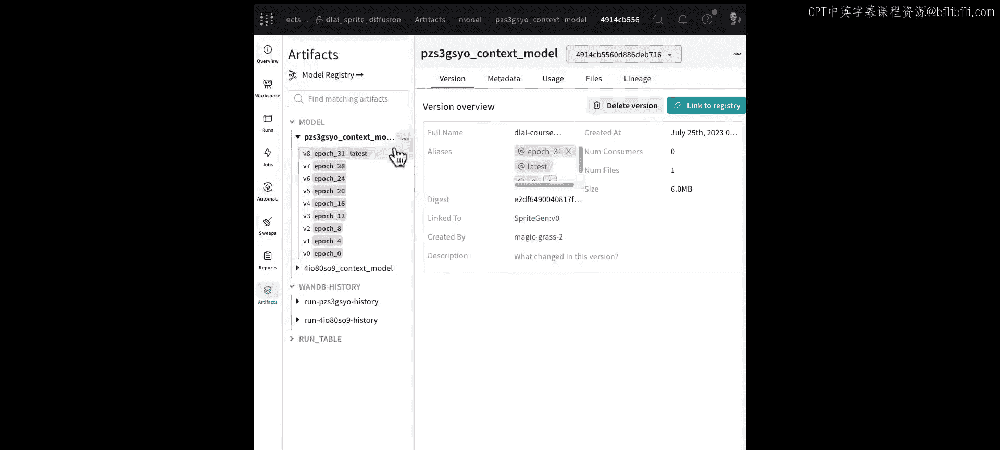
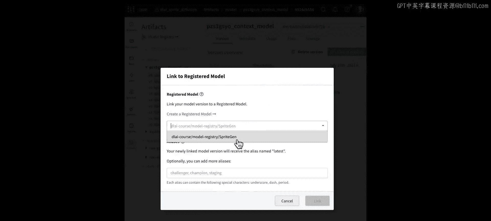
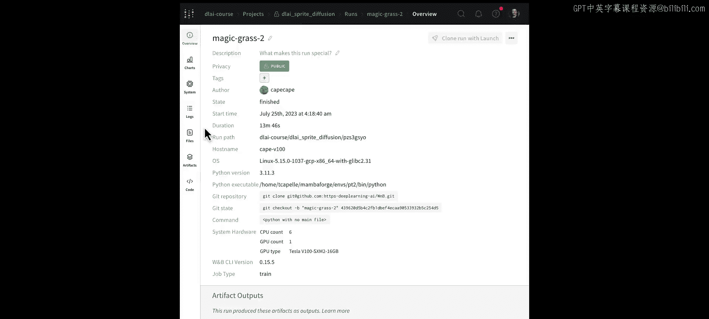

# 吴恩达最新《评估和调试生成型人工智能》｜Evaluating and Debugging Generative AI - P3：02_Instrumenting_A_Training_Notebook.zh - GPT中英字幕课程资源 - BV17z4y137fB

In the previous lesson， you've instrumented a model in this lesson。

 you'll train it a diffusion model and learn some new tools to help us in this process。

 Let's get started。

There is a whole course on diffusion models offered by deep learningarning。AI。

 so let's just summarize the key points here。Diffusion models are denoing models。

 We don't train a model directly to generate images。 Instead。

 we train it to remove noise from images。 During training。

 we add noise to images following a scheduler， and the model has to predict the noise present on the image。

😊，Finally， to generate samples， we start from pure noise and iteratively remove noise until the final image is revealed。

When training generative models， it's important to get the telemetry right。We will， of course。

 keep track of relevant metrics like the loss curve。 However， as demonstrated in this graph。

 the loss flattens out quite early while the samples still lack quality。 For this reason。

 it is crucial to sample from the model regularly during training。

 even when there's little decrease in loss， The images progressively improve。

 We will be uploading these samples to weights and biases。

 while also saving the model checkpoints to keep everything organized。😊。

Now let's jump into the notebook， We will use the training notebook from the Deeplearning。aiI course。

 how diffusion models work， that trains a diffusion model on the Sprites dataset set。

 We're not getting into the details about diffusion。

 I encourage you to take that course if you want to learn more about diffusion models。First。

 we import the relevant libraries and W&B。Next， we encourage you to create an account。

 but you can also log results anonymously。This is logging into my personal account。

 so I'll be able to see metrics in my shared dashboard。Next， we'll define some environment variables。

 such as where to save the models and checkpoints。If you have a device capable of using a coUed GPU。

 we'll also take advantage of this。We updated this notebook to have simple namespace。

 which is a place to set the hyperparameter that we might vary across experiments。

Next we'll import the relevant DDPM noise scheduler and sampler These elements are essential to the diffusion model training as noise is removed with a scheduler at different time steps。

We'll then create the neural network to be trained。

We'll use the sample dataset set from the earlier course， create a data loader。

 and set up an optimizer。Next， let's set up a training loop。To maintain organization and consistency。

 we choose noise only once to generate samples repeatedlyly。

Next we're diving into the training phase of this script。

 so we're starting to actually train the model， and here we start by initializing a WNB run to track that training。

This run will be stored in the DLAI Sprite diffusion project and classified asT。

Giving a job type helps us to easily identify This job later on。 The configuration also gets stored。

 enabling tracking of the parameters used during this training for future reference。

 We also pass back the W and B config， so we can have weights and biases orchestrate and change those values in the future。

 if we need the standard training loop then runs for several epics。

 processing the data loader and computing the forward and backward passes。😊。

These metrics are logged to wastes and biases。 In this case， tracking the loss。

 learning rate and current E。 Next， we want to save the results of training。

 So save the model checkpoints， and we'll do that every four epics。

 So in order to save the checkpoint file， I'll add a weights and biases artifact to save it。😊。

This is our way of versioning and storing files within runs。

Here we use an artifact for model checkpoints， but we could also use it for a data set or predictions or even code。

At the same time， we want to sample some images to view in the workspace。

 so I'll add image logging in here using WMB dot log and WMB dot image。

This allows me to actually visually see the results and look at sample predictions。Finally。

 we finish the run by calling W Vito finish。Now， running this script on a CPU is going to take some time。

 so I'm going to flip to an example that we've already run for you。So here in the sample workspace。

 you'll see your lost curve going down over time。 So this is promising this means your model getting better as it keeps training。

 And let's also look at some of the samples that your model is producing。

 So here if I scroll back to the very beginning， I can see these images look really grainy。

 really noisy， and it's hard to tell what each of these images is supposed to be。

 But as you scroll through each of these steps you can see over time as the model trains。

 it starts to improve。 And now your model is actually producing some really good looking images。

 This one kind of looks like Yoda。 So now that we have something that looks like it's doing pretty well at generating sprites。

 let's actually take that model and make it available for the rest of the team。😊。

So you'll open artifacts and then pull up the latest model， the most recent version。

And link that into the model registry so here we have the Sprite generation model now that you've linked the model。

 you can see the results in the model registry。

The model registry gives your team a central place to see all the best model versions and you can also look at the lineage of where the model came from and easily get back to that training run。

 so the metrics and sample images as well as the exact Git commitm that produced this model。

Now we've talked about tracking the training and seeing the best model version。

 and next up we'll talk about sampling a diffusion model。

