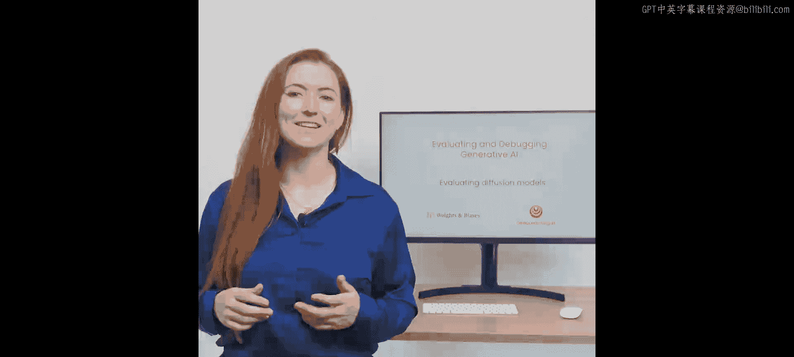
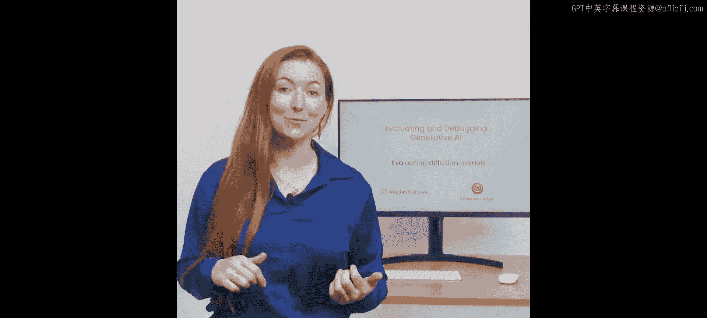
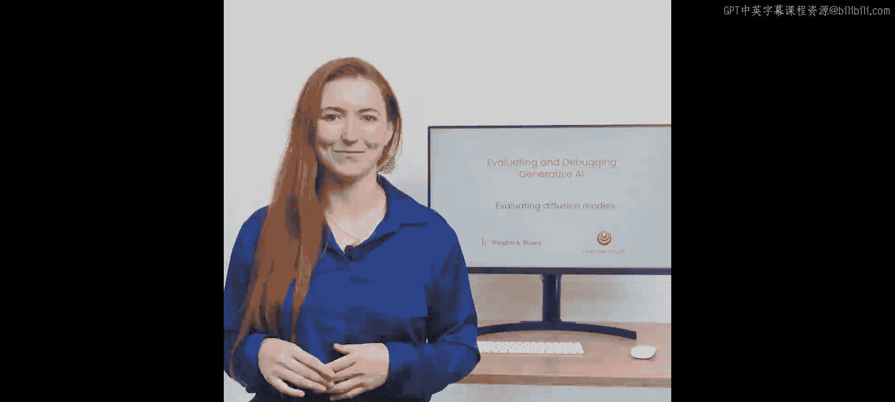
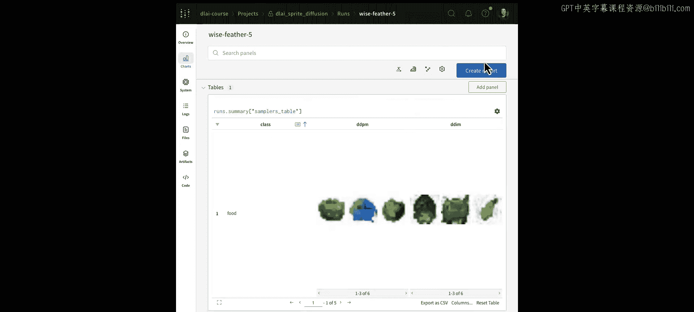
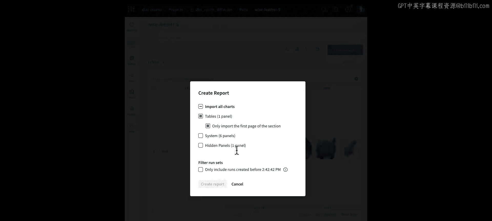
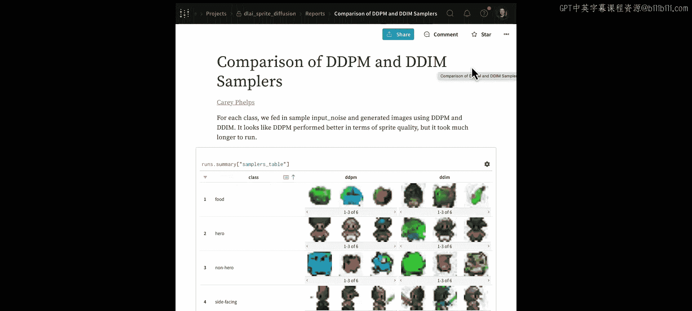
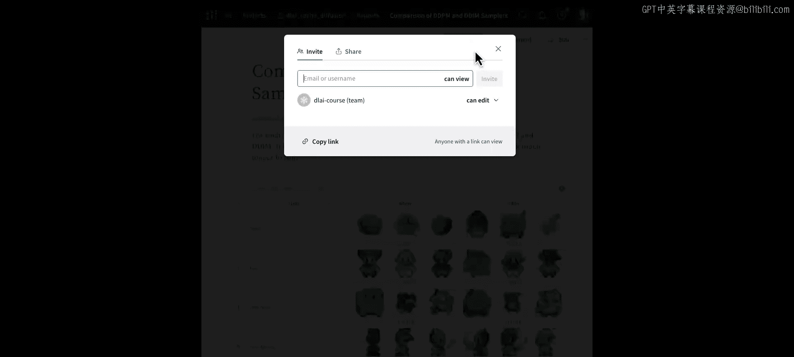
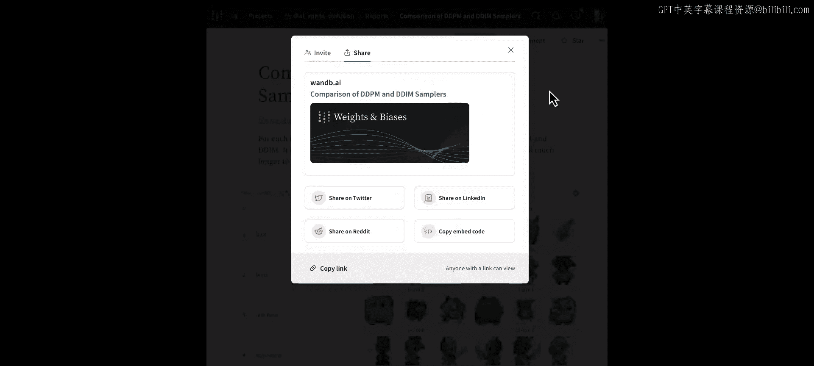
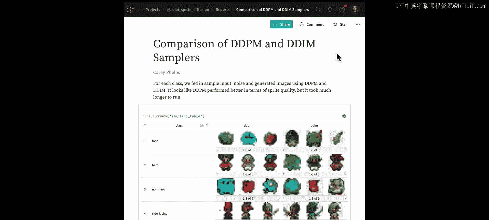

# 吴恩达最新《评估和调试生成型人工智能》｜Evaluating and Debugging Generative AI - P4：03_Monitoring_And_Debugging_A_Training_Run_in_W_B.zh - GPT中英字幕课程资源 - BV17z4y137fB

In this lesson， we'll be comparing diffusion model outputs。

 We'll start with the model we trained in the previous lesson。 Remember。

 we have added this model into the model registry after training it。

Let's dive in。The Model registry acts as a central system for all machine learning models within an organization。

It's a system of record for all of the production ready models and can be used to manage their life cycle from staging to production。

The model registry does not only serve as a storage system。

 but it also promotes teamwork by facilitating collaboration on all models across different teams。

It keeps a detailed lineage of our models while they're in training， under evaluation。

 and when they're in production。This helps us control and understand our models throughout their life cycle。

Moreover， the registry also automates multiple downstream tasks which improves efficiency to compare and evaluate a stage model directly from our registry。

 we will be using tables。Tables can be thought of as a powerful data frame like object where you can log。

 query， and analyze data， including rich media like videos， images， molecules， etc。

The process is fairly simple， you create a table， name the columns of the table and update the table row by row when you wrap up。

 you just need to log it with wnB。log and give it a nameme。Now， let's dive into the code。

Next up will be sampling from a trained diffusion model。

 it's really hard to calculate metrics for generative models and there's a trade off between quality and speed here。

 so we're comparing different sampling algorithms and by the end of the lesson you'll have learned how to compare samplers visually。

So here I'll get started with running our imports。And login。

We'll set up the parameters and store the config in simple namespace again。In the last notebook。

 we saved a model that we'd trained and put it in an artifact and then registered it in the model registry。

 so here with this snippet， we're pulling back down the artifact。

We first pull the model from the registry using the WMB API this way we download the model to our local computer。

We also retrieved some information about the run which produced that model。

Now we can load the weights from the model artifact。

And we can recreate that model using the same parameters as the original run。

Don't forget to put your model in EV mode and into the corresponding device。

Now I'm running this cell to load the model。And here I can look at that model and see that it's being pulled down from weights and biases。

Now， let's set up the diffusion sampler we use during trading， in this case， DDPM。Next。

 we'll define some fixed noises in a context vector， just like during training。

To make our experiments more interesting， we will also be importing another sampler called DDIM。

Also from the diffusion course material， this sampler operates faster。

 but compromises on output quality。 Our goal will be to compare the output of both samplers to achieve this。

 We generate two sets of samples。First， we're sampling from DDPM。Now this will take a little while。

 so we'll speed it up in the video。Now let's compare that to DDIM。When I run the DDIM sampler。

 it only goes for 25 times stamps， so it's much faster than DDPM， which was 500 timests。

Now let's compare our results in a visual table， This table behaves like a data frame that can be rendered in the workspace of your WMB project。

Next we'll iterate through the samples and add them to the table row by row。

We also add the class name and the input noise to the table。

Here we're constructing the table row by row， we're showing the images as well as class name and input noise。

Now that we have a table we've created， we can log it to the project。To do so。

 call W Viiont using your same project as before， and this time set the job type to be Samr's battle。

 this will make it easy for us to find this new run。Next， you'll set the name of the table。

 sampler's table and log that directly to the run。Now let's run this cell to get the results in the UI。

Once the table is finished uploading， I can click the run to open that in a new tab and look at the resulting images。

Here we find the samplers table， so we can see the input noise， the DDPM， and the DDI am result。

 as well as the class， so here's a row of heroes。To compare the two samplers。

 you can see that the same input noise actually generated two different results from the two samplers。

It's interesting to see that these results are somewhat conditioned on the input noise。

I'll expand the table and make the rows bigger so I can see these images in a larger screen。

In this row， for example， it looks like these two characters are pretty similar。

 but this one seems to have generated with better quality。

Now I'm going to group by class so I can see all of the heroes side by side。I'm clicking the menu。

Opening group by。And that's automatically organizing all of the sample images for heroes into one row。

Now I'm going to hide the input noise column， and I can do that by clicking the menu and clicking remove。

Now I can easily flip through sample images for heroes， non heroes， or food。

Now this is interesting looking and I want to share it with my colleagues。

So I can create a report and pull in this sample table。

I'll expand out the table so it's more visible。And I'm switching the view mode so I can see more rows。

Now I can add some context and notes inside this report， so if I send it to a colleague。

 they can see what's going on and what my findings are。I'm going to give this report a helpful title。

And describe the findings that I have。 In this case。

 it looks like DDPM performed better than DD I am。 And I'll explain what's happening。

 So any colleagues that I send this to will have enough context to be able to look at this table and meaningfully understand the results。

😊，Now I'm going to click to publishub to the project。

This means that this report is available for all of my colleagues。

If you want to share a report， it's easy to do so， you can invite folks via email or username and you can also share a link directly。

This ends our sampling comparison。 Next， we'll learn how to evaluate an LLM model。

