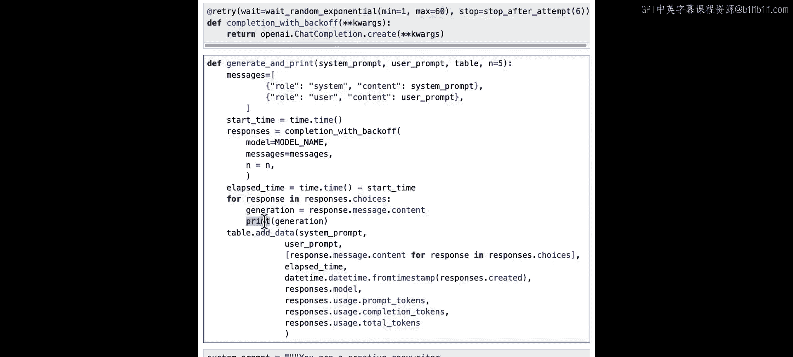
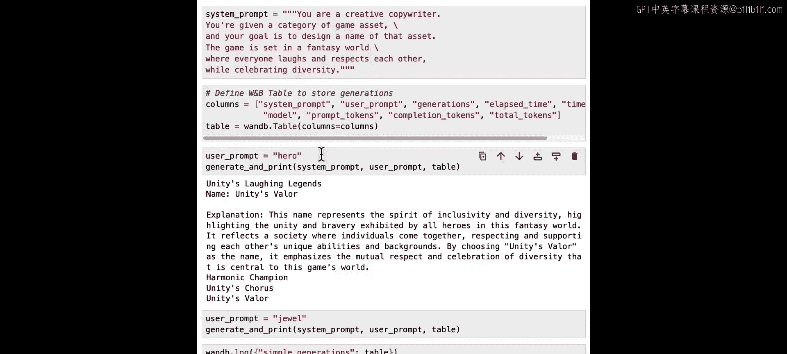
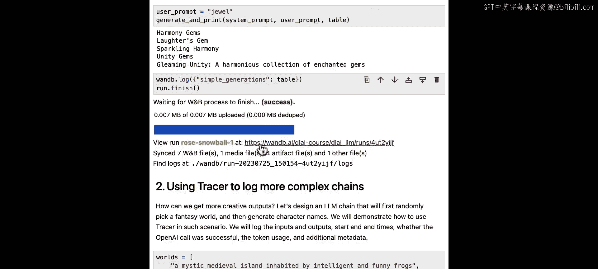
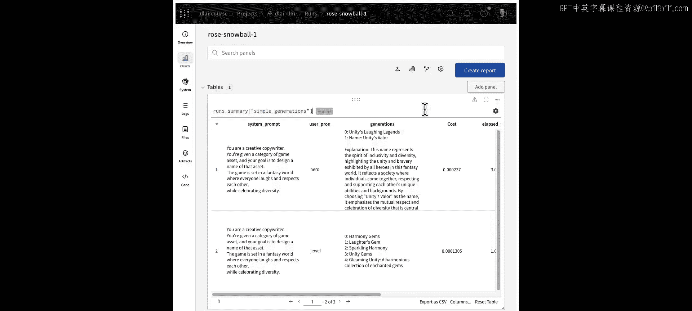
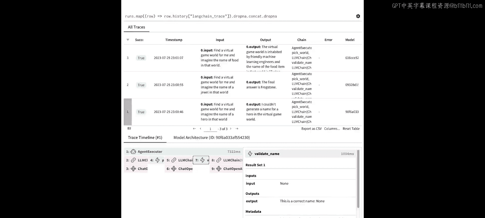

# 吴恩达最新《评估和调试生成型人工智能》｜Evaluating and Debugging Generative AI - P5：04_Evaluating_Generative_Image_Models.zh - GPT中英字幕课程资源 - BV17z4y137fB

In this lesson， we'll evaluate large language models。

 We'll dive into the details and take a look at individual generated samples。

 Let's go to the notebook。

The notebook will explore three examples， starting with the simplest one。

 you'll call an LLM API in this case， open AI and examine the results from the API using WMB tables。

This will show you how to use tables for evaluation， analysis。

 and gaining insights from your experimentation， moving on to the second example。

 you'll create a custom LLM chain and track it with a tool called tracer。

This will demonstrate the value of tracking and debugging more complex chains。 Finally。

 you'll explore how integrations with length chain allow you to build simple agents that you will track through this integration。

 All right， let's begin with the first example。 In this case。

 you'll follow a straightforward workflow。 First， you'll design your system prompt and the user prompt。

😊，After that， you'll call an Open AI endpoint using the chat completionle API。The API will respond。

 and then you'll parse the results and log them in a WB table。Previously。

 you've been generating sprites Now let's stay in this virtual game world and generate names for your game assets。

Now let's jump to the notebook。I'll start by running our imports and setting up the API key。

Next we'll define our project name and specify the model we're using， in this case， GPT 3。5 Trbo。

Next， we'll log in so we can track our results。And now we'll initialize a new run to track generation。

We have some helper code here， first we'll define completion with backoff。

This function avoids rate limits。Then we'll define a function that takes a system prompt。

 user prompt， and a W&B table。We'll use our completion with backoff function to collect responses。

 Additionally， we're tracking the start time and elase time after each response。

For each generated response， we're printing out the result。If you run more experiments。

 the printing out results here in the notebook won't be very efficient。

 that's why we're logging all outputs to a table。

Here we define the system prompt。It's asking the language model to be a creative copywriter generating names for game assets based on a category。

Next， we create a table with all the columns that we want to track。

Now let's start with the user prompt being heroro and see what namess are generated by the mall。Nice。

 that's awesome。 This name Uniities valor really does sound like a hero， harmmonic champion。

 Uniities chorus， Uniities valor， I like these names。😊。

Next， let's do an item from the game， let's do user prompt as Jew。Nice， here are a few options。

 Harmony gems， laughters gem。Gleaming unity， it seems like unity is a big theme here。 Now。

 let's log this table and go look at it in WB。😊，Next。

 you'll click your run link that's printed out here to see the dashboard。

Here you can see the results you just generated in the notebook， but they're saved for you。

 so you can get back to them later if you want to share them with someone or just review your work。

I'll expand out these columns so I can see the text a little better here I can see the system prompt。

 user prompt and the generated examples Now I want an estimate of cost how much are we paying for the Open AI API to generate these fund names for our assets。

So I can create a new column to do that calculation。Here， I hover over the row header。

And click insert one right。Now I get this new column， that just says row， and click on that。

Now I can update the cell expression， and you'll want to type in here。

 square brackets and then total tokens。And we want to multiply the tokens by the estimated cost。

 so in this case， because we're using open AI， it's 0。0000015。Great， now we have a new column。

That's total tokens times that number， and let's rename it cost。

 so it's easy for other people to understand what's happening。Great。

 now this table is something I could share with a colleague to show them what I've tried for generating names。

In the second example， you'll create a simple chain， although it may seem like a toy example。

 you'll use it to demonstrate the concept of a tracer。

 which is very powerful for debugging LLM chains and workflows。

Your chain will consist of just two actions。 The first action involves selecting a virtual world。

 and you'll call it world Picker。😊，As you use this tool， you'll track various aspects。

 such as the inputs， outputs， start and end time， the result， and whether the action was successful。

You'll then pass the output， which is the virtual world to the next step in the chain。

 which is generating a description。This step comes with another set of outputs and inputs for you to track。

 along with their start and end times and the final results。

 Both of these steps will be traced as spans。 They'll be part of the My chain trace。

 which will allow you to understand and analyze this workflow。😊，Now let's see that in the code。

Now we will create and trace a chain to generate names for our assets upfront we'll define three sample worlds and randomly pick from this list。

Then we'll define the confi， so we're still using GT 3。

5 turbo and you can set the temperature here it's 0。7。

 but you can increase this if you want more model creativity。

And the system message is asking the LLM to be a creative copywriter。

So we provide not only a category of the game asset， but also a fantasy world to the LLM。

 The goal is to design a name for the asset in a given fantasy world。

This next function will execute our creative chain。

 illustrating the concept of tracing and how it's constructed。

We will start with the top level span with our creative chain。

Then we'll define a world picker tool where we'll randomly pick a world from our list。

 track the start and end times， and log the inputs and outputs of this span。

We add the tool span to our top level trace。Next， we pass the output of this tool to the LLM chain。

 which requires a system and a user prompt。 We use open AI chat completion and save it as a trace to weights and biases。

 We then add it to our top level trace。Update the metadata and log all spans to W&B by logging that root span。

Finally， we print out the response from our chain。Now we can start a weights and biases run We'll try running this chain with prompts for the game assets。

 hero and jewel。Now that we've executed those creative chains， we can see the results， however。

 we don't know exactly what happened in the background。

 so how did we get volcanic sentinel for our hero or glleamstone for the name of a jewel？

Let's finish this run， then take a closer look at the results in the UI。

Here I'll click on the link to this run so I can see the table。Now in this table。

 I can see the result of what we just ran， the trace view。And I'll expand this out。Up top。

 we have the table， which captured both of the inputs we sent。 So hero and jewel。

 as well as the outputs， the generated names。 But what happened behind the scenes。

 When you click row 1， you can see in your trace timeline below what happened behind the scenes。

 So for this first row， let's look at the two steps。😊，First。

 the World Picker tool takes hero as input。And produces a description， a modern castle。

 and this is randomly chosen from that array of three options。

This result is then passed on to the next step， the Open AI LLM。

You can see that that generated output， that modern fantasy castle。

Is now actually pulled in here to this next step。Now， for inputs to that LLM。

 we have the system prompt as well as the results from the World picker。

This trace time line helps us understand the execution of this chain and how these steps fit together。

 Now， this trace time line is pretty simple。 There's only two steps。

 but this gets really useful when you have a lot of different steps in your chain。

 when it's longer and more complex， this will allow you to debug and pinpoint any issues。

 If the results aren't what you expect。 So， for example， if the world picker failed。

 we could see that here。😊，Although defining chains manually can be exhausting。

 there are libraries like Link chain that can speed up that process。

 We'll discuss that in the following example。This final example uses a lane chain agent in contrast to a chain where each step is predetermined and fixed。

 An agent uses an L L M to reason and make decisions about what steps to take or what tools to use in the demo。

 you'll see that the agent is more unpredictable。 It's less deterministic， so it's harder to debug。

 and it will be helpful to use the tracer。😊，In addition to the World Picker tool。

 this time we'll have the agent use a new tool， name validator to check if the name looks good。Now。

 let's head back to the notebook to see this in action。First， we'll run the necessary inputs。

Then we'll start a new run to keep track of our results。Next。

 we'll set an environment variable L chain W B tracing to true。

 This sets up the tracking so you'll automatically get those traces logged。😊。

Now let me introduce our tools we'll keep it simple as this example is just to illustrate the concept of tracing The first tool is the world Picker。

😊，Which randomly returns a choice from the list of worlds。 The second tool is the name validator。

 which checks if the queryriier name is below 20 characters。😊，If it is。

 it says this is a correct name， otherwise it says this name is too long。

We'll use the Open eye API again with a temperature of 0。7。

 You can turn this up if you want more creativity and we'll initialize the agent with a list of tools。

All right。 Now we're ready to run a query。 We'll ask our agent to find a virtual game world and imagine the name of a hero in that world。

😊，The agent starts a new chain and we don't even need to wait for it。

 we can run the agent a couple of times and check out the results。

I'll click the run link printed out here to open the dashboard。

So here you're on your workspace and you can see the list of traces。And you can click your first row。

And expand this out so we can see a little better。So here in this first row of the table。

The input is to find a virtual game world and imagine the name of a hero。 But the output is。

 I couldn't generate a name for the hero。 Now， that's a problem。 Something went wrong in this trace。

 So let's dive in and figure out what's going on。 Going down to the trace timeline section。

 I can see the steps that the agent took to get to that result。😊，Let's start with that first step。

 we put in the prompt。And we can see the agent reasoning。

 I should pick a virtual game world first and then generate a name for a hero in that world。

And then takes the action pick world。That's great， so what happens next with that world？

It's pulled into the next step where the LLM looks at that virtual world and needs to generate the name for a hero。

And the model outputs that I have picked a virtual game world inhabited by friendly machine learning engineers now I need to generate a name for a hero in that world。

But this is where things go wrong。 It then says action， validate name and action input， none。

So it actually didn't generate a name yet， it skipped right to the validation step。

And that's where things are going wrong here。When we get to the validate nameme step。

It takes the input none， because no name was generated and gives the output。 This is a correct name。

 None， because technically， it's less than 20 characters， which is the rule for that tool。

So using this trace timeline view， we were able to identify where the agent went wrong。

 and now we can debug this to fix this problem for future generations。 In summary。

 this analysis gave us valuable insights into how and where the chain might have gone wrong and we can use that information to improve the results and make our agent more successful。

 Now in the next lesson， we'll talk about fine tuning LLMs。😊。

