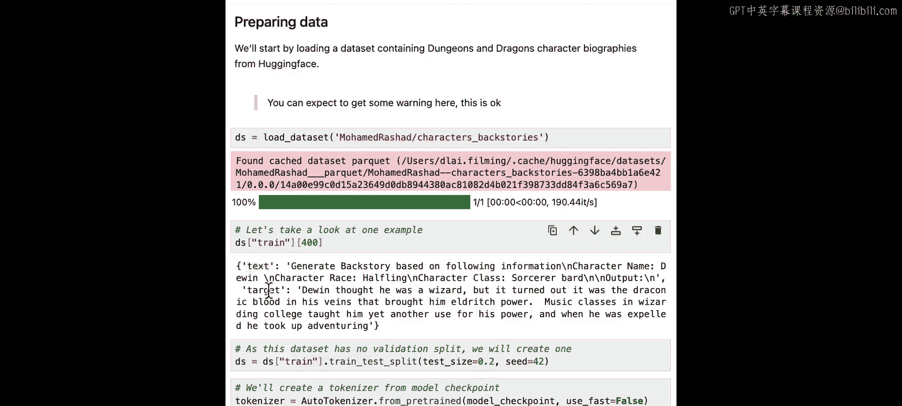
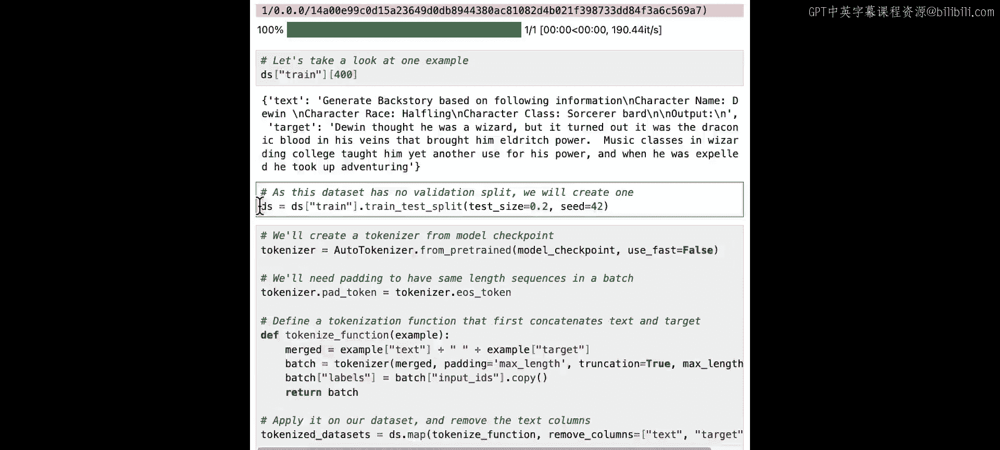
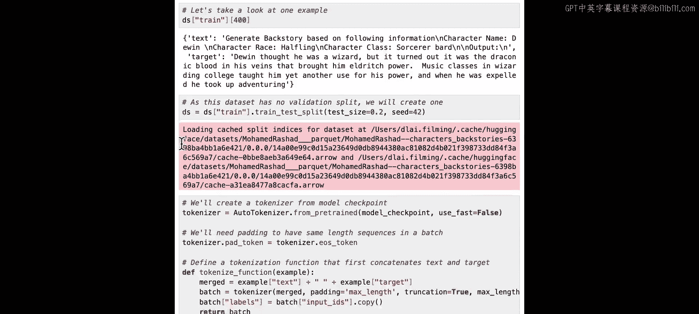
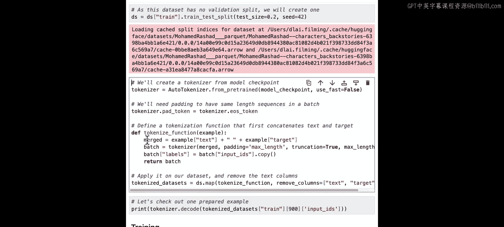
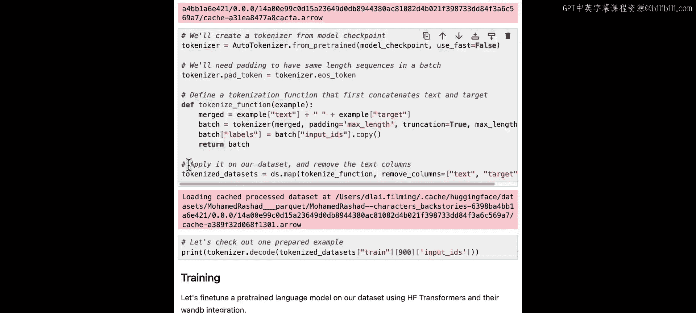
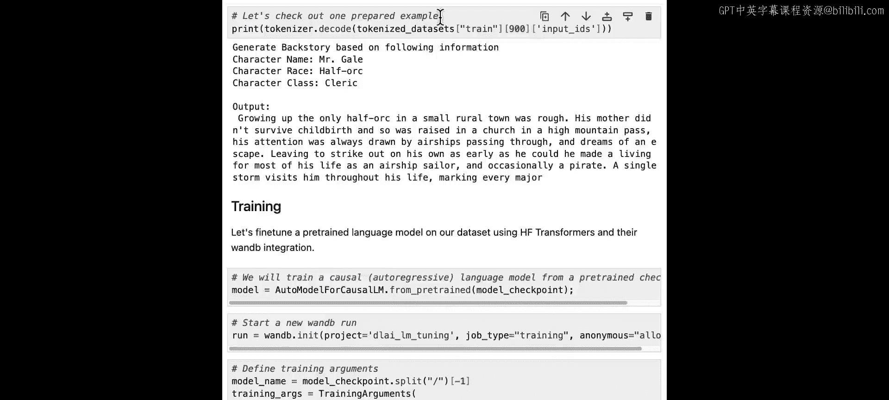
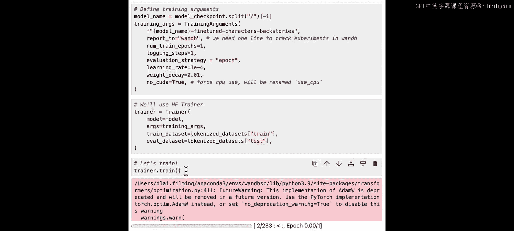
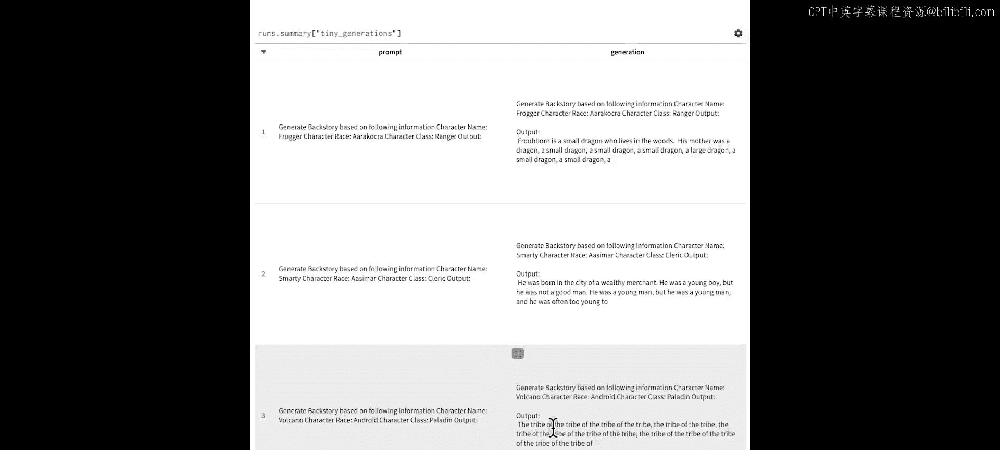

# 吴恩达最新《评估和调试生成型人工智能》｜Evaluating and Debugging Generative AI - P6：05_Evaluating_and_Debugging_LLMs.zh - GPT中英字幕课程资源 - BV17z4y137fB

In the last lesson， we learned about using Lms via API。

 but sometimes you might need to train a completely new model or fine tune an existing one。

 We'll talk about it in this lesson with a focus on debugging and evaluation。 Let's see it in action。

😊。

Training LLMs from scratch can take a long time and cost a lot。

 evaluating them is also complex and resource intensive。

So it's important to keep a close eye on the training process and use checkpoints to deal with any unexpected problems。

You can get valuable information from the dashboard， which shows the training progress， metrics。

 and helps you get the model checkpoints if you need them。

Fine tuning methods let you refine an LLM more economically， even if we have limited computing power。

 but you still need to be careful during the evaluation process。

 depending on what you want to achieve with the LLM。

 you might need to come up with specific evaluation strategies。Let's look at the code together。

Here we'll show you how to finetune a language model using HugingVase To do this efficiently on a CPU we'll use a small language model called tiny storiesies。

 which has 33 million parameters， willll finetune this light model on a data set of character backstories from the Dunngeons and Dragons gaming world。

As usual， start with imports and login。Then set the model checkpoint to pull。

We'll pull the data set from the Huging F H。Looking at this example。

 we can see the data set has two columns。This text column asks the model to generate a backstory。

And this target column holds the generated backstory of the character。

We'll set up the data set split so we have validation in。

And then before training the model， we'll combine and prepare the instructions and stories。

 making sure they're tokenized and padded， we'll also create labels。

Which are identical to our inputs。Labels need to be shifted by one position because the model should predict the next token in a sequence。

 and this will be done by Huging face。

Now， let's try generating a sample to ensure everything is working fine。 When we decode the output。

 we'll see the instruction followed by the generated backstory。If it all looks good， we can proceed。

Before we get into model training， let's check out an example from that data to see what it looks like。

So here it's taken character name Mr。 Gail and character race Ha Ork and then giving us this output story。

 growing up that only half Ok in a small rural town was rough。

 so that's looking good and it seems like that's a good input for a model。

Now let's get into model training。We'll use the transformformers trainer from Huging F。

And demonstrate the very simple integration with WMB。

The model we create is for causal language modeling。

 which means an auto aggressivegressive language model architecture similar to GT。

 that just means predicting the next word in a sequence。We'll start a new weights and biases run。

 and now the job type is going to be training。Next。

 we'll define some training arguments like number of training Es， learning rate， weight decay。

 and crucially we'll set report to to W and B。That means all of your results will stream to that same central dashboard。

That's all you need to do to start streaming metrics。Let's start training the model。

Now I don't want to wait for the training to finish to start seeing my results。

 so I'll scroll back up to the WMB run。And I can click this link to see results live。

Here I can see the metric streaming in over time and training loss is the most interesting to me。

 this is the metric I'll watch over time。When debugging a model training run。

 it's useful to check to make sure the loss keeps going down。

 so you want to see this curve go down into the right。

Some very large language models could take days or even weeks to train。

 and so it's helpful to have a chart like this that you can watch remotely。

This helps us make sure that the model continues to improve and we're not wasting GPU resources。

Great， so training is finished and that was a very small model。

 only training for a single epic for efficiency so the results aren't going to be perfect if you're interested I'd encourage you to try to improve them maybe by running for longer or tweaking the hyperparameters。

😊，Now the training is complete， so let's generate samples from the model。Back in the notebook。

 we defined several prompts and used them to generate backstories for our characters。After this。

 we create a new table and for each of the prompts we'll call model。

generate we can pass various parameters here， like top peak or temperature to steer the model。

 we'll add our generations to the table， log it and finish the run。

Now let's look at the results in our dashboard。Here I'm looking at the results in the project page and I can expand that table to see some samples。

Here in the table， I can look at the prompt and some sample generated output。

This prompt is for a character named Froger。And the generation says Fewborn is a small dragon who lives in the woods。

 His mother was a dragon， a small dragon， a small dragon， a small dragon， large dragon。

 a small dragon。That seems like maybe it got a little stuck on the dragon idea。

We have a smarty character。 And what happened to him， He was born in the city of a wealthy merchant。

 He was a young boy， but he was not a good man。😊，And finally， we have another example for volcano。

 who's an Android。And for this character， the output is just the tribe of the tribe of the tribe of the tribe。

That doesn't seem very good as a backstory， So you can see there's some issues with this small model。

 and that makes sense we were optimizing for speed over performance。

You can see here how important it is to use qualitative evaluation when training generative AI models。

Because just looking at these messages， these outputs。

 you can see whether or not it's doing a good job。We encourage you to come up with metrics that may be relevant for your specific use case。

 then implement them and also log them along with generations。For example。

 you could measure something like number of unique words。

 and in this output we could see it's only really using three words， the tribe of。

 So maybe that's not a very good output。 So the next time you train or fine tune a model。

 we hope you can use these tools to get better results faster。😊。

