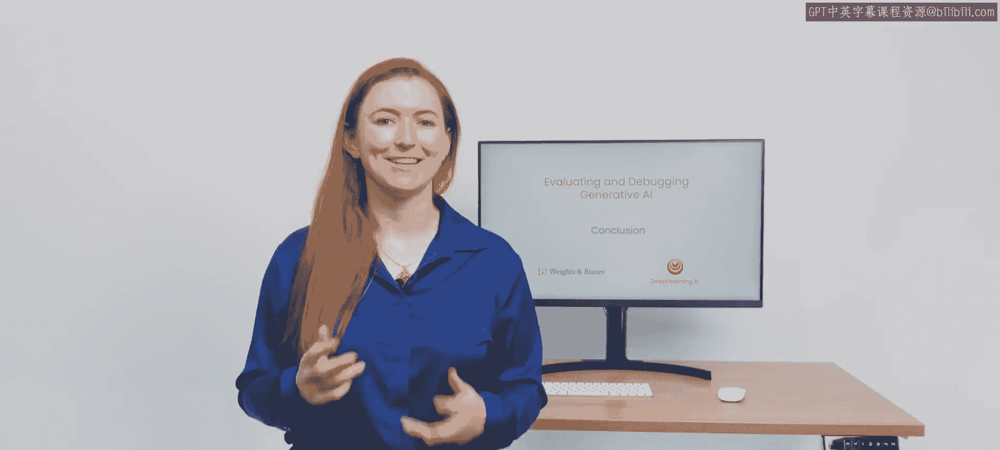
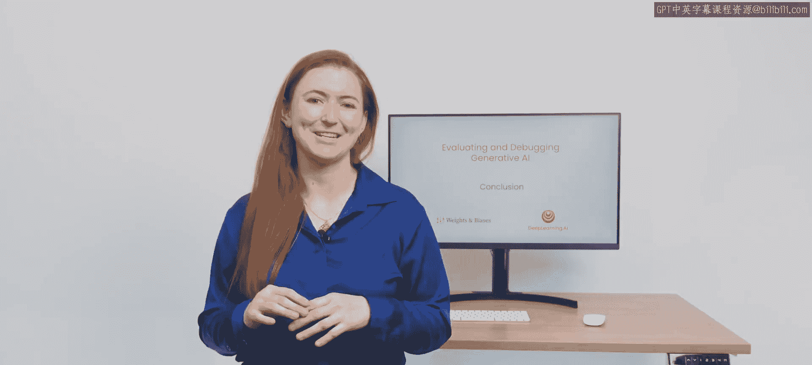

# 吴恩达最新《评估和调试生成型人工智能》｜Evaluating and Debugging Generative AI - P7：06_Conclusion.zh - GPT中英字幕课程资源 - BV17z4y137fB

Congratulations， you've completed the course。 Now， you know how to iterate on generative models。

 track the results of your experiments and share findings。 with these tools。

 you're now equipped to make your development process more transparent and more reproducible。

 I can't wait to see what you build。😊。

