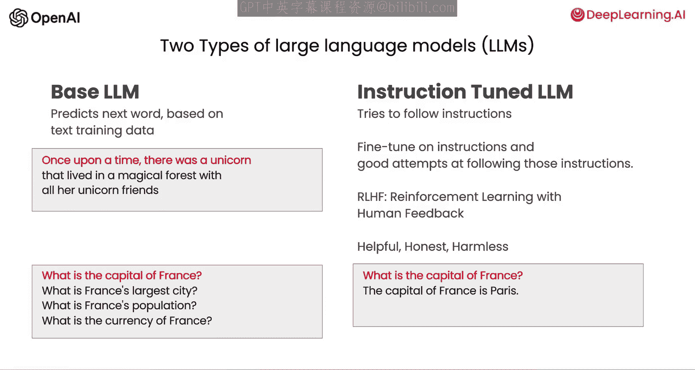
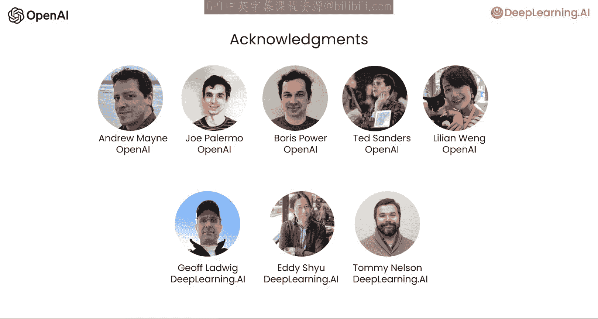

# 吴恩达最新《面向开发者的ChatGPT提示工程》｜chatgpt-prompt-engineering-for-developers｜中英字幕 - P1：1_prompt_eng_01_intro_v3.zh_en - GPT中英字幕课程资源 - BV1e8411o7NP

Welcome to this course on Cha GPT Pro engineeringer for developers。

 I'm thrilled to have with me Iza Ffeit。 to teach this along with me。

 She is a member of the technical staff of Open AI and had built a popular chat GT retrieval plug。

 and a large part of a work has been teaching people how to use O M or large language model of technology in products。

 Shes also contributor to the open AI cookbook that teaches people prompting。

 So thrilled to have you with you。 And I'm thrilled to be here and share some prompting best practices with you。

😊，So there's been a lot of material on the internet for prompting with articles like 30 prompts Everyone has to know。

Along with that has been focused on the chat GT web user interface。

 which many people are using to do specific and often oneoff tasks。

 but I think the power of OOM's large language models as a developer to that is using API calls to OMs to quickly build software applications I think that is still very underappreciated。

 In fact， my team at AI Fund， which is assisted company to deepplial AI has been working with many startups on applying these technologies to many different applications and it been exciting to see what OM APIs can enable developers to very quickly build。

So in this course， we'll share with you some of the possibilities for what you can do as well as best practices for how you can do them。

There's a lot of material to cover first you'll learn some prompting best practices for software development。

 then we'll cover some common use cases， summarizing， inferring， transforming， expanding。

 and then you'll build a chatbot using an LLM。We hope that this will spark your imagination about new applications that you can build。

So in the development of large language models or LOMs， there have been broadly two types of LOMs。

 which I'm going to refer to as base OOMs and instruction tuned OOM。

So base L M has been trained to predict the next word based on text training data。

 often trained on a large amount of data from the Internet and other sources to figure out what's the next most likely word to follow。

So for example， if you were to prompt this once upon a time there was a unicorn。

 it may complete this， that is it may predict the next several words are that live the magical forest with all unicorn friends。

But if you were to prompt us with what is the capital of France。

 then based on what articles on the Internet might have。

 it's quite possible that the base LM will complete this with what is France's largest city。

 what is France's population and so on， because articles on the Internet could quite plausibly be list of quiz questions about the country of France。

In contrast， an instruction tuned OM， which is where a lot of the momentum of LM research and practice has been going。

 an instruction tuned OM has been trained to follow instructions。 So if you were to ask it。

 what is the capital of France， is much more likely to output something like to capital France Paris。

So the way that instruction tune OMs are typically trained is you start off with a base OM doesn't train on the huge amount of text data and further train it for fine tune it with inputs and outputs that are instructions and good attempts to follow those instructions and then often further refine using a technique called RLHF reinforcement learning from human feedback to make the system better able to be helpful and follow instructions because instructiont OMs have been trained to be helpful。

 honest and harmless So， for example， they are less likely to output problematic text such as toxic outputs compared to base OOM。

A lot of the practical usage scenarios have been shifting toward instruction tune L Ms。

 Some of the best practices you find on the Internet may be more suited for a base O M。

 but for most practical applications today， we would recommend most people instead focus on instruction tuned O O Ms。

 which are easier to use and also because of the work of open AI and other L M companies becoming safer and more aligned。

So this course will focus on best practices for instruction to know homes。

Which is what we recommend you use for most of your applicationss。

Before moving on， I just want to acknowledge the team from Open AI and Deep learning AI that had contributed to the materials that E and I will be presenting。

 I'm very grateful to Andrew Maine， Jo Blermo， Boris Power。

 Ted Sanderss and Lillian Wang from Open AI， they were very involved with us brainstorming materials vetting the materials to put together the curriculum for this short course。

 and I'm also grateful on the deep learning side for the work of Jeff Ludwig。

 Eddie Shu and Tommy Nelson。 So when you use an instruction tuned LOM。😊。

Think of giving instructions to another person。 say someone that's smart。

 but doesn't know the specifics of your task。 So when an L M doesn't work。

 sometimes it's because the instructions weren't clear enough。 For example， if you were to say。

 please write me something about Alan Turing。 Well， in addition to that。

 it can be hopeful to be clear about whether you want the text to focus on his scientific work or his personal life or his role in history or something else。

 And if you specify what you want the tone of the text to be。

 should it take on the tone like a professional journalist would write。

 or is it more of a casual note that you dash off to a friend。

 that hopes the L M generate what you want。 And of course， if you picture yourself asking。

 say a fresh college graduate to carry out this task for you。

 if you can even specify what snipppers of text， they should read in advance to write the text about Alan Turing。

 then that even better sets up。Fresh college Gr for success to carry out this task for you。

So in the next video， you see examples of how to be clear and specific。

 which is an important principle of prompting L OMs。

 And you also learn from either a second principle of prompting that is giving LDLM time to think。

 So that let's go on to the next video。