# 吴恩达最新《面向开发者的ChatGPT提示工程》｜chatgpt-prompt-engineering-for-developers｜中英字幕 - P3：3_prompt_eng_03_iterative_v3.zh_en - GPT中英字幕课程资源 - BV1e8411o7NP

When I've been building applications with large language models。

 I don't think I've ever come to the prompt that I ended up using in the final application on my first attempt。

 and this isn't what matters as long as you have a good process to iteratively make your prompt better。

 then you'll be able to come to something that works well for the task you want to achieve。

You may have heard me say that when I train machine learning model。

 it almost never works the first time， In fact I'm very surprised if the first model I trained works。

 I think we're prompting the odds of it working the first time is maybe a little bit higher。

 but as ease is saying。Doesn't matter if the first prompt works。

 what matters more as the process for getting to prompts that works for your application。

 So with that， let's jump into the code and let me show you some framework to think about how to iteratively develop a prompt。

So if you've taken a machine learning class with me before。

 you may have seen me use a diagram saying that with machine learning development。

 you often have an idea。And then implement it， so write the code， get the data， train your model。

 and that gives you an experimental result， and you can then look at that output。

 maybe do error analysis， figure out where it's working or not working。

 and then maybe even change your idea of exactly what problem you want to solve or how to approach it and then change implementation and run another experiment and so on and iterate over and over to get to an effective machine learning model。

If you're not familiar with machine learning， and haven't seen this diagram before don about it。

 not that important for the rest of this presentation， but when you are writing prompts。

To develop an application using an LOM。The process can be quite similar where you have an idea for what you want to do。

 the task you want to complete， and you can then take a first attempt at writing a prompt that hopefully is clear and specific and maybe if appropriate gives the system time to think and then you can run it and see what result you get and if it doesn't work well not the first time。

 then the iterative process of figuring out why the instructions， for example。

 we not clear enough or why it didn't give the algorithm enough time to think allows you to refine the idea refine the prompt and so on and to go around this loop multiple times until you end up with a prompt that works for your application。

This too is why I personally have not paid as much attention to the intended articles that say 30 perfect prompts because I think there probably isn't a perfect prompt for everything under the sun it's more important that you have a process for developing a good pro for your specific application。

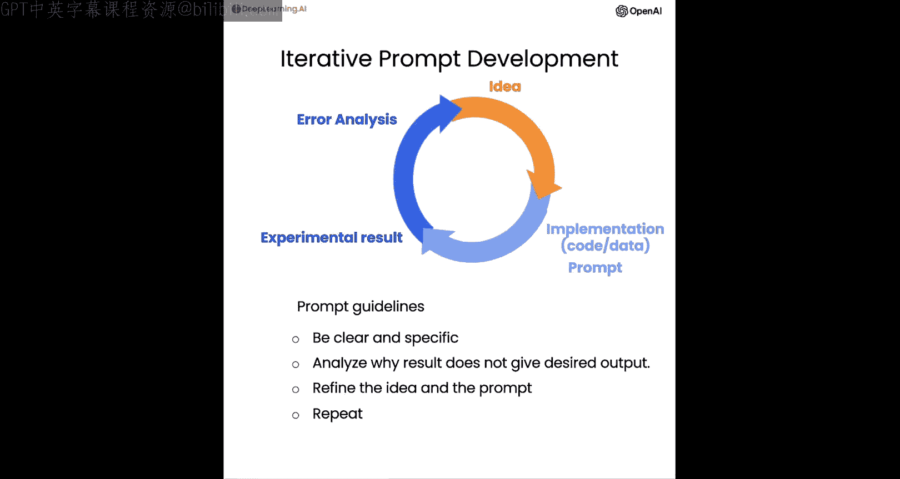

So let's look at an example together in code， I have here the static code that you saw in the previous videos have import import open AI and PoOS。

😊，Here we get the open AI API key， and this is the same helper function that you saw as last time。

And。I'm going to use as the running example in this video。

 the task of summarizing a fact sheet for a chair。So， let me。Just pay sentence here。

And feel free to pause the video and read this more carefully in the notebook on the left if you want。

 but here's a fact sheet for a chair with a description saying it part of a beautiful family of mid century inspired and so on。

 to about the construction as the dimensions， options for the chair， materials。

 and so on comes from Italy。So let's say you want to take this fact sheet and help a marketing team write a description for an online retail website。

Let me just quickly run these three and then we'll come up with a prompt。As follows。

 and they're just。And it just paces in。So my prompt here says your task is to help a marketing team create the description for a retail website of the product based on a tech fact sheet。

 rather product description and so on right so this is my first attempt to explain the task to the large language model so let me hit shift enter and this takes a few seconds to run。

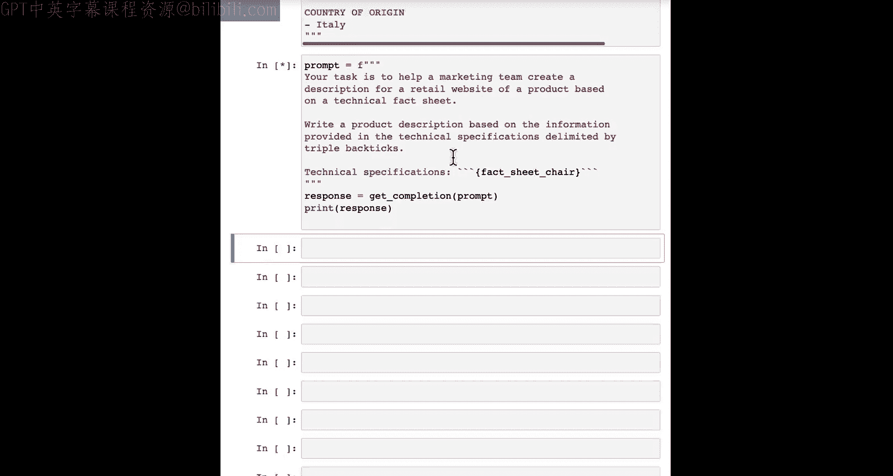

And we get this result it looks like it's done a nice job writing a description。

 introducing a stunning centuryry and smile office chair， perfect edition， and so on。

 but when look at this I go boy， this is really long。

 it's done a nice job doing exactly what I asked it to。

 which is not from the technical fact sheet and write a product description。

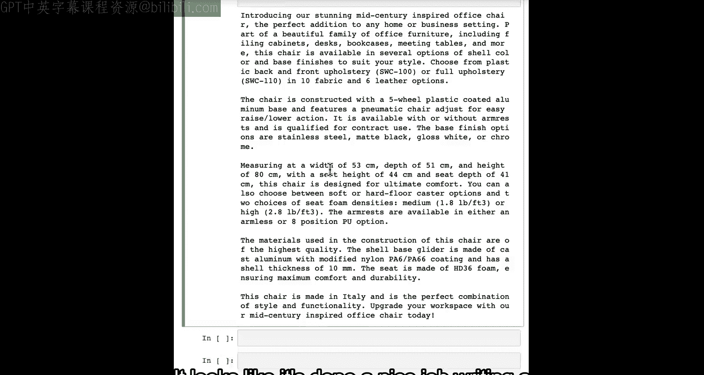

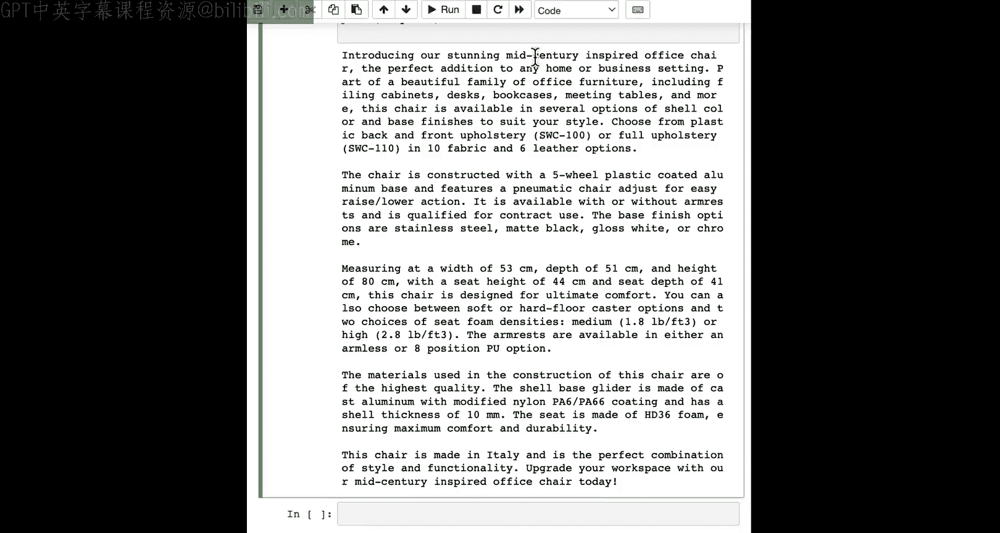

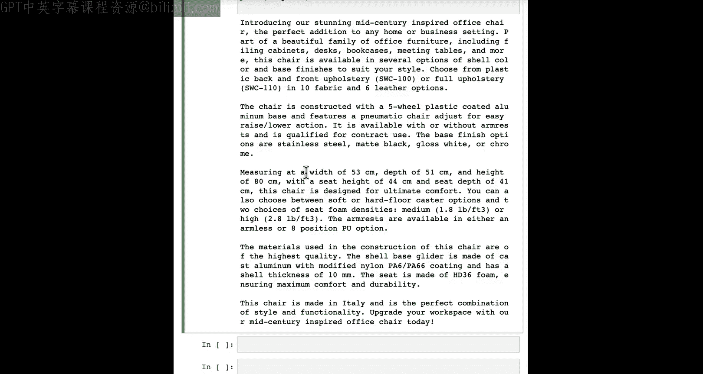

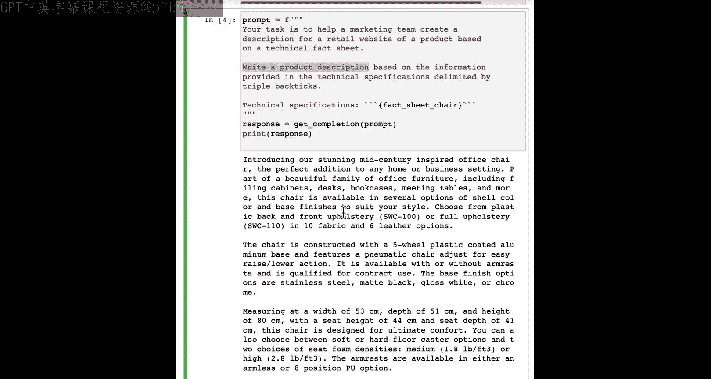

But when I look at this I go just kind of long， maybe we want it to be a little bit shorter。

 So I have had an idea。 I wrote a prompt， got the result。

 I'm not that happy of it because it's too long， so I will then clarify my prompt。

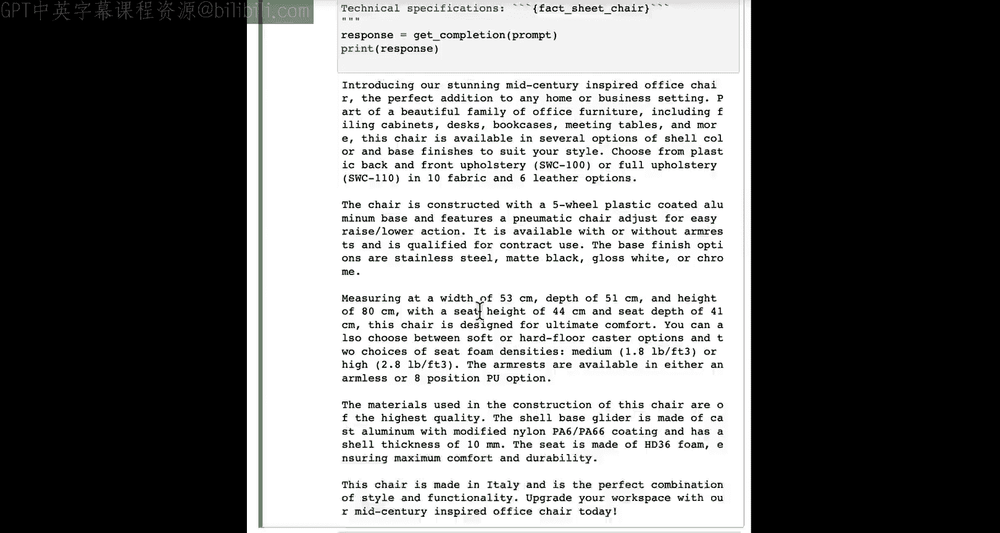

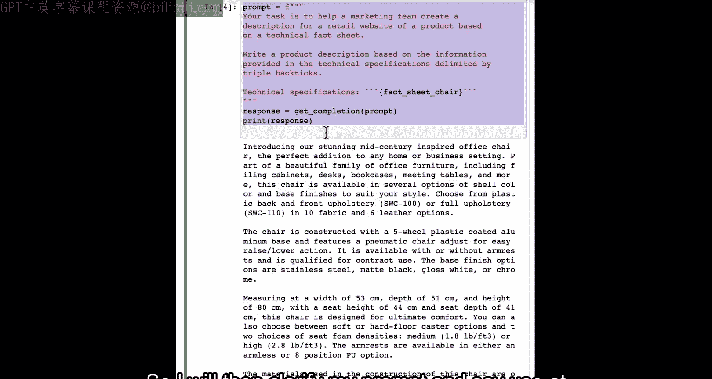

And say。Use。At most 50 words。To try to give better guidance on the desired length of this。

 and thus's run of the game。Okay， this actually looks like a much nicer short description of the product introducing a mid centuryur and office chair and so on five you just。

 yeah both stylish and practical。Not bad。And I let me double check the length that this is。

 So I'm gonna to take the response， split it， going to where there spaces and then you print the length。

 So it's 52 words。' actually not bad。 La language models are。Okay。

 but not that great at following instructions about the very precise work count。

 but this is actually not bad。 Sometimes it will print out something with 60 or 65 and so on words。

 but it kind of within reason。Some of the things you could try to do would be to say use at most the three sentences。

And let me run that again。But these are different ways to tell the large language model what's the length of the output that you want。

 So this is one。2，3， I count these sentences。 also did a pretty good job。

 And then I've also seen people sometimes do things like I don't know， use at most 280 characters。

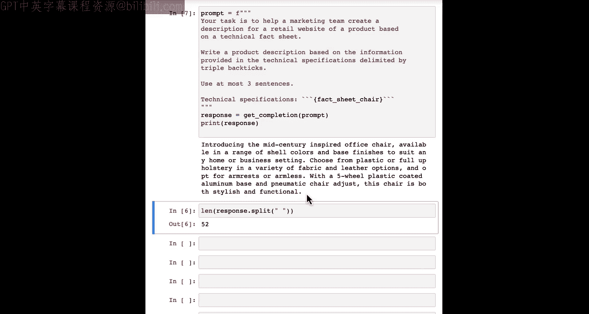

Lunch language models because of the way they interpret text using something called a tokenizer。

 which which I won't talk about， but they tend to be so， so accounting characters， but。

Let's see 281 characters is's actually surprisinglyly close。

 usually a large language model always doesn't get it quite as close。

 but these are different ways they can play with to try to control the length of the output that you get。

 but then just switch back to use at most 50 words。And that's that result that we had just now。

As we continue to refine this text for our website， we might decide that， boy。

 this website isn't selling direct consumers is actually intended to sell furniture to furniture retailers that would be more interested in the technical details of the chair and the materials of the chair in that case you can take this prompt and say I want to modify this prompt to get it to be more precise about the technical details。

So let me keep on modifying this prompt。And I'm going to say。

This description is intended for furniture retailers， so should be technical and focus on materials。

 products and construct it from。😊，Oh， let's run that。And， let's see。Not bad， says， you know。

 Col aluminum based and pneumatic chair。

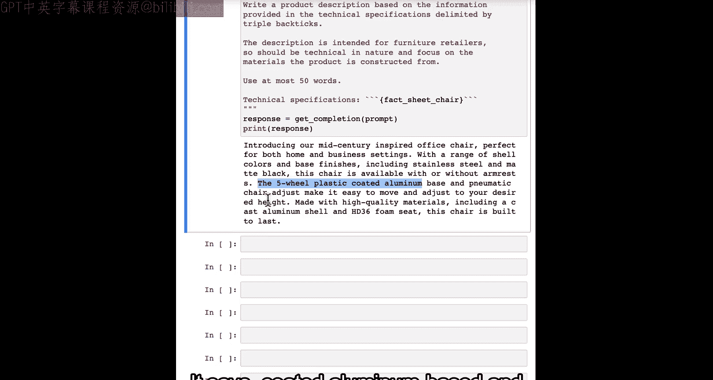

High quality materials so by changing the prompt you can get it to focus more on specific characters on specific characteristics you wanted to。

And。When I look at this， I might decide， h at the end of the description， I also wanted to include。

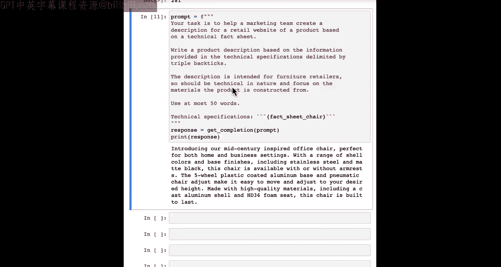

The product IDs， so the two offerings of this share， Sw C 110， SO C 100。

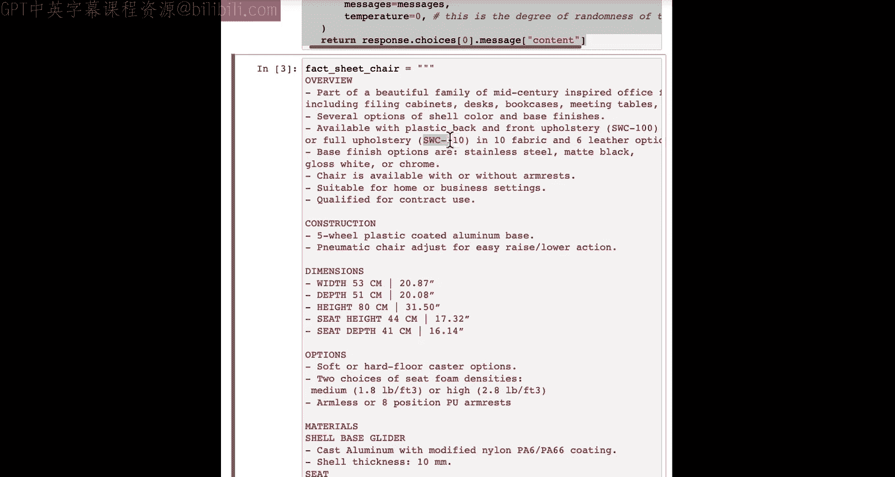

So。Maybe I can。

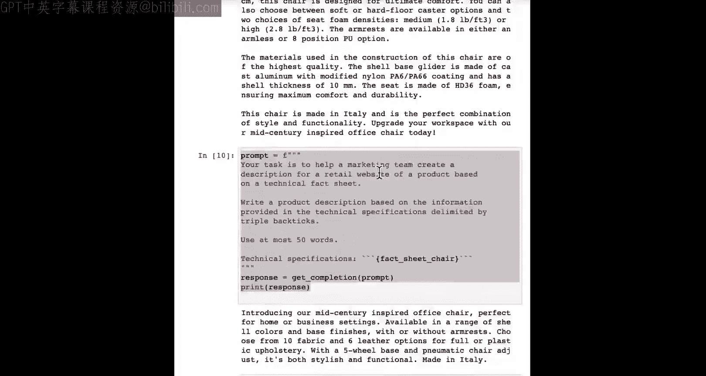

Further improve this prompt。And to get it to give me the product I。

 I can add this instruction at the end of the description include every seven character to product I in the technical specification and。

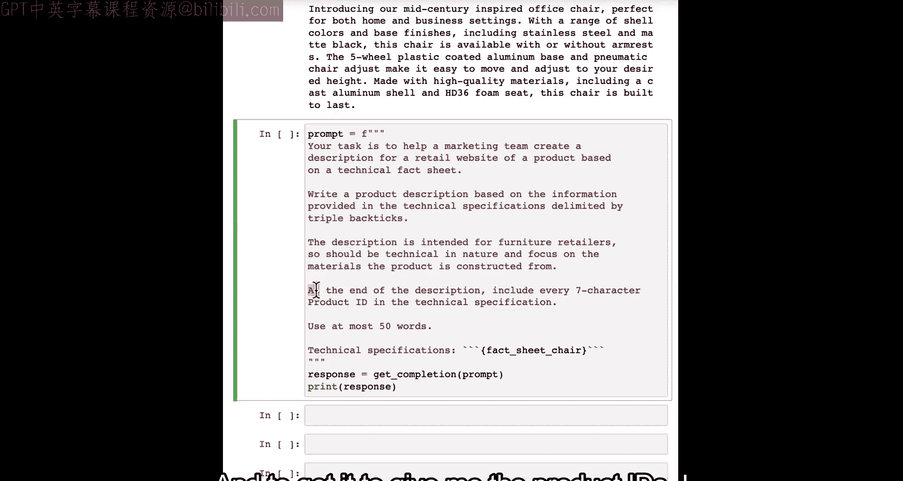

Let's run it。And see what happens。And so it says introduce our Miss sections file office chair。

Shell colors talks about plastic coating aluminum base， practical， some options。

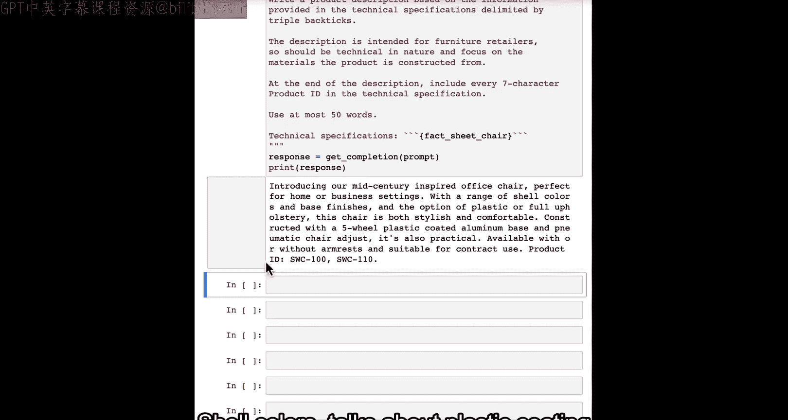

Talks about the two product I。 So this looks pretty good。

 And what you've just seen is short example of the iterative prompt development that many developers will go through。

And I think a guide is in the last video you saw E share a number of best practices and so what I usually do is keep best practices like that in mind。

 be clear and specific and if necessary， give the model time to think with those in mind is worthwhile often take a first attempt at writing a prompt。

 see what happens and then go from there to iteratively refine a prompt to get closer and closer to the result that you need。

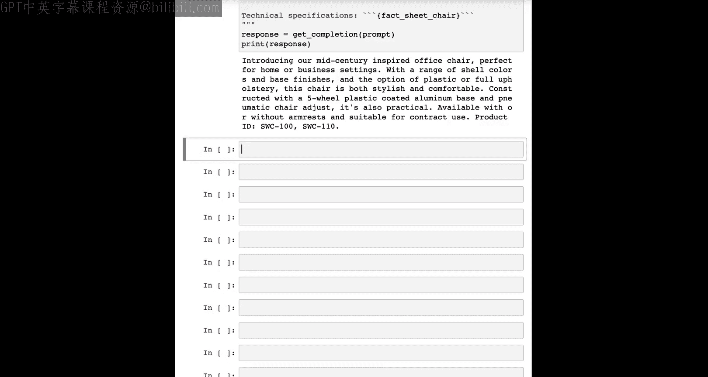

And so a lot of the successful prompts that you may see using various programs was arrive at at an iterative process like this。

Just for fun， let me show you an example of a even more complex prompt that might give you a sense of what chat GT can do。

 which is I've just added a few extra instructions here after the description include the table that gives the product dimensions and then format everything as HTML。

 so let's run that。

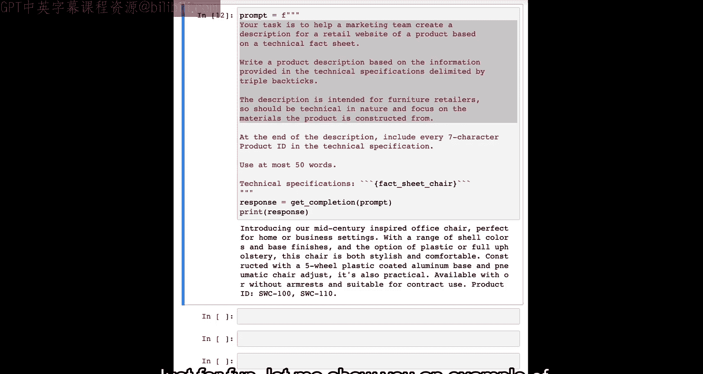

And in practice， you would end up with a prompt like this， really only after multiple iterations。

 I don't think I know anyone that would write this exact prompt the first time they were trying to get the system to process a fact sheet。

And so this actually outputs a bunch of HTML。Let's display to Htm to see if this is even valid Html and see if this works。

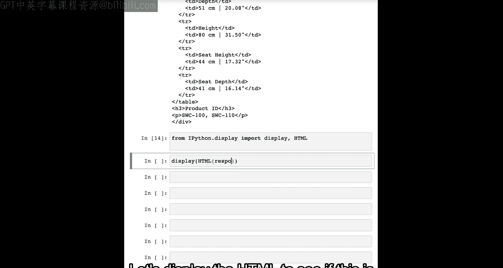

And I don't actually know it's going to work， but let's see oh cool， all right。

 looks like a render it。

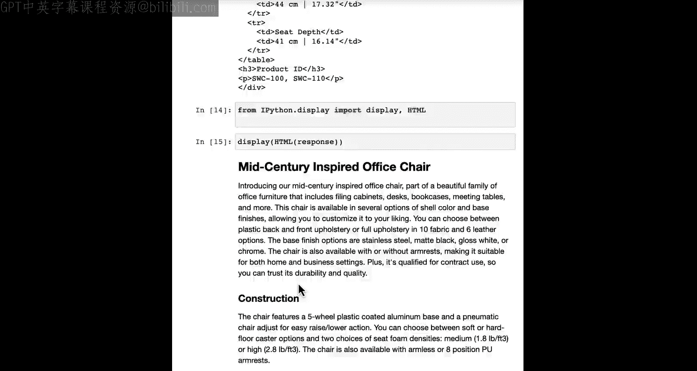

So it has this really nice looking description of a chair。

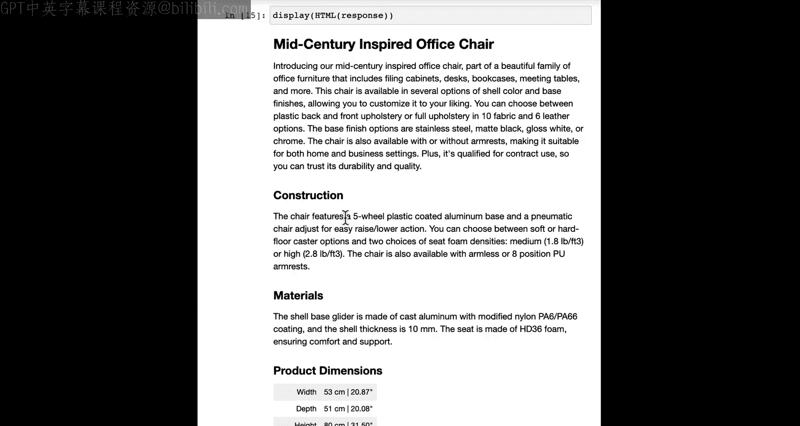

Construction。Materials， product dimensions。

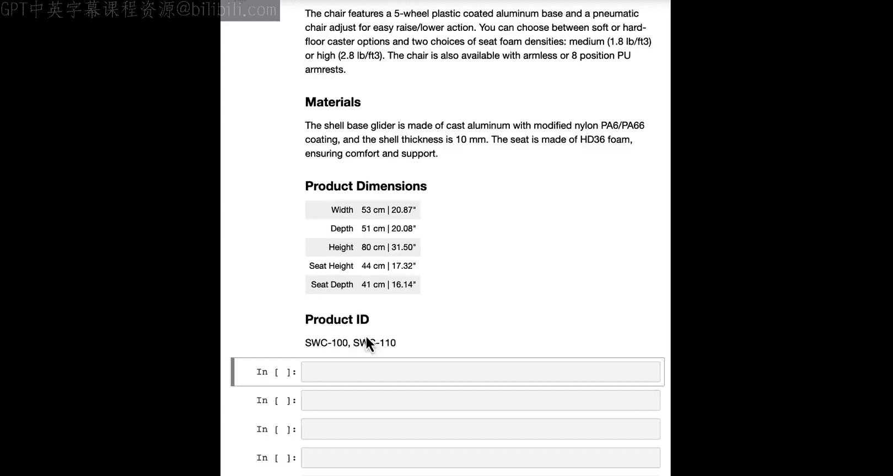

嗯。Oh， it looks like I left out the user most 50 words instructions， so this is a little bit long。

 but if you want that， you， you can even。

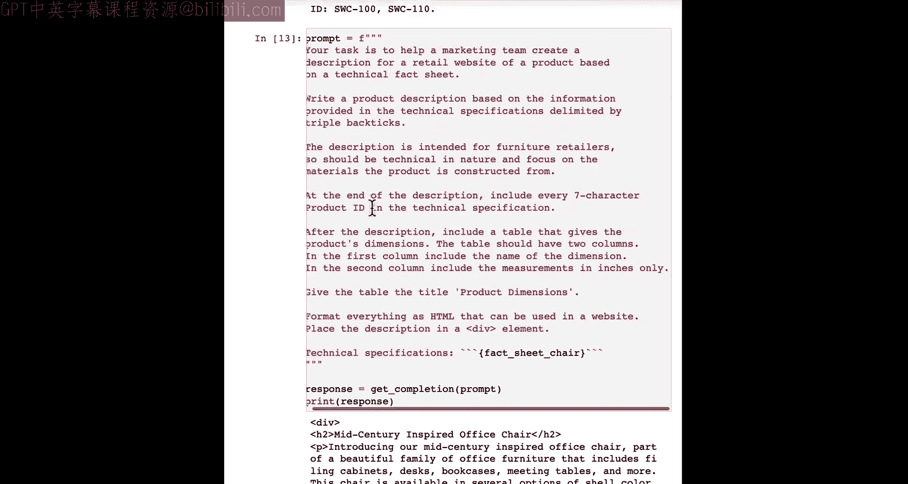

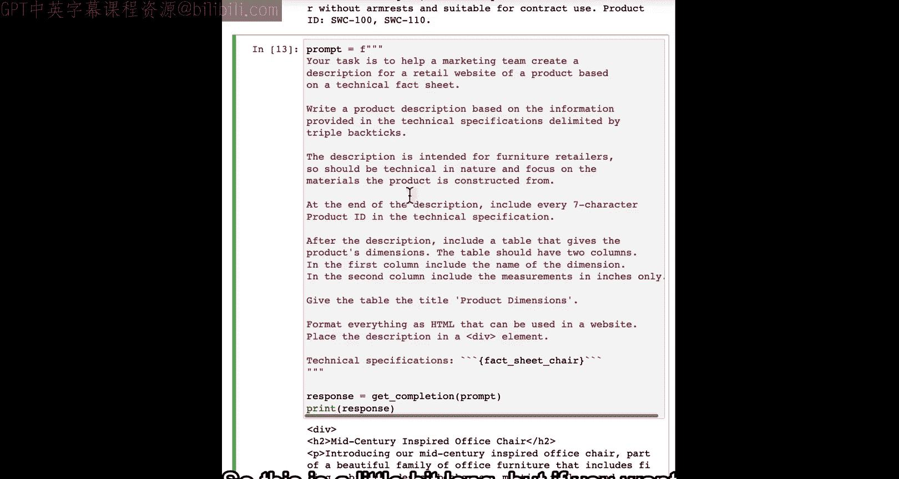

Fe free to pause the video， tell it to be more succinct and regenerate this and see what results you get。

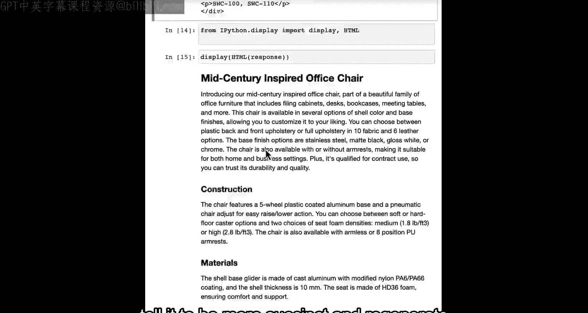

So I hope you take away from this video that prompt development is an iterative process。

 try something， see how it does not yet fulfill exactly what you want。

 and then think about how to clarify your instructions or in some cases。

 think about how to give it more space to think， to get it closer to delivering the results that you want。

And I think the key to being an effective prompt engineer isn't so much about knowing the perfect prompt。

 is about having a good process to develop prompts that are effective for your application。

And in this video， I illustrated。Developing a prompt using just one example for more sophisticated applications。

 sometimes you have。Multiple examples say a list of 10 or even 50 or 100 fact sheets and iteratively develop a prompt evaluated against a large set of cases。

But for the early development of most applications。

 I see many people developing it sort of the way I am with just one example。

 but then for more mature applications sometimes。It could be useful to evaluate problemss against a larger set of examples。

 such as。To test different problems on dozens of fact sheets。

 to see how is average or worst case performances on multiple fact sheets。

 but usually you end up doing that only when an application is more mature and you have to have those metrics to drive that incremental last few steps of prompt improvement。

So with that， please do play with the Jupyter code notebook examples and try different variations and see what results you get and when you're done let's go on to the next video where we'll talk about one very common use of large language models in software applications which is to summarize text So when you're ready let's go on to the next video。

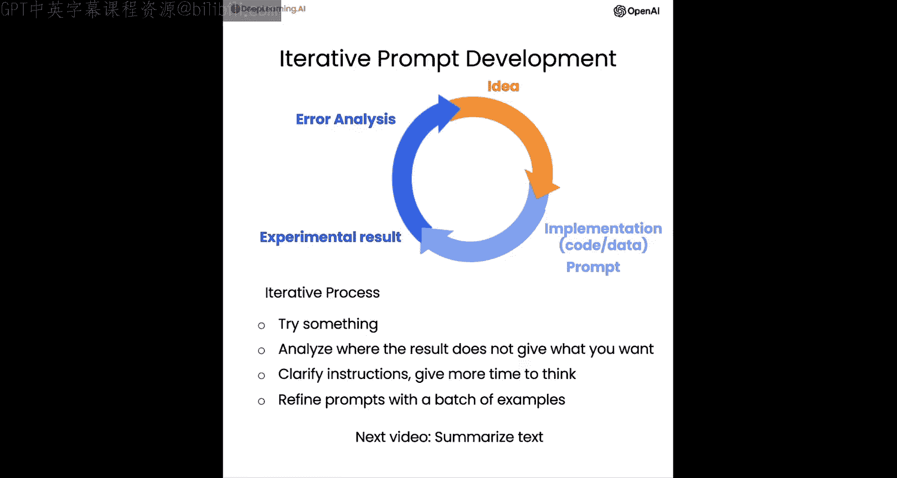