# 吴恩达最新《面向开发者的ChatGPT提示工程》｜chatgpt-prompt-engineering-for-developers｜中英字幕 - P4：4_prompt_eng_04_summarizing_v3.zh_en - GPT中英字幕课程资源 - BV1e8411o7NP

There's so much text in today's world， Pre much none of us have enough time to read all the things we wish we had time to。

 So one of the most exciting applications I've seen of large language models is to use it to summarize text and this is something that I'm seeing multiple teams build into multiple software applications。

😊，You can do this in the chat GT web interface， I do this all the time to summarize articles so I can just kind of read the content of many more articles than I previously could and if you want to do this more programmatically you'll see how to in this lesson。

So with that， let's take into the code to see how you could use this yourself to summarize text。

 so let's start off with the same static code as you saw before of import open AI node API key and here's that gett completion hopeer function。

I'm going to use as。The running example。The task of summarizing this product review got this panda plush toy from Ad's birthday。

 who loves it and takes it everywhere and so on and so on。If you're building an ecommerce website。

And there's just a large volume of reviews， having a tool to summarize the lengthy reviews could give you a way to very quickly glance over more reviews to get a better sense of what all your customers are thinking。

So here's a prompt for generating a summary。Your task is generally short summary of our product review from Ecommer's website。

 summarize review below and so on， in at most 30 words。And so this is soft and cute。

 panda plush toy up by daughter。 but small price arrive early。 Not bad's pretty good summary。

 And as you saw in the previous video， you can also play with things like controlling the character count or the number of sentences to affect the length of this summary。

Now， sometimes when creating a summary， if you have a very specific purpose in mind for the summary。

 For example， if you want to give feedback to the shipping department。

 you can also modify the prompt to reflect that so that it can generate a summary that is more applicable to one particular group in your business so。

 for example， if I add。To give。Feedback。小纸。Shipping department。

And let's say I changed this too to start to focus on。Any aspects that mentioned。

Shipping and delivery of the product。 And if I run this， then。Again， you get a summary。

 but instead of starting off with soften cube panda plush toy。

 it now focuses on the fact that it arrived a day earlier than expected， and then it still has。

 you know other details then。Or as another example。

 if we aren't trying to give feedback to the shipping department。

 but let's say we want to give feedback to the pricing department。

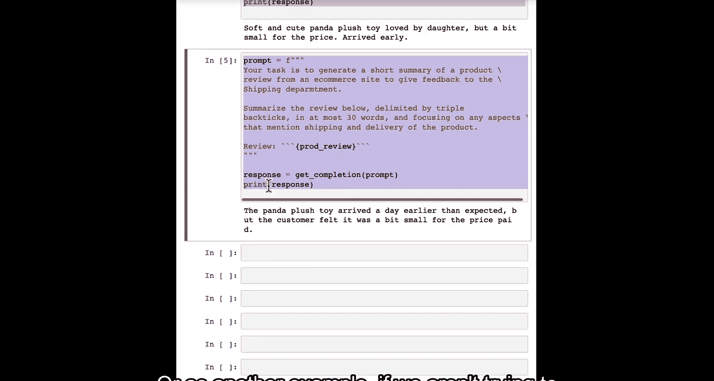

So the precinct heart is。Responseible for determining the price of the product。And。

I'm gonna tell it to focus on。And the aspects are relevant to the price and perceived value。

Then this generates a different summary。That it says， maybe the price may be too high for a size。

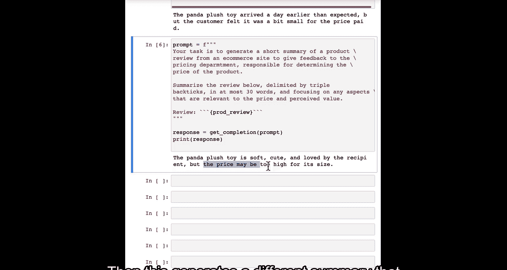

Now， in the summaries that I've generated for the shipping department or the pricing department。

 it focus a bit more on information relevant to those specific departments and in fact。

 feel free to pause the video now and maybe ask it to generate information for the product department responsible for the customer experience of the product。

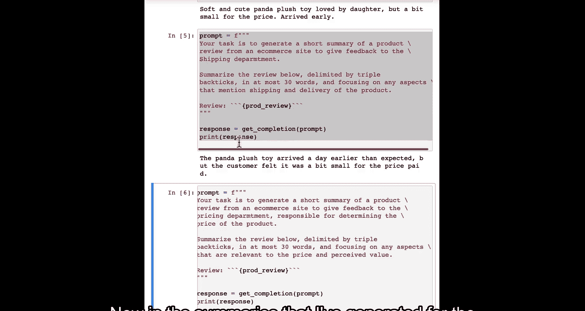

Or for something else that you think might be interested to an ecommerce site。

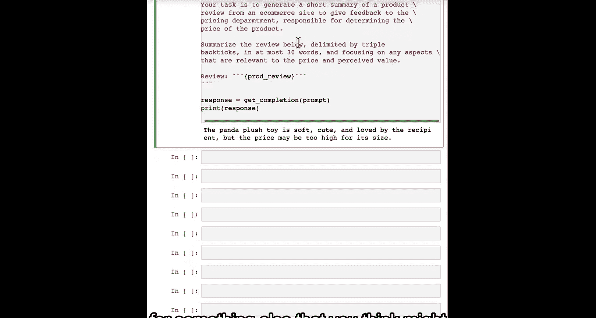

But in these summaries， even though it generated the information relevant to shipping。

 it had some other information too， which you could decide may or may not be helpful。

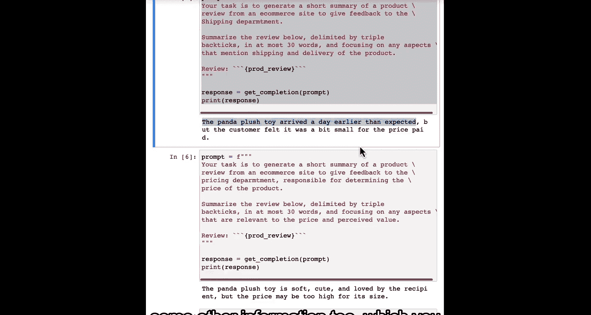

So depending on how you want to summarize it， you can also ask it to extract information rather than summarize it。

So here's a prompt that says youita extract relevant information to give feedback to the shipping department and now it just says probably arrived a day earlier than expected without all of the other information。

 which was also hopeful in a general summary， but less specific to the shipping department if all it wants to know is what happened with the shipping。

Lastly， let me just share with you a concrete example for how to use this in a workflow to help summarize multiple reviews to make them easier to read。

So。Here are a few reviews。 This is kind of long， but you know here's a second review for a standing lamp。

 need lamp from a bedroom。 here's a third review for an electric toothbrush。

 My dental hygiene is recommended。

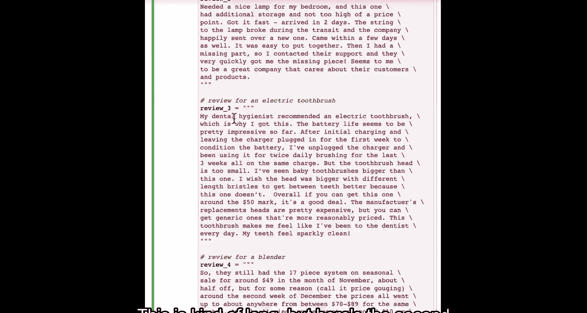

Kind of a long review about the electric toothbrush。

 This is a review for a blender when it set so said 17 piece system on seasonal sale and so on and so on。

 This is actually a lot of text。 If you want， feel free to pause the video and read through all this text。

 But what if you want to know what these review us wrote without having to stop and read all this in detail。

 So I'm going to set review one。

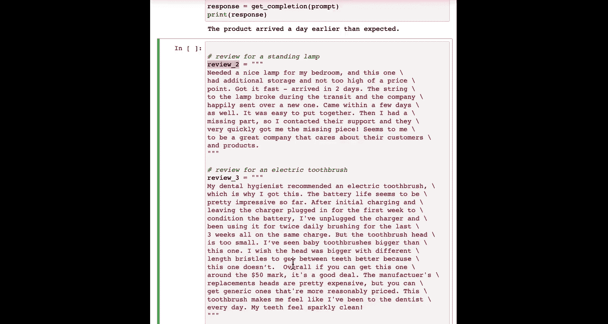

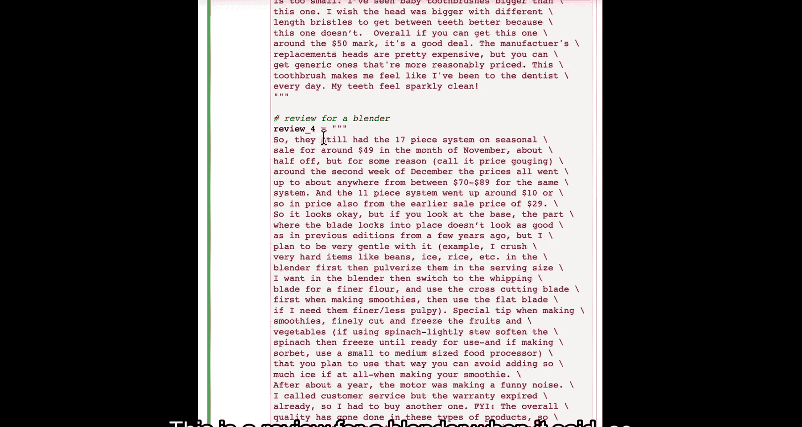

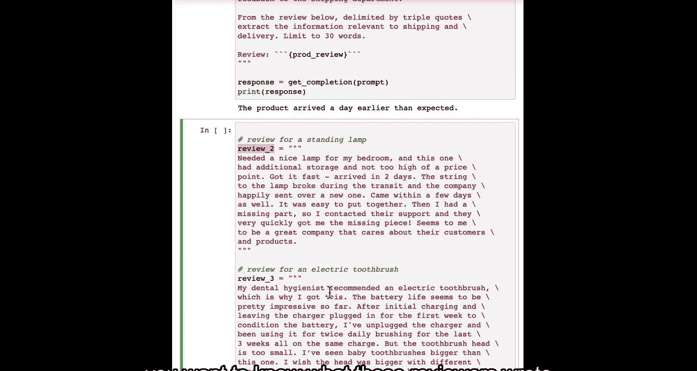

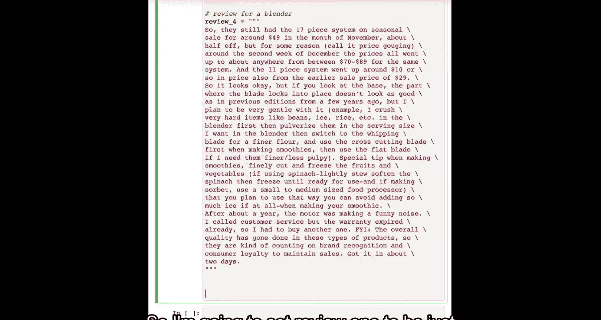

To be just the product review that we had out there。

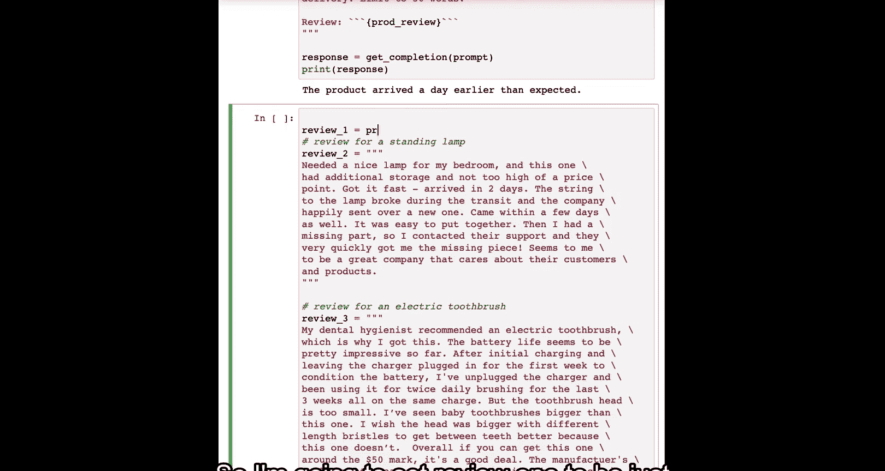

And I'm going to put all of these reviews into a list。 And now， if I implement a。

Full loop over the reviews。So here's my prompt， and here I've asked it to summarize it in at most。

20 words。Then， lesss haves。Get the response and print it out and let's run that。

And it prints out the first review was that panattoy review， summary review of the lamp。

Some review of the toothbrush。 and then the blender。And so， if you have。

websitebsites where you have hundreds of reviews， you can imagine how you might use this to build a dashboard to take huge numbers of reviews。

 generate short summaries of them so that。You or someone else can browse the reviews much more quickly。

 and then if they wish， maybe click in。To see the original longer review。

 and this can help you efficiently get a better sense of what all of your customers are thinking。

Al so that's it for summarizing and I hope that you can picture if you have any applications with many pieces of text。

 how you can use prompts like these to summarize them to help people quickly get a sense of what's in the text。

 the many pieces of text and perhaps optionally digging more if they wish。In the next video。

 we'll look at another capability of large language models， which is to make inferences using text。

 For example， whether you had again product reviews and you wanted to very quickly get a sense of which product reviews have a positive or negative sentiment。

 Let's take a look at how to do that in the next video。😊。

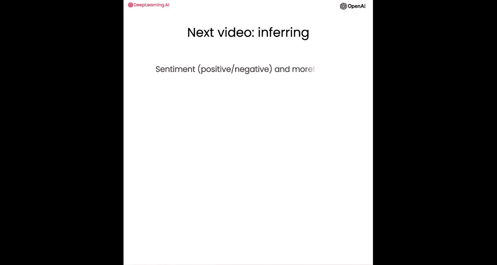