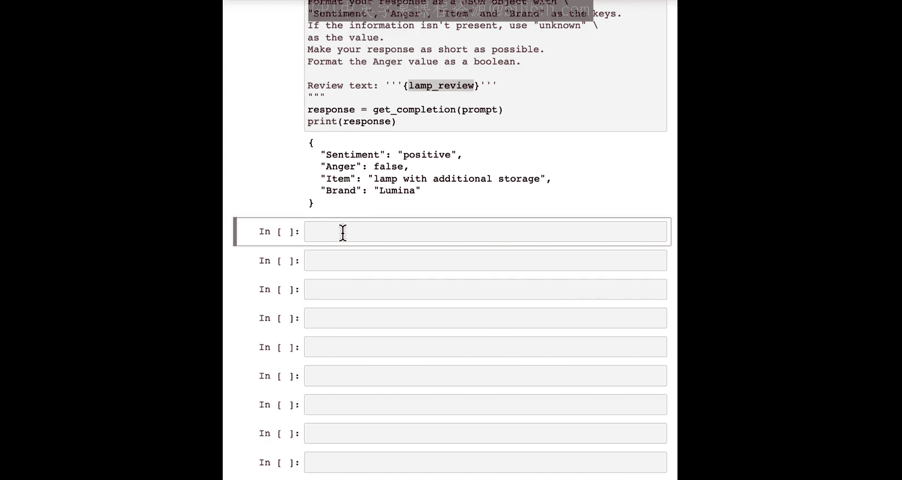
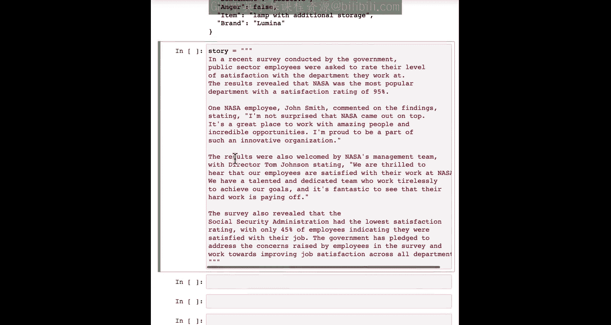
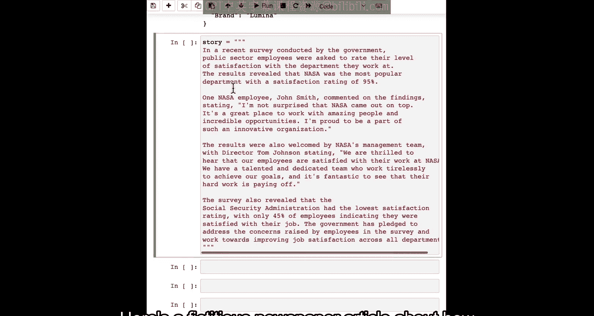
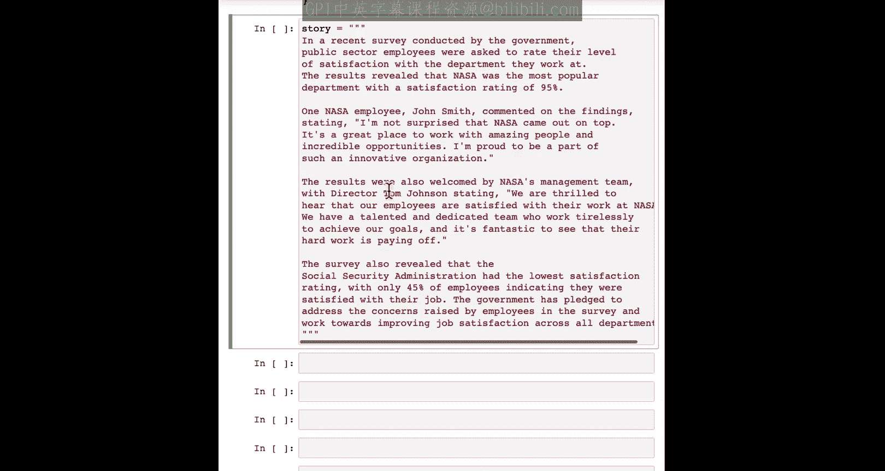
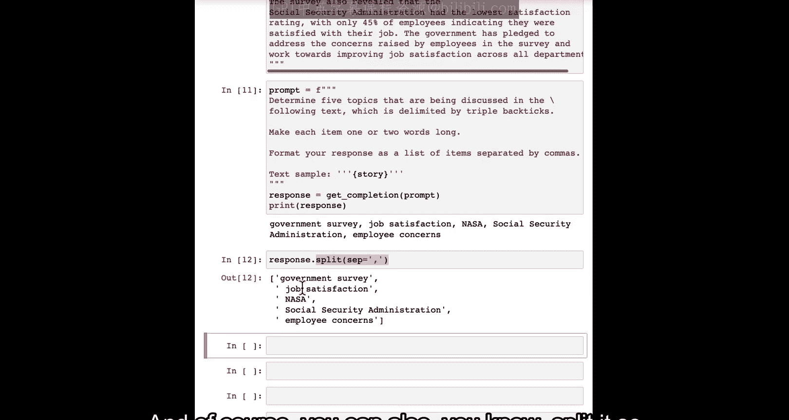
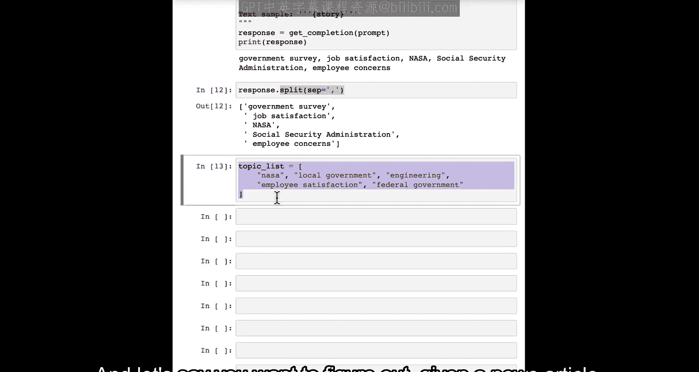
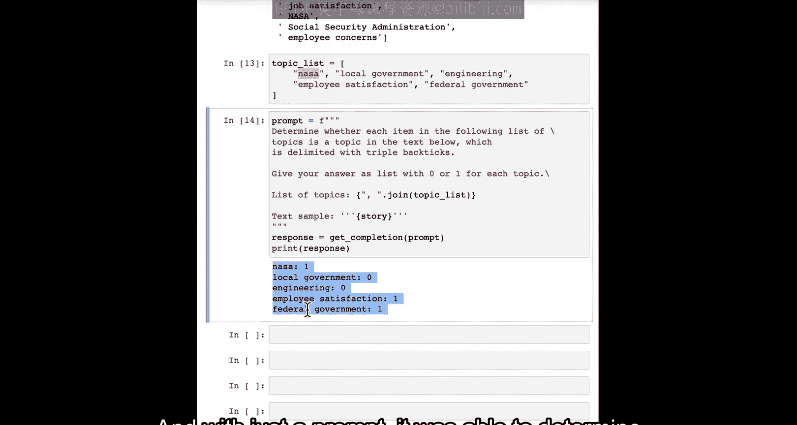
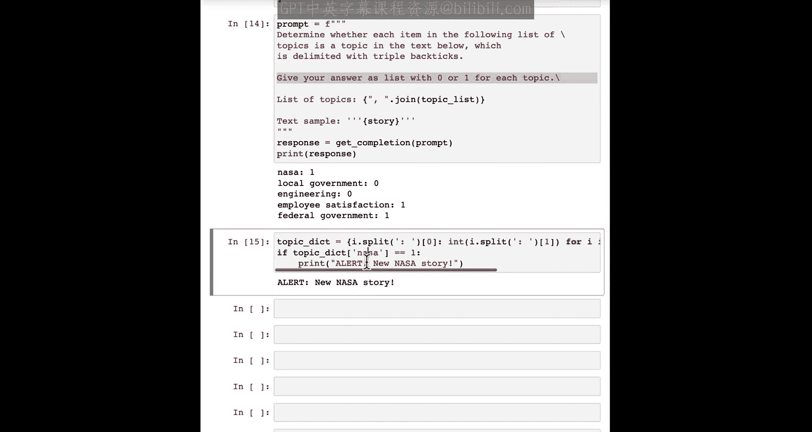
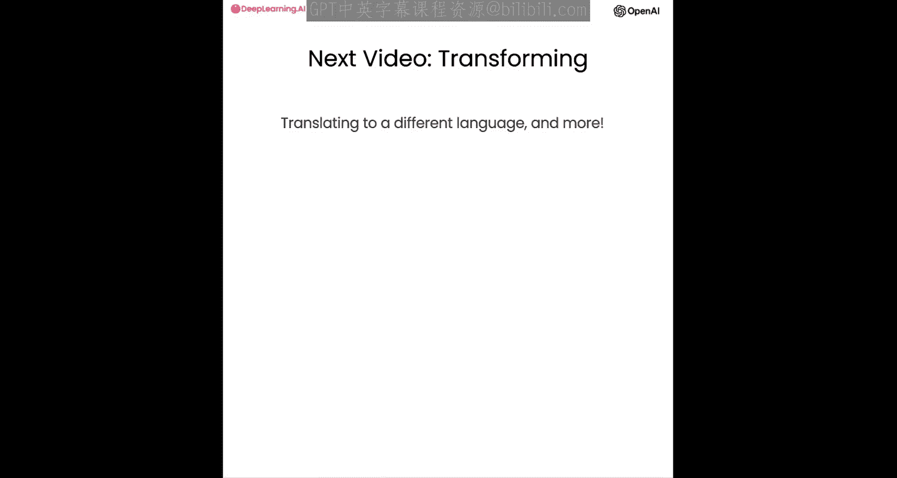

# 吴恩达最新《面向开发者的ChatGPT提示工程》｜chatgpt-prompt-engineering-for-developers｜中英字幕 - P5：5_prompt_eng_05_inferring_v3.zh_en - GPT中英字幕课程资源 - BV1e8411o7NP

This next video is on inferring。 I like to think of these tasks where the model takes a text as input and performs some kind of analysis。

 so this could be extracting labels， extracting names， kind of understanding the sentiment of a text。

 that kind of thing。So if you want to extract a sentiment。

 positive or negative of a piece of text in the traditional machine learning workflow。

 you'd have to collect a label dataset train a model。

 figure out how to deploy the model somewhere in the cloud and make inferences and that can work pretty well but it was just a lot of work to go through that process and also for every task such as sentiment versus extracting names versus something else。

 you have to train and deploy a separate model。 One of the really nice things about large language model is that for many tasks like these you can just write a prompt and have it start generating results pretty much right away and that gets tremendous speed in terms of application development and you can also just use one model。

 one API to do many different tasks rather than needing to figure out how to train and deploy a lot of different models and so with that let's jump into the code to see how you can take advantage of this。

So here's a usual start code。Run that。And the moivating example I'm going to use is a review for a lamp。

Neither a nice lamp from a bedroom and this one additional storage and so on。So。

Let me write a prompt。To classify the sentiment of this。 And if I want the system to tell me。

 you know， what is the sentiment。I could just write what is the sentiment？Of the following。

Project review。With the usual delimit error and the review text and so on， and let's run that。

And this says the sentiment of the product review is positive， which is actually seems pretty right。

 This lamp isn't perfect， but this customer seems pretty happy。

 See you're a great company that cares about the customers of products。

 I think positive sentiment seems like the right answer。😊，Now this prints out the entire sentence。

 the sentiment of the product review is positive。If you wanted to give a more concise response to make it easier for post processing。

I can take this prompt and another instruction to give you answers a single word。

 either positive or negative， so just prints out positive like this。

 which makes it easier for a piece of text to take this output and process it and do something with it。

Let's look at another prompt again， still using the La review。

Here I have it identify a list of emotions that the writer of the following review is expressing include no more than five items in this list。

So large language models are pretty good at extracting specific things out of a piece of text in this case。

 we're expressing the emotions。😊，And this could be useful of understanding how your customers think about a particular product for longer customer support organizations。

 it's important to understand if a particular user is extremely upset。 So you might have a。

Different classification problem like this is the right to the funny review expressing anger because if someone is really angry they might merit。

 paying extra attention to have a customer review， to have customer support the customer success。

 reach out to figure what's going on and make things right for the customer In this case the customer is not angry。

And notice that with supervised learning， if I had wanted to build all of these classifiers。

 there's no way， you know， I would have been able to do this with supervised learning in the just a few minutes that you saw me do so in this video。

 I'd encourage you to pause this video and try changing some of these prompts。

 Maybe ask if the customer is expressing delight or ask if there are any missing parts and see if you can get a prompt to。

😊，Make different inferences about this lab review。Let me show some more。

Things that you can do with this system， specifically。

Extracting richer information from a customer review。

So information extraction is the part of NLP of natural language processing that relates to taking a piece of text and extracting certain things that you want to know from the text。

 So in this prompt or asking it， identify the following items。

The item purchase and the name of the company that made the item。 Again。

 if you are trying to summarize many reviews。From an online shopping e-commerce website。

 it might be useful for your launch collection of reviews to figure out what were the items who made the item。

 figure out positive and negative sentiment， to attract trends about positive or negative sentiment for specific items or for specific manufacturers。

And in this example， I'm going to ask it to format your response as a J object with item and brand as the keys。

And so if I do that。It says the item of a lamp， the brand is luminar。

 and you can easily load this into the Python dictionary to then do additional processing on this output。

In the examples we've gone through， you saw how to write a prompts to recognize the sentiment。

Fig out if someone is angry and then also extract the item and the brand。

One way to extract all of this information。Would be to use three or four prompts and。

Call get completion， you know， three times or four times。

 extract these different fields one at a time。 but it turns out you can actually write a single prompt to extract all of this information at the same time。

 So we'll say identifying items， extract sentiment is a reviewer， expressing anger， item purchase。

 company in。And then here。I'm also going to tow it to format the anger value as a brilliant value。

And let me run that。And this outputs a。Jason。Where sentiment is positive anger and there no quotes around false because it also to just output it as a brilliantodian value。

 extracted the item as lamp with additional storage instead of lamp seems okay。But this way。

 you can extract multiple fields out of a piece of text with just a single prompt。And as usual。

 please feel free to pause a video and play with different variations on this yourself。

Or maybe even trytyping in a totally different review to see if it can still extract these things accurately。

Now， one of the cool applications I've seen of large language models is inferring topics。

 given a long piece of text， you know， what is this。

P of text about what are the topics。

Here is a fictitious newspaper article about how government workers feel about the agency they work for。

 so the recent survey conducted by government， you know and so on results reviewed in NASA was a popular department with high satisfaction rating。

 I am a fan of NASA love the work they do， but this is a fictitious article。

And so give an articlesicle like this。We can ask it。With this prompt。

Determine five topics that are being discussed in the following text。

 Let's make each item one or two words long format your response in a comma separated list。

And so if we run that， you know， we get out this article is' about the governance survey It's about job satisfaction。

 It's about NaA and so on。 So overall， I think pretty nice。😊。

Extraction of a list of topics and of course you can also you know splitit it so you get a python list with the five topics that desireicle was about。

And if you have a collection of articles and extract topics。

 you can then also use a large language model to help you index into different topics so let me use a slightly different topic list let's say that we're news website or something and you know these are the topics we tried now local government engineering employee satisfaction。

Federal government。 and let's say you want to figure out given the news article。

 which of these topics are coveredted in that news article。

So here's a prompt that I can use。I'm going to say determine whether each item in the final list of topics is a topic in the text below。

 give your answer as a list of 01 for each topic。And so。Great。

 so this is the same story text us before。 So this things a story。 It is about NAA。

 It' not about local governments， not about engineering。 It is about employee satisfaction。

 and it is about federal government。 So with this。In machine learning。

 this is sometimes called a zero shot learning。Algorithm because we didn't give it any training data that was labeled so that zero shot and with just a prompt。

 it was able to determine which of these topics are covered in that news article。

And so if you want to generate a news alert， say， so that process news and you know I really like a lot of the work that NASA does。

 so if you want to build a system that can take this。

 you put this information into dictionary and whenever NASA， news pops out， print alert。

 new NASA story， they can use this to very quickly， take the article。

 figure out what topics it isnt about and that the topic includes NASA， have it print out alert。

 new NASA story。Oh just one thing， I use this topic dictionary down here。

This prompt that I use up here isn't very robust。 If I wanted a production system。

 I would probably have it output the answer as a in JO format rather than as a list because the output of the large language model can be a little bit inconsistent so this is actually a pretty brittle piece of code。

 but if you want when you're done watching this video。

 feel free to see you can figure out how to modify this prompt to have an output Jason instead of a list like this and then have a more robust way to tell if a bigger article is a story about NASA。

So that's it for inferring and in just a few minutes you can build multiple systems for making inferences about text that previously this would have taken days or even weeks for a skilled machine learning developer。

And so I find this very exciting that both for skilled machine learning developers as well as for people that are newer to machine learning。

 you can now use prompting to very quickly build and start making inferences on pretty complicated natural language processing tasks like these In the next video we'll continue to talk about exciting things you could do of large language models and would go on to transforming how you take one piece of text and transform it into a different piece of text such as Trans it to different language Let's go on to the next video。

😊。

