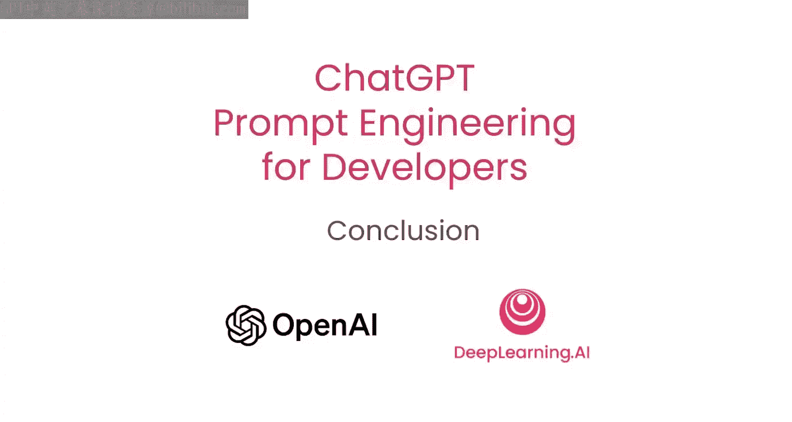
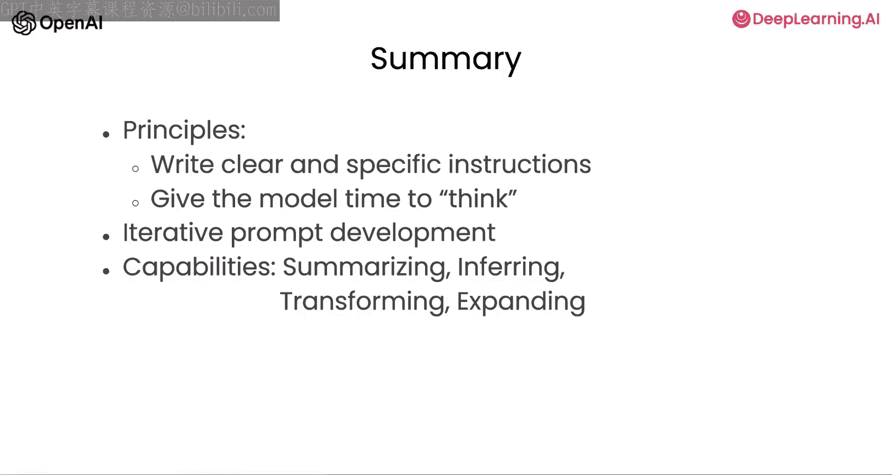

# 吴恩达最新《面向开发者的ChatGPT提示工程》｜chatgpt-prompt-engineering-for-developers｜中英字幕 - P8：9_prompt_eng_09_conclusion_v2.zh_en - GPT中英字幕课程资源 - BV1e8411o7NP

Congratulations on making it to the end of this short course。In summary， in this short course。

 you've learned about two key principles for prompting， write clear and specific instructions。

 and when it's appropriate， give them all the time to think。

 you also learn about iterative prompt development and how having a process to get to the prompt is right for your application is key。

And we went through a few capabilities of large language models that are useful for many applications。

 specifically summarizing inferring， transforming and expanding。

 And you also saw how to build a custom chatbot。

That was a lot that you learned in just one short course。

 And I hope you enjoyed going through these materials。

 We hope you'll come up with some ideas for applications that you can build yourself now。

 And please go try this out and let us know what you come up with。 No application is too small。 It's。

 you know， fine to start with something that's kind of a very small project with maybe a little bit of utility or maybe it's not even useful at all。

 It's just something fun。 Yeah， and I find playing with these models actually really fun。

 So play of it。 Yeah， I agree。 it's good a good weekend activity。 speaking from experience。😊。

And just， you know， please use the learnings from your first project to build a better second project。

 and， you know， maybe even a better third project so on。

 That's kind of how I have kind of grown over time using these models myself as well。

 Or if you have an idea for a bigger project already， just just go for it。 And you know。

 as a reminder， these kind of large language models are a very powerful technology。

 So it kind of goes without saying that we ask you to use them responsibly and please only build things that will have a positive impact。

 Yeah fully agree。 I think in this age， people that build AI systems can have a huge impact on others。

 So it's more important than ever that all of us only use these tools responsibly。

And I think building large language model based applications is just a very exciting and growing field right now。

 And now that you finish this course， I think you now have a wealth of knowledge to let you build things that few people today know how to。

 So I hope you also help us to spread the word and encourage others to take this course too。😊。

In closing， I hope you had fun doing this course and I want to thank you for finishing this course and both E and I look forward to hearing about the amazing things that you feel。

😊。