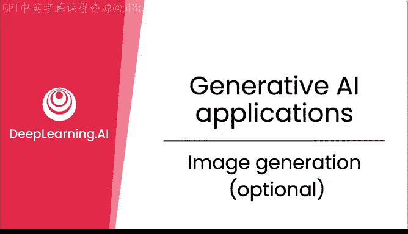
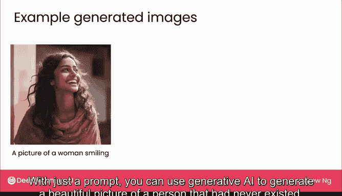
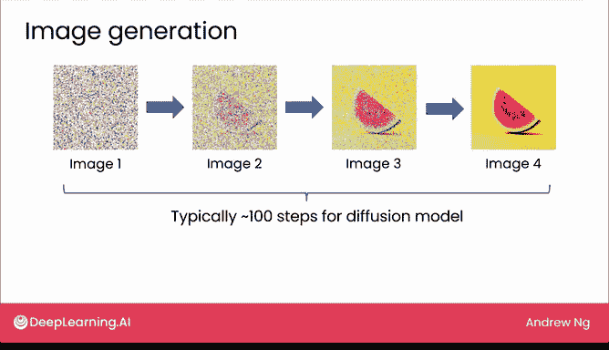
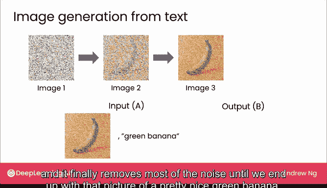

# 吴恩达最新《面向每个人的生成式AI》Generative AI for Everyone（中英字幕） - P10：10_01_06_图像生成（选修）.zh_en - GPT中英字幕课程资源 - BV11G411X7nZ

Thanks for stick with me for this final optional video on image generation so far this week we'll focus most of attention on text generation and text generation is what a lot of users are using and is having the biggest impact of all the different tools of generative AI。

But part of the excitement of Gene AI is also image generation and there are also starting to be some models that can generate either text or images。

 and these are sometimes called multimodal models because it can operate in multiple modalities text or images What I'd like to do in this video is share a view how image generation works Let's take a look with just a prompt you can use Gen AI to generate a beautiful picture of a person that never existed or a picture of a futuristic scene or a picture of a cool robots like this How does this technology work。

😊。

Image generation today is mostly done via a method called a diffusion model。

 diffusion models have learned from huge numbers of images found on the Internet or elsewhere。

 and it turns out that at the heart of a diffusion model is supervised learning。 Here's what it does。

 Let's say the algorithm finds a picture on the internet of an apple like this。

 And it wants to learn from pictures like this and hundreds of millions of others on how to generate images。

 The first step is to take this image and gradually add more and more noise to it so that you go from this nice picture of an apple to a noisier to an even noisier to finally a picture that just looks like pure noise where all the pixels are just chosen at random and it doesn't look at all like an apple。

 The diffusion model then uses pictures like these as data to learn using supervised learning to take as input a noisy image and output。

S less noisy image specifically it would create a data where the first data point says if it's given the second input image。

 what we want the supervised learning algorithm to do is learn to output a cleaner version of this apple and here's another data point given this third image of an even noisier image。

 we would like the algorithm to learn to output a slightly less noisy version like this。And finally。

 given an image of pure noise like this fourth image。

 we would like it to learn to output a slightly less noisy picture here that just suggests the presence of an apple After training on maybe hundreds of millions of images via a process like this when you want to apply it to generate a new image this is how you would run it you would start off with a pure noise image so start by taking picture where every single pixel and picture is just chosen completely a random we then feed this picture to the Suvised learning algorithm that we trained up on the previous light when we feed them pure noise it learns to remove a little bit of noise from this picture and you may end up with a picture like this that suggests some sort of fruit in the middle where not quite sure what it is yet given the second picture we again feed it to the model and it then takes away even a little bit more noise and now it looks like we can see a noisy picture of a watermelon。

And then if you apply this one more time， we end up with this fourth image。

 which looks like a pretty nice picture of a watermelon。

 I'm illustrating this process using four steps of adding noise on the previous slide and four steps of removing noise on this slide but in practice maybe about 100 steps would be more typical for a diffusion model So this algorithm will work for generating pictures completely at random but we want to be able the control the image it generates by specifying a prompt to tell it what we wanted to generate。

 let me describe a modification of the algorithm that lets you add text or add a prompt to tell it what you wanted to generate in this training data were given pictures like this apple as well as a description or prompt that could have generated this apple So here I have a text description saying this is a red apple then we will same as before add the noise to this picture until we get this fourth image。

which is pure noise， but we're going to change how we build the learning algorithm。

 which is rather than inputting the slightly noisy picture and expecting it to generate a clean picture。

 we instead have the input a to the supervised learning algorithm B。

 this noisy picture as well as the text caption or the prompt that could have generated this picture namely red apple and given this input。

 we now want the algorithm to output this clean picture of an apple and similarly we generate additional data points for the algorithm using the other noisy images where each time given a noisy image and the text prompt red apple we want the algorithm to learn to generate a less noisy picture of a red apple So having learned from a very large dataset when you want to apply this algorithm to generating say a green banana this is what you do same as before we start off with an image of pure noise so。

Every single pixel is chosen completely at random and if you wanted to generate a green banana。

 you input to the Suvis learning algorithm that picture of pure noise together with the prompt green banana now that it knows you want a green banana。

 hopefully the algorithm will' put a picture that maybe looks like this can't see the banana that clearly but maybe there's a suggestion of some sort of greenish root in the middle and this is a first step of the image generation。

The next step is we then take this image on the right that was an output B and now feed that is the input A with again the prompt green banana to get it to generate a slightly less noisy picture and now we see clearly looks like it's a green banana but a pretty noisy one and we do this one more time and it finally removes most of the noise until we end up with that picture of a pretty nice green banana so that's how diffusion models work for generating images and at the heart of this really magical process of generating beautiful images is again supervised learning。

Thanks for sticking with me for this optional video and I look forward to seeing you next week where we'll dive much more into applications being built using Genative AI I'll see you in the next video。

😊。