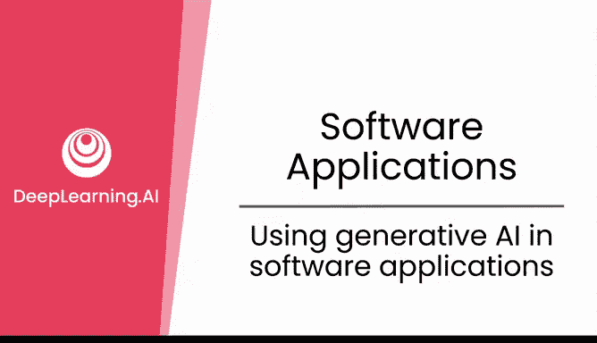
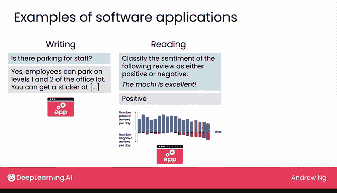
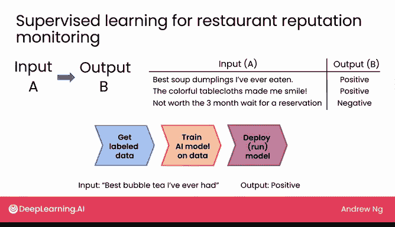
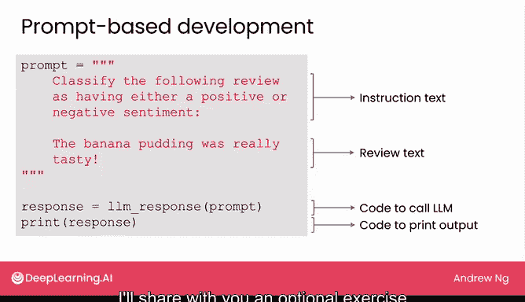
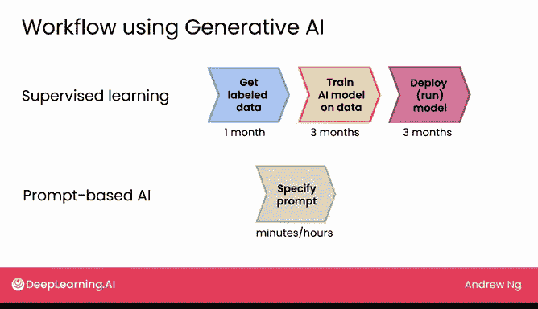

# 吴恩达最新《面向每个人的生成式AI》Generative AI for Everyone（中英字幕） - P11：11_02_01_在软件应用中使用生成式AI.zh_en - GPT中英字幕课程资源 - BV11G411X7nZ

Welcome back Last week we discussed how Genrative AI can be used either via web user interface or be built into a software application。

This week， we'll take a look at how many amazing software applications are being built using Genta AI and we'll also take a look at some technology options that go beyond just prompting and that allow you to do much more with Gen AI for example。

 having it operate on your own proprietary documents rather than just on what is learned from public sources on the Internet。

 Let's take a look。 we saw last week a few examples of Gentor AI applications such as writing answers to questions that may require access to information about your company's parking policy in this example。

 or reading restaurant reviews on the internet to help with reputation monitoring or building a chatbot to help take food orders。

 It turns out that while some applications like this did exist and were built before the rise of Genta AI。

 Gen AI has made building these applications much easier and in many cases is。

the work much better as well。 Let me illustrate with the example of reading restaurant reviews for reputation monitoring a few years ago if you wanted to build a system for reading restaurant reviews it would have taken writing a lot of software code that looks like this pages and pages of software that you would need machine learning engineers to write and specifically the process of building a restaurant reputation monitoring review system would have looked like this you would use supervised learning that's that technology that maps from inputs A to outputs B and if I were building the system I would start by collecting maybe a few hundred or a few thousand data points with examples like this I would have a review that suit dumplings Ive eaten that sounds delicious and label that as a positive review the colorful table cost made me small。

 That's positive or not worth the threemonth weight that would be a negative review。

And the process of building the system would involve first getting label data。

 then finding an AI team to help train an AI model on the data to learn how to output positive negative depending on different inputs A and then finally you might have to find a cloud service like AWs or Google Cloud word zero to deploy and run the model so that when you then input best bubble tea I've ever had。

 that would hopefully recognizes as having a positive sentiment and this process would often take months In contrast。

 if you were to use promptbased development， this is the code you would need to develop a sentiment classifier。

 First， here's how we specify a prompt in code my prompt which have set equal to two positive text that's the instruction text classify the following review as having the positive negative sentiment and then here is the review text and after specifying the prompt in。

 I just need one line of code。

To call the large line model to get a response back and then I'm going to have it display or print the response so this is pretty much all the code it takes to build such a system and in fact in the next video I'll share view an optional exercise where you can try out this code yourself。

Whereas with the traditional approach to building a sentiment classifier using supervised learning。

 the timeline for the project might have been a month to get say 1000 labeled examples with 1 thousand reviews and the positive negative labels after collecting the data it might have taken a team say three months to train the AI model on data and in another three months to deploy the Mis running well andr and robust。

 I don't know if this seems like a long time to you。

 but for many really good machine learning teams that I've worked with。

 this six to 12 month timeline was pretty realistic for what it took to build and deploy a valuable AI model and this worked and this was very valuable for a lot of applications but this just took a long time In contrast for promptbased AI This is what it feels like you can specify a prompt in minutes or maybe hours and then deploy the model in hours or maybe days。

So there are now many applications that have previously taken me and very good machine learning teams。

 maybe six to 12 ones to build that today I think there are millions of people around the world that can now build in maybe days or a week and this is fantastic because this lowerring of the barrier to entry to building such applications is leading to flourishing of a lot more AI applications。

 with one important caveat， which is that as we discussed last week。

 Gen AI tends to work much better for unstructured data like text and images and audio but with that admitted the important caveat。

 the number of AI applications built on top of Gen AI is just letting the community do much more than ever before in the next optional video。

 I'd like to invite you to try out some codes with me for reading restaurant reviews and classifying sentiment It's fine if you've never seen or written a line of code before in your life。

 but I'm hoping to convey to you how little。😊，Code is needed to do this now and let you try it out yourself。

 So I hope you take a look， though， also feel free to skip it if you wish。 And after that。

 we'll come back and talk about what building a gen AI software project feels like when we talk about the life cycle of agen AI project。

😊。