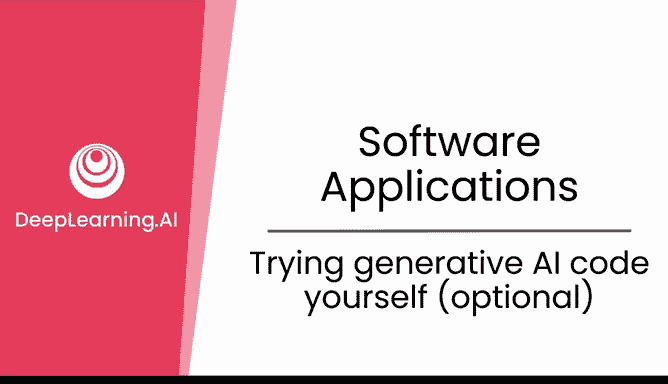
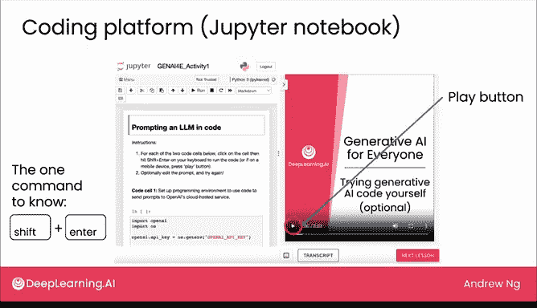
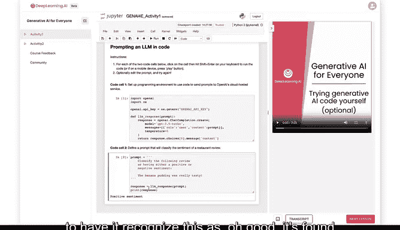

# 吴恩达最新《面向每个人的生成式AI》Generative AI for Everyone（中英字幕） - P12：12_02_02_动手编写生成式AI代码（选修）.zh_en - GPT中英字幕课程资源 - BV11G411X7nZ

Thanks for joining me for this optional video In the next item on the Cosera website。

 you be able to click on a link to take you to the deep learningning AI platform。

 which will let you trial some code for yourself。 Let me just show you what you see when you get there when the deep learning AI platform loads you see a user interface that looks like this with some code on the left and if the code looks unfamiliar to you don't worry about it will step through every single step with you and on the right is a video player if you click on the play button on this video player I will step through at that time the code with you and the only thing you need to remember for this optional exercise is the command shift enter because in this programming environment on the left that's the one command you need to run in order to get through the code So to go through this optional exercise please go on to that next item and hit the play button。

And in this user interface on the Deep learninger AI platform。

 and we'll walk through the code example together then。

When we get to that platform， you see code that looks like this and the only thing you have to do is go to the code and then hit shift enter to run this code and then shift enter to run this code where the prompt that I showed you just now to have it recognize this as oh good is' found has the banana pudding was very tasty has a positive sentiment。

So you don't have to do this little plain with code exercise to fully complete this course on Gen AI。

 but if you do， I hope you have fun with it and it will come back to discuss the life cycle of a Gen AI project。

