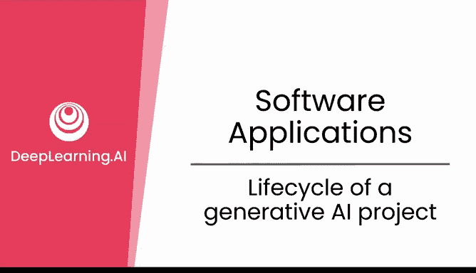
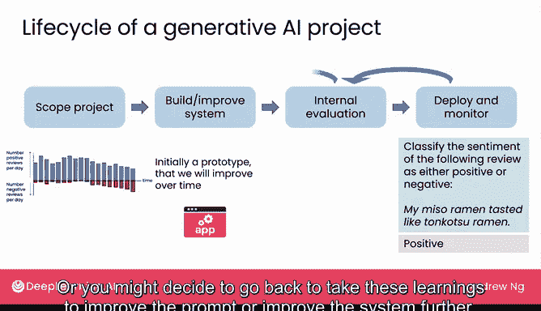
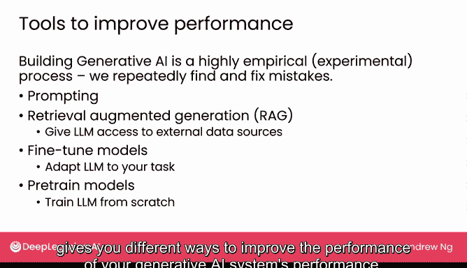
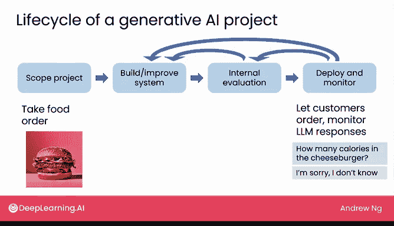

# 吴恩达最新《面向每个人的生成式AI》Generative AI for Everyone（中英字幕） - P13：13_02_03_生成式AI项目生命周期.zh_en - GPT中英字幕课程资源 - BV11G411X7nZ

I'd like to share with you what the process of building a Gen AI software application feels like。

 Let's take a look。 Here's what the life cycle of a Gen VI project to build a software application feels like。

 We would start off by scopeop in a project to decide what do we want this software to do。 So。

 for example， say you decide you want to build a restaurant reputation monitoring system。

 The next step would be to actually try to implement it。 And given the ease of。😊。

Building AI applications using Gen AI， which you may have seen in the optional video that came before this one。

Very often you be able to build a prototype quite quickly and then plan to over time improve this software prototype for some applications I've worked on。

 we would build the initial prototype in one or two days and that initial prototype frankly isn't that good initially but building it quickly lets us then take it into internal evaluation where we might have our own internal team write different restaurant reviews and test the system to see how often it is giving a correct response and sometimes the internal evaluation will turn out some examples where it doesn't give the right results in this case with my pastor was code it outputs this as a positive sentiment and you know sometimes copasor is delicious but this sounds like a negative sentiment to me and based on problems that we discover internally will then go back to continue to improve the system。

As you saw last week， writing prompts is a highly iterative process where you have to try something。

 see that works and then improve it and building a gen AI software application also tends to be a very iterative process。

 after a sufficient internal evaluation to give you confidence that the systems working well enough then we would deploy it out in the wild and continue to monitor its performance and it would not surprise me if you deploy something and initially external users also generates input that causes the system to make some mistakes。

 For example， maybe a user write my misso ramen tastes like toco ramen is as good of that。

 Well if you're not familiar with ramen or Japanese cuisine。

 you may not know is this a good thing or a bad thing and if your system raises as a positive sentiments。

 but it turns out that if you are ordering miso ramen on the menu you probably don't want it to taste like。

Ko ramen， which tastes more like porkbased soup broth and when you find incorrect responses like this out in the while you might decide to go back to internal evaluation。

 for example， to systematically understand if your system is say underperforming on certain types of cuisine or you might decide to go back to take these learnings to improve the prompt or improve the system further。

 assuming you decide that these types of errors are unacceptable。

 So it turns out that building geneative AI software is a highly empirical and by that I mean highly experimental process。

 meaning that we repeatedly try something and then find and fix mistakes。

We've already seen how prompting itself is a highly empirical process where you would have an idea。

 try the prompt， see the El response， then maybe update your idea and the prompt and go again。

But other than updating the prompts， there are other tools that we talk about this week for improving the performance of your Gen AI system。

 One tool that we talk about later this week is rag or retrieval augmented generation that gives the large language model access external data sources。

 We'll also talk later this week about the technique called fine tuning that allows you to adapt a large language model to your task and then finally pretraining models。

 which refers to training a large language model from scratch don't worry about it if you don't know what any of these terms mean will go through each of them in depth later this week。

 but there are key techniques that in addition to prompting gives you different ways to improve the performance of your Gen AI systems performance。

 Just to walk through a second example of the lifecycl of regen AI project。

 Let's look at what building a system to take food orders might look like。

Say you decide to scope a food order customer service chatbot to take all this。

What you want do is start by building the system and quickly throw together a chatbot to take food orders then because we don't know how well this is doing internally。

 you might let your internal team try it out and place different orders and see how well it does and sometimes they generate good responses like do you have pickles on their cheeseburger and it ask if you want some and sometimes it will give an unexpected poor response such as if you do have mushrooms on your burgers but for some reason the chatbot says I'm sorry we don't have mushrooms similar to what we saw for the restaurant reputation monitoring system it will be by discovering mistakes like these that helps you to improve the system and after you're sufficiently confident that this is safe to deploy externally you can then deploy it and let customers place real orders and monitor the large language。

Mos responseses to make sure that if it still says anything it isn't quite supposed to。

 that you can continue to improve its performance。 Having built a number of gen AI projects。

 I've often been surprised and delighted by the strange and wonderful things that the users would try to do with your system。

 For example， if a user asks how many calories out there in your burger。 initially。

 the system may not know。 but if you discover this。

 you can then update the system using perhaps a technique called Ra that I mentioned just now and it will go into depth later this week to allow your software application to give the correct answer。

So that's what building a Gen VI software application feels like。

 And if you work at a company with a few or a lot of software developers and if you ever come up with a cool idea for a Gen VI application that your company could build。

 this hopefully gives you a sense of what that process of getting it built might be like。

Now one of the worries I sometimes hear about is， is it really expensive to use these large language models hosted by companies on the internet。

 It turns out that the use of these large language models is probably cheaper than many people think in the next video I'd like to share with you some intuitions about how expensive it is or isn't to actually use these large language models Let's go on to the next video。

